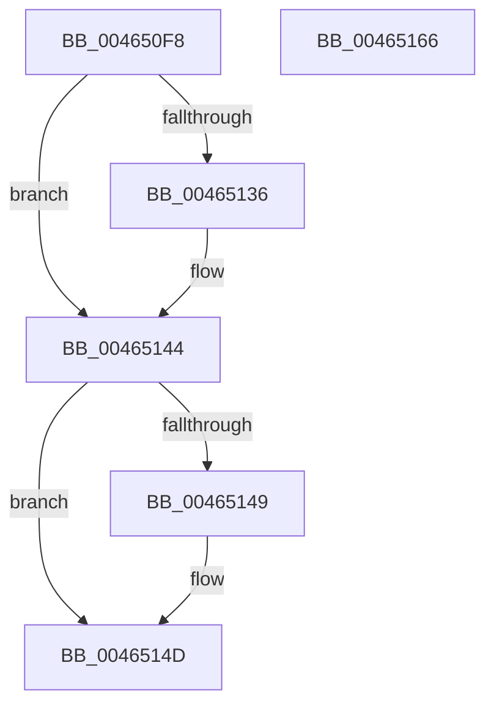

# MI_LOCK_RELOCATIONS_EXCLUSIVE

- RVA: `0x004650F8`–`0x00465167` (길이 `111` bytes)
- VA: `0x00000001404650F8`
- 실행 섹션: `.text`
- PDB 이름 있음: `예`; PDB Function 태그: `아니요`
- unwind 정보 RVA: `0x0005C954`
- 디코드: `32`개 명령, `111/111` bytes 표시
- 미해석 바이트: `0` (있으면 어셈블리에 `.byte`로 보존)

> 이 문서는 커널 이미지의 기계어와 PDB 기호를 분석해 생성했습니다. 4번과 5번은 함수 원형과 자료형을 바이너리 사용 방식에서 추정한 C 해석이며 원본 소스 복구 결과는 아닙니다.

## 1. Dependencies

- 직접 호출 지점: **2**; 고유 호출 대상: **2**
- 직접 호출자로 확인된 함수: **5**
- RIP 상대 이미지 참조: **0**

### Outgoing calls
- `0x00465126` → [KeAbPreAcquire](../21/KeAbPreAcquire_function_00210230.md) (function, `0x00210230`)
- `0x0046513F` → [ExfAcquirePushLockExclusiveEx](../20/ExfAcquirePushLockExclusiveEx_function_0020FC90.md) (function, `0x0020FC90`)

### Direct callers
- [MiRelocateImageAgain](../../page/98/MiRelocateImageAgain_function_009885C8.md) at `0x00988643`
- [MiCaptureRetpolineImportInfo](../../page/A9/MiCaptureRetpolineImportInfo_function_00A9FB00.md) at `0x00A9FB70`
- [MiCaptureSecureImageBaseAddress](../../page/AA/MiCaptureSecureImageBaseAddress_function_00AA881C.md) at `0x00AA8852`
- [MiFreeRetpolineImportInfo](../../page/AA/MiFreeRetpolineImportInfo_function_00AAFF1C.md) at `0x00AAFF65`
- [sub_00B2B6D0](../../page/B2/Unknown_function_00B2B6D0.md) at `0x00B2B707`

### Static image references
- 디코드된 RIP-relative 메모리 참조가 없습니다.

## 2. Other-region calls and transfers

- 다른 실행 섹션으로 향하는 call: **0**
- 별도 외부 분기/꼬리 이동을 확인하지 못했습니다.

## 3. Assembly (complete function range)

```asm
004650F8  48 89 5C 24 08                  mov qword ptr [rsp + 8], rbx
004650FD  48 89 6C 24 10                  mov qword ptr [rsp + 0x10], rbp
00465102  48 89 74 24 18                  mov qword ptr [rsp + 0x18], rsi
00465107  57                              push rdi
00465108  48 83 EC 20                     sub rsp, 0x20
0046510C  66 FF 89 E6 01 00 00            dec word ptr [rcx + 0x1e6]
00465113  48 8D 7A 18                     lea rdi, [rdx + 0x18]
00465117  48 8B EA                        mov rbp, rdx
0046511A  48 8B F1                        mov rsi, rcx
0046511D  48 8B CF                        mov rcx, rdi
00465120  45 33 C0                        xor r8d, r8d
00465123  33 D2                           xor edx, edx
00465125  90                              nop
00465126  E8 05 B1 DA FF                  call 0x140210230
0046512B  F0 48 0F BA 2F 00               lock bts qword ptr [rdi], 0
00465131  48 8B D8                        mov rbx, rax
00465134  73 0E                           jae 0x140465144
00465136  4C 8B C7                        mov r8, rdi
00465139  48 8B D0                        mov rdx, rax
0046513C  48 8B CF                        mov rcx, rdi
0046513F  E8 4C AB DA FF                  call 0x14020fc90
00465144  48 85 DB                        test rbx, rbx
00465147  74 04                           je 0x14046514d
00465149  C6 43 0A 01                     mov byte ptr [rbx + 0xa], 1
0046514D  48 8B 5C 24 30                  mov rbx, qword ptr [rsp + 0x30]
00465152  48 89 75 08                     mov qword ptr [rbp + 8], rsi
00465156  48 8B 6C 24 38                  mov rbp, qword ptr [rsp + 0x38]
0046515B  48 8B 74 24 40                  mov rsi, qword ptr [rsp + 0x40]
00465160  48 83 C4 20                     add rsp, 0x20
00465164  5F                              pop rdi
00465165  C3                              ret
00465166  CC                              int3
```

## 4. C-style interpretation (structured pseudocode)

```c
__int64 __fastcall MI_LOCK_RELOCATIONS_EXCLUSIVE(__int64 a1, __int64 a2, int a3)
{
    __int64 result;
    __int64 v_rsp;
    unsigned __int64 v_stack_p10;
    unsigned __int64 v_stack_p18;
    unsigned __int64 v_stack_p8;

    v_stack_p8 = v_rbx;
    v_stack_p10 = v_rbp;
    v_stack_p18 = v_rsi;
    v_rsp = (v_rsp) - (32);
    a3 = 0;
    a2 = 0;
    result = KeAbPreAcquire(a2 + 24, a2, a3, a4);
    if (!(condition_is_above_or_equal)) {
        a3 = a2 + 24;
        a2 = result;
        a1 = a2 + 24;
        result = ExfAcquirePushLockExclusiveEx(a1, a2, a3, a4);
    }
    if (result != 0) {
        *(unsigned __int8 *)(result + 10) = 1;
    }
    *(unsigned __int64 *)(a2 + 8) = a1;
    v_rsp = (v_rsp) + (32);
    return result;
}
```

## 5. (Beta) C Style

```c
int64_t MI_LOCK_RELOCATIONS_EXCLUSIVE(void *Arg1, void *Arg2, int32_t Arg3)
{
    uint8_t *arg1 = (uint8_t *)Arg1;
    uint8_t *arg2 = (uint8_t *)Arg2;

    int64_t result;
    int64_t local_rsp;
    uint64_t v_stack_p10;
    uint64_t v_stack_p18;
    uint64_t v_stack_p8;

    v_stack_p8 = local_rbx;
    v_stack_p10 = local_rbp;
    v_stack_p18 = local_rsi;
    local_rsp = (local_rsp) - (32);
    Arg3 = 0;
    Arg2 = 0;
    result = KeAbPreAcquire(Arg2 + 24, Arg2, Arg3, a4);
    if (!(condition_is_above_or_equal)) {
        Arg3 = Arg2 + 24;
        Arg2 = result;
        Arg1 = Arg2 + 24;
        result = ExfAcquirePushLockExclusiveEx(Arg1, Arg2, Arg3, a4);
    }
    if (result != 0) {
        *(uint8_t *)(result + 0xA) = 1;
    }
    *(void **)(arg2 + 0x8) = Arg1;
    local_rsp = (local_rsp) + (32);
    return result;
}
```

### 관측된 메모리 오프셋

구조체 형식이 확인되지 않은 접근은 인자 기준의 오프셋으로만 기록했습니다.

| 기준 인자 | 오프셋 표현 | 폭 (bit) | 접근 |
|---|---:|---:|---|
| `Arg1` | `+ 0x1E6` | `16` | `R/W` |
| `Arg2` | `+ 0x0` | `64` | `R/W` |
| `Arg2` | `+ 0x8` | `64` | `W` |
| `Arg2` | `+ 0x18` | `64` | `R` |

## 6. Execution-region graph

[열기: 2D/3D 그래프와 함수 탐색 컨트롤 패널](../../../control-panel.html?section=text&rva=0x004650F8&view=graph)

- 2D 그래프는 위에서 아래로 흐르고, 3D 그래프는 빈 공간을 드래그해 회전합니다. Shift+드래그는 이동, 휠은 확대·축소, 함수 노드 선택은 대상 보고서 이동입니다.

### Static fallback


