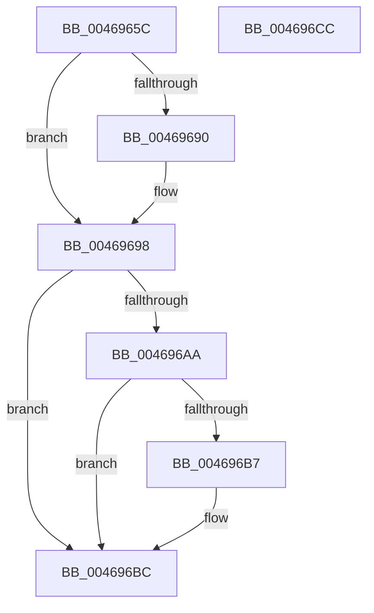

# MI_UNLOCK_RELOCATIONS_EXCLUSIVE

- RVA: `0x0046965C`–`0x004696CD` (길이 `113` bytes)
- VA: `0x000000014046965C`
- 실행 섹션: `.text`
- PDB 이름 있음: `예`; PDB Function 태그: `아니요`
- unwind 정보 RVA: `0x00060BC4`
- 디코드: `33`개 명령, `113/113` bytes 표시
- 미해석 바이트: `0` (있으면 어셈블리에 `.byte`로 보존)

> 이 문서는 커널 이미지의 기계어와 PDB 기호를 분석해 생성했습니다. 4번과 5번은 함수 원형과 자료형을 바이너리 사용 방식에서 추정한 C 해석이며 원본 소스 복구 결과는 아닙니다.

## 1. Dependencies

- 직접 호출 지점: **3**; 고유 호출 대상: **3**
- 직접 호출자로 확인된 함수: **5**
- RIP 상대 이미지 참조: **0**

### Outgoing calls
- `0x00469693` → [ExfTryToWakePushLock](../26/ExfTryToWakePushLock_function_00265DD0.md) (function, `0x00265DD0`)
- `0x0046969B` → [KeAbPostRelease](../2E/KeAbPostRelease_function_002E1600.md) (function, `0x002E1600`)
- `0x004696B7` → [KiCheckForKernelApcDelivery](../2E/KiCheckForKernelApcDelivery_function_002E2C80.md) (function, `0x002E2C80`)

### Direct callers
- [MiRelocateImageAgain](../../page/98/MiRelocateImageAgain_function_009885C8.md) at `0x009886E7`
- [MiCaptureRetpolineImportInfo](../../page/A9/MiCaptureRetpolineImportInfo_function_00A9FB00.md) at `0x00A9FB83`
- [MiCaptureSecureImageBaseAddress](../../page/AA/MiCaptureSecureImageBaseAddress_function_00AA881C.md) at `0x00AA8872`
- [MiFreeRetpolineImportInfo](../../page/AA/MiFreeRetpolineImportInfo_function_00AAFF1C.md) at `0x00AAFF82`
- [sub_00B2B6D0](../../page/B2/Unknown_function_00B2B6D0.md) at `0x00B2B7FC`

### Static image references
- 디코드된 RIP-relative 메모리 참조가 없습니다.

## 2. Other-region calls and transfers

- 다른 실행 섹션으로 향하는 call: **0**
- 별도 외부 분기/꼬리 이동을 확인하지 못했습니다.

## 3. Assembly (complete function range)

```asm
0046965C  48 89 5C 24 08                  mov qword ptr [rsp + 8], rbx
00469661  48 89 74 24 10                  mov qword ptr [rsp + 0x10], rsi
00469666  57                              push rdi
00469667  48 83 EC 20                     sub rsp, 0x20
0046966B  48 8B C1                        mov rax, rcx
0046966E  48 8D 7A 18                     lea rdi, [rdx + 0x18]
00469672  BE 01 00 00 00                  mov esi, 1
00469677  48 8B D9                        mov rbx, rcx
0046967A  48 0B C6                        or rax, rsi
0046967D  48 89 42 08                     mov qword ptr [rdx + 8], rax
00469681  48 83 C8 FF                     or rax, 0xffffffffffffffff
00469685  F0 48 0F C1 07                  lock xadd qword ptr [rdi], rax
0046968A  24 06                           and al, 6
0046968C  3C 02                           cmp al, 2
0046968E  75 08                           jne 0x140469698
00469690  48 8B CF                        mov rcx, rdi
00469693  E8 38 C7 DF FF                  call 0x140265dd0
00469698  48 8B CF                        mov rcx, rdi
0046969B  E8 60 7F E7 FF                  call 0x1402e1600
004696A0  90                              nop
004696A1  66 01 B3 E6 01 00 00            add word ptr [rbx + 0x1e6], si
004696A8  75 12                           jne 0x1404696bc
004696AA  48 8D 83 98 00 00 00            lea rax, [rbx + 0x98]
004696B1  90                              nop
004696B2  48 39 00                        cmp qword ptr [rax], rax
004696B5  74 05                           je 0x1404696bc
004696B7  E8 C4 95 E7 FF                  call 0x1402e2c80
004696BC  48 8B 5C 24 30                  mov rbx, qword ptr [rsp + 0x30]
004696C1  48 8B 74 24 38                  mov rsi, qword ptr [rsp + 0x38]
004696C6  48 83 C4 20                     add rsp, 0x20
004696CA  5F                              pop rdi
004696CB  C3                              ret
004696CC  CC                              int3
```

## 4. C-style interpretation (structured pseudocode)

```c
__int64 __fastcall MI_UNLOCK_RELOCATIONS_EXCLUSIVE(__int64 a1, __int64 a2)
{
    __int64 result;
    __int64 v_rsp;
    unsigned __int64 v_stack_p10;
    unsigned __int64 v_stack_p8;

    v_stack_p8 = v_rbx;
    v_stack_p10 = v_rsi;
    v_rsp = (v_rsp) - (32);
    result = (a1) | (1);
    *(unsigned __int64 *)(a2 + 8) = result;
    result = (result) | (-1);
    result = (unsigned __int8)((result) & (6));
    if (((unsigned __int8)(result)) == 2) {
        a1 = a2 + 24;
        result = ExfTryToWakePushLock(a1, a2, a3, a4);
    }
    result = KeAbPostRelease(a2 + 24, a2, a3, a4);
    if (((unsigned __int8)(result)) != 2) goto loc_004696BC;
    result = a1 + 152;
    if ((*(unsigned __int64 *)(a1 + 152)) != (a1 + 152)) {
        result = KiCheckForKernelApcDelivery(a2 + 24, a2, a3, a4);
    }
    v_rsp = (v_rsp) + (32);
    return result;
}
```

## 5. (Beta) C Style

```c
int64_t MI_UNLOCK_RELOCATIONS_EXCLUSIVE(void *Arg1, void *Arg2)
{
    uint8_t *arg1 = (uint8_t *)Arg1;
    uint8_t *arg2 = (uint8_t *)Arg2;

    int64_t result;
    int64_t local_rsp;
    uint64_t v_stack_p10;
    uint64_t v_stack_p8;

    v_stack_p8 = local_rbx;
    v_stack_p10 = local_rsi;
    local_rsp = (local_rsp) - (32);
    result = (Arg1) | (1);
    *(uint64_t *)(arg2 + 0x8) = result;
    result = (result) | (-1);
    result = (uint8_t)((result) & (6));
    if (((uint8_t)(result)) == 2) {
        Arg1 = Arg2 + 24;
        result = ExfTryToWakePushLock(Arg1, Arg2, a3, a4);
    }
    result = KeAbPostRelease(Arg2 + 24, Arg2, a3, a4);
    if (((uint8_t)(result)) != 2) goto loc_004696BC;
    result = Arg1 + 152;
    if ((*(uint64_t *)(arg1 + 0x98)) != (Arg1 + 152)) {
        result = KiCheckForKernelApcDelivery(Arg2 + 24, Arg2, a3, a4);
    }
    local_rsp = (local_rsp) + (32);
    return result;
}
```

### 관측된 메모리 오프셋

구조체 형식이 확인되지 않은 접근은 인자 기준의 오프셋으로만 기록했습니다.

| 기준 인자 | 오프셋 표현 | 폭 (bit) | 접근 |
|---|---:|---:|---|
| `Arg1` | `+ 0x0` | `64` | `R` |
| `Arg1` | `+ 0x98` | `64` | `R` |
| `Arg1` | `+ 0x1E6` | `16` | `R/W` |
| `Arg2` | `+ 0x0` | `64` | `R/W` |
| `Arg2` | `+ 0x8` | `64` | `W` |
| `Arg2` | `+ 0x18` | `64` | `R` |

## 6. Execution-region graph

[열기: 2D/3D 그래프와 함수 탐색 컨트롤 패널](../../../control-panel.html?section=text&rva=0x0046965C&view=graph)

- 2D 그래프는 위에서 아래로 흐르고, 3D 그래프는 빈 공간을 드래그해 회전합니다. Shift+드래그는 이동, 휠은 확대·축소, 함수 노드 선택은 대상 보고서 이동입니다.

### Static fallback


