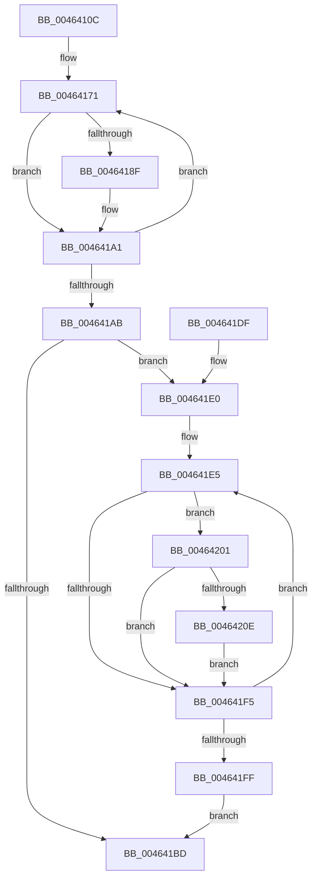

# MiAdjustPteBins

- RVA: `0x0046410C`–`0x0046421F` (길이 `275` bytes)
- VA: `0x000000014046410C`
- 실행 섹션: `.text`
- PDB 이름 있음: `예`; PDB Function 태그: `아니요`
- unwind 정보 RVA: `0x000AA854`
- 디코드: `71`개 명령, `275/275` bytes 표시
- 미해석 바이트: `0` (있으면 어셈블리에 `.byte`로 보존)

> 이 문서는 커널 이미지의 기계어와 PDB 기호를 분석해 생성했습니다. 4번과 5번은 함수 원형과 자료형을 바이너리 사용 방식에서 추정한 C 해석이며 원본 소스 복구 결과는 아닙니다.

## 1. Dependencies

- 직접 호출 지점: **5**; 고유 호출 대상: **4**
- 직접 호출자로 확인된 함수: **1**
- RIP 상대 이미지 참조: **8**

### Outgoing calls
- `0x0046417E` → [MiEmptyPteBins](../31/MiEmptyPteBins_function_0031AAE4.md) (function, `0x0031AAE4`)
- `0x00464186` → [MiPteBinsNeedTrimming](MiPteBinsNeedTrimming_function_00464228.md) (function, `0x00464228`)
- `0x0046419C` → [MiEmptyPteBins](../31/MiEmptyPteBins_function_0031AAE4.md) (function, `0x0031AAE4`)
- `0x004641C5` → [_security_check_cookie](../6A/_security_check_cookie_function_006AC640.md) (function, `0x006AC640`)
- `0x00464218` → [MiAttemptCoalesce](../47/MiAttemptCoalesce_function_00479EB0.md) (function, `0x00479EB0`)

### Direct callers
- [MiWorkingSetManager](../2D/MiWorkingSetManager_function_002DA7E0.md) at `0x002DA956`

### Static image references
- `0x00464120` → RVA `0x00E0A740` (`.data`; read)
- `0x0046412F` → RVA `0x00E37668` (`.data`; read)
- `0x00464143` → RVA `0x00E35EE0` (`.data`; read)
- `0x00464150` → RVA `0x00E35F40` (`.data`; read)
- `0x0046415B` → RVA `0x00E35E80` (`.data`; read)
- `0x00464166` → RVA `0x00E35E20` (`.data`; read)
- `0x004641AB` → RVA `0x00E35FA6` (`.data`; read)
- `0x004641B3` → RVA `0x00E35FA6` (`.data`; write)

## 2. Other-region calls and transfers

- 다른 실행 섹션으로 향하는 call: **0**
- 별도 외부 분기/꼬리 이동을 확인하지 못했습니다.

## 3. Assembly (complete function range)

```asm
0046410C  4C 8B DC                        mov r11, rsp
0046410F  49 89 5B 08                     mov qword ptr [r11 + 8], rbx
00464113  49 89 6B 10                     mov qword ptr [r11 + 0x10], rbp
00464117  49 89 73 18                     mov qword ptr [r11 + 0x18], rsi
0046411B  57                              push rdi
0046411C  48 83 EC 50                     sub rsp, 0x50
00464120  48 8B 05 19 66 9A 00            mov rax, qword ptr [rip + 0x9a6619]
00464127  48 33 C4                        xor rax, rsp
0046412A  48 89 44 24 48                  mov qword ptr [rsp + 0x48], rax
0046412F  48 8D 05 32 35 9D 00            lea rax, [rip + 0x9d3532]
00464136  BF 05 00 00 00                  mov edi, 5
0046413B  49 89 43 C8                     mov qword ptr [r11 - 0x38], rax
0046413F  49 8D 5B C8                     lea rbx, [r11 - 0x38]
00464143  48 8D 05 96 1D 9D 00            lea rax, [rip + 0x9d1d96]
0046414A  8B F7                           mov esi, edi
0046414C  49 89 43 D0                     mov qword ptr [r11 - 0x30], rax
00464150  48 8D 05 E9 1D 9D 00            lea rax, [rip + 0x9d1de9]
00464157  49 89 43 D8                     mov qword ptr [r11 - 0x28], rax
0046415B  48 8D 05 1E 1D 9D 00            lea rax, [rip + 0x9d1d1e]
00464162  49 89 43 E0                     mov qword ptr [r11 - 0x20], rax
00464166  48 8D 05 B3 1C 9D 00            lea rax, [rip + 0x9d1cb3]
0046416D  49 89 43 E8                     mov qword ptr [r11 - 0x18], rax
00464171  48 8B 2B                        mov rbp, qword ptr [rbx]
00464174  45 33 C0                        xor r8d, r8d
00464177  48 8B CD                        mov rcx, rbp
0046417A  48 83 CA FF                     or rdx, 0xffffffffffffffff
0046417E  E8 61 69 EB FF                  call 0x14031aae4
00464183  48 8B CD                        mov rcx, rbp
00464186  E8 9D 00 00 00                  call 0x140464228
0046418B  85 C0                           test eax, eax
0046418D  74 12                           je 0x1404641a1
0046418F  41 B8 01 00 00 00               mov r8d, 1
00464195  48 83 CA FF                     or rdx, 0xffffffffffffffff
00464199  48 8B CD                        mov rcx, rbp
0046419C  E8 43 69 EB FF                  call 0x14031aae4
004641A1  48 83 C3 08                     add rbx, 8
004641A5  48 83 EE 01                     sub rsi, 1
004641A9  75 C6                           jne 0x140464171
004641AB  8A 05 F5 1D 9D 00               mov al, byte ptr [rip + 0x9d1df5]
004641B1  FE C0                           inc al
004641B3  88 05 ED 1D 9D 00               mov byte ptr [rip + 0x9d1ded], al
004641B9  A8 0F                           test al, 0xf
004641BB  74 23                           je 0x1404641e0
004641BD  48 8B 4C 24 48                  mov rcx, qword ptr [rsp + 0x48]
004641C2  48 33 CC                        xor rcx, rsp
004641C5  E8 76 84 24 00                  call 0x1406ac640
004641CA  48 8B 5C 24 60                  mov rbx, qword ptr [rsp + 0x60]
004641CF  48 8B 6C 24 68                  mov rbp, qword ptr [rsp + 0x68]
004641D4  48 8B 74 24 70                  mov rsi, qword ptr [rsp + 0x70]
004641D9  48 83 C4 50                     add rsp, 0x50
004641DD  5F                              pop rdi
004641DE  C3                              ret
004641DF  CC                              int3
004641E0  48 8D 5C 24 20                  lea rbx, [rsp + 0x20]
004641E5  48 8B 0B                        mov rcx, qword ptr [rbx]
004641E8  48 8B 51 58                     mov rdx, qword ptr [rcx + 0x58]
004641EC  48 81 FA 00 00 20 00            cmp rdx, 0x200000
004641F3  77 0C                           ja 0x140464201
004641F5  48 83 C3 08                     add rbx, 8
004641F9  48 83 EF 01                     sub rdi, 1
004641FD  75 E6                           jne 0x1404641e5
004641FF  EB BC                           jmp 0x1404641bd
00464201  48 8B 41 38                     mov rax, qword ptr [rcx + 0x38]
00464205  48 C1 E8 02                     shr rax, 2
00464209  48 3B D0                        cmp rdx, rax
0046420C  76 E7                           jbe 0x1404641f5
0046420E  48 8B 51 48                     mov rdx, qword ptr [rcx + 0x48]
00464212  4C 8B 01                        mov r8, qword ptr [rcx]
00464215  4C 2B C2                        sub r8, rdx
00464218  E8 93 5C 01 00                  call 0x140479eb0
0046421D  EB D6                           jmp 0x1404641f5
```

## 4. C-style interpretation (structured pseudocode)

```c
__int64 __fastcall MiAdjustPteBins(__int64 a1, __int64 a2, int a3)
{
    __int64 result;
    __int64 v_rbx;
    __int64 v_rdi;
    __int64 v_rsi;
    __int64 v_rsp;
    unsigned __int64 v_stack_m10;
    unsigned __int64 v_stack_p10;
    unsigned __int64 v_stack_p18;
    unsigned __int64 v_stack_p20;
    unsigned __int64 v_stack_p8;

    *(unsigned __int64 *)(v_rsp + 8) = v_rbx;
    *(unsigned __int64 *)(v_rsp + 16) = v_rbp;
    *(unsigned __int64 *)(v_rsp + 24) = v_rsi;
    v_rsp = (v_rsp) - (80);
    result = (*(unsigned __int64 *)(v_rip + 10118681)) ^ (v_rsp);
    v_stack_m10 = result;
    *(unsigned __int64 *)(v_rsp - 56) = v_rip + 10302770;
    *(unsigned __int64 *)(v_rsp - 48) = v_rip + 10296726;
    *(unsigned __int64 *)(v_rsp - 40) = v_rip + 10296809;
    *(unsigned __int64 *)(v_rsp - 32) = v_rip + 10296606;
    *(unsigned __int64 *)(v_rsp - 24) = v_rip + 10296499;
loc_00464171:
    a3 = 0;
    a2 = (a2) | (-1);
    result = MiEmptyPteBins(*(unsigned __int64 *)(v_rsp - 56), a2, a3, a4);
    result = MiPteBinsNeedTrimming(*(unsigned __int64 *)(v_rsp - 56), a2, a3, a4);
    if ((unsigned int)(result) != 0) {
        a3 = 1;
        a2 = (a2) | (-1);
        a1 = *(unsigned __int64 *)(v_rsp - 56);
        result = MiEmptyPteBins(a1, a2, a3, a4);
    }
    v_rbx = (v_rsp - 56) + (8);
    v_rsi = (5) - (1);
    if (condition_is_not_equal) goto loc_00464171;
    result = (unsigned __int8)((*(unsigned __int8 *)(v_rip + 10296821)) + 1);
    *(unsigned __int8 *)(v_rip + 10296813) = (unsigned __int8)(result);
    if ((((unsigned __int8)(result)) & (15)) == 0) goto loc_004641E0;
loc_004641BD:
    a1 = (v_stack_m10) ^ (v_rsp);
    result = _security_check_cookie(a1, a2, a3, a4);
    v_rsp = (v_rsp) + (80);
    return result;
loc_004641E0:
loc_004641E5:
    if ((*(unsigned __int64 *)(*(unsigned __int64 *)(v_stack_p20) + 88)) > 0x200000ULL) goto loc_00464201;
loc_004641F5:
    v_rbx = (v_stack_p20) + (8);
    v_rdi = (5) - (1);
    if (condition_is_not_equal) goto loc_004641E5;
    goto loc_004641BD;
loc_00464201:
    result = (*(unsigned __int64 *)(*(unsigned __int64 *)(v_stack_p20) + 56)) >> (2);
    if ((*(unsigned __int64 *)(*(unsigned __int64 *)(v_stack_p20) + 88)) <= result) goto loc_004641F5;
    a3 = (*(unsigned __int64 *)(*(unsigned __int64 *)(v_stack_p20))) - (*(unsigned __int64 *)(*(unsigned __int64 *)(v_stack_p20) + 72));
    result = MiAttemptCoalesce(*(unsigned __int64 *)(v_stack_p20), *(unsigned __int64 *)(*(unsigned __int64 *)(v_stack_p20) + 72), a3, a4);
    goto loc_004641F5;
}
```

## 5. (Beta) C Style

```c
int64_t MiAdjustPteBins(int64_t Arg1, int64_t Arg2, int32_t Arg3)
{
    int64_t result;
    int64_t local_rbx;
    int64_t local_rdi;
    int64_t local_rsi;
    int64_t local_rsp;
    uint64_t v_stack_m10;
    uint64_t v_stack_p10;
    uint64_t v_stack_p18;
    uint64_t v_stack_p20;
    uint64_t v_stack_p8;

    *(uint64_t *)(local_rsp + 0x8) = local_rbx;
    *(uint64_t *)(local_rsp + 0x10) = local_rbp;
    *(uint64_t *)(local_rsp + 0x18) = local_rsi;
    local_rsp = (local_rsp) - (80);
    result = (*(uint64_t *)(v_rip + 0x9A6619)) ^ (local_rsp);
    v_stack_m10 = result;
    *(uint64_t *)(local_rsp - 0x38) = v_rip + 10302770;
    *(uint64_t *)(local_rsp - 0x30) = v_rip + 10296726;
    *(uint64_t *)(local_rsp - 0x28) = v_rip + 10296809;
    *(uint64_t *)(local_rsp - 0x20) = v_rip + 10296606;
    *(uint64_t *)(local_rsp - 0x18) = v_rip + 10296499;
loc_00464171:
    Arg3 = 0;
    Arg2 = (Arg2) | (-1);
    result = MiEmptyPteBins(*(uint64_t *)(local_rsp - 0x38), Arg2, Arg3, a4);
    result = MiPteBinsNeedTrimming(*(uint64_t *)(local_rsp - 0x38), Arg2, Arg3, a4);
    if ((uint32_t)(result) != 0) {
        Arg3 = 1;
        Arg2 = (Arg2) | (-1);
        Arg1 = *(uint64_t *)(local_rsp - 0x38);
        result = MiEmptyPteBins(Arg1, Arg2, Arg3, a4);
    }
    local_rbx = (local_rsp - 56) + (8);
    local_rsi = (5) - (1);
    if (condition_is_not_equal) goto loc_00464171;
    result = (uint8_t)((*(uint8_t *)(v_rip + 0x9D1DF5)) + 1);
    *(uint8_t *)(v_rip + 0x9D1DED) = (uint8_t)(result);
    if ((((uint8_t)(result)) & (15)) == 0) goto loc_004641E0;
loc_004641BD:
    Arg1 = (v_stack_m10) ^ (local_rsp);
    result = _security_check_cookie(Arg1, Arg2, Arg3, a4);
    local_rsp = (local_rsp) + (80);
    return result;
loc_004641E0:
loc_004641E5:
    if ((*(uint64_t *)(*(uint64_t *)(v_stack_p20) + 0x58)) > 0x200000ULL) goto loc_00464201;
loc_004641F5:
    local_rbx = (v_stack_p20) + (8);
    local_rdi = (5) - (1);
    if (condition_is_not_equal) goto loc_004641E5;
    goto loc_004641BD;
loc_00464201:
    result = (*(uint64_t *)(*(uint64_t *)(v_stack_p20) + 0x38)) >> (2);
    if ((*(uint64_t *)(*(uint64_t *)(v_stack_p20) + 0x58)) <= result) goto loc_004641F5;
    Arg3 = (*(uint64_t *)(*(uint64_t *)(v_stack_p20))) - (*(uint64_t *)(*(uint64_t *)(v_stack_p20) + 0x48));
    result = MiAttemptCoalesce(*(uint64_t *)(v_stack_p20), *(uint64_t *)(*(uint64_t *)(v_stack_p20) + 0x48), Arg3, a4);
    goto loc_004641F5;
}
```

## 6. Execution-region graph

[열기: 2D/3D 그래프와 함수 탐색 컨트롤 패널](../../../control-panel.html?section=text&rva=0x0046410C&view=graph)

- 2D 그래프는 위에서 아래로 흐르고, 3D 그래프는 빈 공간을 드래그해 회전합니다. Shift+드래그는 이동, 휠은 확대·축소, 함수 노드 선택은 대상 보고서 이동입니다.

### Static fallback


