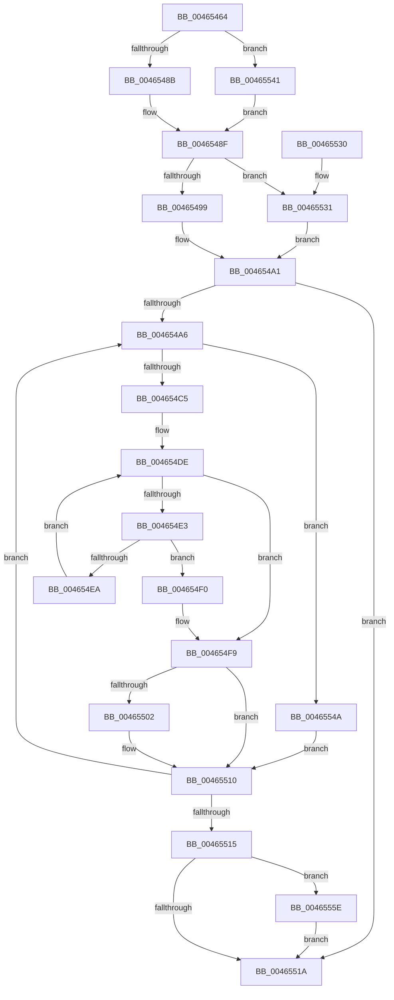

# MiAnyProtosAreMapped

- RVA: `0x00465464`–`0x00465568` (길이 `260` bytes)
- VA: `0x0000000140465464`
- 실행 섹션: `.text`
- PDB 이름 있음: `예`; PDB Function 태그: `아니요`
- unwind 정보 RVA: `0x000AAA50`
- 디코드: `74`개 명령, `260/260` bytes 표시
- 미해석 바이트: `0` (있으면 어셈블리에 `.byte`로 보존)

> 이 문서는 커널 이미지의 기계어와 PDB 기호를 분석해 생성했습니다. 4번과 5번은 함수 원형과 자료형을 바이너리 사용 방식에서 추정한 C 해석이며 원본 소스 복구 결과는 아닙니다.

## 1. Dependencies

- 직접 호출 지점: **3**; 고유 호출 대상: **2**
- 직접 호출자로 확인된 함수: **1**
- RIP 상대 이미지 참조: **0**

### Outgoing calls
- `0x004654B4` → [MiCheckProtoPtePageState](../31/MiCheckProtoPtePageState_function_003183E0.md) (function, `0x003183E0`)
- `0x00465505` → [MiUnlockProtoPoolPage](../24/MiUnlockProtoPoolPage_function_00246090.md) (function, `0x00246090`)
- `0x00465561` → [MiUnlockProtoPoolPage](../24/MiUnlockProtoPoolPage_function_00246090.md) (function, `0x00246090`)

### Direct callers
- [sub_002E0B15](../2E/Unknown_function_002E0B15.md) at `0x002E1089`

### Static image references
- 디코드된 RIP-relative 메모리 참조가 없습니다.

## 2. Other-region calls and transfers

- 다른 실행 섹션으로 향하는 call: **0**
- 별도 외부 분기/꼬리 이동을 확인하지 못했습니다.

## 3. Assembly (complete function range)

```asm
00465464  48 89 5C 24 10                  mov qword ptr [rsp + 0x10], rbx
00465469  48 89 6C 24 18                  mov qword ptr [rsp + 0x18], rbp
0046546E  56                              push rsi
0046546F  57                              push rdi
00465470  41 56                           push r14
00465472  48 83 EC 20                     sub rsp, 0x20
00465476  45 33 F6                        xor r14d, r14d
00465479  C6 44 24 40 11                  mov byte ptr [rsp + 0x40], 0x11
0046547E  48 8B F1                        mov rsi, rcx
00465481  48 3B 4A 18                     cmp rcx, qword ptr [rdx + 0x18]
00465485  0F 85 B6 00 00 00               jne 0x140465541
0046548B  48 8B 5A 08                     mov rbx, qword ptr [rdx + 8]
0046548F  48 3B 72 20                     cmp rsi, qword ptr [rdx + 0x20]
00465493  0F 85 98 00 00 00               jne 0x140465531
00465499  48 8B 7A 10                     mov rdi, qword ptr [rdx + 0x10]
0046549D  48 83 C7 08                     add rdi, 8
004654A1  48 3B DF                        cmp rbx, rdi
004654A4  73 74                           jae 0x14046551a
004654A6  48 8B 0E                        mov rcx, qword ptr [rsi]
004654A9  4C 8D 4C 24 40                  lea r9, [rsp + 0x40]
004654AE  45 33 C0                        xor r8d, r8d
004654B1  48 8B D3                        mov rdx, rbx
004654B4  E8 27 2F EB FF                  call 0x1403183e0
004654B9  48 8B E8                        mov rbp, rax
004654BC  48 85 C0                        test rax, rax
004654BF  0F 84 85 00 00 00               je 0x14046554a
004654C5  48 8B C3                        mov rax, rbx
004654C8  48 8B CF                        mov rcx, rdi
004654CB  48 25 00 F0 FF FF               and rax, 0xfffffffffffff000
004654D1  48 05 00 10 00 00               add rax, 0x1000
004654D7  48 3B F8                        cmp rdi, rax
004654DA  48 0F 47 C8                     cmova rcx, rax
004654DE  48 3B D9                        cmp rbx, rcx
004654E1  73 16                           jae 0x1404654f9
004654E3  48 8B 03                        mov rax, qword ptr [rbx]
004654E6  A8 01                           test al, 1
004654E8  75 06                           jne 0x1404654f0
004654EA  48 83 C3 08                     add rbx, 8
004654EE  EB EE                           jmp 0x1404654de
004654F0  41 BE 01 00 00 00               mov r14d, 1
004654F6  48 8B DF                        mov rbx, rdi
004654F9  8A 54 24 40                     mov dl, byte ptr [rsp + 0x40]
004654FD  80 FA 11                        cmp dl, 0x11
00465500  74 0E                           je 0x140465510
00465502  48 8B CD                        mov rcx, rbp
00465505  E8 86 0B DE FF                  call 0x140246090
0046550A  B2 11                           mov dl, 0x11
0046550C  88 54 24 40                     mov byte ptr [rsp + 0x40], dl
00465510  48 3B DF                        cmp rbx, rdi
00465513  72 91                           jb 0x1404654a6
00465515  80 FA 11                        cmp dl, 0x11
00465518  75 44                           jne 0x14046555e
0046551A  48 8B 5C 24 48                  mov rbx, qword ptr [rsp + 0x48]
0046551F  41 8B C6                        mov eax, r14d
00465522  48 8B 6C 24 50                  mov rbp, qword ptr [rsp + 0x50]
00465527  48 83 C4 20                     add rsp, 0x20
0046552B  41 5E                           pop r14
0046552D  5F                              pop rdi
0046552E  5E                              pop rsi
0046552F  C3                              ret
00465530  CC                              int3
00465531  8B 49 2C                        mov ecx, dword ptr [rcx + 0x2c]
00465534  48 8B 46 08                     mov rax, qword ptr [rsi + 8]
00465538  48 8D 3C C8                     lea rdi, [rax + rcx*8]
0046553C  E9 60 FF FF FF                  jmp 0x1404654a1
00465541  48 8B 59 08                     mov rbx, qword ptr [rcx + 8]
00465545  E9 45 FF FF FF                  jmp 0x14046548f
0046554A  8A 54 24 40                     mov dl, byte ptr [rsp + 0x40]
0046554E  48 81 E3 00 F0 FF FF            and rbx, 0xfffffffffffff000
00465555  48 81 C3 00 10 00 00            add rbx, 0x1000
0046555C  EB B2                           jmp 0x140465510
0046555E  48 8B CD                        mov rcx, rbp
00465561  E8 2A 0B DE FF                  call 0x140246090
00465566  EB B2                           jmp 0x14046551a
```

## 4. C-style interpretation (structured pseudocode)

```c
__int64 __fastcall MiAnyProtosAreMapped(__int64 a1, __int64 a2, int a3)
{
    __int64 result;
    __int64 v_r14;
    __int64 v_rbx;
    __int64 v_rdi;
    __int64 v_rsp;
    unsigned __int64 v_stack_p10;
    unsigned __int64 v_stack_p18;
    unsigned __int8 v_stack_p40;
    unsigned __int8 v_stack_p8;

    v_stack_p10 = v_rbx;
    v_stack_p18 = v_rbp;
    v_rsp = (v_rsp) - (32);
    v_r14 = 0;
    v_stack_p8 = 17;
    if (a1 != (*(unsigned __int64 *)(a2 + 24))) goto loc_00465541;
loc_0046548F:
    if (a1 != (*(unsigned __int64 *)(a2 + 32))) goto loc_00465531;
    v_rdi = (*(unsigned __int64 *)(a2 + 16)) + (8);
loc_004654A1:
    if ((*(unsigned __int64 *)(a2 + 8)) >= v_rdi) goto loc_0046551A;
loc_004654A6:
    a3 = 0;
    result = MiCheckProtoPtePageState(*(unsigned __int64 *)(a1), *(unsigned __int64 *)(a2 + 8), a3, v_stack_p8);
    if (result == 0) goto loc_0046554A;
    result = (*(unsigned __int64 *)(a2 + 8)) & (0xFFFFFFFFFFFFF000ULL);
    result = (result) + (0x1000ULL);
    a1 = v_rdi;
    if (v_rdi > result) { a1 = result; }
loc_004654DE:
    if ((*(unsigned __int64 *)(a2 + 8)) >= a1) goto loc_004654F9;
    if ((((unsigned __int8)(*(unsigned __int64 *)(*(unsigned __int64 *)(a2 + 8)))) & (1)) != 0) goto loc_004654F0;
    v_rbx = (*(unsigned __int64 *)(a2 + 8)) + (8);
    goto loc_004654DE;
loc_004654F0:
loc_004654F9:
    result = *(unsigned __int64 *)(*(unsigned __int64 *)(a2 + 8));
    if (((unsigned __int8)(v_stack_p8)) != 17) {
        a1 = result;
        result = MiUnlockProtoPoolPage(a1, v_stack_p8, a3, v_stack_p8);
        a2 = 17;
        v_stack_p8 = (unsigned __int8)(a2);
    }
    if (v_rdi < v_rdi) goto loc_004654A6;
    if (((unsigned __int8)(a2)) != 17) goto loc_0046555E;
loc_0046551A:
    v_rsp = (v_rsp) + (32);
    return 1;
loc_00465531:
    goto loc_004654A1;
loc_00465541:
    goto loc_0046548F;
loc_0046554A:
    v_rbx = (*(unsigned __int64 *)((unsigned int)(*(unsigned int *)(a1 + 44)) + 8)) & (0xFFFFFFFFFFFFF000ULL);
    v_rbx = (v_rbx) + (0x1000ULL);
    goto loc_00465510;
loc_0046555E:
    result = MiUnlockProtoPoolPage(v_stack_p18, v_stack_p40, a3, v_stack_p8);
    goto loc_0046551A;
}
```

## 5. (Beta) C Style

```c
int64_t MiAnyProtosAreMapped(int64_t Arg1, void *Arg2, int32_t Arg3)
{
    uint8_t *arg2 = (uint8_t *)Arg2;

    int64_t result;
    int64_t local_r14;
    int64_t local_rbx;
    int64_t local_rdi;
    int64_t local_rsp;
    uint64_t v_stack_p10;
    uint64_t v_stack_p18;
    uint8_t v_stack_p40;
    uint8_t v_stack_p8;

    v_stack_p10 = local_rbx;
    v_stack_p18 = local_rbp;
    local_rsp = (local_rsp) - (32);
    local_r14 = 0;
    v_stack_p8 = 17;
    if (Arg1 != (*(uint64_t *)(arg2 + 0x18))) goto loc_00465541;
loc_0046548F:
    if (Arg1 != (*(uint64_t *)(arg2 + 0x20))) goto loc_00465531;
    local_rdi = (*(uint64_t *)(arg2 + 0x10)) + (8);
loc_004654A1:
    if ((*(uint64_t *)(arg2 + 0x8)) >= local_rdi) goto loc_0046551A;
loc_004654A6:
    Arg3 = 0;
    result = MiCheckProtoPtePageState(*(uint64_t *)(Arg1), *(uint64_t *)(arg2 + 0x8), Arg3, v_stack_p8);
    if (result == 0) goto loc_0046554A;
    result = (*(uint64_t *)(arg2 + 0x8)) & (0xFFFFFFFFFFFFF000ULL);
    result = (result) + (0x1000ULL);
    Arg1 = local_rdi;
    if (local_rdi > result) { Arg1 = result; }
loc_004654DE:
    if ((*(uint64_t *)(arg2 + 0x8)) >= Arg1) goto loc_004654F9;
    if ((((uint8_t)(*(uint64_t *)(*(uint64_t *)(arg2 + 0x8)))) & (1)) != 0) goto loc_004654F0;
    local_rbx = (*(uint64_t *)(arg2 + 0x8)) + (8);
    goto loc_004654DE;
loc_004654F0:
loc_004654F9:
    result = *(uint64_t *)(*(uint64_t *)(arg2 + 0x8));
    if (((uint8_t)(v_stack_p8)) != 17) {
        Arg1 = result;
        result = MiUnlockProtoPoolPage(Arg1, v_stack_p8, Arg3, v_stack_p8);
        Arg2 = 17;
        v_stack_p8 = (uint8_t)(Arg2);
    }
    if (local_rdi < local_rdi) goto loc_004654A6;
    if (((uint8_t)(Arg2)) != 17) goto loc_0046555E;
loc_0046551A:
    local_rsp = (local_rsp) + (32);
    return 1;
loc_00465531:
    goto loc_004654A1;
loc_00465541:
    goto loc_0046548F;
loc_0046554A:
    local_rbx = (*(uint64_t *)((uint32_t)(*(uint32_t *)(Arg1 + 0x2C)) + 0x8)) & (0xFFFFFFFFFFFFF000ULL);
    local_rbx = (local_rbx) + (0x1000ULL);
    goto loc_00465510;
loc_0046555E:
    result = MiUnlockProtoPoolPage(v_stack_p18, v_stack_p40, Arg3, v_stack_p8);
    goto loc_0046551A;
}
```

### 관측된 메모리 오프셋

구조체 형식이 확인되지 않은 접근은 인자 기준의 오프셋으로만 기록했습니다.

| 기준 인자 | 오프셋 표현 | 폭 (bit) | 접근 |
|---|---:|---:|---|
| `Arg2` | `+ 0x8` | `64` | `R` |
| `Arg2` | `+ 0x10` | `64` | `R` |
| `Arg2` | `+ 0x18` | `64` | `R` |
| `Arg2` | `+ 0x20` | `64` | `R` |

## 6. Execution-region graph

[열기: 2D/3D 그래프와 함수 탐색 컨트롤 패널](../../../control-panel.html?section=text&rva=0x00465464&view=graph)

- 2D 그래프는 위에서 아래로 흐르고, 3D 그래프는 빈 공간을 드래그해 회전합니다. Shift+드래그는 이동, 휠은 확대·축소, 함수 노드 선택은 대상 보고서 이동입니다.

### Static fallback


