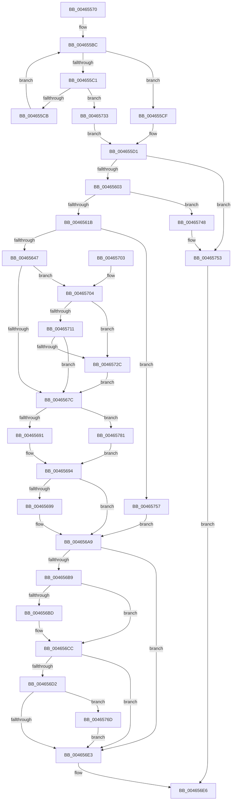

# MiCapturePfnVm

- RVA: `0x00465570`–`0x00465788` (길이 `536` bytes)
- VA: `0x0000000140465570`
- 실행 섹션: `.text`
- PDB 이름 있음: `예`; PDB Function 태그: `아니요`
- unwind 정보 RVA: `0x000AAA68`
- 디코드: `141`개 명령, `536/536` bytes 표시
- 미해석 바이트: `0` (있으면 어셈블리에 `.byte`로 보존)

> 이 문서는 커널 이미지의 기계어와 PDB 기호를 분석해 생성했습니다. 4번과 5번은 함수 원형과 자료형을 바이너리 사용 방식에서 추정한 C 해석이며 원본 소스 복구 결과는 아닙니다.

## 1. Dependencies

- 직접 호출 지점: **11**; 고유 호출 대상: **10**
- 직접 호출자로 확인된 함수: **1**
- RIP 상대 이미지 참조: **2**

### Outgoing calls
- `0x004655F3` → [MiSafeLockPage](../32/MiSafeLockPage_function_00321620.md) (function, `0x00321620`)
- `0x0046560B` → [MiCombineCandidate](../31/MiCombineCandidate_function_00316290.md) (function, `0x00316290`)
- `0x0046564A` → [MiGetTopLevelPfn](../2B/MiGetTopLevelPfn_function_002B44E0.md) (function, `0x002B44E0`)
- `0x00465655` → [MiGetPageTablePfnBuddyRaw](../2B/MiGetPageTablePfnBuddyRaw_function_002B4470.md) (function, `0x002B4470`)
- `0x00465660` → [MiProcessSuitableForCombining](../2B/MiProcessSuitableForCombining_function_002B6294.md) (function, `0x002B6294`)
- `0x00465684` → [ObReferenceObjectSafeWithTag](../21/ObReferenceObjectSafeWithTag_function_00210EE0.md) (function, `0x00210EE0`)
- `0x004656AF` → [MiUnlockPage](../31/MiUnlockPage_function_0031A3E0.md) (function, `0x0031A3E0`)
- `0x004656C3` → [MiGetCombineDomain](MiGetCombineDomain_function_00465790.md) (function, `0x00465790`)
- `0x0046571F` → [MiCheckProcessCombineSequence](MiCheckProcessCombineSequence_function_004657A8.md) (function, `0x004657A8`)
- `0x0046574E` → [MiUnlockPage](../31/MiUnlockPage_function_0031A3E0.md) (function, `0x0031A3E0`)
- `0x0046576F` → [VmCheckPageCombine](../../page/A6/VmCheckPageCombine_function_00A6B41C.md) (function, `0x00A6B41C`)

### Direct callers
- [MiProcessCrcList](../../page/9F/MiProcessCrcList_function_009F6F94.md) at `0x009F71CA`

### Static image references
- `0x00465733` → RVA `0x00E2FF10` (`.data`; read)
- `0x0046575B` → RVA `0x00E380C0` (`.data`; read)

## 2. Other-region calls and transfers

- 다른 실행 섹션으로 향하는 call: **1**
  - `0x0046576F` → [VmCheckPageCombine](../../page/A6/VmCheckPageCombine_function_00A6B41C.md) (`.text` → `PAGE`)
- 별도 외부 분기/꼬리 이동을 확인하지 못했습니다.

## 3. Assembly (complete function range)

```asm
00465570  48 8B C4                        mov rax, rsp
00465573  48 89 58 10                     mov qword ptr [rax + 0x10], rbx
00465577  48 89 68 18                     mov qword ptr [rax + 0x18], rbp
0046557B  48 89 70 20                     mov qword ptr [rax + 0x20], rsi
0046557F  48 89 48 08                     mov qword ptr [rax + 8], rcx
00465583  57                              push rdi
00465584  41 54                           push r12
00465586  41 55                           push r13
00465588  41 56                           push r14
0046558A  41 57                           push r15
0046558C  48 83 EC 20                     sub rsp, 0x20
00465590  48 8B 74 24 70                  mov rsi, qword ptr [rsp + 0x70]
00465595  0F 57 C0                        xorps xmm0, xmm0
00465598  4C 8B 31                        mov r14, qword ptr [rcx]
0046559B  48 8B FA                        mov rdi, rdx
0046559E  44 8B 91 88 00 00 00            mov r10d, dword ptr [rcx + 0x88]
004655A5  41 8B D8                        mov ebx, r8d
004655A8  4C 8B 59 78                     mov r11, qword ptr [rcx + 0x78]
004655AC  33 D2                           xor edx, edx
004655AE  0F 11 06                        movups xmmword ptr [rsi], xmm0
004655B1  0F 11 46 10                     movups xmmword ptr [rsi + 0x10], xmm0
004655B5  C7 46 10 18 00 00 00            mov dword ptr [rsi + 0x10], 0x18
004655BC  41 3B D2                        cmp edx, r10d
004655BF  73 0E                           jae 0x1404655cf
004655C1  4D 3B 0C D3                     cmp r9, qword ptr [r11 + rdx*8]
004655C5  0F 84 68 01 00 00               je 0x140465733
004655CB  FF C2                           inc edx
004655CD  EB ED                           jmp 0x1404655bc
004655CF  33 ED                           xor ebp, ebp
004655D1  48 B8 00 00 00 00 00 DE FF FF   movabs rax, 0xffffde0000000000
004655DB  48 8B CF                        mov rcx, rdi
004655DE  48 2B C8                        sub rcx, rax
004655E1  48 B8 AB AA AA AA AA AA AA AA   movabs rax, 0xaaaaaaaaaaaaaaab
004655EB  48 C1 F9 04                     sar rcx, 4
004655EF  48 0F AF C8                     imul rcx, rax
004655F3  E8 28 C0 EB FF                  call 0x140321620
004655F8  44 8A E8                        mov r13b, al
004655FB  3C 11                           cmp al, 0x11
004655FD  0F 84 50 01 00 00               je 0x140465753
00465603  4C 8B C7                        mov r8, rdi
00465606  8B D3                           mov edx, ebx
00465608  49 8B CE                        mov rcx, r14
0046560B  E8 80 0C EB FF                  call 0x140316290
00465610  44 8B F8                        mov r15d, eax
00465613  85 C0                           test eax, eax
00465615  0F 84 2D 01 00 00               je 0x140465748
0046561B  8B 4F 10                        mov ecx, dword ptr [rdi + 0x10]
0046561E  48 BA 00 00 00 00 00 00 00 80   movabs rdx, 0x8000000000000000
00465628  48 8B 47 08                     mov rax, qword ptr [rdi + 8]
0046562C  48 C1 E9 05                     shr rcx, 5
00465630  48 0B C2                        or rax, rdx
00465633  83 E1 1F                        and ecx, 0x1f
00465636  48 89 46 08                     mov qword ptr [rsi + 8], rax
0046563A  89 4E 10                        mov dword ptr [rsi + 0x10], ecx
0046563D  41 83 FF 01                     cmp r15d, 1
00465641  0F 85 10 01 00 00               jne 0x140465757
00465647  48 8B CF                        mov rcx, rdi
0046564A  E8 91 EE E4 FF                  call 0x1402b44e0
0046564F  48 8B C8                        mov rcx, rax
00465652  4C 8B E0                        mov r12, rax
00465655  E8 16 EE E4 FF                  call 0x1402b4470
0046565A  48 8B C8                        mov rcx, rax
0046565D  4C 8B F0                        mov r14, rax
00465660  E8 2F 0C E5 FF                  call 0x1402b6294
00465665  F7 D8                           neg eax
00465667  48 8D 89 00 04 00 00            lea rcx, [rcx + 0x400]
0046566E  48 1B DB                        sbb rbx, rbx
00465671  48 23 D9                        and rbx, rcx
00465674  85 ED                           test ebp, ebp
00465676  0F 84 88 00 00 00               je 0x140465704
0046567C  BA 4D 6D 43 62                  mov edx, 0x62436d4d
00465681  49 8B CE                        mov rcx, r14
00465684  E8 57 B8 DA FF                  call 0x140210ee0
00465689  84 C0                           test al, al
0046568B  0F 84 F0 00 00 00               je 0x140465781
00465691  4C 89 36                        mov qword ptr [rsi], r14
00465694  4C 3B E7                        cmp r12, rdi
00465697  74 10                           je 0x1404656a9
00465699  48 B8 FF FF FF FF FF FF FF 7F   movabs rax, 0x7fffffffffffffff
004656A3  F0 49 21 44 24 18               lock and qword ptr [r12 + 0x18], rax
004656A9  41 8A D5                        mov dl, r13b
004656AC  48 8B CF                        mov rcx, rdi
004656AF  E8 2C 4D EB FF                  call 0x14031a3e0
004656B4  48 85 DB                        test rbx, rbx
004656B7  74 2A                           je 0x1404656e3
004656B9  85 ED                           test ebp, ebp
004656BB  75 0F                           jne 0x1404656cc
004656BD  48 8B D3                        mov rdx, rbx
004656C0  41 8B CF                        mov ecx, r15d
004656C3  E8 C8 00 00 00                  call 0x140465790
004656C8  48 89 46 18                     mov qword ptr [rsi + 0x18], rax
004656CC  41 83 FF 01                     cmp r15d, 1
004656D0  75 11                           jne 0x1404656e3
004656D2  48 8B 0E                        mov rcx, qword ptr [rsi]
004656D5  48 83 B9 70 06 00 00 00         cmp qword ptr [rcx + 0x670], 0
004656DD  0F 85 8A 00 00 00               jne 0x14046576d
004656E3  48 8B C3                        mov rax, rbx
004656E6  48 8B 5C 24 58                  mov rbx, qword ptr [rsp + 0x58]
004656EB  48 8B 6C 24 60                  mov rbp, qword ptr [rsp + 0x60]
004656F0  48 8B 74 24 68                  mov rsi, qword ptr [rsp + 0x68]
004656F5  48 83 C4 20                     add rsp, 0x20
004656F9  41 5F                           pop r15
004656FB  41 5E                           pop r14
004656FD  41 5D                           pop r13
004656FF  41 5C                           pop r12
00465701  5F                              pop rdi
00465702  C3                              ret
00465703  CC                              int3
00465704  41 F7 86 54 07 00 00 00 10 00 00  test dword ptr [r14 + 0x754], 0x1000
0046570F  75 1B                           jne 0x14046572c
00465711  48 8B 54 24 50                  mov rdx, qword ptr [rsp + 0x50]
00465716  49 8B CE                        mov rcx, r14
00465719  8B 92 20 01 00 00               mov edx, dword ptr [rdx + 0x120]
0046571F  E8 84 00 00 00                  call 0x1404657a8
00465724  85 C0                           test eax, eax
00465726  0F 85 50 FF FF FF               jne 0x14046567c
0046572C  33 DB                           xor ebx, ebx
0046572E  E9 49 FF FF FF                  jmp 0x14046567c
00465733  48 8B 05 D6 A7 9C 00            mov rax, qword ptr [rip + 0x9ca7d6]
0046573A  BD 01 00 00 00                  mov ebp, 1
0046573F  48 89 46 18                     mov qword ptr [rsi + 0x18], rax
00465743  E9 89 FE FF FF                  jmp 0x1404655d1
00465748  41 8A D5                        mov dl, r13b
0046574B  48 8B CF                        mov rcx, rdi
0046574E  E8 8D 4C EB FF                  call 0x14031a3e0
00465753  33 C0                           xor eax, eax
00465755  EB 8F                           jmp 0x1404656e6
00465757  8B C5                           mov eax, ebp
00465759  F7 D8                           neg eax
0046575B  48 8D 05 5E 29 9D 00            lea rax, [rip + 0x9d295e]
00465762  48 1B DB                        sbb rbx, rbx
00465765  48 23 D8                        and rbx, rax
00465768  E9 3C FF FF FF                  jmp 0x1404656a9
0046576D  8B D5                           mov edx, ebp
0046576F  E8 A8 5C 60 00                  call 0x140a6b41c
00465774  F7 D8                           neg eax
00465776  48 1B C9                        sbb rcx, rcx
00465779  48 23 D9                        and rbx, rcx
0046577C  E9 62 FF FF FF                  jmp 0x1404656e3
00465781  33 DB                           xor ebx, ebx
00465783  E9 0C FF FF FF                  jmp 0x140465694
```

## 4. C-style interpretation (structured pseudocode)

```c
__int64 __fastcall MiCapturePfnVm(__int64 a1, __int64 a2, int a3, __int64 a4, __int64 a5)
{
    __int64 result;
    __int64 v_rbp;
    __int64 v_rbx;
    __int64 v_rsp;
    unsigned __int64 v_stack_p10;
    unsigned __int64 v_stack_p18;
    unsigned __int64 v_stack_p20;
    unsigned __int64 v_stack_p50;

    *(unsigned __int64 *)(v_rsp + 16) = v_rbx;
    *(unsigned __int64 *)(v_rsp + 24) = v_rbp;
    *(unsigned __int64 *)(v_rsp + 32) = v_rsi;
    *(unsigned __int64 *)(v_rsp + 8) = a1;
    v_rsp = (v_rsp) - (32);
    a2 = 0;
    *(unsigned __int64 *)(a5) = v_xmm0;
    *(unsigned __int64 *)(a5 + 16) = v_xmm0;
    *(unsigned int *)(a5 + 16) = 24;
loc_004655BC:
    if (0 >= ((unsigned int)((unsigned int)(*(unsigned int *)(a1 + 136))))) goto loc_004655CF;
    if (a4 == (*(unsigned __int64 *)(*(unsigned __int64 *)(a1 + 120) + a2 * 8))) goto loc_00465733;
    a2 = (unsigned int)((a2) + 1);
    goto loc_004655BC;
loc_004655CF:
    v_rbp = 0;
loc_004655D1:
    a1 = (a2) - (v_rsp);
    a1 = (a1) >> (4);
    a1 = (a1) * (v_rsp);
    result = MiSafeLockPage(a1, a2, a3, a4);
    if (((unsigned __int8)(result)) == 17) goto loc_00465753;
    result = MiCombineCandidate(*(unsigned __int64 *)(a1), (unsigned int)((unsigned int)((unsigned int)(a3))), a2, a4);
    if ((unsigned int)(result) == 0) goto loc_00465748;
    a1 = ((unsigned int)(*(unsigned int *)(a2 + 16))) >> (5);
    result = (*(unsigned __int64 *)(a2 + 8)) | ((unsigned int)((unsigned int)((unsigned int)(a3))));
    a1 = (unsigned int)((a1) & (31));
    *(unsigned __int64 *)(a5 + 8) = result;
    *(unsigned int *)(a5 + 16) = (unsigned int)(a1);
    if (((unsigned int)((unsigned int)((unsigned int)(result)))) != 1) goto loc_00465757;
    result = MiGetTopLevelPfn(a2, (unsigned int)((unsigned int)((unsigned int)(a3))), a2, a4);
    result = MiGetPageTablePfnBuddyRaw(result, (unsigned int)((unsigned int)((unsigned int)(a3))), a2, a4);
    result = MiProcessSuitableForCombining(result, (unsigned int)((unsigned int)((unsigned int)(a3))), a2, a4);
    result = (unsigned int)(-(result));
    v_rbx = ((unsigned int)(a3)) & (result + 1024);
    if (0 == 0) goto loc_00465704;
loc_0046567C:
    result = ObReferenceObjectSafeWithTag(result, (unsigned int)(0x62436D4DULL), a2, a4);
    if ((unsigned __int8)(result) == 0) goto loc_00465781;
    *(unsigned __int64 *)(a5) = result;
loc_00465694:
    if (result != a2) {
    }
    result = MiUnlockPage(a2, (unsigned __int8)((unsigned __int8)(result)), a2, a4);
    if (v_rbx == 0) goto loc_004656E3;
    if (0 == 0) {
        a2 = v_rbx;
        a1 = (unsigned int)((unsigned int)((unsigned int)(result)));
        result = MiGetCombineDomain(a1, a2, a2, a4);
        *(unsigned __int64 *)(a5 + 24) = result;
    }
    if (((unsigned int)((unsigned int)((unsigned int)(result)))) != 1) goto loc_004656E3;
    if ((*(unsigned __int64 *)(*(unsigned __int64 *)(a5) + 1648)) != 0) goto loc_0046576D;
loc_004656E3:
loc_004656E6:
    v_rsp = (v_rsp) + (32);
    return v_rbx;
loc_00465704:
    if (((*(unsigned int *)(result + 1876)) & (0x1000ULL)) != 0) goto loc_0046572C;
    result = MiCheckProcessCombineSequence(result, (unsigned int)(*(unsigned int *)(v_stack_p50 + 288)), a2, a4);
    if ((unsigned int)(result) != 0) goto loc_0046567C;
loc_0046572C:
    v_rbx = 0;
    goto loc_0046567C;
loc_00465733:
    *(unsigned __int64 *)(v_stack_p20 + 24) = *(unsigned __int64 *)(v_rip + 10266582);
    goto loc_004655D1;
loc_00465748:
    result = MiUnlockPage(a2, (unsigned __int8)((unsigned __int8)(result)), a2, a4);
loc_00465753:
    result = 0;
    goto loc_004656E6;
loc_00465757:
    result = (unsigned int)(-(1));
    v_rbx = (v_rbx) & (v_rip + 10299742);
    goto loc_004656A9;
loc_0046576D:
    result = VmCheckPageCombine(a2, 1, a2, a4);
    result = (unsigned int)(-(result));
    v_rbx = (v_rbx) & (a2);
    goto loc_004656E3;
loc_00465781:
    v_rbx = 0;
    goto loc_00465694;
}
```

## 5. (Beta) C Style

```c
int64_t MiCapturePfnVm(void *Arg1, void *Arg2, int32_t Arg3, int64_t Arg4, void *Arg5)
{
    uint8_t *arg1 = (uint8_t *)Arg1;
    uint8_t *arg2 = (uint8_t *)Arg2;
    uint8_t *arg5 = (uint8_t *)Arg5;

    int64_t result;
    int64_t local_rbp;
    int64_t local_rbx;
    int64_t local_rsp;
    uint64_t v_stack_p10;
    uint64_t v_stack_p18;
    uint64_t v_stack_p20;
    uint64_t v_stack_p50;

    *(uint64_t *)(local_rsp + 0x10) = local_rbx;
    *(uint64_t *)(local_rsp + 0x18) = local_rbp;
    *(uint64_t *)(local_rsp + 0x20) = local_rsi;
    *(void **)(local_rsp + 0x8) = Arg1;
    local_rsp = (local_rsp) - (32);
    Arg2 = 0;
    *(uint64_t *)(arg5) = v_xmm0;
    *(uint64_t *)(arg5 + 0x10) = v_xmm0;
    *(uint32_t *)(arg5 + 0x10) = 24;
loc_004655BC:
    if (0 >= ((uint32_t)((uint32_t)(*(uint32_t *)(arg1 + 0x88))))) goto loc_004655CF;
    if (Arg4 == (*(uint64_t *)(*(uint64_t *)(arg1 + 0x78) + arg2 * 8))) goto loc_00465733;
    Arg2 = (uint32_t)((Arg2) + 1);
    goto loc_004655BC;
loc_004655CF:
    local_rbp = 0;
loc_004655D1:
    Arg1 = (Arg2) - (local_rsp);
    Arg1 = (Arg1) >> (4);
    Arg1 = (Arg1) * (local_rsp);
    result = MiSafeLockPage(Arg1, Arg2, Arg3, Arg4);
    if (((uint8_t)(result)) == 17) goto loc_00465753;
    result = MiCombineCandidate(*(uint64_t *)(arg1), (uint32_t)((uint32_t)((uint32_t)(Arg3))), Arg2, Arg4);
    if ((uint32_t)(result) == 0) goto loc_00465748;
    Arg1 = ((uint32_t)(*(uint32_t *)(arg2 + 0x10))) >> (5);
    result = (*(uint64_t *)(arg2 + 0x8)) | ((uint32_t)((uint32_t)((uint32_t)(Arg3))));
    Arg1 = (uint32_t)((Arg1) & (31));
    *(uint64_t *)(arg5 + 0x8) = result;
    *(uint32_t *)(arg5 + 0x10) = (uint32_t)(Arg1);
    if (((uint32_t)((uint32_t)((uint32_t)(result)))) != 1) goto loc_00465757;
    result = MiGetTopLevelPfn(Arg2, (uint32_t)((uint32_t)((uint32_t)(Arg3))), Arg2, Arg4);
    result = MiGetPageTablePfnBuddyRaw(result, (uint32_t)((uint32_t)((uint32_t)(Arg3))), Arg2, Arg4);
    result = MiProcessSuitableForCombining(result, (uint32_t)((uint32_t)((uint32_t)(Arg3))), Arg2, Arg4);
    result = (uint32_t)(-(result));
    local_rbx = ((uint32_t)(Arg3)) & (result + 1024);
    if (0 == 0) goto loc_00465704;
loc_0046567C:
    result = ObReferenceObjectSafeWithTag(result, (uint32_t)(0x62436D4DULL), Arg2, Arg4);
    if ((uint8_t)(result) == 0) goto loc_00465781;
    *(uint64_t *)(arg5) = result;
loc_00465694:
    if (result != Arg2) {
    }
    result = MiUnlockPage(Arg2, (uint8_t)((uint8_t)(result)), Arg2, Arg4);
    if (local_rbx == 0) goto loc_004656E3;
    if (0 == 0) {
        Arg2 = local_rbx;
        Arg1 = (uint32_t)((uint32_t)((uint32_t)(result)));
        result = MiGetCombineDomain(Arg1, Arg2, Arg2, Arg4);
        *(uint64_t *)(arg5 + 0x18) = result;
    }
    if (((uint32_t)((uint32_t)((uint32_t)(result)))) != 1) goto loc_004656E3;
    if ((*(uint64_t *)(*(uint64_t *)(arg5) + 0x670)) != 0) goto loc_0046576D;
loc_004656E3:
loc_004656E6:
    local_rsp = (local_rsp) + (32);
    return local_rbx;
loc_00465704:
    if (((*(uint32_t *)(result + 0x754)) & (0x1000ULL)) != 0) goto loc_0046572C;
    result = MiCheckProcessCombineSequence(result, (uint32_t)(*(uint32_t *)(v_stack_p50 + 0x120)), Arg2, Arg4);
    if ((uint32_t)(result) != 0) goto loc_0046567C;
loc_0046572C:
    local_rbx = 0;
    goto loc_0046567C;
loc_00465733:
    *(uint64_t *)(v_stack_p20 + 0x18) = *(uint64_t *)(v_rip + 0x9CA7D6);
    goto loc_004655D1;
loc_00465748:
    result = MiUnlockPage(Arg2, (uint8_t)((uint8_t)(result)), Arg2, Arg4);
loc_00465753:
    result = 0;
    goto loc_004656E6;
loc_00465757:
    result = (uint32_t)(-(1));
    local_rbx = (local_rbx) & (v_rip + 10299742);
    goto loc_004656A9;
loc_0046576D:
    result = VmCheckPageCombine(Arg2, 1, Arg2, Arg4);
    result = (uint32_t)(-(result));
    local_rbx = (local_rbx) & (Arg2);
    goto loc_004656E3;
loc_00465781:
    local_rbx = 0;
    goto loc_00465694;
}
```

### 관측된 메모리 오프셋

구조체 형식이 확인되지 않은 접근은 인자 기준의 오프셋으로만 기록했습니다.

| 기준 인자 | 오프셋 표현 | 폭 (bit) | 접근 |
|---|---:|---:|---|
| `Arg1` | `+ 0x0` | `64` | `R` |
| `Arg1` | `+ 0x78` | `64` | `R` |
| `Arg1` | `+ 0x88` | `32` | `R` |
| `Arg2` | `+ 0x8` | `64` | `R` |
| `Arg2` | `+ 0x10` | `32` | `R` |
| `Arg5` | `+ 0x0` | `64` | `R` |
| `Arg5` | `+ 0x0` | `64` | `W` |
| `Arg5` | `+ 0x0` | `128` | `R` |
| `Arg5` | `+ 0x8` | `64` | `W` |
| `Arg5` | `+ 0x10` | `32` | `W` |
| `Arg5` | `+ 0x10` | `128` | `R` |
| `Arg5` | `+ 0x18` | `64` | `W` |

## 6. Execution-region graph

[열기: 2D/3D 그래프와 함수 탐색 컨트롤 패널](../../../control-panel.html?section=text&rva=0x00465570&view=graph)

- 2D 그래프는 위에서 아래로 흐르고, 3D 그래프는 빈 공간을 드래그해 회전합니다. Shift+드래그는 이동, 휠은 확대·축소, 함수 노드 선택은 대상 보고서 이동입니다.

### Static fallback


