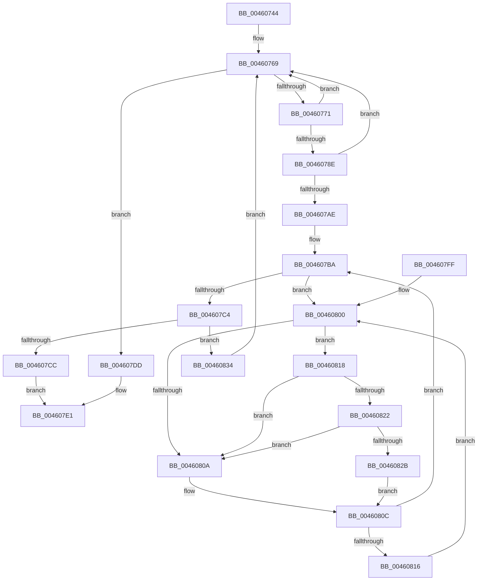

# MiCaptureProtectionFromLockedProto

- RVA: `0x00460744`–`0x0046083F` (길이 `251` bytes)
- VA: `0x0000000140460744`
- 실행 섹션: `.text`
- PDB 이름 있음: `예`; PDB Function 태그: `아니요`
- unwind 정보 RVA: `0x000A9CB0`
- 디코드: `67`개 명령, `251/251` bytes 표시
- 미해석 바이트: `0` (있으면 어셈블리에 `.byte`로 보존)

> 이 문서는 커널 이미지의 기계어와 PDB 기호를 분석해 생성했습니다. 4번과 5번은 함수 원형과 자료형을 바이너리 사용 방식에서 추정한 C 해석이며 원본 소스 복구 결과는 아닙니다.

## 1. Dependencies

- 직접 호출 지점: **2**; 고유 호출 대상: **2**
- 직접 호출자로 확인된 함수: **1**
- RIP 상대 이미지 참조: **3**

### Outgoing calls
- `0x00460822` → [KiCheckVpBackingLongSpinWaitHypercall](../30/KiCheckVpBackingLongSpinWaitHypercall_function_0030F490.md) (function, `0x0030F490`)
- `0x0046082D` → [HvlNotifyLongSpinWait](../30/HvlNotifyLongSpinWait_function_0030F460.md) (function, `0x0030F460`)

### Direct callers
- [sub_0032BD21](../32/Unknown_function_0032BD21.md) at `0x0032C0AC`

### Static image references
- `0x00460785` → RVA `0x00E2DCE0` (`.data`; read)
- `0x00460802` → RVA `0x00FC52AC` (`ALMOSTRO`; reference)
- `0x00460818` → RVA `0x00FC6AB8` (`ALMOSTRO`; read)

## 2. Other-region calls and transfers

- 다른 실행 섹션으로 향하는 call: **0**
- 별도 외부 분기/꼬리 이동을 확인하지 못했습니다.

## 3. Assembly (complete function range)

```asm
00460744  48 89 5C 24 10                  mov qword ptr [rsp + 0x10], rbx
00460749  48 89 6C 24 18                  mov qword ptr [rsp + 0x18], rbp
0046074E  48 89 74 24 20                  mov qword ptr [rsp + 0x20], rsi
00460753  57                              push rdi
00460754  41 56                           push r14
00460756  41 57                           push r15
00460758  48 83 EC 20                     sub rsp, 0x20
0046075C  4C 8B F1                        mov r14, rcx
0046075F  49 BF FF FF FF FF FF FF FF 7F   movabs r15, 0x7fffffffffffffff
00460769  49 8B 1E                        mov rbx, qword ptr [r14]
0046076C  F6 C3 01                        test bl, 1
0046076F  74 6C                           je 0x1404607dd
00460771  48 8B C3                        mov rax, rbx
00460774  48 B9 FF FF FF FF FF 00 00 00   movabs rcx, 0xffffffffff
0046077E  48 C1 E8 0C                     shr rax, 0xc
00460782  48 23 C1                        and rax, rcx
00460785  48 3B 05 54 D5 9C 00            cmp rax, qword ptr [rip + 0x9cd554]
0046078C  77 DB                           ja 0x140460769
0046078E  48 8D 3C 40                     lea rdi, [rax + rax*2]
00460792  48 C1 E7 04                     shl rdi, 4
00460796  48 B8 28 00 00 00 00 DE FF FF   movabs rax, 0xffffde0000000028
004607A0  48 8B 04 07                     mov rax, qword ptr [rdi + rax]
004607A4  48 C1 E8 36                     shr rax, 0x36
004607A8  0F BA E0 00                     bt eax, 0
004607AC  73 BB                           jae 0x140460769
004607AE  48 BD 00 00 00 00 00 DE FF FF   movabs rbp, 0xffffde0000000000
004607B8  33 F6                           xor esi, esi
004607BA  F0 48 0F BA 6C 2F 18 3F         lock bts qword ptr [rdi + rbp + 0x18], 0x3f
004607C2  72 3C                           jb 0x140460800
004607C4  49 8B 06                        mov rax, qword ptr [r14]
004607C7  48 3B D8                        cmp rbx, rax
004607CA  75 68                           jne 0x140460834
004607CC  48 8B 5C 2F 10                  mov rbx, qword ptr [rdi + rbp + 0x10]
004607D1  48 C1 EB 05                     shr rbx, 5
004607D5  F0 4C 21 7C 2F 18               lock and qword ptr [rdi + rbp + 0x18], r15
004607DB  EB 04                           jmp 0x1404607e1
004607DD  48 C1 EB 05                     shr rbx, 5
004607E1  48 8B 6C 24 50                  mov rbp, qword ptr [rsp + 0x50]
004607E6  83 E3 1F                        and ebx, 0x1f
004607E9  48 8B 74 24 58                  mov rsi, qword ptr [rsp + 0x58]
004607EE  8B C3                           mov eax, ebx
004607F0  48 8B 5C 24 48                  mov rbx, qword ptr [rsp + 0x48]
004607F5  48 83 C4 20                     add rsp, 0x20
004607F9  41 5F                           pop r15
004607FB  41 5E                           pop r14
004607FD  5F                              pop rdi
004607FE  C3                              ret
004607FF  CC                              int3
00460800  FF C6                           inc esi
00460802  85 35 A4 4A B6 00               test dword ptr [rip + 0xb64aa4], esi
00460808  74 0E                           je 0x140460818
0046080A  F3 90                           pause
0046080C  48 8B 44 2F 18                  mov rax, qword ptr [rdi + rbp + 0x18]
00460811  48 85 C0                        test rax, rax
00460814  79 A4                           jns 0x1404607ba
00460816  EB E8                           jmp 0x140460800
00460818  8B 05 9A 62 B6 00               mov eax, dword ptr [rip + 0xb6629a]
0046081E  A8 40                           test al, 0x40
00460820  74 E8                           je 0x14046080a
00460822  E8 69 EC EA FF                  call 0x14030f490
00460827  84 C0                           test al, al
00460829  74 DF                           je 0x14046080a
0046082B  8B CE                           mov ecx, esi
0046082D  E8 2E EC EA FF                  call 0x14030f460
00460832  EB D8                           jmp 0x14046080c
00460834  F0 4C 21 7C 2F 18               lock and qword ptr [rdi + rbp + 0x18], r15
0046083A  E9 2A FF FF FF                  jmp 0x140460769
```

## 4. C-style interpretation (structured pseudocode)

```c
__int64 __fastcall MiCaptureProtectionFromLockedProto(__int64 a1)
{
    __int64 result;
    __int64 v_rbx;
    __int64 v_rdi;
    __int64 v_rsi;
    __int64 v_rsp;
    unsigned __int64 v_stack_p10;
    unsigned __int64 v_stack_p18;
    unsigned __int64 v_stack_p20;

    v_stack_p10 = v_rbx;
    v_stack_p18 = v_rbp;
    v_stack_p20 = v_rsi;
    v_rsp = (v_rsp) - (32);
loc_00460769:
    if ((((unsigned __int8)(*(unsigned __int64 *)(a1))) & (1)) == 0) goto loc_004607DD;
    result = (*(unsigned __int64 *)(a1)) >> (12);
    result = (result) & (a1);
    if (result > (*(unsigned __int64 *)(v_rip + 10278228))) goto loc_00460769;
    v_rdi = (result + result * 2) << (4);
    result = (*(unsigned __int64 *)(v_rdi + result * 1)) >> (54);
    if (condition_is_above_or_equal) goto loc_00460769;
    v_rsi = 0;
loc_004607BA:
    if (condition_is_below) goto loc_00460800;
    if ((*(unsigned __int64 *)(a1)) != (*(unsigned __int64 *)(a1))) goto loc_00460834;
    v_rbx = (*(unsigned __int64 *)(v_rdi + v_rbp * 1 + 16)) >> (5);
    goto loc_004607E1;
loc_004607DD:
    v_rbx = (v_rbx) >> (5);
loc_004607E1:
    v_rbx = (unsigned int)((v_rbx) & (31));
    v_rsp = (v_rsp) + (32);
    return (unsigned int)((unsigned int)(v_rbx));
loc_00460800:
    v_rsi = (unsigned int)((v_stack_p20) + 1);
    if (((*(unsigned int *)(v_rip + 11946660)) & ((unsigned int)(v_rsi))) == 0) goto loc_00460818;
loc_0046080A:
loc_0046080C:
    if (!sign_flag) goto loc_004607BA;
    goto loc_00460800;
loc_00460818:
    if ((((unsigned __int8)((unsigned int)(*(unsigned int *)(v_rip + 11952794)))) & (64)) == 0) goto loc_0046080A;
    result = KiCheckVpBackingLongSpinWaitHypercall(a1, a2, a3, a4);
    if ((unsigned __int8)(result) == 0) goto loc_0046080A;
    result = HvlNotifyLongSpinWait((unsigned int)((unsigned int)(v_rsi)), a2, a3, a4);
    goto loc_0046080C;
loc_00460834:
    goto loc_00460769;
}
```

## 5. (Beta) C Style

```c
int64_t MiCaptureProtectionFromLockedProto(void *Arg1)
{
    uint8_t *arg1 = (uint8_t *)Arg1;

    int64_t result;
    int64_t local_rbx;
    int64_t local_rdi;
    int64_t local_rsi;
    int64_t local_rsp;
    uint64_t v_stack_p10;
    uint64_t v_stack_p18;
    uint64_t v_stack_p20;

    v_stack_p10 = local_rbx;
    v_stack_p18 = local_rbp;
    v_stack_p20 = local_rsi;
    local_rsp = (local_rsp) - (32);
loc_00460769:
    if ((((uint8_t)(*(uint64_t *)(arg1))) & (1)) == 0) goto loc_004607DD;
    result = (*(uint64_t *)(arg1)) >> (12);
    result = (result) & (Arg1);
    if (result > (*(uint64_t *)(v_rip + 0x9CD554))) goto loc_00460769;
    local_rdi = (result + result * 2) << (4);
    result = (*(uint64_t *)(local_rdi + result * 1)) >> (54);
    if (condition_is_above_or_equal) goto loc_00460769;
    local_rsi = 0;
loc_004607BA:
    if (condition_is_below) goto loc_00460800;
    if ((*(uint64_t *)(arg1)) != (*(uint64_t *)(arg1))) goto loc_00460834;
    local_rbx = (*(uint64_t *)(local_rdi + local_rbp * 1 + 0x10)) >> (5);
    goto loc_004607E1;
loc_004607DD:
    local_rbx = (local_rbx) >> (5);
loc_004607E1:
    local_rbx = (uint32_t)((local_rbx) & (31));
    local_rsp = (local_rsp) + (32);
    return (uint32_t)((uint32_t)(local_rbx));
loc_00460800:
    local_rsi = (uint32_t)((v_stack_p20) + 1);
    if (((*(uint32_t *)(v_rip + 0xB64AA4)) & ((uint32_t)(local_rsi))) == 0) goto loc_00460818;
loc_0046080A:
loc_0046080C:
    if (!sign_flag) goto loc_004607BA;
    goto loc_00460800;
loc_00460818:
    if ((((uint8_t)((uint32_t)(*(uint32_t *)(v_rip + 0xB6629A)))) & (64)) == 0) goto loc_0046080A;
    result = KiCheckVpBackingLongSpinWaitHypercall(Arg1, a2, a3, a4);
    if ((uint8_t)(result) == 0) goto loc_0046080A;
    result = HvlNotifyLongSpinWait((uint32_t)((uint32_t)(local_rsi)), a2, a3, a4);
    goto loc_0046080C;
loc_00460834:
    goto loc_00460769;
}
```

### 관측된 메모리 오프셋

구조체 형식이 확인되지 않은 접근은 인자 기준의 오프셋으로만 기록했습니다.

| 기준 인자 | 오프셋 표현 | 폭 (bit) | 접근 |
|---|---:|---:|---|
| `Arg1` | `+ 0x0` | `64` | `R` |

## 6. Execution-region graph

[열기: 2D/3D 그래프와 함수 탐색 컨트롤 패널](../../../control-panel.html?section=text&rva=0x00460744&view=graph)

- 2D 그래프는 위에서 아래로 흐르고, 3D 그래프는 빈 공간을 드래그해 회전합니다. Shift+드래그는 이동, 휠은 확대·축소, 함수 노드 선택은 대상 보고서 이동입니다.

### Static fallback


