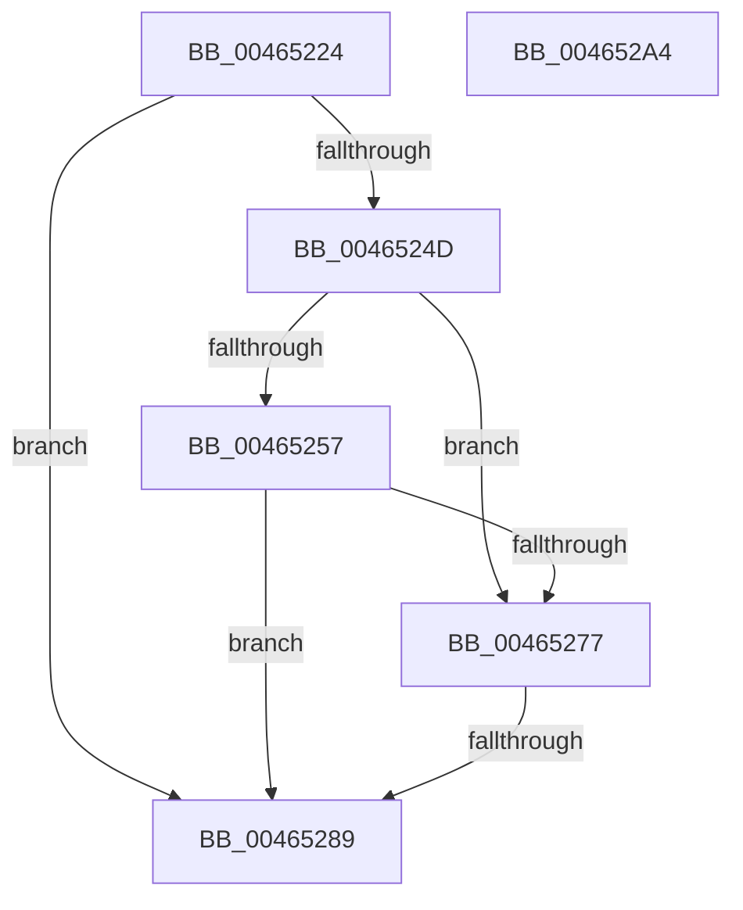

# MiCaptureWriteWatchDirtyBit

- RVA: `0x00465224`–`0x004652A5` (길이 `129` bytes)
- VA: `0x0000000140465224`
- 실행 섹션: `.text`
- PDB 이름 있음: `예`; PDB Function 태그: `예`
- unwind 정보 RVA: `0x0005E6B4`
- 디코드: `38`개 명령, `129/129` bytes 표시
- 미해석 바이트: `0` (있으면 어셈블리에 `.byte`로 보존)

> 이 문서는 커널 이미지의 기계어와 PDB 기호를 분석해 생성했습니다. 4번과 5번은 함수 원형과 자료형을 바이너리 사용 방식에서 추정한 C 해석이며 원본 소스 복구 결과는 아닙니다.

## 1. Dependencies

- 직접 호출 지점: **3**; 고유 호출 대상: **3**
- 직접 호출자로 확인된 함수: **9**
- RIP 상대 이미지 참조: **0**

### Outgoing calls
- `0x00465259` → [MiLockVadTree](../27/MiLockVadTree_function_0027C0F0.md) (function, `0x0027C0F0`)
- `0x00465261` → [MiLocateAddress](../31/MiLocateAddress_function_003168D0.md) (function, `0x003168D0`)
- `0x0046526D` → [MiUnlockVadTree](../29/MiUnlockVadTree_function_00297020.md) (function, `0x00297020`)

### Direct callers
- [MiBuildForkPte](../22/MiBuildForkPte_function_0022E32C.md) at `0x0022F1B7`
- [MiWsleFlush](../23/MiWsleFlush_function_0023FB30.md) at `0x0023FC31`
- [MiUnmapFrameBuffer](../2A/MiUnmapFrameBuffer_function_002AAF14.md) at `0x002AB02C`
- [MiRevertValidPte](../2C/MiRevertValidPte_function_002C5160.md) at `0x002C5559`
- [MiDeleteRotateVa](../2C/MiDeleteRotateVa_function_002C79D4.md) at `0x002C7B3D`
- [MiMakeCombineCandidateClean](MiMakeCombineCandidateClean_function_00465170.md) at `0x00465217`
- [MiSwitchToTransition](../4C/MiSwitchToTransition_function_004C0F5C.md) at `0x004C1396`
- [MiProtectAweRegion](../4C/MiProtectAweRegion_function_004CE62C.md) at `0x004CEB66`
- [sub_006F91FE](../6F/Unknown_function_006F91FE.md) at `0x006F92F8`

### Static image references
- 디코드된 RIP-relative 메모리 참조가 없습니다.

## 2. Other-region calls and transfers

- 다른 실행 섹션으로 향하는 call: **0**
- call이 아닌 외부 분기/꼬리 이동: **1**
  - `0x00465283` → [sub_006F2D78](../6F/Unknown_function_006F2D78.md) (`tail-transfer`)

## 3. Assembly (complete function range)

```asm
00465224  48 8B C4                        mov rax, rsp
00465227  48 89 58 08                     mov qword ptr [rax + 8], rbx
0046522B  48 89 68 10                     mov qword ptr [rax + 0x10], rbp
0046522F  48 89 70 18                     mov qword ptr [rax + 0x18], rsi
00465233  48 89 78 20                     mov qword ptr [rax + 0x20], rdi
00465237  41 56                           push r14
00465239  48 83 EC 20                     sub rsp, 0x20
0046523D  8B 81 F4 01 00 00               mov eax, dword ptr [rcx + 0x1f4]
00465243  49 8B D8                        mov rbx, r8
00465246  4C 8B F2                        mov r14, rdx
00465249  A8 20                           test al, 0x20
0046524B  75 3C                           jne 0x140465289
0046524D  BF 01 00 00 00                  mov edi, 1
00465252  48 85 DB                        test rbx, rbx
00465255  75 20                           jne 0x140465277
00465257  8B CF                           mov ecx, edi
00465259  E8 92 6E E1 FF                  call 0x14027c0f0
0046525E  49 8B CE                        mov rcx, r14
00465261  E8 6A 16 EB FF                  call 0x1403168d0
00465266  B2 11                           mov dl, 0x11
00465268  8B CF                           mov ecx, edi
0046526A  48 8B D8                        mov rbx, rax
0046526D  E8 AE 1D E3 FF                  call 0x140297020
00465272  48 85 DB                        test rbx, rbx
00465275  74 12                           je 0x140465289
00465277  8B 43 30                        mov eax, dword ptr [rbx + 0x30]
0046527A  B9 00 00 60 00                  mov ecx, 0x600000
0046527F  23 C1                           and eax, ecx
00465281  3B C1                           cmp eax, ecx
00465283  0F 84 EF DA 28 00               je 0x1406f2d78
00465289  48 8B 5C 24 30                  mov rbx, qword ptr [rsp + 0x30]
0046528E  48 8B 6C 24 38                  mov rbp, qword ptr [rsp + 0x38]
00465293  48 8B 74 24 40                  mov rsi, qword ptr [rsp + 0x40]
00465298  48 8B 7C 24 48                  mov rdi, qword ptr [rsp + 0x48]
0046529D  48 83 C4 20                     add rsp, 0x20
004652A1  41 5E                           pop r14
004652A3  C3                              ret
004652A4  CC                              int3
```

## 4. C-style interpretation (structured pseudocode)

```c
__int64 __fastcall MiCaptureWriteWatchDirtyBit(__int64 a1, __int64 a2, __int64 a3)
{
    __int64 result;
    __int64 v_rsp;
    unsigned __int64 v_stack_p10;
    unsigned __int64 v_stack_p18;
    unsigned __int64 v_stack_p20;
    unsigned __int64 v_stack_p8;

    *(unsigned __int64 *)(v_rsp + 8) = v_rbx;
    *(unsigned __int64 *)(v_rsp + 16) = v_rbp;
    *(unsigned __int64 *)(v_rsp + 24) = v_rsi;
    *(unsigned __int64 *)(v_rsp + 32) = v_rdi;
    v_rsp = (v_rsp) - (32);
    if ((((unsigned __int8)((unsigned int)(*(unsigned int *)(a1 + 500)))) & (32)) != 0) goto loc_00465289;
    if (a3 != 0) goto loc_00465277;
    result = MiLockVadTree(1, a2, a3, a4);
    result = MiLocateAddress(a2, a2, a3, a4);
    result = MiUnlockVadTree(1, 17, a3, a4);
    if (result == 0) goto loc_00465289;
loc_00465277:
    result = (unsigned int)(((unsigned int)(*(unsigned int *)(result + 48))) & ((unsigned int)((unsigned int)(0x600000ULL))));
loc_00465289:
    v_rsp = (v_rsp) + (32);
    return result;
}
```

## 5. (Beta) C Style

```c
int64_t MiCaptureWriteWatchDirtyBit(void *Arg1, int64_t Arg2, int64_t Arg3)
{
    uint8_t *arg1 = (uint8_t *)Arg1;

    int64_t result;
    int64_t local_rsp;
    uint64_t v_stack_p10;
    uint64_t v_stack_p18;
    uint64_t v_stack_p20;
    uint64_t v_stack_p8;

    *(uint64_t *)(local_rsp + 0x8) = local_rbx;
    *(uint64_t *)(local_rsp + 0x10) = local_rbp;
    *(uint64_t *)(local_rsp + 0x18) = local_rsi;
    *(uint64_t *)(local_rsp + 0x20) = local_rdi;
    local_rsp = (local_rsp) - (32);
    if ((((uint8_t)((uint32_t)(*(uint32_t *)(arg1 + 0x1F4)))) & (32)) != 0) goto loc_00465289;
    if (Arg3 != 0) goto loc_00465277;
    result = MiLockVadTree(1, Arg2, Arg3, a4);
    result = MiLocateAddress(Arg2, Arg2, Arg3, a4);
    result = MiUnlockVadTree(1, 17, Arg3, a4);
    if (result == 0) goto loc_00465289;
loc_00465277:
    result = (uint32_t)(((uint32_t)(*(uint32_t *)(result + 0x30))) & ((uint32_t)((uint32_t)(0x600000ULL))));
loc_00465289:
    local_rsp = (local_rsp) + (32);
    return result;
}
```

### 관측된 메모리 오프셋

구조체 형식이 확인되지 않은 접근은 인자 기준의 오프셋으로만 기록했습니다.

| 기준 인자 | 오프셋 표현 | 폭 (bit) | 접근 |
|---|---:|---:|---|
| `Arg1` | `+ 0x1F4` | `32` | `R` |

## 6. Execution-region graph

[열기: 2D/3D 그래프와 함수 탐색 컨트롤 패널](../../../control-panel.html?section=text&rva=0x00465224&view=graph)

- 2D 그래프는 위에서 아래로 흐르고, 3D 그래프는 빈 공간을 드래그해 회전합니다. Shift+드래그는 이동, 휠은 확대·축소, 함수 노드 선택은 대상 보고서 이동입니다.

### Static fallback


