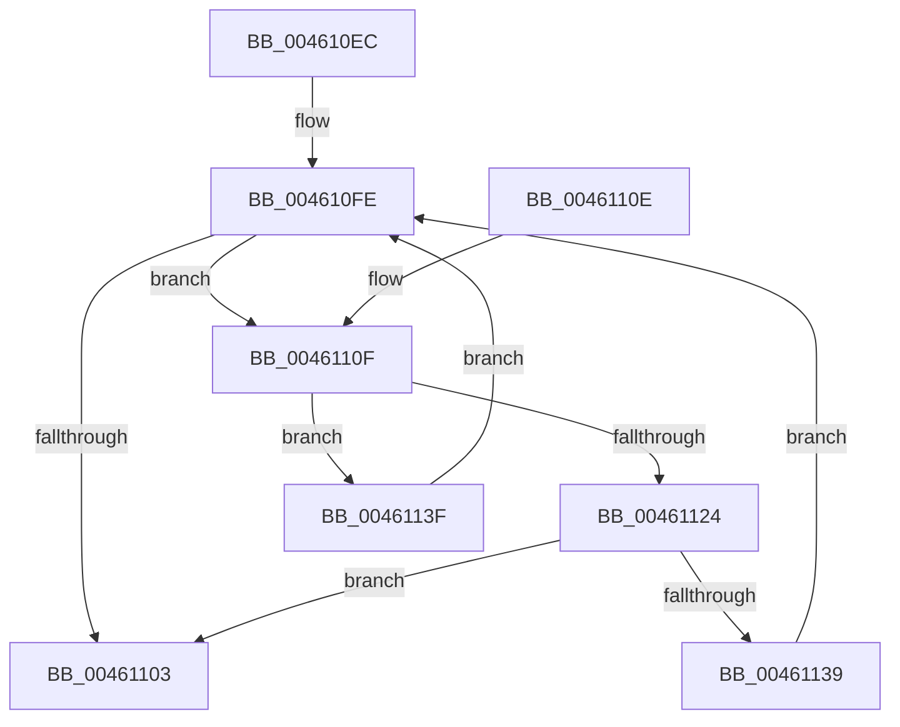

# MiCheckForConflictingVadExistence

- RVA: `0x004610EC`–`0x00461144` (길이 `88` bytes)
- VA: `0x00000001404610EC`
- 실행 섹션: `.text`
- PDB 이름 있음: `예`; PDB Function 태그: `아니요`
- unwind 정보 RVA: `0x000DB714`
- 디코드: `27`개 명령, `88/88` bytes 표시
- 미해석 바이트: `0` (있으면 어셈블리에 `.byte`로 보존)

> 이 문서는 커널 이미지의 기계어와 PDB 기호를 분석해 생성했습니다. 4번과 5번은 함수 원형과 자료형을 바이너리 사용 방식에서 추정한 C 해석이며 원본 소스 복구 결과는 아닙니다.

## 1. Dependencies

- 직접 호출 지점: **0**; 고유 호출 대상: **0**
- 직접 호출자로 확인된 함수: **1**
- RIP 상대 이미지 참조: **0**

### Outgoing calls
- 직접 디코드된 call 명령이 없습니다.

### Direct callers
- [MiIsVaRangeAvailable](../../page/97/MiIsVaRangeAvailable_function_0097FD90.md) at `0x0097FDB7`

### Static image references
- 디코드된 RIP-relative 메모리 참조가 없습니다.

## 2. Other-region calls and transfers

- 다른 실행 섹션으로 향하는 call: **0**
- 별도 외부 분기/꼬리 이동을 확인하지 못했습니다.

## 3. Assembly (complete function range)

```asm
004610EC  4C 8B 89 58 05 00 00            mov r9, qword ptr [rcx + 0x558]
004610F3  48 C1 EA 0C                     shr rdx, 0xc
004610F7  49 C1 E8 0C                     shr r8, 0xc
004610FB  45 33 D2                        xor r10d, r10d
004610FE  4D 85 C9                        test r9, r9
00461101  75 0C                           jne 0x14046110f
00461103  4D 85 C9                        test r9, r9
00461106  41 0F 95 C2                     setne r10b
0046110A  41 8B C2                        mov eax, r10d
0046110D  C3                              ret
0046110E  CC                              int3
0046110F  41 0F B6 49 20                  movzx ecx, byte ptr [r9 + 0x20]
00461114  41 8B 41 18                     mov eax, dword ptr [r9 + 0x18]
00461118  48 C1 E1 20                     shl rcx, 0x20
0046111C  48 0B C8                        or rcx, rax
0046111F  4C 3B C1                        cmp r8, rcx
00461122  72 1B                           jb 0x14046113f
00461124  41 0F B6 49 21                  movzx ecx, byte ptr [r9 + 0x21]
00461129  41 8B 41 1C                     mov eax, dword ptr [r9 + 0x1c]
0046112D  48 C1 E1 20                     shl rcx, 0x20
00461131  48 0B C8                        or rcx, rax
00461134  48 3B D1                        cmp rdx, rcx
00461137  76 CA                           jbe 0x140461103
00461139  4D 8B 49 08                     mov r9, qword ptr [r9 + 8]
0046113D  EB BF                           jmp 0x1404610fe
0046113F  4D 8B 09                        mov r9, qword ptr [r9]
00461142  EB BA                           jmp 0x1404610fe
```

## 4. C-style interpretation (structured pseudocode)

```c
__int64 __fastcall MiCheckForConflictingVadExistence(__int64 a1, __int64 a2, __int64 a3)
{
    __int64 v_r10;

    a2 = (a2) >> (12);
    a3 = (a3) >> (12);
    v_r10 = 0;
loc_004610FE:
    if (*(unsigned __int64 *)(a1 + 1368) != 0) goto loc_0046110F;
loc_00461103:
    v_r10 = (*(unsigned __int64 *)(a1 + 1368) != 0) ? 1 : 0;
    return (unsigned int)((unsigned int)(v_r10));
loc_0046110F:
    a1 = (*(unsigned __int8 *)(*(unsigned __int64 *)(a1 + 1368) + 32)) << (32);
    a1 = (a1) | ((unsigned int)(*(unsigned int *)(*(unsigned __int64 *)(a1 + 1368) + 24)));
    if (a3 < a1) goto loc_0046113F;
    a1 = (*(unsigned __int8 *)(*(unsigned __int64 *)(a1 + 1368) + 33)) << (32);
    a1 = (a1) | ((unsigned int)(*(unsigned int *)(*(unsigned __int64 *)(a1 + 1368) + 28)));
    if (a2 <= a1) goto loc_00461103;
    goto loc_004610FE;
loc_0046113F:
    goto loc_004610FE;
}
```

## 5. (Beta) C Style

```c
int64_t MiCheckForConflictingVadExistence(void *Arg1, int64_t Arg2, int64_t Arg3)
{
    uint8_t *arg1 = (uint8_t *)Arg1;

    int64_t local_r10;

    Arg2 = (Arg2) >> (12);
    Arg3 = (Arg3) >> (12);
    local_r10 = 0;
loc_004610FE:
    if (*(uint64_t *)(arg1 + 0x558) != 0) goto loc_0046110F;
loc_00461103:
    local_r10 = (*(uint64_t *)(arg1 + 0x558) != 0) ? 1 : 0;
    return (uint32_t)((uint32_t)(local_r10));
loc_0046110F:
    Arg1 = (*(uint8_t *)(*(uint64_t *)(arg1 + 0x558) + 0x20)) << (32);
    Arg1 = (Arg1) | ((uint32_t)(*(uint32_t *)(*(uint64_t *)(arg1 + 0x558) + 0x18)));
    if (Arg3 < Arg1) goto loc_0046113F;
    Arg1 = (*(uint8_t *)(*(uint64_t *)(arg1 + 0x558) + 0x21)) << (32);
    Arg1 = (Arg1) | ((uint32_t)(*(uint32_t *)(*(uint64_t *)(arg1 + 0x558) + 0x1C)));
    if (Arg2 <= Arg1) goto loc_00461103;
    goto loc_004610FE;
loc_0046113F:
    goto loc_004610FE;
}
```

### 관측된 메모리 오프셋

구조체 형식이 확인되지 않은 접근은 인자 기준의 오프셋으로만 기록했습니다.

| 기준 인자 | 오프셋 표현 | 폭 (bit) | 접근 |
|---|---:|---:|---|
| `Arg1` | `+ 0x558` | `64` | `R` |

## 6. Execution-region graph

[열기: 2D/3D 그래프와 함수 탐색 컨트롤 패널](../../../control-panel.html?section=text&rva=0x004610EC&view=graph)

- 2D 그래프는 위에서 아래로 흐르고, 3D 그래프는 빈 공간을 드래그해 회전합니다. Shift+드래그는 이동, 휠은 확대·축소, 함수 노드 선택은 대상 보고서 이동입니다.

### Static fallback


