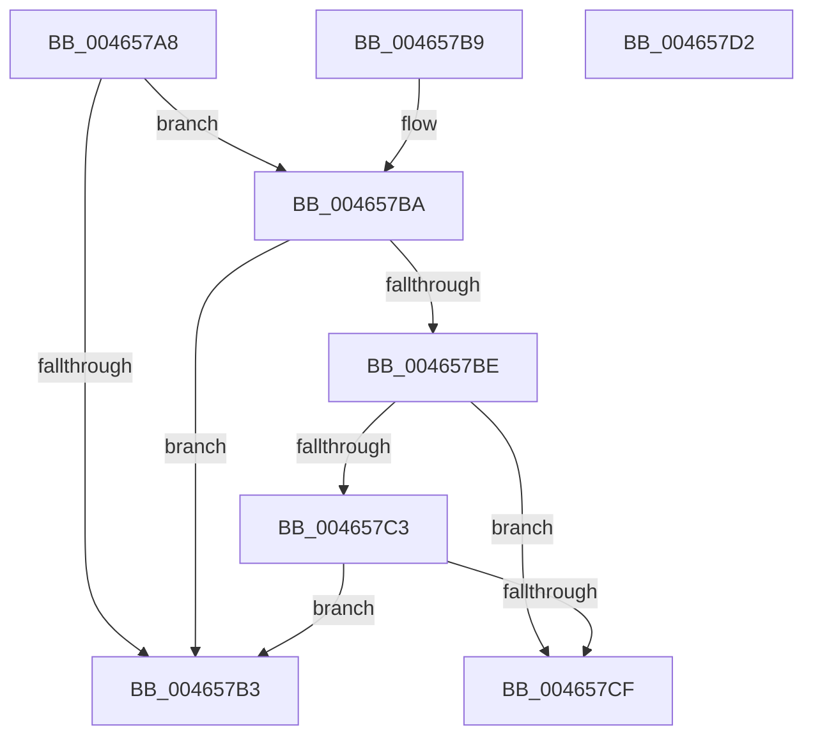

# MiCheckProcessCombineSequence

- RVA: `0x004657A8`–`0x004657D3` (길이 `43` bytes)
- VA: `0x00000001404657A8`
- 실행 섹션: `.text`
- PDB 이름 있음: `예`; PDB Function 태그: `아니요`
- unwind 정보 RVA: `0x000DB714`
- 디코드: `16`개 명령, `43/43` bytes 표시
- 미해석 바이트: `0` (있으면 어셈블리에 `.byte`로 보존)

> 이 문서는 커널 이미지의 기계어와 PDB 기호를 분석해 생성했습니다. 4번과 5번은 함수 원형과 자료형을 바이너리 사용 방식에서 추정한 C 해석이며 원본 소스 복구 결과는 아닙니다.

## 1. Dependencies

- 직접 호출 지점: **0**; 고유 호출 대상: **0**
- 직접 호출자로 확인된 함수: **2**
- RIP 상대 이미지 참조: **0**

### Outgoing calls
- 직접 디코드된 call 명령이 없습니다.

### Direct callers
- [MiSharePages](../31/MiSharePages_function_00315110.md) at `0x00315F1F`
- [MiCapturePfnVm](MiCapturePfnVm_function_00465570.md) at `0x0046571F`

### Static image references
- 디코드된 RIP-relative 메모리 참조가 없습니다.

## 2. Other-region calls and transfers

- 다른 실행 섹션으로 향하는 call: **0**
- 별도 외부 분기/꼬리 이동을 확인하지 못했습니다.

## 3. Assembly (complete function range)

```asm
004657A8  8B 81 A4 07 00 00               mov eax, dword ptr [rcx + 0x7a4]
004657AE  83 F8 01                        cmp eax, 1
004657B1  75 07                           jne 0x1404657ba
004657B3  B8 01 00 00 00                  mov eax, 1
004657B8  C3                              ret
004657B9  CC                              int3
004657BA  3B C2                           cmp eax, edx
004657BC  74 F5                           je 0x1404657b3
004657BE  83 F8 02                        cmp eax, 2
004657C1  73 0C                           jae 0x1404657cf
004657C3  33 C0                           xor eax, eax
004657C5  F0 0F B1 91 A4 07 00 00         lock cmpxchg dword ptr [rcx + 0x7a4], edx
004657CD  74 E4                           je 0x1404657b3
004657CF  33 C0                           xor eax, eax
004657D1  C3                              ret
004657D2  CC                              int3
```

## 4. C-style interpretation (structured pseudocode)

```c
__int64 __fastcall MiCheckProcessCombineSequence(__int64 a1, int a2)
{
    __int64 result;

    if (((unsigned int)((unsigned int)(*(unsigned int *)(a1 + 1956)))) != 1) goto loc_004657BA;
loc_004657B3:
    return 1;
loc_004657BA:
    if (1 == a2) goto loc_004657B3;
    if (1 >= 2) goto loc_004657CF;
    result = 0;
    if (condition_is_equal) goto loc_004657B3;
loc_004657CF:
    result = 0;
    return result;
}
```

## 5. (Beta) C Style

```c
int64_t MiCheckProcessCombineSequence(void *Arg1, int32_t Arg2)
{
    uint8_t *arg1 = (uint8_t *)Arg1;

    int64_t result;

    if (((uint32_t)((uint32_t)(*(uint32_t *)(arg1 + 0x7A4)))) != 1) goto loc_004657BA;
loc_004657B3:
    return 1;
loc_004657BA:
    if (1 == Arg2) goto loc_004657B3;
    if (1 >= 2) goto loc_004657CF;
    result = 0;
    if (condition_is_equal) goto loc_004657B3;
loc_004657CF:
    result = 0;
    return result;
}
```

### 관측된 메모리 오프셋

구조체 형식이 확인되지 않은 접근은 인자 기준의 오프셋으로만 기록했습니다.

| 기준 인자 | 오프셋 표현 | 폭 (bit) | 접근 |
|---|---:|---:|---|
| `Arg1` | `+ 0x7A4` | `32` | `R` |

## 6. Execution-region graph

[열기: 2D/3D 그래프와 함수 탐색 컨트롤 패널](../../../control-panel.html?section=text&rva=0x004657A8&view=graph)

- 2D 그래프는 위에서 아래로 흐르고, 3D 그래프는 빈 공간을 드래그해 회전합니다. Shift+드래그는 이동, 휠은 확대·축소, 함수 노드 선택은 대상 보고서 이동입니다.

### Static fallback


