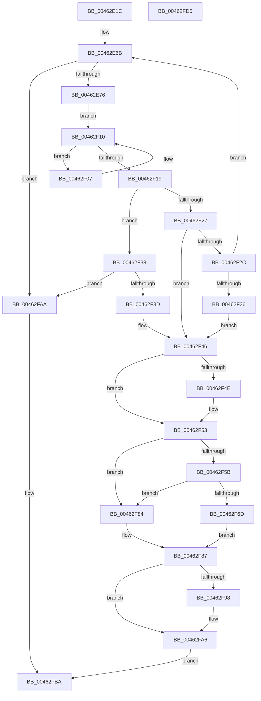

# MiCleanSection

- RVA: `0x00462E1C`–`0x00462FD6` (길이 `442` bytes)
- VA: `0x0000000140462E1C`
- 실행 섹션: `.text`
- PDB 이름 있음: `예`; PDB Function 태그: `아니요`
- unwind 정보 RVA: `0x00073494`
- 디코드: `130`개 명령, `442/442` bytes 표시
- 미해석 바이트: `0` (있으면 어셈블리에 `.byte`로 보존)

> 이 문서는 커널 이미지의 기계어와 PDB 기호를 분석해 생성했습니다. 4번과 5번은 함수 원형과 자료형을 바이너리 사용 방식에서 추정한 C 해석이며 원본 소스 복구 결과는 아닙니다.

## 1. Dependencies

- 직접 호출 지점: **7**; 고유 호출 대상: **6**
- 직접 호출자로 확인된 함수: **2**
- RIP 상대 이미지 참조: **1**

### Outgoing calls
- `0x00462EBB` → [MiReleaseSpinLockExclusive](../24/MiReleaseSpinLockExclusive_function_002482C0.md) (function, `0x002482C0`)
- `0x00462EEB` → [MiFlushSection](../40/MiFlushSection_function_004036B0.md) (function, `0x004036B0`)
- `0x00462EF7` → [ExAcquireSpinLockExclusive](../24/ExAcquireSpinLockExclusive_function_00248690.md) (function, `0x00248690`)
- `0x00462F5E` → [MiInsertUnusedSegment](../44/MiInsertUnusedSegment_function_004443DC.md) (function, `0x004443DC`)
- `0x00462F8E` → [MiReleaseSpinLockExclusive](../24/MiReleaseSpinLockExclusive_function_002482C0.md) (function, `0x002482C0`)
- `0x00462FA1` → [MiReturnCrossPartitionSectionCharges](../4B/MiReturnCrossPartitionSectionCharges_function_004BA61C.md) (function, `0x004BA61C`)
- `0x00462FB3` → [MiDestroySection](MiDestroySection_function_00462FDC.md) (function, `0x00462FDC`)

### Direct callers
- [MiCheckControlArea](../28/MiCheckControlArea_function_002861B0.md) at `0x00286517`
- [MiAttemptSectionDelete](../2A/MiAttemptSectionDelete_function_002AD044.md) at `0x002AD0D1`

### Static image references
- `0x00462F71` → RVA `0x00E30088` (`.data`; read)

## 2. Other-region calls and transfers

- 다른 실행 섹션으로 향하는 call: **0**
- 별도 외부 분기/꼬리 이동을 확인하지 못했습니다.

## 3. Assembly (complete function range)

```asm
00462E1C  48 89 5C 24 10                  mov qword ptr [rsp + 0x10], rbx
00462E21  55                              push rbp
00462E22  56                              push rsi
00462E23  57                              push rdi
00462E24  41 54                           push r12
00462E26  41 55                           push r13
00462E28  41 56                           push r14
00462E2A  41 57                           push r15
00462E2C  48 8B EC                        mov rbp, rsp
00462E2F  48 81 EC 80 00 00 00            sub rsp, 0x80
00462E36  33 C0                           xor eax, eax
00462E38  0F 57 C9                        xorps xmm1, xmm1
00462E3B  44 8A F2                        mov r14b, dl
00462E3E  48 89 45 F0                     mov qword ptr [rbp - 0x10], rax
00462E42  33 D2                           xor edx, edx
00462E44  0F 57 C0                        xorps xmm0, xmm0
00462E47  48 39 51 40                     cmp qword ptr [rcx + 0x40], rdx
00462E4B  44 8B E2                        mov r12d, edx
00462E4E  48 8B D9                        mov rbx, rcx
00462E51  8D 70 01                        lea esi, [rax + 1]
00462E54  41 0F 95 C4                     setne r12b
00462E58  45 8A E8                        mov r13b, r8b
00462E5B  48 83 C1 28                     add rcx, 0x28
00462E5F  0F 11 45 C0                     movups xmmword ptr [rbp - 0x40], xmm0
00462E63  0F 11 4D D0                     movups xmmword ptr [rbp - 0x30], xmm1
00462E67  0F 11 4D E0                     movups xmmword ptr [rbp - 0x20], xmm1
00462E6B  8B 43 38                        mov eax, dword ptr [rbx + 0x38]
00462E6E  A8 20                           test al, 0x20
00462E70  0F 85 34 01 00 00               jne 0x140462faa
00462E76  48 8D 45 E8                     lea rax, [rbp - 0x18]
00462E7A  89 55 E4                        mov dword ptr [rbp - 0x1c], edx
00462E7D  48 89 45 F0                     mov qword ptr [rbp - 0x10], rax
00462E81  48 8D 7B 50                     lea rdi, [rbx + 0x50]
00462E85  48 8D 45 E8                     lea rax, [rbp - 0x18]
00462E89  48 C7 45 D8 04 00 00 00         mov qword ptr [rbp - 0x28], 4
00462E91  48 89 45 E8                     mov qword ptr [rbp - 0x18], rax
00462E95  41 8A D6                        mov dl, r14b
00462E98  48 8B 07                        mov rax, qword ptr [rdi]
00462E9B  48 89 45 D0                     mov qword ptr [rbp - 0x30], rax
00462E9F  48 8D 45 D0                     lea rax, [rbp - 0x30]
00462EA3  48 89 07                        mov qword ptr [rdi], rax
00462EA6  48 8D 43 48                     lea rax, [rbx + 0x48]
00462EAA  48 8B C8                        mov rcx, rax
00462EAD  66 C7 45 E0 07 01               mov word ptr [rbp - 0x20], 0x107
00462EB3  C6 45 E2 06                     mov byte ptr [rbp - 0x1e], 6
00462EB7  48 89 45 58                     mov qword ptr [rbp + 0x58], rax
00462EBB  E8 00 54 DE FF                  call 0x1402482c0
00462EC0  48 8D 45 C0                     lea rax, [rbp - 0x40]
00462EC4  45 33 C9                        xor r9d, r9d
00462EC7  48 89 44 24 38                  mov qword ptr [rsp + 0x38], rax
00462ECC  4C 8D 83 80 00 00 00            lea r8, [rbx + 0x80]
00462ED3  48 83 64 24 30 00               and qword ptr [rsp + 0x30], 0
00462ED9  33 D2                           xor edx, edx
00462EDB  C7 44 24 28 00 00 00 80         mov dword ptr [rsp + 0x28], 0x80000000
00462EE3  33 C9                           xor ecx, ecx
00462EE5  48 83 64 24 20 00               and qword ptr [rsp + 0x20], 0
00462EEB  E8 C0 07 FA FF                  call 0x1404036b0
00462EF0  48 8D 4B 48                     lea rcx, [rbx + 0x48]
00462EF4  89 45 40                        mov dword ptr [rbp + 0x40], eax
00462EF7  E8 94 57 DE FF                  call 0x140248690
00462EFC  48 8B 0F                        mov rcx, qword ptr [rdi]
00462EFF  44 8A F0                        mov r14b, al
00462F02  48 8B 01                        mov rax, qword ptr [rcx]
00462F05  EB 09                           jmp 0x140462f10
00462F07  48 8B F9                        mov rdi, rcx
00462F0A  48 8B C8                        mov rcx, rax
00462F0D  48 8B 00                        mov rax, qword ptr [rax]
00462F10  48 8D 55 D0                     lea rdx, [rbp - 0x30]
00462F14  48 3B CA                        cmp rcx, rdx
00462F17  75 EE                           jne 0x140462f07
00462F19  33 D2                           xor edx, edx
00462F1B  48 89 07                        mov qword ptr [rdi], rax
00462F1E  48 8D 4B 28                     lea rcx, [rbx + 0x28]
00462F22  39 55 DC                        cmp dword ptr [rbp - 0x24], edx
00462F25  74 11                           je 0x140462f38
00462F27  48 39 31                        cmp qword ptr [rcx], rsi
00462F2A  75 1A                           jne 0x140462f46
00462F2C  48 39 53 18                     cmp qword ptr [rbx + 0x18], rdx
00462F30  0F 84 35 FF FF FF               je 0x140462e6b
00462F36  EB 0E                           jmp 0x140462f46
00462F38  39 55 40                        cmp dword ptr [rbp + 0x40], edx
00462F3B  7D 6D                           jge 0x140462faa
00462F3D  BE 02 00 00 00                  mov esi, 2
00462F42  48 8D 4B 28                     lea rcx, [rbx + 0x28]
00462F46  48 FF 09                        dec qword ptr [rcx]
00462F49  45 84 ED                        test r13b, r13b
00462F4C  74 05                           je 0x140462f53
00462F4E  0F BA 6B 38 12                  bts dword ptr [rbx + 0x38], 0x12
00462F53  48 8B FA                        mov rdi, rdx
00462F56  83 FE 02                        cmp esi, 2
00462F59  75 29                           jne 0x140462f84
00462F5B  48 8B CB                        mov rcx, rbx
00462F5E  E8 79 14 FE FF                  call 0x1404443dc
00462F63  33 D2                           xor edx, edx
00462F65  48 8B F8                        mov rdi, rax
00462F68  48 85 C0                        test rax, rax
00462F6B  74 17                           je 0x140462f84
00462F6D  0F B7 4B 3C                     movzx ecx, word ptr [rbx + 0x3c]
00462F71  48 8B 05 10 D1 9C 00            mov rax, qword ptr [rip + 0x9cd110]
00462F78  81 E1 FF 03 00 00               and ecx, 0x3ff
00462F7E  48 8B 1C C8                     mov rbx, qword ptr [rax + rcx*8]
00462F82  EB 03                           jmp 0x140462f87
00462F84  48 8B DA                        mov rbx, rdx
00462F87  48 8B 4D 58                     mov rcx, qword ptr [rbp + 0x58]
00462F8B  41 8A D6                        mov dl, r14b
00462F8E  E8 2D 53 DE FF                  call 0x1402482c0
00462F93  48 85 FF                        test rdi, rdi
00462F96  74 0E                           je 0x140462fa6
00462F98  4C 8B C7                        mov r8, rdi
00462F9B  41 8B D4                        mov edx, r12d
00462F9E  48 8B CB                        mov rcx, rbx
00462FA1  E8 76 76 05 00                  call 0x1404ba61c
00462FA6  33 C0                           xor eax, eax
00462FA8  EB 10                           jmp 0x140462fba
00462FAA  48 89 11                        mov qword ptr [rcx], rdx
00462FAD  41 8A D6                        mov dl, r14b
00462FB0  48 8B CB                        mov rcx, rbx
00462FB3  E8 24 00 00 00                  call 0x140462fdc
00462FB8  8B C6                           mov eax, esi
00462FBA  48 8B 9C 24 C8 00 00 00         mov rbx, qword ptr [rsp + 0xc8]
00462FC2  48 81 C4 80 00 00 00            add rsp, 0x80
00462FC9  41 5F                           pop r15
00462FCB  41 5E                           pop r14
00462FCD  41 5D                           pop r13
00462FCF  41 5C                           pop r12
00462FD1  5F                              pop rdi
00462FD2  5E                              pop rsi
00462FD3  5D                              pop rbp
00462FD4  C3                              ret
00462FD5  CC                              int3
```

## 4. C-style interpretation (structured pseudocode)

```c
__int64 __fastcall MiCleanSection(__int64 a1, int a2, unsigned __int8 a3, int a4)
{
    __int64 result;
    __int64 v_r12;
    __int64 v_rsp;
    unsigned __int64 v_stack_m48;
    unsigned __int64 v_stack_m50;
    unsigned int v_stack_m54;
    unsigned __int8 v_stack_m56;
    unsigned __int64 v_stack_m58;
    unsigned int v_stack_m5C;
    unsigned __int64 v_stack_m60;
    unsigned __int64 v_stack_m68;
    unsigned __int64 v_stack_m78;
    unsigned __int64 v_stack_m80;
    unsigned __int64 v_stack_m88;
    unsigned int v_stack_m90;
    unsigned __int64 v_stack_m98;
    unsigned __int64 v_stack_p10;
    unsigned __int64 v_stack_p20;
    unsigned int v_stack_p8;

    v_stack_p10 = v_rbx;
    v_rsp = (v_rsp) - (128);
    result = 0;
    v_stack_m48 = 0;
    a2 = 0;
    v_r12 = ((*(unsigned __int64 *)(a1 + 64)) != 0) ? 1 : 0;
    a1 = (a1) + (40);
    v_stack_m78 = v_xmm0;
    v_stack_m68 = v_xmm1;
    v_stack_m58 = v_xmm1;
loc_00462E6B:
    if ((((unsigned __int8)((unsigned int)(*(unsigned int *)(a1 + 56)))) & (32)) != 0) goto loc_00462FAA;
    v_stack_m54 = 0;
    v_stack_m48 = v_stack_m50;
    v_stack_m60 = 4;
    v_stack_m50 = v_stack_m50;
    v_stack_m68 = *(unsigned __int64 *)(a1 + 80);
    *(unsigned __int64 *)(a1 + 80) = v_stack_m68;
    v_stack_m58 = 263;
    v_stack_m56 = 6;
    v_stack_p20 = a1 + 72;
    result = MiReleaseSpinLockExclusive(a1 + 72, (unsigned __int8)((unsigned __int8)(a2)), a3, a4);
    a4 = 0;
    v_stack_m80 = v_stack_m78;
    a2 = 0;
    v_stack_m90 = 0x80000000ULL;
    a1 = 0;
    result = MiFlushSection(a1, a2, a1 + 128, a4);
    v_stack_p8 = (unsigned int)(result);
    result = ExAcquireSpinLockExclusive(a1 + 72, a2, a1 + 128, a4);
    goto loc_00462F10;
loc_00462F07:
loc_00462F10:
    if ((*(unsigned __int64 *)(*(unsigned __int64 *)(a1 + 80))) != v_stack_m68) goto loc_00462F07;
    a2 = 0;
    *(unsigned __int64 *)(*(unsigned __int64 *)(a1 + 80)) = *(unsigned __int64 *)(*(unsigned __int64 *)(*(unsigned __int64 *)(a1 + 80)));
    if (v_stack_m5C == 0) goto loc_00462F38;
    if ((*(unsigned __int64 *)(a1 + 40)) != (result + 1)) goto loc_00462F46;
    if ((*(unsigned __int64 *)(a1 + 24)) == 0) goto loc_00462E6B;
    goto loc_00462F46;
loc_00462F38:
    if (v_stack_p8 >= 0) goto loc_00462FAA;
loc_00462F46:
    if (a3 != 0) {
    }
    if (2 != 2) goto loc_00462F84;
    result = MiInsertUnusedSegment(0, a2, a1 + 128, a4);
    a2 = 0;
    if (result == 0) goto loc_00462F84;
    a1 = (unsigned int)((*(unsigned __int16 *)(a1 + 60)) & (0x3FFULL));
    goto loc_00462F87;
loc_00462F84:
loc_00462F87:
    result = MiReleaseSpinLockExclusive(v_stack_p20, (unsigned __int8)((unsigned __int8)(result)), a1 + 128, a4);
    if (result != 0) {
        a3 = result;
        a2 = (unsigned int)(v_r12);
        a1 = 0;
        result = MiReturnCrossPartitionSectionCharges(a1, a2, a3, a4);
    }
    result = 0;
    goto loc_00462FBA;
loc_00462FAA:
    *(unsigned __int64 *)(a1) = a2;
    result = MiDestroySection(0, (unsigned __int8)((unsigned __int8)(result)), a3, a4);
loc_00462FBA:
    v_rsp = (v_rsp) + (128);
    return 2;
}
```

## 5. (Beta) C Style

```c
int64_t MiCleanSection(void *Arg1, int32_t Arg2, uint8_t Arg3, int32_t Arg4)
{
    uint8_t *arg1 = (uint8_t *)Arg1;

    int64_t result;
    int64_t local_r12;
    int64_t local_rsp;
    uint64_t v_stack_m48;
    uint64_t v_stack_m50;
    uint32_t v_stack_m54;
    uint8_t v_stack_m56;
    uint64_t v_stack_m58;
    uint32_t v_stack_m5C;
    uint64_t v_stack_m60;
    uint64_t v_stack_m68;
    uint64_t v_stack_m78;
    uint64_t v_stack_m80;
    uint64_t v_stack_m88;
    uint32_t v_stack_m90;
    uint64_t v_stack_m98;
    uint64_t v_stack_p10;
    uint64_t v_stack_p20;
    uint32_t v_stack_p8;

    v_stack_p10 = local_rbx;
    local_rsp = (local_rsp) - (128);
    result = 0;
    v_stack_m48 = 0;
    Arg2 = 0;
    local_r12 = ((*(uint64_t *)(arg1 + 0x40)) != 0) ? 1 : 0;
    Arg1 = (Arg1) + (40);
    v_stack_m78 = v_xmm0;
    v_stack_m68 = v_xmm1;
    v_stack_m58 = v_xmm1;
loc_00462E6B:
    if ((((uint8_t)((uint32_t)(*(uint32_t *)(arg1 + 0x38)))) & (32)) != 0) goto loc_00462FAA;
    v_stack_m54 = 0;
    v_stack_m48 = v_stack_m50;
    v_stack_m60 = 4;
    v_stack_m50 = v_stack_m50;
    v_stack_m68 = *(uint64_t *)(arg1 + 0x50);
    *(uint64_t *)(arg1 + 0x50) = v_stack_m68;
    v_stack_m58 = 263;
    v_stack_m56 = 6;
    v_stack_p20 = Arg1 + 72;
    result = MiReleaseSpinLockExclusive(Arg1 + 72, (uint8_t)((uint8_t)(Arg2)), Arg3, Arg4);
    Arg4 = 0;
    v_stack_m80 = v_stack_m78;
    Arg2 = 0;
    v_stack_m90 = 0x80000000ULL;
    Arg1 = 0;
    result = MiFlushSection(Arg1, Arg2, Arg1 + 128, Arg4);
    v_stack_p8 = (uint32_t)(result);
    result = ExAcquireSpinLockExclusive(Arg1 + 72, Arg2, Arg1 + 128, Arg4);
    goto loc_00462F10;
loc_00462F07:
loc_00462F10:
    if ((*(uint64_t *)(*(uint64_t *)(arg1 + 0x50))) != v_stack_m68) goto loc_00462F07;
    Arg2 = 0;
    *(uint64_t *)(*(uint64_t *)(arg1 + 0x50)) = *(uint64_t *)(*(uint64_t *)(*(uint64_t *)(arg1 + 0x50)));
    if (v_stack_m5C == 0) goto loc_00462F38;
    if ((*(uint64_t *)(arg1 + 0x28)) != (result + 1)) goto loc_00462F46;
    if ((*(uint64_t *)(arg1 + 0x18)) == 0) goto loc_00462E6B;
    goto loc_00462F46;
loc_00462F38:
    if (v_stack_p8 >= 0) goto loc_00462FAA;
loc_00462F46:
    if (Arg3 != 0) {
    }
    if (2 != 2) goto loc_00462F84;
    result = MiInsertUnusedSegment(0, Arg2, Arg1 + 128, Arg4);
    Arg2 = 0;
    if (result == 0) goto loc_00462F84;
    Arg1 = (uint32_t)((*(uint16_t *)(arg1 + 0x3C)) & (0x3FFULL));
    goto loc_00462F87;
loc_00462F84:
loc_00462F87:
    result = MiReleaseSpinLockExclusive(v_stack_p20, (uint8_t)((uint8_t)(result)), Arg1 + 128, Arg4);
    if (result != 0) {
        Arg3 = result;
        Arg2 = (uint32_t)(local_r12);
        Arg1 = 0;
        result = MiReturnCrossPartitionSectionCharges(Arg1, Arg2, Arg3, Arg4);
    }
    result = 0;
    goto loc_00462FBA;
loc_00462FAA:
    *(uint64_t *)(arg1) = Arg2;
    result = MiDestroySection(0, (uint8_t)((uint8_t)(result)), Arg3, Arg4);
loc_00462FBA:
    local_rsp = (local_rsp) + (128);
    return 2;
}
```

### 관측된 메모리 오프셋

구조체 형식이 확인되지 않은 접근은 인자 기준의 오프셋으로만 기록했습니다.

| 기준 인자 | 오프셋 표현 | 폭 (bit) | 접근 |
|---|---:|---:|---|
| `Arg1` | `+ 0x0` | `64` | `R` |
| `Arg1` | `+ 0x0` | `64` | `R/W` |
| `Arg1` | `+ 0x0` | `64` | `W` |
| `Arg1` | `+ 0x18` | `64` | `R` |
| `Arg1` | `+ 0x28` | `64` | `R` |
| `Arg1` | `+ 0x38` | `32` | `R` |
| `Arg1` | `+ 0x38` | `32` | `R/W` |
| `Arg1` | `+ 0x3C` | `16` | `R` |
| `Arg1` | `+ 0x40` | `64` | `R` |
| `Arg1` | `+ 0x48` | `64` | `R` |
| `Arg1` | `+ 0x50` | `64` | `R` |
| `Arg1` | `+ 0x80` | `64` | `R` |

## 6. Execution-region graph

[열기: 2D/3D 그래프와 함수 탐색 컨트롤 패널](../../../control-panel.html?section=text&rva=0x00462E1C&view=graph)

- 2D 그래프는 위에서 아래로 흐르고, 3D 그래프는 빈 공간을 드래그해 회전합니다. Shift+드래그는 이동, 휠은 확대·축소, 함수 노드 선택은 대상 보고서 이동입니다.

### Static fallback


