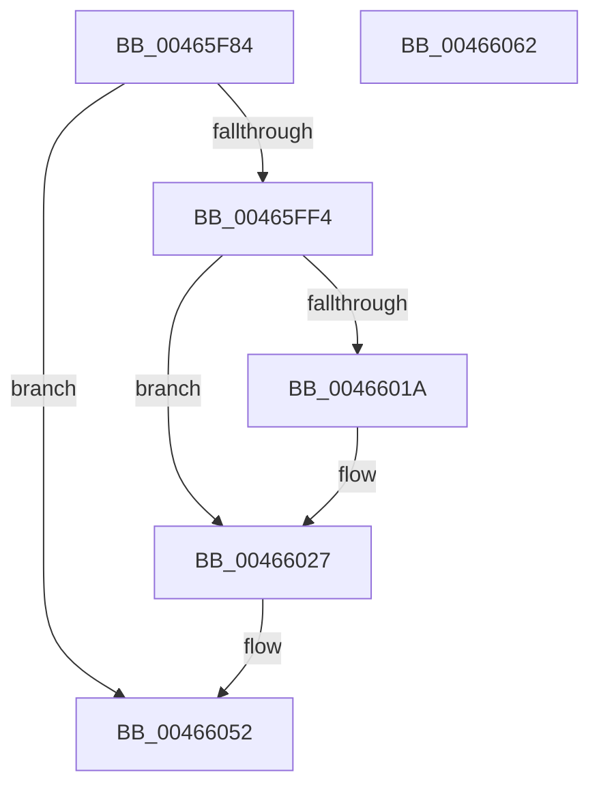

# MiClearContainingMapping

- RVA: `0x00465F84`–`0x00466063` (길이 `223` bytes)
- VA: `0x0000000140465F84`
- 실행 섹션: `.text`
- PDB 이름 있음: `예`; PDB Function 태그: `아니요`
- unwind 정보 RVA: `0x0005FD94`
- 디코드: `51`개 명령, `223/223` bytes 표시
- 미해석 바이트: `0` (있으면 어셈블리에 `.byte`로 보존)

> 이 문서는 커널 이미지의 기계어와 PDB 기호를 분석해 생성했습니다. 4번과 5번은 함수 원형과 자료형을 바이너리 사용 방식에서 추정한 C 해석이며 원본 소스 복구 결과는 아닙니다.

## 1. Dependencies

- 직접 호출 지점: **1**; 고유 호출 대상: **1**
- 직접 호출자로 확인된 함수: **1**
- RIP 상대 이미지 참조: **1**

### Outgoing calls
- `0x00466009` → [MiMapPageInHyperSpaceWorker](../33/MiMapPageInHyperSpaceWorker_function_00332B10.md) (function, `0x00332B10`)

### Direct callers
- [MiDeleteTopLevelPage](MiDeleteTopLevelPage_function_00465E7C.md) at `0x00465EC8`

### Static image references
- `0x00466044` → RVA `0x00010880` (`.rdata`; read)

## 2. Other-region calls and transfers

- 다른 실행 섹션으로 향하는 call: **0**
- 별도 외부 분기/꼬리 이동을 확인하지 못했습니다.

## 3. Assembly (complete function range)

```asm
00465F84  48 89 5C 24 10                  mov qword ptr [rsp + 0x10], rbx
00465F89  48 89 74 24 18                  mov qword ptr [rsp + 0x18], rsi
00465F8E  57                              push rdi
00465F8F  48 83 EC 20                     sub rsp, 0x20
00465F93  48 8B D9                        mov rbx, rcx
00465F96  48 B8 FF FF FF FF FF 00 00 00   movabs rax, 0xffffffffff
00465FA0  48 8B 49 28                     mov rcx, qword ptr [rcx + 0x28]
00465FA4  48 23 C8                        and rcx, rax
00465FA7  48 8D 04 49                     lea rax, [rcx + rcx*2]
00465FAB  48 03 C0                        add rax, rax
00465FAE  48 BA 00 00 00 00 00 DE FF FF   movabs rdx, 0xffffde0000000000
00465FB8  4C 8B 44 C2 08                  mov r8, qword ptr [rdx + rax*8 + 8]
00465FBD  48 BE F8 FF FF FF 7F 00 00 00   movabs rsi, 0x7ffffffff8
00465FC7  48 8B 53 08                     mov rdx, qword ptr [rbx + 8]
00465FCB  48 C1 EA 09                     shr rdx, 9
00465FCF  48 23 D6                        and rdx, rsi
00465FD2  48 BF 00 00 00 00 80 F6 FF FF   movabs rdi, 0xfffff68000000000
00465FDC  48 8B C7                        mov rax, rdi
00465FDF  48 03 D0                        add rdx, rax
00465FE2  48 B8 00 00 00 00 00 00 00 80   movabs rax, 0x8000000000000000
00465FEC  4C 0B C0                        or r8, rax
00465FEF  4C 3B C2                        cmp r8, rdx
00465FF2  75 5E                           jne 0x140466052
00465FF4  48 8B 5B 08                     mov rbx, qword ptr [rbx + 8]
00465FF8  33 D2                           xor edx, edx
00465FFA  C1 EB 03                        shr ebx, 3
00465FFD  41 B8 00 00 00 80               mov r8d, 0x80000000
00466003  81 E3 FF 01 00 00               and ebx, 0x1ff
00466009  E8 02 CB EC FF                  call 0x140332b10
0046600E  48 8B D0                        mov rdx, rax
00466011  48 8B 0C D8                     mov rcx, qword ptr [rax + rbx*8]
00466015  F6 C1 01                        test cl, 1
00466018  74 0D                           je 0x140466027
0046601A  48 83 E1 FE                     and rcx, 0xfffffffffffffffe
0046601E  48 0F BA E9 0A                  bts rcx, 0xa
00466023  48 89 0C D8                     mov qword ptr [rax + rbx*8], rcx
00466027  48 C1 EA 09                     shr rdx, 9
0046602B  48 23 D6                        and rdx, rsi
0046602E  48 8B C7                        mov rax, rdi
00466031  48 03 D0                        add rdx, rax
00466034  65 48 8B 04 25 20 00 00 00      mov rax, qword ptr gs:[0x20]
0046603D  48 8B 88 38 88 00 00            mov rcx, qword ptr [rax + 0x8838]
00466044  48 8B 05 35 A8 BA FF            mov rax, qword ptr [rip - 0x4557cb]
0046604B  48 83 21 00                     and qword ptr [rcx], 0
0046604F  48 89 02                        mov qword ptr [rdx], rax
00466052  48 8B 5C 24 38                  mov rbx, qword ptr [rsp + 0x38]
00466057  48 8B 74 24 40                  mov rsi, qword ptr [rsp + 0x40]
0046605C  48 83 C4 20                     add rsp, 0x20
00466060  5F                              pop rdi
00466061  C3                              ret
00466062  CC                              int3
```

## 4. C-style interpretation (structured pseudocode)

```c
__int64 __fastcall MiClearContainingMapping(__int64 a1)
{
    __int64 result;
    __int64 v_rbx;
    __int64 v_rsp;
    unsigned __int64 v_stack_p10;
    unsigned __int64 v_stack_p18;

    v_stack_p10 = v_rbx;
    v_stack_p18 = v_rsi;
    v_rsp = (v_rsp) - (32);
    a1 = (*(unsigned __int64 *)(a1 + 40)) & (result);
    result = (a1 + a1 * 2) + (a1 + a1 * 2);
    a2 = (*(unsigned __int64 *)(a1 + 8)) >> (9);
    a2 = (a2) & (v_rsi);
    a2 = (a2) + (v_rdi);
    a3 = (*(unsigned __int64 *)(a2 + result * 8 + 8)) | (v_rdi);
    if (a3 != a2) goto loc_00466052;
    a2 = 0;
    v_rbx = (unsigned int)((*(unsigned __int64 *)(a1 + 8)) >> (3));
    v_rbx = (unsigned int)((v_rbx) & (511));
    result = MiMapPageInHyperSpaceWorker(a1, a2, (unsigned int)(0x80000000ULL), a4);
    if ((((unsigned __int8)(*(unsigned __int64 *)(result + v_rbx * 8))) & (1)) != 0) {
        a1 = (*(unsigned __int64 *)(result + v_rbx * 8)) & (-2);
        *(unsigned __int64 *)(result + v_rbx * 8) = a1;
    }
    a2 = (result) >> (9);
    a2 = (a2) & (v_rsi);
    a2 = (a2) + (v_rdi);
    *(unsigned __int64 *)(a2) = *(unsigned __int64 *)(v_rip - 4544459);
loc_00466052:
    v_rsp = (v_rsp) + (32);
    return *(unsigned __int64 *)(v_rip - 4544459);
}
```

## 5. (Beta) C Style

```c
int64_t MiClearContainingMapping(void *Arg1)
{
    uint8_t *arg1 = (uint8_t *)Arg1;

    int64_t result;
    int64_t local_rbx;
    int64_t local_rsp;
    uint64_t v_stack_p10;
    uint64_t v_stack_p18;

    v_stack_p10 = local_rbx;
    v_stack_p18 = local_rsi;
    local_rsp = (local_rsp) - (32);
    Arg1 = (*(uint64_t *)(arg1 + 0x28)) & (result);
    result = (Arg1 + Arg1 * 2) + (Arg1 + Arg1 * 2);
    a2 = (*(uint64_t *)(arg1 + 0x8)) >> (9);
    a2 = (a2) & (local_rsi);
    a2 = (a2) + (local_rdi);
    a3 = (*(uint64_t *)(a2 + result * 8 + 0x8)) | (local_rdi);
    if (a3 != a2) goto loc_00466052;
    a2 = 0;
    local_rbx = (uint32_t)((*(uint64_t *)(arg1 + 0x8)) >> (3));
    local_rbx = (uint32_t)((local_rbx) & (511));
    result = MiMapPageInHyperSpaceWorker(Arg1, a2, (uint32_t)(0x80000000ULL), a4);
    if ((((uint8_t)(*(uint64_t *)(result + local_rbx * 8))) & (1)) != 0) {
        Arg1 = (*(uint64_t *)(result + local_rbx * 8)) & (-2);
        *(void **)(result + local_rbx * 8) = Arg1;
    }
    a2 = (result) >> (9);
    a2 = (a2) & (local_rsi);
    a2 = (a2) + (local_rdi);
    *(uint64_t *)(a2) = *(uint64_t *)(v_rip - 0x4557CB);
loc_00466052:
    local_rsp = (local_rsp) + (32);
    return *(uint64_t *)(v_rip - 0x4557CB);
}
```

### 관측된 메모리 오프셋

구조체 형식이 확인되지 않은 접근은 인자 기준의 오프셋으로만 기록했습니다.

| 기준 인자 | 오프셋 표현 | 폭 (bit) | 접근 |
|---|---:|---:|---|
| `Arg1` | `+ 0x8` | `64` | `R` |
| `Arg1` | `+ 0x28` | `64` | `R` |

## 6. Execution-region graph

[열기: 2D/3D 그래프와 함수 탐색 컨트롤 패널](../../../control-panel.html?section=text&rva=0x00465F84&view=graph)

- 2D 그래프는 위에서 아래로 흐르고, 3D 그래프는 빈 공간을 드래그해 회전합니다. Shift+드래그는 이동, 휠은 확대·축소, 함수 노드 선택은 대상 보고서 이동입니다.

### Static fallback


