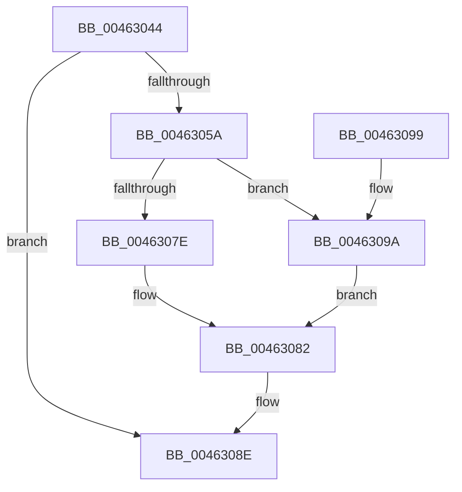

# MiClearFilePointer

- RVA: `0x00463044`–`0x004630A1` (길이 `93` bytes)
- VA: `0x0000000140463044`
- 실행 섹션: `.text`
- PDB 이름 있음: `예`; PDB Function 태그: `아니요`
- unwind 정보 RVA: `0x0006CF28`
- 디코드: `27`개 명령, `93/93` bytes 표시
- 미해석 바이트: `0` (있으면 어셈블리에 `.byte`로 보존)

> 이 문서는 커널 이미지의 기계어와 PDB 기호를 분석해 생성했습니다. 4번과 5번은 함수 원형과 자료형을 바이너리 사용 방식에서 추정한 C 해석이며 원본 소스 복구 결과는 아닙니다.

## 1. Dependencies

- 직접 호출 지점: **2**; 고유 호출 대상: **2**
- 직접 호출자로 확인된 함수: **3**
- RIP 상대 이미지 참조: **1**

### Outgoing calls
- `0x0046306C` → [ExAcquireSpinLockExclusiveAtDpcLevel](../24/ExAcquireSpinLockExclusiveAtDpcLevel_function_00248E80.md) (function, `0x00248E80`)
- `0x00463089` → [ExReleaseSpinLockExclusiveFromDpcLevel](../24/ExReleaseSpinLockExclusiveFromDpcLevel_function_002497E0.md) (function, `0x002497E0`)

### Direct callers
- [sub_00248F71](../24/Unknown_function_00248F71.md) at `0x00248F8A`
- [MiCheckControlArea](../28/MiCheckControlArea_function_002861B0.md) at `0x00286457`
- [MiCheckControlArea](../28/MiCheckControlArea_function_002861B0.md) at `0x00286576`
- [MiDestroySection](MiDestroySection_function_00462FDC.md) at `0x00463004`

### Static image references
- `0x00463065` → RVA `0x00E2CD00` (`.data`; read)

## 2. Other-region calls and transfers

- 다른 실행 섹션으로 향하는 call: **0**
- 별도 외부 분기/꼬리 이동을 확인하지 못했습니다.

## 3. Assembly (complete function range)

```asm
00463044  48 89 5C 24 08                  mov qword ptr [rsp + 8], rbx
00463049  57                              push rdi
0046304A  48 83 EC 20                     sub rsp, 0x20
0046304E  8B 59 38                        mov ebx, dword ptr [rcx + 0x38]
00463051  BA 00 00 08 00                  mov edx, 0x80000
00463056  85 DA                           test edx, ebx
00463058  75 34                           jne 0x14046308e
0046305A  8B C3                           mov eax, ebx
0046305C  0B C2                           or eax, edx
0046305E  89 41 38                        mov dword ptr [rcx + 0x38], eax
00463061  48 8B 79 40                     mov rdi, qword ptr [rcx + 0x40]
00463065  48 8D 0D 94 9C 9C 00            lea rcx, [rip + 0x9c9c94]
0046306C  E8 0F 5E DE FF                  call 0x140248e80
00463071  48 83 E7 F0                     and rdi, 0xfffffffffffffff0
00463075  48 8B 47 28                     mov rax, qword ptr [rdi + 0x28]
00463079  F6 C3 20                        test bl, 0x20
0046307C  75 1C                           jne 0x14046309a
0046307E  48 83 20 00                     and qword ptr [rax], 0
00463082  48 8D 0D 77 9C 9C 00            lea rcx, [rip + 0x9c9c77]
00463089  E8 52 67 DE FF                  call 0x1402497e0
0046308E  48 8B 5C 24 30                  mov rbx, qword ptr [rsp + 0x30]
00463093  48 83 C4 20                     add rsp, 0x20
00463097  5F                              pop rdi
00463098  C3                              ret
00463099  CC                              int3
0046309A  48 83 60 10 00                  and qword ptr [rax + 0x10], 0
0046309F  EB E1                           jmp 0x140463082
```

## 4. C-style interpretation (structured pseudocode)

```c
__int64 __fastcall MiClearFilePointer(__int64 a1)
{
    __int64 result;
    __int64 v_rdi;
    __int64 v_rsp;
    unsigned __int64 v_stack_p8;

    v_stack_p8 = v_rbx;
    v_rsp = (v_rsp) - (32);
    if ((((unsigned int)((unsigned int)(0x80000ULL))) & ((unsigned int)((unsigned int)(*(unsigned int *)(a1 + 56))))) != 0) goto loc_0046308E;
    result = (unsigned int)(((unsigned int)((unsigned int)((unsigned int)(*(unsigned int *)(a1 + 56))))) | ((unsigned int)((unsigned int)(0x80000ULL))));
    *(unsigned int *)(a1 + 56) = (unsigned int)(result);
    result = ExAcquireSpinLockExclusiveAtDpcLevel(v_rip + 10263700, (unsigned int)(0x80000ULL), a3, a4);
    v_rdi = (*(unsigned __int64 *)(a1 + 64)) & (-16);
    if ((((unsigned __int8)((unsigned int)(*(unsigned int *)(a1 + 56)))) & (32)) != 0) goto loc_0046309A;
loc_00463082:
    result = ExReleaseSpinLockExclusiveFromDpcLevel(v_rip + 10263671, (unsigned int)(0x80000ULL), a3, a4);
loc_0046308E:
    v_rsp = (v_rsp) + (32);
    return result;
loc_0046309A:
    goto loc_00463082;
}
```

## 5. (Beta) C Style

```c
int64_t MiClearFilePointer(void *Arg1)
{
    uint8_t *arg1 = (uint8_t *)Arg1;

    int64_t result;
    int64_t local_rdi;
    int64_t local_rsp;
    uint64_t v_stack_p8;

    v_stack_p8 = local_rbx;
    local_rsp = (local_rsp) - (32);
    if ((((uint32_t)((uint32_t)(0x80000ULL))) & ((uint32_t)((uint32_t)(*(uint32_t *)(arg1 + 0x38))))) != 0) goto loc_0046308E;
    result = (uint32_t)(((uint32_t)((uint32_t)((uint32_t)(*(uint32_t *)(arg1 + 0x38))))) | ((uint32_t)((uint32_t)(0x80000ULL))));
    *(uint32_t *)(arg1 + 0x38) = (uint32_t)(result);
    result = ExAcquireSpinLockExclusiveAtDpcLevel(v_rip + 10263700, (uint32_t)(0x80000ULL), a3, a4);
    local_rdi = (*(uint64_t *)(arg1 + 0x40)) & (-16);
    if ((((uint8_t)((uint32_t)(*(uint32_t *)(arg1 + 0x38)))) & (32)) != 0) goto loc_0046309A;
loc_00463082:
    result = ExReleaseSpinLockExclusiveFromDpcLevel(v_rip + 10263671, (uint32_t)(0x80000ULL), a3, a4);
loc_0046308E:
    local_rsp = (local_rsp) + (32);
    return result;
loc_0046309A:
    goto loc_00463082;
}
```

### 관측된 메모리 오프셋

구조체 형식이 확인되지 않은 접근은 인자 기준의 오프셋으로만 기록했습니다.

| 기준 인자 | 오프셋 표현 | 폭 (bit) | 접근 |
|---|---:|---:|---|
| `Arg1` | `+ 0x38` | `32` | `R` |
| `Arg1` | `+ 0x38` | `32` | `W` |
| `Arg1` | `+ 0x40` | `64` | `R` |

## 6. Execution-region graph

[열기: 2D/3D 그래프와 함수 탐색 컨트롤 패널](../../../control-panel.html?section=text&rva=0x00463044&view=graph)

- 2D 그래프는 위에서 아래로 흐르고, 3D 그래프는 빈 공간을 드래그해 회전합니다. Shift+드래그는 이동, 휠은 확대·축소, 함수 노드 선택은 대상 보고서 이동입니다.

### Static fallback


