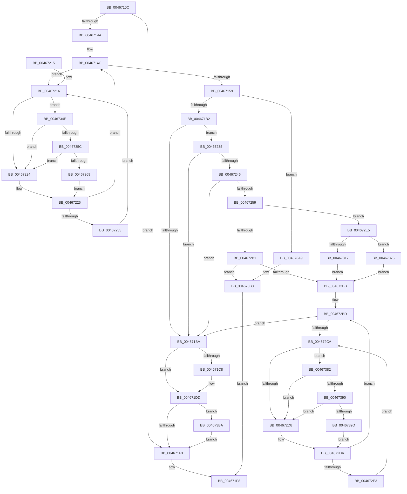

# MiCompleteSecureProcessFault

- RVA: `0x0046710C`–`0x004673D0` (길이 `708` bytes)
- VA: `0x000000014046710C`
- 실행 섹션: `.text`
- PDB 이름 있음: `예`; PDB Function 태그: `아니요`
- unwind 정보 RVA: `0x000AAF08`
- 디코드: `172`개 명령, `708/708` bytes 표시
- 미해석 바이트: `0` (있으면 어셈블리에 `.byte`로 보존)

> 이 문서는 커널 이미지의 기계어와 PDB 기호를 분석해 생성했습니다. 4번과 5번은 함수 원형과 자료형을 바이너리 사용 방식에서 추정한 C 해석이며 원본 소스 복구 결과는 아닙니다.

## 1. Dependencies

- 직접 호출 지점: **17**; 고유 호출 대상: **13**
- 직접 호출자로 확인된 함수: **2**
- RIP 상대 이미지 참조: **4**

### Outgoing calls
- `0x00467138` → [MI_READ_PTE_LOCK_FREE](../28/MI_READ_PTE_LOCK_FREE_function_002828A0.md) (function, `0x002828A0`)
- `0x004671CB` → [MiAbortCombineScan](../2A/MiAbortCombineScan_function_002A1160.md) (function, `0x002A1160`)
- `0x004671D8` → [MiMarkPfnVerified](../38/MiMarkPfnVerified_function_003833C4.md) (function, `0x003833C4`)
- `0x004671E0` → [MiCaptureDirtyBitToPfn](../37/MiCaptureDirtyBitToPfn_function_00370DD0.md) (function, `0x00370DD0`)
- `0x00467238` → [MiGetPfnSlabType](../28/MiGetPfnSlabType_function_0028E2D0.md) (function, `0x0028E2D0`)
- `0x00467283` → [MI_PAGE_TO_FULL_COLOR](../33/MI_PAGE_TO_FULL_COLOR_function_00337820.md) (function, `0x00337820`)
- `0x004672A6` → [MiGetSlabPage](../37/MiGetSlabPage_function_00376FBC.md) (function, `0x00376FBC`)
- `0x0046730E` → [MiTradeActivePage](../37/MiTradeActivePage_function_00374424.md) (function, `0x00374424`)
- `0x00467325` → [MiSetOriginalPtePfnFromFreeList](../28/MiSetOriginalPtePfnFromFreeList_function_0028A99C.md) (function, `0x0028A99C`)
- `0x0046732D` → [MiReleaseFreshPageAtDpc](../33/MiReleaseFreshPageAtDpc_function_00334B50.md) (function, `0x00334B50`)
- `0x00467338` → [MI_READ_PTE_LOCK_FREE](../28/MI_READ_PTE_LOCK_FREE_function_002828A0.md) (function, `0x002828A0`)
- `0x0046735C` → [KiCheckVpBackingLongSpinWaitHypercall](../30/KiCheckVpBackingLongSpinWaitHypercall_function_0030F490.md) (function, `0x0030F490`)
- `0x0046736B` → [HvlNotifyLongSpinWait](../30/HvlNotifyLongSpinWait_function_0030F460.md) (function, `0x0030F460`)
- `0x00467378` → [MiReleaseFreshPageAtDpc](../33/MiReleaseFreshPageAtDpc_function_00334B50.md) (function, `0x00334B50`)
- `0x00467390` → [KiCheckVpBackingLongSpinWaitHypercall](../30/KiCheckVpBackingLongSpinWaitHypercall_function_0030F490.md) (function, `0x0030F490`)
- `0x0046739F` → [HvlNotifyLongSpinWait](../30/HvlNotifyLongSpinWait_function_0030F460.md) (function, `0x0030F460`)
- `0x004673C6` → [MiReleasePageFileInfo](../28/MiReleasePageFileInfo_function_00283FD0.md) (function, `0x00283FD0`)

### Direct callers
- [MiAllocateWsle](../33/MiAllocateWsle_function_003332C0.md) at `0x00333E65`
- [MiValidVirtualizationFault](MiValidVirtualizationFault_function_00466EC0.md) at `0x00466F8C`

### Static image references
- `0x0046715D` → RVA `0x00E30088` (`.data`; read)
- `0x00467218` → RVA `0x00FC52AC` (`ALMOSTRO`; reference)
- `0x00467317` → RVA `0x00010880` (`.rdata`; read)
- `0x0046734E` → RVA `0x00FC6AB8` (`ALMOSTRO`; read)

## 2. Other-region calls and transfers

- 다른 실행 섹션으로 향하는 call: **0**
- 별도 외부 분기/꼬리 이동을 확인하지 못했습니다.

## 3. Assembly (complete function range)

```asm
0046710C  48 8B C4                        mov rax, rsp
0046710F  48 89 58 10                     mov qword ptr [rax + 0x10], rbx
00467113  48 89 68 18                     mov qword ptr [rax + 0x18], rbp
00467117  48 89 70 20                     mov qword ptr [rax + 0x20], rsi
0046711B  48 89 48 08                     mov qword ptr [rax + 8], rcx
0046711F  57                              push rdi
00467120  41 54                           push r12
00467122  41 55                           push r13
00467124  41 56                           push r14
00467126  41 57                           push r15
00467128  48 83 EC 30                     sub rsp, 0x30
0046712C  48 8B 19                        mov rbx, qword ptr [rcx]
0046712F  4D 8B F0                        mov r14, r8
00467132  48 8B CA                        mov rcx, rdx
00467135  4C 8B E2                        mov r12, rdx
00467138  E8 63 B7 E1 FF                  call 0x1402828a0
0046713D  48 8B 43 28                     mov rax, qword ptr [rbx + 0x28]
00467141  48 85 C0                        test rax, rax
00467144  0F 88 A9 00 00 00               js 0x1404671f3
0046714A  33 FF                           xor edi, edi
0046714C  F0 48 0F BA 6B 18 3F            lock bts qword ptr [rbx + 0x18], 0x3f
00467153  0F 82 BD 00 00 00               jb 0x140467216
00467159  48 8B 43 28                     mov rax, qword ptr [rbx + 0x28]
0046715D  48 8B 0D 24 8F 9C 00            mov rcx, qword ptr [rip + 0x9c8f24]
00467164  4C 8B 7B 08                     mov r15, qword ptr [rbx + 8]
00467168  48 C1 E8 2B                     shr rax, 0x2b
0046716C  25 FF 03 00 00                  and eax, 0x3ff
00467171  4C 8B 2C C1                     mov r13, qword ptr [rcx + rax*8]
00467175  48 B8 00 00 00 00 00 00 00 80   movabs rax, 0x8000000000000000
0046717F  4C 0B F8                        or r15, rax
00467182  49 8B F7                        mov rsi, r15
00467185  48 C1 E6 19                     shl rsi, 0x19
00467189  48 B8 00 00 00 00 80 F6 FF FF   movabs rax, 0xfffff68000000000
00467193  48 C1 E0 19                     shl rax, 0x19
00467197  48 BD FF FF FF FF FF FF FF 7F   movabs rbp, 0x7fffffffffffffff
004671A1  48 2B F0                        sub rsi, rax
004671A4  48 C1 FE 10                     sar rsi, 0x10
004671A8  F6 43 22 08                     test byte ptr [rbx + 0x22], 8
004671AC  0F 85 F7 01 00 00               jne 0x1404673a9
004671B2  41 8B 45 04                     mov eax, dword ptr [r13 + 4]
004671B6  A8 08                           test al, 8
004671B8  75 7B                           jne 0x140467235
004671BA  48 8B 43 28                     mov rax, qword ptr [rbx + 0x28]
004671BE  48 C1 E8 3C                     shr rax, 0x3c
004671C2  24 07                           and al, 7
004671C4  3C 03                           cmp al, 3
004671C6  74 15                           je 0x1404671dd
004671C8  48 8B CB                        mov rcx, rbx
004671CB  E8 90 9F E3 FF                  call 0x1402a1160
004671D0  BA 04 00 00 00                  mov edx, 4
004671D5  48 8B CB                        mov rcx, rbx
004671D8  E8 E7 C1 F1 FF                  call 0x1403833c4
004671DD  48 8B CB                        mov rcx, rbx
004671E0  E8 EB 9B F0 FF                  call 0x140370dd0
004671E5  F0 48 21 6B 18                  lock and qword ptr [rbx + 0x18], rbp
004671EA  48 85 C0                        test rax, rax
004671ED  0F 85 C7 01 00 00               jne 0x1404673ba
004671F3  B8 01 00 00 00                  mov eax, 1
004671F8  48 8B 5C 24 68                  mov rbx, qword ptr [rsp + 0x68]
004671FD  48 8B 6C 24 70                  mov rbp, qword ptr [rsp + 0x70]
00467202  48 8B 74 24 78                  mov rsi, qword ptr [rsp + 0x78]
00467207  48 83 C4 30                     add rsp, 0x30
0046720B  41 5F                           pop r15
0046720D  41 5E                           pop r14
0046720F  41 5D                           pop r13
00467211  41 5C                           pop r12
00467213  5F                              pop rdi
00467214  C3                              ret
00467215  CC                              int3
00467216  FF C7                           inc edi
00467218  85 3D 8E E0 B5 00               test dword ptr [rip + 0xb5e08e], edi
0046721E  0F 84 2A 01 00 00               je 0x14046734e
00467224  F3 90                           pause
00467226  48 8B 43 18                     mov rax, qword ptr [rbx + 0x18]
0046722A  48 85 C0                        test rax, rax
0046722D  0F 89 19 FF FF FF               jns 0x14046714c
00467233  EB E1                           jmp 0x140467216
00467235  48 8B CB                        mov rcx, rbx
00467238  E8 93 70 E2 FF                  call 0x14028e2d0
0046723D  83 F8 09                        cmp eax, 9
00467240  0F 85 74 FF FF FF               jne 0x1404671ba
00467246  48 B8 00 00 00 00 00 80 FF FF   movabs rax, 0xffff800000000000
00467250  48 3B F0                        cmp rsi, rax
00467253  0F 83 61 FF FF FF               jae 0x1404671ba
00467259  F0 48 21 6B 18                  lock and qword ptr [rbx + 0x18], rbp
0046725E  48 B8 00 00 00 00 00 DE FF FF   movabs rax, 0xffffde0000000000
00467268  48 8B C0                        mov rax, rax
0046726B  48 8B CB                        mov rcx, rbx
0046726E  48 2B C8                        sub rcx, rax
00467271  48 B8 AB AA AA AA AA AA AA AA   movabs rax, 0xaaaaaaaaaaaaaaab
0046727B  48 C1 F9 04                     sar rcx, 4
0046727F  48 0F AF C8                     imul rcx, rax
00467283  E8 98 05 ED FF                  call 0x140337820
00467288  83 64 24 28 00                  and dword ptr [rsp + 0x28], 0
0046728D  41 B9 10 00 00 00               mov r9d, 0x10
00467293  49 83 C6 30                     add r14, 0x30
00467297  44 8B C0                        mov r8d, eax
0046729A  49 8B CD                        mov rcx, r13
0046729D  4C 89 74 24 20                  mov qword ptr [rsp + 0x20], r14
004672A2  41 8D 51 F2                     lea edx, [r9 - 0xe]
004672A6  E8 11 FD F0 FF                  call 0x140376fbc
004672AB  48 83 F8 FF                     cmp rax, -1
004672AF  75 34                           jne 0x1404672e5
004672B1  49 83 3E 00                     cmp qword ptr [r14], 0
004672B5  0F 85 F8 00 00 00               jne 0x1404673b3
004672BB  33 FF                           xor edi, edi
004672BD  F0 48 0F BA 6B 18 3F            lock bts qword ptr [rbx + 0x18], 0x3f
004672C4  0F 83 F0 FE FF FF               jae 0x1404671ba
004672CA  FF C7                           inc edi
004672CC  85 3D DA DF B5 00               test dword ptr [rip + 0xb5dfda], edi
004672D2  0F 84 AA 00 00 00               je 0x140467382
004672D8  F3 90                           pause
004672DA  48 8B 43 18                     mov rax, qword ptr [rbx + 0x18]
004672DE  48 85 C0                        test rax, rax
004672E1  79 DA                           jns 0x1404672bd
004672E3  EB E5                           jmp 0x1404672ca
004672E5  48 8D 3C 40                     lea rdi, [rax + rax*2]
004672E9  48 B8 00 00 00 00 00 DE FF FF   movabs rax, 0xffffde0000000000
004672F3  48 C1 E7 04                     shl rdi, 4
004672F7  48 8B C0                        mov rax, rax
004672FA  83 64 24 20 00                  and dword ptr [rsp + 0x20], 0
004672FF  48 03 F8                        add rdi, rax
00467302  48 8B D7                        mov rdx, rdi
00467305  45 33 C9                        xor r9d, r9d
00467308  4C 8B C6                        mov r8, rsi
0046730B  48 8B CB                        mov rcx, rbx
0046730E  E8 11 D1 F0 FF                  call 0x140374424
00467313  85 C0                           test eax, eax
00467315  74 5E                           je 0x140467375
00467317  48 8B 05 62 95 BA FF            mov rax, qword ptr [rip - 0x456a9e]
0046731E  48 8D 4B 10                     lea rcx, [rbx + 0x10]
00467322  48 89 01                        mov qword ptr [rcx], rax
00467325  E8 72 36 E2 FF                  call 0x14028a99c
0046732A  48 8B CB                        mov rcx, rbx
0046732D  E8 1E D8 EC FF                  call 0x140334b50
00467332  49 8B CF                        mov rcx, r15
00467335  48 8B DF                        mov rbx, rdi
00467338  E8 63 B5 E1 FF                  call 0x1402828a0
0046733D  49 89 04 24                     mov qword ptr [r12], rax
00467341  48 8B 44 24 60                  mov rax, qword ptr [rsp + 0x60]
00467346  48 89 38                        mov qword ptr [rax], rdi
00467349  E9 6D FF FF FF                  jmp 0x1404672bb
0046734E  8B 05 64 F7 B5 00               mov eax, dword ptr [rip + 0xb5f764]
00467354  A8 40                           test al, 0x40
00467356  0F 84 C8 FE FF FF               je 0x140467224
0046735C  E8 2F 81 EA FF                  call 0x14030f490
00467361  84 C0                           test al, al
00467363  0F 84 BB FE FF FF               je 0x140467224
00467369  8B CF                           mov ecx, edi
0046736B  E8 F0 80 EA FF                  call 0x14030f460
00467370  E9 B1 FE FF FF                  jmp 0x140467226
00467375  48 8B CF                        mov rcx, rdi
00467378  E8 D3 D7 EC FF                  call 0x140334b50
0046737D  E9 39 FF FF FF                  jmp 0x1404672bb
00467382  8B 05 30 F7 B5 00               mov eax, dword ptr [rip + 0xb5f730]
00467388  A8 40                           test al, 0x40
0046738A  0F 84 48 FF FF FF               je 0x1404672d8
00467390  E8 FB 80 EA FF                  call 0x14030f490
00467395  84 C0                           test al, al
00467397  0F 84 3B FF FF FF               je 0x1404672d8
0046739D  8B CF                           mov ecx, edi
0046739F  E8 BC 80 EA FF                  call 0x14030f460
004673A4  E9 31 FF FF FF                  jmp 0x1404672da
004673A9  41 83 4E 38 40                  or dword ptr [r14 + 0x38], 0x40
004673AE  F0 48 21 6B 18                  lock and qword ptr [rbx + 0x18], rbp
004673B3  33 C0                           xor eax, eax
004673B5  E9 3E FE FF FF                  jmp 0x1404671f8
004673BA  41 B8 01 00 00 00               mov r8d, 1
004673C0  48 8B D0                        mov rdx, rax
004673C3  49 8B CD                        mov rcx, r13
004673C6  E8 05 CC E1 FF                  call 0x140283fd0
004673CB  E9 23 FE FF FF                  jmp 0x1404671f3
```

## 4. C-style interpretation (structured pseudocode)

```c
__int64 __fastcall MiCompleteSecureProcessFault(__int64 a1, __int64 a2, __int64 a3)
{
    __int64 result;
    __int64 v_r14;
    __int64 v_r15;
    __int64 v_rdi;
    __int64 v_rsi;
    __int64 v_rsp;
    unsigned __int64 v_stack_p10;
    unsigned __int64 v_stack_p18;
    unsigned __int64 v_stack_p20;
    unsigned int v_stack_p28;
    unsigned __int64 v_stack_p60;

    *(unsigned __int64 *)(v_rsp + 16) = v_rbx;
    *(unsigned __int64 *)(v_rsp + 24) = v_rbp;
    *(unsigned __int64 *)(v_rsp + 32) = v_rsi;
    *(unsigned __int64 *)(v_rsp + 8) = a1;
    v_rsp = (v_rsp) - (48);
    result = MI_READ_PTE_LOCK_FREE(a2, a2, a3, a4);
    if (sign_flag) goto loc_004671F3;
    v_rdi = 0;
loc_0046714C:
    if (condition_is_below) goto loc_00467216;
    result = (*(unsigned __int64 *)(*(unsigned __int64 *)(a1) + 40)) >> (43);
    result = (unsigned int)((result) & (0x3FFULL));
    v_r15 = (*(unsigned __int64 *)(*(unsigned __int64 *)(a1) + 8)) | (result);
    v_rsi = (v_r15) << (25);
    result = (result) << (25);
    v_rsi = (v_rsi) - (result);
    v_rsi = (v_rsi) >> (16);
    if (((*(unsigned __int8 *)(*(unsigned __int64 *)(a1) + 34)) & (8)) != 0) goto loc_004673A9;
    if ((((unsigned __int8)((unsigned int)(*(unsigned int *)(*(unsigned __int64 *)(*(unsigned __int64 *)(v_rip + 10260260) + result * 8) + 4)))) & (8)) != 0) goto loc_00467235;
loc_004671BA:
    result = (*(unsigned __int64 *)(*(unsigned __int64 *)(a1) + 40)) >> (60);
    result = (unsigned __int8)((result) & (7));
    if (((unsigned __int8)(result)) != 3) {
        a1 = *(unsigned __int64 *)(a1);
        result = MiAbortCombineScan(a1, a2, a3, a4);
        a2 = 4;
        a1 = *(unsigned __int64 *)(a1);
        result = MiMarkPfnVerified(a1, a2, a3, a4);
    }
    result = MiCaptureDirtyBitToPfn(*(unsigned __int64 *)(a1), a2, a3, a4);
    if (result != 0) goto loc_004673BA;
loc_004671F3:
loc_004671F8:
    v_rsp = (v_rsp) + (48);
    return 1;
loc_00467216:
    v_rdi = (unsigned int)((v_rdi) + 1);
    if (((*(unsigned int *)(v_rip + 11919502)) & ((unsigned int)(v_rdi))) == 0) goto loc_0046734E;
loc_00467224:
loc_00467226:
    if (!sign_flag) goto loc_0046714C;
    goto loc_00467216;
loc_00467235:
    result = MiGetPfnSlabType(v_stack_p10, a2, a3, a4);
    if (((unsigned int)(result)) != 9) goto loc_004671BA;
    if (v_stack_p20 >= result) goto loc_004671BA;
    a1 = (v_stack_p10) - (result);
    a1 = (a1) >> (4);
    a1 = (a1) * (result);
    result = MI_PAGE_TO_FULL_COLOR(a1, a2, a3, a4);
    v_r14 = (a3) + (48);
    v_stack_p20 = v_r14;
    result = MiGetSlabPage(*(unsigned __int64 *)(*(unsigned __int64 *)(v_rip + 10260260) + result * 8), 16 - 14, (unsigned int)((unsigned int)(result)), 16);
    if (result != -1) goto loc_004672E5;
    if ((*(unsigned __int64 *)(v_r14)) != 0) goto loc_004673B3;
loc_004672BB:
    v_rdi = 0;
loc_004672BD:
    if (condition_is_above_or_equal) goto loc_004671BA;
loc_004672CA:
    v_rdi = (unsigned int)((v_rdi) + 1);
    if (((*(unsigned int *)(v_rip + 11919322)) & ((unsigned int)(v_rdi))) == 0) goto loc_00467382;
loc_004672D8:
loc_004672DA:
    if (!sign_flag) goto loc_004672BD;
    goto loc_004672CA;
loc_004672E5:
    v_rdi = (*(unsigned __int64 *)(v_stack_p10 + 24) + *(unsigned __int64 *)(v_stack_p10 + 24) * 2) << (4);
    v_rdi = (v_rdi) + (*(unsigned __int64 *)(v_stack_p10 + 24));
    a4 = 0;
    result = MiTradeActivePage(v_stack_p10, v_rdi, v_stack_p20, a4);
    if ((unsigned int)(result) == 0) goto loc_00467375;
    *(unsigned __int64 *)(v_stack_p10 + 16) = *(unsigned __int64 *)(v_rip - 4549278);
    result = MiSetOriginalPtePfnFromFreeList(v_stack_p10 + 16, v_rdi, v_stack_p20, a4);
    result = MiReleaseFreshPageAtDpc(v_stack_p10, v_rdi, v_stack_p20, a4);
    result = MI_READ_PTE_LOCK_FREE(v_r15, v_rdi, v_stack_p20, a4);
    *(unsigned __int64 *)(a2) = result;
    *(unsigned __int64 *)(v_stack_p60) = v_rdi;
    goto loc_004672BB;
loc_0046734E:
    if ((((unsigned __int8)((unsigned int)(*(unsigned int *)(v_rip + 11925348)))) & (64)) == 0) goto loc_00467224;
    result = KiCheckVpBackingLongSpinWaitHypercall(v_r15, v_rdi, v_stack_p20, a4);
    if ((unsigned __int8)(result) == 0) goto loc_00467224;
    result = HvlNotifyLongSpinWait((unsigned int)((unsigned int)(v_rdi)), v_rdi, v_stack_p20, a4);
    goto loc_00467226;
loc_00467375:
    result = MiReleaseFreshPageAtDpc(v_rdi, v_rdi, v_stack_p20, a4);
    goto loc_004672BB;
loc_00467382:
    if ((((unsigned __int8)((unsigned int)(*(unsigned int *)(v_rip + 11925296)))) & (64)) == 0) goto loc_004672D8;
    result = KiCheckVpBackingLongSpinWaitHypercall(v_rdi, v_rdi, v_stack_p20, a4);
    if ((unsigned __int8)(result) == 0) goto loc_004672D8;
    result = HvlNotifyLongSpinWait((unsigned int)((unsigned int)(v_rdi)), v_rdi, v_stack_p20, a4);
    goto loc_004672DA;
loc_004673A9:
loc_004673B3:
    result = 0;
    goto loc_004671F8;
loc_004673BA:
    result = MiReleasePageFileInfo(*(unsigned __int64 *)(*(unsigned __int64 *)(v_rip + 10260260) + result * 8), 0, 1, a4);
    goto loc_004671F3;
}
```

## 5. (Beta) C Style

```c
int64_t MiCompleteSecureProcessFault(void *Arg1, void *Arg2, void *Arg3)
{
    uint8_t *arg1 = (uint8_t *)Arg1;
    uint8_t *arg2 = (uint8_t *)Arg2;
    uint8_t *arg3 = (uint8_t *)Arg3;

    int64_t result;
    int64_t local_r14;
    int64_t local_r15;
    int64_t local_rdi;
    int64_t local_rsi;
    int64_t local_rsp;
    uint64_t v_stack_p10;
    uint64_t v_stack_p18;
    uint64_t v_stack_p20;
    uint32_t v_stack_p28;
    uint64_t v_stack_p60;

    *(uint64_t *)(local_rsp + 0x10) = local_rbx;
    *(uint64_t *)(local_rsp + 0x18) = local_rbp;
    *(uint64_t *)(local_rsp + 0x20) = local_rsi;
    *(void **)(local_rsp + 0x8) = Arg1;
    local_rsp = (local_rsp) - (48);
    result = MI_READ_PTE_LOCK_FREE(Arg2, Arg2, Arg3, a4);
    if (sign_flag) goto loc_004671F3;
    local_rdi = 0;
loc_0046714C:
    if (condition_is_below) goto loc_00467216;
    result = (*(uint64_t *)(*(uint64_t *)(arg1) + 0x28)) >> (43);
    result = (uint32_t)((result) & (0x3FFULL));
    local_r15 = (*(uint64_t *)(*(uint64_t *)(arg1) + 0x8)) | (result);
    local_rsi = (local_r15) << (25);
    result = (result) << (25);
    local_rsi = (local_rsi) - (result);
    local_rsi = (local_rsi) >> (16);
    if (((*(uint8_t *)(*(uint64_t *)(arg1) + 0x22)) & (8)) != 0) goto loc_004673A9;
    if ((((uint8_t)((uint32_t)(*(uint32_t *)(*(uint64_t *)(*(uint64_t *)(v_rip + 0x9C8F24) + result * 8) + 0x4)))) & (8)) != 0) goto loc_00467235;
loc_004671BA:
    result = (*(uint64_t *)(*(uint64_t *)(arg1) + 0x28)) >> (60);
    result = (uint8_t)((result) & (7));
    if (((uint8_t)(result)) != 3) {
        Arg1 = *(uint64_t *)(arg1);
        result = MiAbortCombineScan(Arg1, Arg2, Arg3, a4);
        Arg2 = 4;
        Arg1 = *(uint64_t *)(arg1);
        result = MiMarkPfnVerified(Arg1, Arg2, Arg3, a4);
    }
    result = MiCaptureDirtyBitToPfn(*(uint64_t *)(arg1), Arg2, Arg3, a4);
    if (result != 0) goto loc_004673BA;
loc_004671F3:
loc_004671F8:
    local_rsp = (local_rsp) + (48);
    return 1;
loc_00467216:
    local_rdi = (uint32_t)((local_rdi) + 1);
    if (((*(uint32_t *)(v_rip + 0xB5E08E)) & ((uint32_t)(local_rdi))) == 0) goto loc_0046734E;
loc_00467224:
loc_00467226:
    if (!sign_flag) goto loc_0046714C;
    goto loc_00467216;
loc_00467235:
    result = MiGetPfnSlabType(v_stack_p10, Arg2, Arg3, a4);
    if (((uint32_t)(result)) != 9) goto loc_004671BA;
    if (v_stack_p20 >= result) goto loc_004671BA;
    Arg1 = (v_stack_p10) - (result);
    Arg1 = (Arg1) >> (4);
    Arg1 = (Arg1) * (result);
    result = MI_PAGE_TO_FULL_COLOR(Arg1, Arg2, Arg3, a4);
    local_r14 = (Arg3) + (48);
    v_stack_p20 = local_r14;
    result = MiGetSlabPage(*(uint64_t *)(*(uint64_t *)(v_rip + 0x9C8F24) + result * 8), 16 - 14, (uint32_t)((uint32_t)(result)), 16);
    if (result != -1) goto loc_004672E5;
    if ((*(uint64_t *)(local_r14)) != 0) goto loc_004673B3;
loc_004672BB:
    local_rdi = 0;
loc_004672BD:
    if (condition_is_above_or_equal) goto loc_004671BA;
loc_004672CA:
    local_rdi = (uint32_t)((local_rdi) + 1);
    if (((*(uint32_t *)(v_rip + 0xB5DFDA)) & ((uint32_t)(local_rdi))) == 0) goto loc_00467382;
loc_004672D8:
loc_004672DA:
    if (!sign_flag) goto loc_004672BD;
    goto loc_004672CA;
loc_004672E5:
    local_rdi = (*(uint64_t *)(v_stack_p10 + 0x18) + *(uint64_t *)(v_stack_p10 + 0x18) * 2) << (4);
    local_rdi = (local_rdi) + (*(uint64_t *)(v_stack_p10 + 0x18));
    a4 = 0;
    result = MiTradeActivePage(v_stack_p10, local_rdi, v_stack_p20, a4);
    if ((uint32_t)(result) == 0) goto loc_00467375;
    *(uint64_t *)(v_stack_p10 + 0x10) = *(uint64_t *)(v_rip - 0x456A9E);
    result = MiSetOriginalPtePfnFromFreeList(v_stack_p10 + 16, local_rdi, v_stack_p20, a4);
    result = MiReleaseFreshPageAtDpc(v_stack_p10, local_rdi, v_stack_p20, a4);
    result = MI_READ_PTE_LOCK_FREE(local_r15, local_rdi, v_stack_p20, a4);
    *(uint64_t *)(arg2) = result;
    *(uint64_t *)(v_stack_p60) = local_rdi;
    goto loc_004672BB;
loc_0046734E:
    if ((((uint8_t)((uint32_t)(*(uint32_t *)(v_rip + 0xB5F764)))) & (64)) == 0) goto loc_00467224;
    result = KiCheckVpBackingLongSpinWaitHypercall(local_r15, local_rdi, v_stack_p20, a4);
    if ((uint8_t)(result) == 0) goto loc_00467224;
    result = HvlNotifyLongSpinWait((uint32_t)((uint32_t)(local_rdi)), local_rdi, v_stack_p20, a4);
    goto loc_00467226;
loc_00467375:
    result = MiReleaseFreshPageAtDpc(local_rdi, local_rdi, v_stack_p20, a4);
    goto loc_004672BB;
loc_00467382:
    if ((((uint8_t)((uint32_t)(*(uint32_t *)(v_rip + 0xB5F730)))) & (64)) == 0) goto loc_004672D8;
    result = KiCheckVpBackingLongSpinWaitHypercall(local_rdi, local_rdi, v_stack_p20, a4);
    if ((uint8_t)(result) == 0) goto loc_004672D8;
    result = HvlNotifyLongSpinWait((uint32_t)((uint32_t)(local_rdi)), local_rdi, v_stack_p20, a4);
    goto loc_004672DA;
loc_004673A9:
loc_004673B3:
    result = 0;
    goto loc_004671F8;
loc_004673BA:
    result = MiReleasePageFileInfo(*(uint64_t *)(*(uint64_t *)(v_rip + 0x9C8F24) + result * 8), 0, 1, a4);
    goto loc_004671F3;
}
```

### 관측된 메모리 오프셋

구조체 형식이 확인되지 않은 접근은 인자 기준의 오프셋으로만 기록했습니다.

| 기준 인자 | 오프셋 표현 | 폭 (bit) | 접근 |
|---|---:|---:|---|
| `Arg1` | `+ 0x0` | `64` | `R` |
| `Arg2` | `+ 0x0` | `64` | `W` |
| `Arg3` | `+ 0x0` | `64` | `R` |
| `Arg3` | `+ 0x38` | `32` | `R/W` |

## 6. Execution-region graph

[열기: 2D/3D 그래프와 함수 탐색 컨트롤 패널](../../../control-panel.html?section=text&rva=0x0046710C&view=graph)

- 2D 그래프는 위에서 아래로 흐르고, 3D 그래프는 빈 공간을 드래그해 회전합니다. Shift+드래그는 이동, 휠은 확대·축소, 함수 노드 선택은 대상 보고서 이동입니다.

### Static fallback


