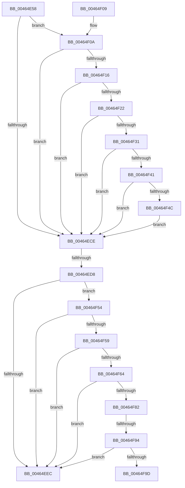

# MiComputeUnusedSegmentReduction

- RVA: `0x00464E58`–`0x00464FA2` (길이 `330` bytes)
- VA: `0x0000000140464E58`
- 실행 섹션: `.text`
- PDB 이름 있음: `예`; PDB Function 태그: `예`
- unwind 정보 RVA: `0x00067C6C`
- 디코드: `91`개 명령, `330/330` bytes 표시
- 미해석 바이트: `0` (있으면 어셈블리에 `.byte`로 보존)

> 이 문서는 커널 이미지의 기계어와 PDB 기호를 분석해 생성했습니다. 4번과 5번은 함수 원형과 자료형을 바이너리 사용 방식에서 추정한 C 해석이며 원본 소스 복구 결과는 아닙니다.

## 1. Dependencies

- 직접 호출 지점: **4**; 고유 호출 대상: **4**
- 직접 호출자로 확인된 함수: **1**
- RIP 상대 이미지 참조: **0**

### Outgoing calls
- `0x00464E8E` → [ExAcquireSpinLockShared](../24/ExAcquireSpinLockShared_function_0024DCE0.md) (function, `0x0024DCE0`)
- `0x00464EB4` → [MiReleaseSpinLockShared](../34/MiReleaseSpinLockShared_function_00348BF0.md) (function, `0x00348BF0`)
- `0x00464EDB` → [MiMarkPendingCommitRequests](MiMarkPendingCommitRequests_function_00464FA8.md) (function, `0x00464FA8`)
- `0x00464F19` → [MiShouldTrimUnusedSegments](../49/MiShouldTrimUnusedSegments_function_0049D7AC.md) (function, `0x0049D7AC`)

### Direct callers
- [MiIssueSegmentDereferenceWork](MiIssueSegmentDereferenceWork_function_00464AB0.md) at `0x00464BBD`

### Static image references
- 디코드된 RIP-relative 메모리 참조가 없습니다.

## 2. Other-region calls and transfers

- 다른 실행 섹션으로 향하는 call: **0**
- call이 아닌 외부 분기/꼬리 이동: **3**
  - `0x00464ED2` → [sub_006F2C92](../6F/Unknown_function_006F2C92.md) (`tail-transfer`)
  - `0x00464F8E` → [sub_006F2C92 + 0xC5](../6F/Unknown_function_006F2C92.md) (`tail-transfer`)
  - `0x00464F9D` → [sub_006F2C92 + 0xC5](../6F/Unknown_function_006F2C92.md) (`tail-transfer`)

## 3. Assembly (complete function range)

```asm
00464E58  48 89 5C 24 08                  mov qword ptr [rsp + 8], rbx
00464E5D  48 89 6C 24 10                  mov qword ptr [rsp + 0x10], rbp
00464E62  48 89 74 24 18                  mov qword ptr [rsp + 0x18], rsi
00464E67  57                              push rdi
00464E68  41 54                           push r12
00464E6A  41 55                           push r13
00464E6C  41 56                           push r14
00464E6E  41 57                           push r15
00464E70  48 83 EC 20                     sub rsp, 0x20
00464E74  48 8D 99 F8 41 00 00            lea rbx, [rcx + 0x41f8]
00464E7B  48 8B E9                        mov rbp, rcx
00464E7E  0F 57 C0                        xorps xmm0, xmm0
00464E81  48 8B CB                        mov rcx, rbx
00464E84  4D 8B F0                        mov r14, r8
00464E87  44 8B EA                        mov r13d, edx
00464E8A  41 0F 11 00                     movups xmmword ptr [r8], xmm0
00464E8E  E8 4D 8E DE FF                  call 0x14024dce0
00464E93  48 8B B5 40 4B 00 00            mov rsi, qword ptr [rbp + 0x4b40]
00464E9A  8A D0                           mov dl, al
00464E9C  4C 8B BD 98 4C 00 00            mov r15, qword ptr [rbp + 0x4c98]
00464EA3  48 8B CB                        mov rcx, rbx
00464EA6  48 8B BD E0 41 00 00            mov rdi, qword ptr [rbp + 0x41e0]
00464EAD  4C 8B A5 F0 41 00 00            mov r12, qword ptr [rbp + 0x41f0]
00464EB4  E8 37 3D EE FF                  call 0x140348bf0
00464EB9  49 3B F7                        cmp rsi, r15
00464EBC  49 8B DF                        mov rbx, r15
00464EBF  41 BB 00 00 10 00               mov r11d, 0x100000
00464EC5  48 0F 46 DE                     cmovbe rbx, rsi
00464EC9  48 3B DF                        cmp rbx, rdi
00464ECC  77 3C                           ja 0x140464f0a
00464ECE  41 83 FD 03                     cmp r13d, 3
00464ED2  0F 84 BA DD 28 00               je 0x1406f2c92
00464ED8  48 8B CD                        mov rcx, rbp
00464EDB  E8 C8 00 00 00                  call 0x140464fa8
00464EE0  48 89 85 F8 0A 00 00            mov qword ptr [rbp + 0xaf8], rax
00464EE7  48 85 C0                        test rax, rax
00464EEA  75 68                           jne 0x140464f54
00464EEC  48 8B 5C 24 50                  mov rbx, qword ptr [rsp + 0x50]
00464EF1  48 8B 6C 24 58                  mov rbp, qword ptr [rsp + 0x58]
00464EF6  48 8B 74 24 60                  mov rsi, qword ptr [rsp + 0x60]
00464EFB  48 83 C4 20                     add rsp, 0x20
00464EFF  41 5F                           pop r15
00464F01  41 5E                           pop r14
00464F03  41 5D                           pop r13
00464F05  41 5C                           pop r12
00464F07  5F                              pop rdi
00464F08  C3                              ret
00464F09  CC                              int3
00464F0A  48 8B 85 C8 41 00 00            mov rax, qword ptr [rbp + 0x41c8]
00464F11  4C 3B F8                        cmp r15, rax
00464F14  75 B8                           jne 0x140464ece
00464F16  48 8B CD                        mov rcx, rbp
00464F19  E8 8E 88 03 00                  call 0x14049d7ac
00464F1E  85 C0                           test eax, eax
00464F20  74 AC                           je 0x140464ece
00464F22  4D 89 26                        mov qword ptr [r14], r12
00464F25  48 8B 8D 38 08 00 00            mov rcx, qword ptr [rbp + 0x838]
00464F2C  49 3B CB                        cmp rcx, r11
00464F2F  76 9D                           jbe 0x140464ece
00464F31  48 81 C1 00 00 F0 FF            add rcx, -0x100000
00464F38  48 C1 E9 0C                     shr rcx, 0xc
00464F3C  48 3B D9                        cmp rbx, rcx
00464F3F  76 8D                           jbe 0x140464ece
00464F41  48 8B C3                        mov rax, rbx
00464F44  48 2B C1                        sub rax, rcx
00464F47  49 3B C4                        cmp rax, r12
00464F4A  76 82                           jbe 0x140464ece
00464F4C  49 89 06                        mov qword ptr [r14], rax
00464F4F  E9 7A FF FF FF                  jmp 0x140464ece
00464F54  49 3B DF                        cmp rbx, r15
00464F57  77 93                           ja 0x140464eec
00464F59  49 8B CF                        mov rcx, r15
00464F5C  48 2B CB                        sub rcx, rbx
00464F5F  48 3B C1                        cmp rax, rcx
00464F62  76 88                           jbe 0x140464eec
00464F64  48 8B CB                        mov rcx, rbx
00464F67  49 2B CF                        sub rcx, r15
00464F6A  48 03 C1                        add rax, rcx
00464F6D  B9 00 01 00 00                  mov ecx, 0x100
00464F72  48 3B C3                        cmp rax, rbx
00464F75  48 0F 47 C3                     cmova rax, rbx
00464F79  48 3B C1                        cmp rax, rcx
00464F7C  0F 86 6A FF FF FF               jbe 0x140464eec
00464F82  48 2B D8                        sub rbx, rax
00464F85  49 8B 06                        mov rax, qword ptr [r14]
00464F88  48 03 D9                        add rbx, rcx
00464F8B  48 85 C0                        test rax, rax
00464F8E  0F 84 C3 DD 28 00               je 0x1406f2d57
00464F94  48 3B D8                        cmp rbx, rax
00464F97  0F 83 4F FF FF FF               jae 0x140464eec
00464F9D  E9 B5 DD 28 00                  jmp 0x1406f2d57
```

## 4. C-style interpretation (structured pseudocode)

```c
__int64 __fastcall MiComputeUnusedSegmentReduction(__int64 a1, int a2, __int64 a3)
{
    __int64 result;
    __int64 v_rbx;
    __int64 v_rsp;
    unsigned __int64 v_stack_p10;
    unsigned __int64 v_stack_p18;
    unsigned __int64 v_stack_p8;

    v_stack_p8 = v_rbx;
    v_stack_p10 = v_rbp;
    v_stack_p18 = v_rsi;
    v_rsp = (v_rsp) - (32);
    *(unsigned __int64 *)(a3) = v_xmm0;
    result = ExAcquireSpinLockShared(a1 + 16888, a2, a3, a4);
    result = MiReleaseSpinLockShared(a1 + 16888, (unsigned __int8)(result), a3, a4);
    v_rbx = *(unsigned __int64 *)(a1 + 19608);
    if ((*(unsigned __int64 *)(a1 + 19264)) <= (*(unsigned __int64 *)(a1 + 19608))) { v_rbx = *(unsigned __int64 *)(a1 + 19264); }
    if (v_rbx > (*(unsigned __int64 *)(a1 + 16864))) goto loc_00464F0A;
loc_00464ECE:
    result = MiMarkPendingCommitRequests(a1, (unsigned __int8)(result), a3, a4);
    *(unsigned __int64 *)(a1 + 2808) = result;
    if (result != 0) goto loc_00464F54;
loc_00464EEC:
    v_rsp = (v_rsp) + (32);
    return result;
loc_00464F0A:
    if ((*(unsigned __int64 *)(a1 + 19608)) != (*(unsigned __int64 *)(v_stack_p10 + 16840))) goto loc_00464ECE;
    result = MiShouldTrimUnusedSegments(v_stack_p10, (unsigned __int8)(result), a3, a4);
    if ((unsigned int)(result) == 0) goto loc_00464ECE;
    *(unsigned __int64 *)(a3) = *(unsigned __int64 *)(a1 + 16880);
    if ((*(unsigned __int64 *)(v_stack_p10 + 2104)) <= ((unsigned int)(0x100000ULL))) goto loc_00464ECE;
    a1 = (*(unsigned __int64 *)(v_stack_p10 + 2104)) + (0xFFFFFFFFFFF00000ULL);
    a1 = (a1) >> (12);
    if (v_stack_p8 <= a1) goto loc_00464ECE;
    result = (v_stack_p8) - (a1);
    if (result <= (*(unsigned __int64 *)(a1 + 16880))) goto loc_00464ECE;
    *(unsigned __int64 *)(a3) = result;
    goto loc_00464ECE;
loc_00464F54:
    if (v_stack_p8 > (*(unsigned __int64 *)(a1 + 19608))) goto loc_00464EEC;
    a1 = (*(unsigned __int64 *)(a1 + 19608)) - (v_stack_p8);
    if (result <= a1) goto loc_00464EEC;
    a1 = (v_stack_p8) - (*(unsigned __int64 *)(a1 + 19608));
    result = (result) + (a1);
    if (result > v_stack_p8) { result = v_stack_p8; }
    if (result <= 256) goto loc_00464EEC;
    v_rbx = (v_stack_p8) - (result);
    v_rbx = (v_rbx) + (256);
    if (v_rbx >= (*(unsigned __int64 *)(a3))) goto loc_00464EEC;
}
```

## 5. (Beta) C Style

```c
int64_t MiComputeUnusedSegmentReduction(void *Arg1, int32_t Arg2, void *Arg3)
{
    uint8_t *arg1 = (uint8_t *)Arg1;
    uint8_t *arg3 = (uint8_t *)Arg3;

    int64_t result;
    int64_t local_rbx;
    int64_t local_rsp;
    uint64_t v_stack_p10;
    uint64_t v_stack_p18;
    uint64_t v_stack_p8;

    v_stack_p8 = local_rbx;
    v_stack_p10 = local_rbp;
    v_stack_p18 = local_rsi;
    local_rsp = (local_rsp) - (32);
    *(uint64_t *)(arg3) = v_xmm0;
    result = ExAcquireSpinLockShared(Arg1 + 16888, Arg2, Arg3, a4);
    result = MiReleaseSpinLockShared(Arg1 + 16888, (uint8_t)(result), Arg3, a4);
    local_rbx = *(uint64_t *)(arg1 + 0x4C98);
    if ((*(uint64_t *)(arg1 + 0x4B40)) <= (*(uint64_t *)(arg1 + 0x4C98))) { local_rbx = *(uint64_t *)(arg1 + 0x4B40); }
    if (local_rbx > (*(uint64_t *)(arg1 + 0x41E0))) goto loc_00464F0A;
loc_00464ECE:
    result = MiMarkPendingCommitRequests(Arg1, (uint8_t)(result), Arg3, a4);
    *(uint64_t *)(arg1 + 0xAF8) = result;
    if (result != 0) goto loc_00464F54;
loc_00464EEC:
    local_rsp = (local_rsp) + (32);
    return result;
loc_00464F0A:
    if ((*(uint64_t *)(arg1 + 0x4C98)) != (*(uint64_t *)(v_stack_p10 + 0x41C8))) goto loc_00464ECE;
    result = MiShouldTrimUnusedSegments(v_stack_p10, (uint8_t)(result), Arg3, a4);
    if ((uint32_t)(result) == 0) goto loc_00464ECE;
    *(uint64_t *)(arg3) = *(uint64_t *)(arg1 + 0x41F0);
    if ((*(uint64_t *)(v_stack_p10 + 0x838)) <= ((uint32_t)(0x100000ULL))) goto loc_00464ECE;
    Arg1 = (*(uint64_t *)(v_stack_p10 + 0x838)) + (0xFFFFFFFFFFF00000ULL);
    Arg1 = (Arg1) >> (12);
    if (v_stack_p8 <= Arg1) goto loc_00464ECE;
    result = (v_stack_p8) - (Arg1);
    if (result <= (*(uint64_t *)(arg1 + 0x41F0))) goto loc_00464ECE;
    *(uint64_t *)(arg3) = result;
    goto loc_00464ECE;
loc_00464F54:
    if (v_stack_p8 > (*(uint64_t *)(arg1 + 0x4C98))) goto loc_00464EEC;
    Arg1 = (*(uint64_t *)(arg1 + 0x4C98)) - (v_stack_p8);
    if (result <= Arg1) goto loc_00464EEC;
    Arg1 = (v_stack_p8) - (*(uint64_t *)(arg1 + 0x4C98));
    result = (result) + (Arg1);
    if (result > v_stack_p8) { result = v_stack_p8; }
    if (result <= 256) goto loc_00464EEC;
    local_rbx = (v_stack_p8) - (result);
    local_rbx = (local_rbx) + (256);
    if (local_rbx >= (*(uint64_t *)(arg3))) goto loc_00464EEC;
}
```

### 관측된 메모리 오프셋

구조체 형식이 확인되지 않은 접근은 인자 기준의 오프셋으로만 기록했습니다.

| 기준 인자 | 오프셋 표현 | 폭 (bit) | 접근 |
|---|---:|---:|---|
| `Arg1` | `+ 0x838` | `64` | `R` |
| `Arg1` | `+ 0xAF8` | `64` | `W` |
| `Arg1` | `+ 0x41C8` | `64` | `R` |
| `Arg1` | `+ 0x41E0` | `64` | `R` |
| `Arg1` | `+ 0x41F0` | `64` | `R` |
| `Arg1` | `+ 0x41F8` | `64` | `R` |
| `Arg1` | `+ 0x4B40` | `64` | `R` |
| `Arg1` | `+ 0x4C98` | `64` | `R` |
| `Arg3` | `+ 0x0` | `64` | `R` |
| `Arg3` | `+ 0x0` | `64` | `W` |
| `Arg3` | `+ 0x0` | `128` | `R` |

## 6. Execution-region graph

[열기: 2D/3D 그래프와 함수 탐색 컨트롤 패널](../../../control-panel.html?section=text&rva=0x00464E58&view=graph)

- 2D 그래프는 위에서 아래로 흐르고, 3D 그래프는 빈 공간을 드래그해 회전합니다. Shift+드래그는 이동, 휠은 확대·축소, 함수 노드 선택은 대상 보고서 이동입니다.

### Static fallback


