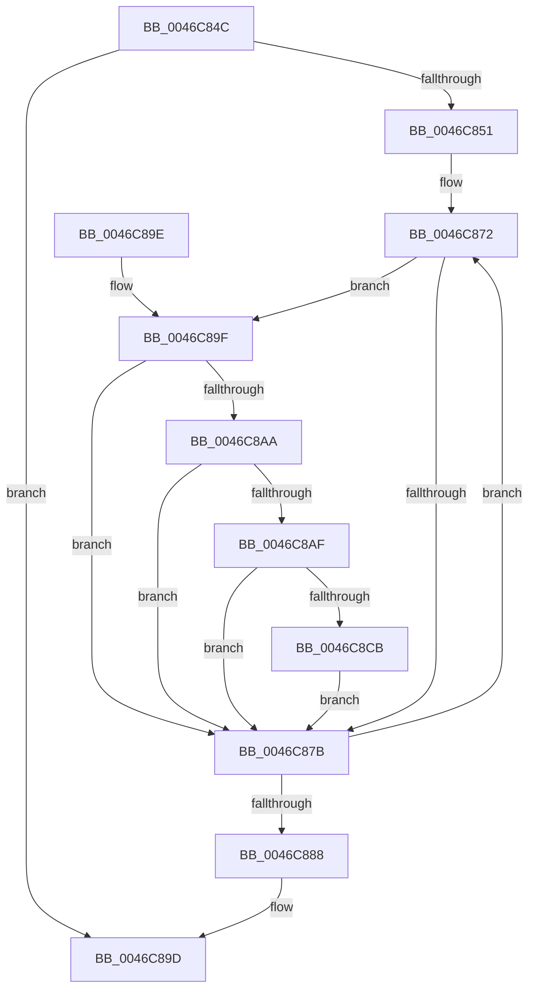

# MiCopyPtes

- RVA: `0x0046C84C`–`0x0046C8DE` (길이 `146` bytes)
- VA: `0x000000014046C84C`
- 실행 섹션: `.text`
- PDB 이름 있음: `예`; PDB Function 태그: `아니요`
- unwind 정보 RVA: `0x000AB870`
- 디코드: `39`개 명령, `146/146` bytes 표시
- 미해석 바이트: `0` (있으면 어셈블리에 `.byte`로 보존)

> 이 문서는 커널 이미지의 기계어와 PDB 기호를 분석해 생성했습니다. 4번과 5번은 함수 원형과 자료형을 바이너리 사용 방식에서 추정한 C 해석이며 원본 소스 복구 결과는 아닙니다.

## 1. Dependencies

- 직접 호출 지점: **1**; 고유 호출 대상: **1**
- 직접 호출자로 확인된 함수: **3**
- RIP 상대 이미지 참조: **1**

### Outgoing calls
- `0x0046C8D7` → [MiCheckLinearProtectedPteAccessedBit](../29/MiCheckLinearProtectedPteAccessedBit_function_00292D80.md) (function, `0x00292D80`)

### Direct callers
- [MiCopyTopLevelMappings](MiCopyTopLevelMappings_function_0046C54C.md) at `0x0046C5B2`
- [MiCopyTopLevelMappings](MiCopyTopLevelMappings_function_0046C54C.md) at `0x0046C5F8`
- [sub_006F15CE](../6F/Unknown_function_006F15CE.md) at `0x006F161A`
- [MxCopyPage](../../init/C6/MxCopyPage_function_00C631F4.md) at `0x00C63291`

### Static image references
- `0x0046C89F` → RVA `0x00FC6A88` (`ALMOSTRO`; read)

## 2. Other-region calls and transfers

- 다른 실행 섹션으로 향하는 call: **0**
- 별도 외부 분기/꼬리 이동을 확인하지 못했습니다.

## 3. Assembly (complete function range)

```asm
0046C84C  4D 85 C0                        test r8, r8
0046C84F  74 4C                           je 0x14046c89d
0046C851  48 89 5C 24 08                  mov qword ptr [rsp + 8], rbx
0046C856  48 89 74 24 10                  mov qword ptr [rsp + 0x10], rsi
0046C85B  48 89 7C 24 18                  mov qword ptr [rsp + 0x18], rdi
0046C860  41 56                           push r14
0046C862  48 83 EC 20                     sub rsp, 0x20
0046C866  4C 8B F2                        mov r14, rdx
0046C869  49 8B F0                        mov rsi, r8
0046C86C  4C 2B F1                        sub r14, rcx
0046C86F  48 8B F9                        mov rdi, rcx
0046C872  49 8B 1C 3E                     mov rbx, qword ptr [r14 + rdi]
0046C876  F6 C3 01                        test bl, 1
0046C879  75 24                           jne 0x14046c89f
0046C87B  48 89 1F                        mov qword ptr [rdi], rbx
0046C87E  48 83 C7 08                     add rdi, 8
0046C882  48 83 EE 01                     sub rsi, 1
0046C886  75 EA                           jne 0x14046c872
0046C888  48 8B 5C 24 30                  mov rbx, qword ptr [rsp + 0x30]
0046C88D  48 8B 74 24 38                  mov rsi, qword ptr [rsp + 0x38]
0046C892  48 8B 7C 24 40                  mov rdi, qword ptr [rsp + 0x40]
0046C897  48 83 C4 20                     add rsp, 0x20
0046C89B  41 5E                           pop r14
0046C89D  C3                              ret
0046C89E  CC                              int3
0046C89F  48 0F BA 25 E0 A1 B5 00 24      bt qword ptr [rip + 0xb5a1e0], 0x24
0046C8A8  73 D1                           jae 0x14046c87b
0046C8AA  F6 C3 20                        test bl, 0x20
0046C8AD  75 CC                           jne 0x14046c87b
0046C8AF  48 B8 00 00 00 00 80 F6 FF FF   movabs rax, 0xfffff68000000000
0046C8B9  48 B9 00 00 00 00 40 00 00 00   movabs rcx, 0x4000000000
0046C8C3  48 03 C1                        add rax, rcx
0046C8C6  48 3B F8                        cmp rdi, rax
0046C8C9  72 B0                           jb 0x14046c87b
0046C8CB  41 B8 80 00 00 00               mov r8d, 0x80
0046C8D1  48 8B D3                        mov rdx, rbx
0046C8D4  48 8B CF                        mov rcx, rdi
0046C8D7  E8 A4 64 E2 FF                  call 0x140292d80
0046C8DC  EB 9D                           jmp 0x14046c87b
```

## 4. C-style interpretation (structured pseudocode)

```c
__int64 __fastcall MiCopyPtes(__int64 a1, __int64 a2, __int64 a3)
{
    __int64 result;
    __int64 v_r14;
    __int64 v_rdi;
    __int64 v_rsi;
    __int64 v_rsp;
    unsigned __int64 v_stack_p10;
    unsigned __int64 v_stack_p18;
    unsigned __int64 v_stack_p8;

    if (a3 == 0) goto loc_0046C89D;
    v_stack_p8 = v_rbx;
    v_stack_p10 = v_rsi;
    v_stack_p18 = v_rdi;
    v_rsp = (v_rsp) - (32);
    v_r14 = (a2) - (a1);
loc_0046C872:
    if ((((unsigned __int8)(*(unsigned __int64 *)(v_r14 + a1 * 1))) & (1)) != 0) goto loc_0046C89F;
loc_0046C87B:
    *(unsigned __int64 *)(a1) = *(unsigned __int64 *)(v_r14 + a1 * 1);
    v_rdi = (a1) + (8);
    v_rsi = (a3) - (1);
    if (condition_is_not_equal) goto loc_0046C872;
    v_rsp = (v_rsp) + (32);
loc_0046C89D:
    return result;
loc_0046C89F:
    if (condition_is_above_or_equal) goto loc_0046C87B;
    if ((((unsigned __int8)(v_stack_p8)) & (32)) != 0) goto loc_0046C87B;
    result = (result) + (a1);
    if (v_stack_p18 < result) goto loc_0046C87B;
    result = MiCheckLinearProtectedPteAccessedBit(v_stack_p18, v_stack_p8, 128, a4);
    goto loc_0046C87B;
}
```

## 5. (Beta) C Style

```c
int64_t MiCopyPtes(int64_t Arg1, void *Arg2, int64_t Arg3)
{
    uint8_t *arg2 = (uint8_t *)Arg2;

    int64_t result;
    int64_t local_r14;
    int64_t local_rdi;
    int64_t local_rsi;
    int64_t local_rsp;
    uint64_t v_stack_p10;
    uint64_t v_stack_p18;
    uint64_t v_stack_p8;

    if (Arg3 == 0) goto loc_0046C89D;
    v_stack_p8 = local_rbx;
    v_stack_p10 = local_rsi;
    v_stack_p18 = local_rdi;
    local_rsp = (local_rsp) - (32);
    local_r14 = (Arg2) - (Arg1);
loc_0046C872:
    if ((((uint8_t)(*(uint64_t *)(local_r14 + Arg1 * 1))) & (1)) != 0) goto loc_0046C89F;
loc_0046C87B:
    *(uint64_t *)(Arg1) = *(uint64_t *)(local_r14 + Arg1 * 1);
    local_rdi = (Arg1) + (8);
    local_rsi = (Arg3) - (1);
    if (condition_is_not_equal) goto loc_0046C872;
    local_rsp = (local_rsp) + (32);
loc_0046C89D:
    return result;
loc_0046C89F:
    if (condition_is_above_or_equal) goto loc_0046C87B;
    if ((((uint8_t)(v_stack_p8)) & (32)) != 0) goto loc_0046C87B;
    result = (result) + (Arg1);
    if (v_stack_p18 < result) goto loc_0046C87B;
    result = MiCheckLinearProtectedPteAccessedBit(v_stack_p18, v_stack_p8, 128, a4);
    goto loc_0046C87B;
}
```

### 관측된 메모리 오프셋

구조체 형식이 확인되지 않은 접근은 인자 기준의 오프셋으로만 기록했습니다.

| 기준 인자 | 오프셋 표현 | 폭 (bit) | 접근 |
|---|---:|---:|---|
| `Arg2` | `+ 0x0 + rdi*1` | `64` | `R` |

## 6. Execution-region graph

[열기: 2D/3D 그래프와 함수 탐색 컨트롤 패널](../../../control-panel.html?section=text&rva=0x0046C84C&view=graph)

- 2D 그래프는 위에서 아래로 흐르고, 3D 그래프는 빈 공간을 드래그해 회전합니다. Shift+드래그는 이동, 휠은 확대·축소, 함수 노드 선택은 대상 보고서 이동입니다.

### Static fallback


