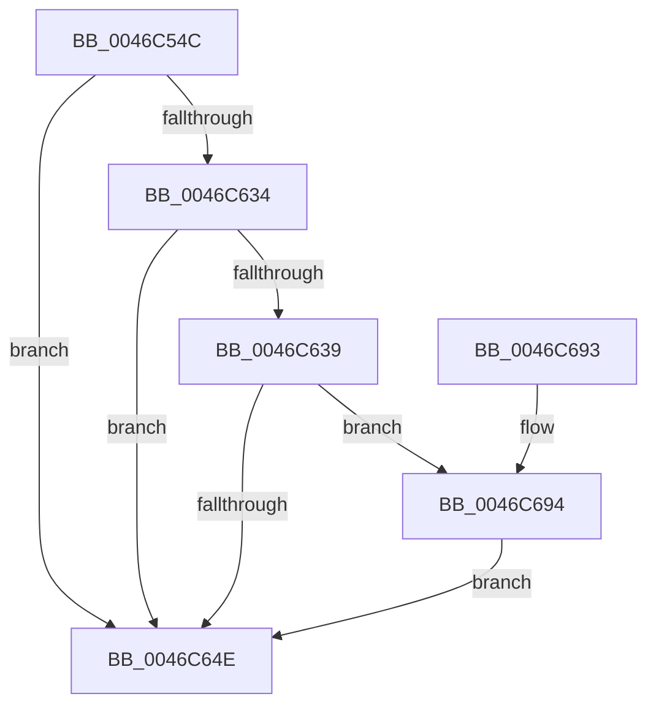

# MiCopyTopLevelMappings

- RVA: `0x0046C54C`–`0x0046C6A7` (길이 `347` bytes)
- VA: `0x000000014046C54C`
- 실행 섹션: `.text`
- PDB 이름 있음: `예`; PDB Function 태그: `아니요`
- unwind 정보 RVA: `0x000AB83C`
- 디코드: `79`개 명령, `347/347` bytes 표시
- 미해석 바이트: `0` (있으면 어셈블리에 `.byte`로 보존)

> 이 문서는 커널 이미지의 기계어와 PDB 기호를 분석해 생성했습니다. 4번과 5번은 함수 원형과 자료형을 바이너리 사용 방식에서 추정한 C 해석이며 원본 소스 복구 결과는 아닙니다.

## 1. Dependencies

- 직접 호출 지점: **6**; 고유 호출 대상: **5**
- 직접 호출자로 확인된 함수: **2**
- RIP 상대 이미지 참조: **4**

### Outgoing calls
- `0x0046C566` → [MiMakeValidPte](../2C/MiMakeValidPte_function_002C5590.md) (function, `0x002C5590`)
- `0x0046C58F` → [MiMapPageInHyperSpaceWorker](../33/MiMapPageInHyperSpaceWorker_function_00332B10.md) (function, `0x00332B10`)
- `0x0046C5B2` → [MiCopyPtes](MiCopyPtes_function_0046C84C.md) (function, `0x0046C84C`)
- `0x0046C5C3` → [MiShadowTopLevelPxes](MiShadowTopLevelPxes_function_0046C6B0.md) (function, `0x0046C6B0`)
- `0x0046C5F8` → [MiCopyPtes](MiCopyPtes_function_0046C84C.md) (function, `0x0046C84C`)
- `0x0046C6A0` → [MiCheckLinearProtectedPteAccessedBit](../29/MiCheckLinearProtectedPteAccessedBit_function_00292D80.md) (function, `0x00292D80`)

### Direct callers
- [MiCreateNewProcessTopLevelMappings](MiCreateNewProcessTopLevelMappings_function_0046C4A0.md) at `0x0046C4CA`
- [sub_006F28BE](../6F/Unknown_function_006F28BE.md) at `0x006F29F3`

### Static image references
- `0x0046C56B` → RVA `0x00E38C58` (`.data`; read)
- `0x0046C5C8` → RVA `0x00E2F390` (`.data`; read)
- `0x0046C5FD` → RVA `0x00010880` (`.rdata`; read)
- `0x0046C629` → RVA `0x00FC6A88` (`ALMOSTRO`; read)

## 2. Other-region calls and transfers

- 다른 실행 섹션으로 향하는 call: **0**
- 별도 외부 분기/꼬리 이동을 확인하지 못했습니다.

## 3. Assembly (complete function range)

```asm
0046C54C  48 89 5C 24 08                  mov qword ptr [rsp + 8], rbx
0046C551  55                              push rbp
0046C552  56                              push rsi
0046C553  57                              push rdi
0046C554  48 83 EC 20                     sub rsp, 0x20
0046C558  48 8B E9                        mov rbp, rcx
0046C55B  41 B8 04 00 00 90               mov r8d, 0x90000004
0046C561  33 C9                           xor ecx, ecx
0046C563  48 8B F2                        mov rsi, rdx
0046C566  E8 25 90 E5 FF                  call 0x1402c5590
0046C56B  48 8B 3D E6 C6 9C 00            mov rdi, qword ptr [rip + 0x9cc6e6]
0046C572  48 8B D8                        mov rbx, rax
0046C575  48 C1 EF 27                     shr rdi, 0x27
0046C579  33 D2                           xor edx, edx
0046C57B  41 B8 00 00 00 80               mov r8d, 0x80000000
0046C581  48 8B CE                        mov rcx, rsi
0046C584  81 E7 FF 01 00 00               and edi, 0x1ff
0046C58A  48 0F BA F3 08                  btr rbx, 8
0046C58F  E8 7C 65 EC FF                  call 0x140332b10
0046C594  44 8D 87 01 FF FF FF            lea r8d, [rdi - 0xff]
0046C59B  48 8B F0                        mov rsi, rax
0046C59E  48 BF 00 D8 BE 7D FB F6 FF FF   movabs rdi, 0xfffff6fb7dbed800
0046C5A8  48 8B D7                        mov rdx, rdi
0046C5AB  48 8D 88 00 08 00 00            lea rcx, [rax + 0x800]
0046C5B2  E8 95 02 00 00                  call 0x14046c84c
0046C5B7  48 8B D7                        mov rdx, rdi
0046C5BA  41 B8 00 01 00 00               mov r8d, 0x100
0046C5C0  48 8B CD                        mov rcx, rbp
0046C5C3  E8 E8 00 00 00                  call 0x14046c6b0
0046C5C8  48 8B 05 C1 2D 9C 00            mov rax, qword ptr [rip + 0x9c2dc1]
0046C5CF  41 B8 00 02 00 00               mov r8d, 0x200
0046C5D5  48 C1 E8 27                     shr rax, 0x27
0046C5D9  25 FF 01 00 00                  and eax, 0x1ff
0046C5DE  FF C0                           inc eax
0046C5E0  44 2B C0                        sub r8d, eax
0046C5E3  44 8B C8                        mov r9d, eax
0046C5E6  48 B8 00 D0 BE 7D FB F6 FF FF   movabs rax, 0xfffff6fb7dbed000
0046C5F0  4A 8D 14 C8                     lea rdx, [rax + r9*8]
0046C5F4  4A 8D 0C CE                     lea rcx, [rsi + r9*8]
0046C5F8  E8 4F 02 00 00                  call 0x14046c84c
0046C5FD  48 8B 05 7C 42 BA FF            mov rax, qword ptr [rip - 0x45bd84]
0046C604  48 B9 68 DF BE 7D FB F6 FF FF   movabs rcx, 0xfffff6fb7dbedf68
0046C60E  48 C1 E9 03                     shr rcx, 3
0046C612  81 E1 FF 01 00 00               and ecx, 0x1ff
0046C618  48 BD 00 00 00 00 80 F6 FF FF   movabs rbp, 0xfffff68000000000
0046C622  48 8D 3C CE                     lea rdi, [rsi + rcx*8]
0046C626  48 89 07                        mov qword ptr [rdi], rax
0046C629  48 0F BA 25 56 A4 B5 00 24      bt qword ptr [rip + 0xb5a456], 0x24
0046C632  73 1A                           jae 0x14046c64e
0046C634  F6 C3 20                        test bl, 0x20
0046C637  75 15                           jne 0x14046c64e
0046C639  48 8B C5                        mov rax, rbp
0046C63C  48 B9 00 00 00 00 40 00 00 00   movabs rcx, 0x4000000000
0046C646  48 03 C1                        add rax, rcx
0046C649  48 3B F8                        cmp rdi, rax
0046C64C  73 46                           jae 0x14046c694
0046C64E  48 C1 EE 09                     shr rsi, 9
0046C652  48 B8 F8 FF FF FF 7F 00 00 00   movabs rax, 0x7ffffffff8
0046C65C  48 23 F0                        and rsi, rax
0046C65F  48 89 1F                        mov qword ptr [rdi], rbx
0046C662  48 8B C5                        mov rax, rbp
0046C665  48 8B 5C 24 40                  mov rbx, qword ptr [rsp + 0x40]
0046C66A  48 03 F0                        add rsi, rax
0046C66D  65 48 8B 04 25 20 00 00 00      mov rax, qword ptr gs:[0x20]
0046C676  48 8B 88 38 88 00 00            mov rcx, qword ptr [rax + 0x8838]
0046C67D  48 8B 05 FC 41 BA FF            mov rax, qword ptr [rip - 0x45be04]
0046C684  48 83 21 00                     and qword ptr [rcx], 0
0046C688  48 89 06                        mov qword ptr [rsi], rax
0046C68B  48 83 C4 20                     add rsp, 0x20
0046C68F  5F                              pop rdi
0046C690  5E                              pop rsi
0046C691  5D                              pop rbp
0046C692  C3                              ret
0046C693  CC                              int3
0046C694  41 B8 80 00 00 00               mov r8d, 0x80
0046C69A  48 8B D3                        mov rdx, rbx
0046C69D  48 8B CF                        mov rcx, rdi
0046C6A0  E8 DB 66 E2 FF                  call 0x140292d80
0046C6A5  EB A7                           jmp 0x14046c64e
```

## 4. C-style interpretation (structured pseudocode)

```c
__int64 __fastcall MiCopyTopLevelMappings(__int64 a1, __int64 a2)
{
    __int64 result;
    __int64 v_rdi;
    __int64 v_rsi;
    __int64 v_rsp;
    unsigned __int64 v_stack_p8;

    v_stack_p8 = v_rbx;
    v_rsp = (v_rsp) - (32);
    a1 = 0;
    result = MiMakeValidPte(a1, a2, (unsigned int)(0x90000004ULL), a4);
    v_rdi = (*(unsigned __int64 *)(v_rip + 10274534)) >> (39);
    a2 = 0;
    v_rdi = (unsigned int)((v_rdi) & (511));
    result = MiMapPageInHyperSpaceWorker(0, a2, (unsigned int)(0x80000000ULL), a4);
    result = MiCopyPtes(result + 2048, v_rdi, v_rdi - 255, a4);
    result = MiShadowTopLevelPxes(0, v_rdi, 256, a4);
    result = (*(unsigned __int64 *)(v_rip + 10235329)) >> (39);
    result = (unsigned int)((result) & (511));
    result = (unsigned int)((result) + 1);
    a3 = (unsigned int)((512) - ((unsigned int)(result)));
    result = MiCopyPtes(result + (unsigned int)((unsigned int)(result)) * 8, result + (unsigned int)((unsigned int)(result)) * 8, a3, (unsigned int)((unsigned int)(result)));
    a1 = (result + (unsigned int)((unsigned int)(result)) * 8) >> (3);
    a1 = (unsigned int)((a1) & (511));
    *(unsigned __int64 *)(result + a1 * 8) = *(unsigned __int64 *)(v_rip - 4570500);
    if (condition_is_above_or_equal) goto loc_0046C64E;
    if ((((unsigned __int8)(result)) & (32)) != 0) goto loc_0046C64E;
    result = (a1) + (a1);
    if ((result + a1 * 8) >= result) goto loc_0046C694;
loc_0046C64E:
    v_rsi = (result) >> (9);
    v_rsi = (v_rsi) & (result);
    *(unsigned __int64 *)(result + a1 * 8) = result;
    v_rsi = (v_rsi) + (a1);
    *(unsigned __int64 *)(v_rsi) = *(unsigned __int64 *)(v_rip - 4570628);
    v_rsp = (v_rsp) + (32);
    return *(unsigned __int64 *)(v_rip - 4570628);
loc_0046C694:
    result = MiCheckLinearProtectedPteAccessedBit(result + a1 * 8, v_stack_p8, 128, (unsigned int)((unsigned int)(result)));
    goto loc_0046C64E;
}
```

## 5. (Beta) C Style

```c
int64_t MiCopyTopLevelMappings(int64_t Arg1, int64_t Arg2)
{
    int64_t result;
    int64_t local_rdi;
    int64_t local_rsi;
    int64_t local_rsp;
    uint64_t v_stack_p8;

    v_stack_p8 = local_rbx;
    local_rsp = (local_rsp) - (32);
    Arg1 = 0;
    result = MiMakeValidPte(Arg1, Arg2, (uint32_t)(0x90000004ULL), a4);
    local_rdi = (*(uint64_t *)(v_rip + 0x9CC6E6)) >> (39);
    Arg2 = 0;
    local_rdi = (uint32_t)((local_rdi) & (511));
    result = MiMapPageInHyperSpaceWorker(0, Arg2, (uint32_t)(0x80000000ULL), a4);
    result = MiCopyPtes(result + 2048, local_rdi, local_rdi - 255, a4);
    result = MiShadowTopLevelPxes(0, local_rdi, 256, a4);
    result = (*(uint64_t *)(v_rip + 0x9C2DC1)) >> (39);
    result = (uint32_t)((result) & (511));
    result = (uint32_t)((result) + 1);
    a3 = (uint32_t)((512) - ((uint32_t)(result)));
    result = MiCopyPtes(result + (uint32_t)((uint32_t)(result)) * 8, result + (uint32_t)((uint32_t)(result)) * 8, a3, (uint32_t)((uint32_t)(result)));
    Arg1 = (result + (uint32_t)((uint32_t)(result)) * 8) >> (3);
    Arg1 = (uint32_t)((Arg1) & (511));
    *(uint64_t *)(result + Arg1 * 8) = *(uint64_t *)(v_rip - 0x45BD84);
    if (condition_is_above_or_equal) goto loc_0046C64E;
    if ((((uint8_t)(result)) & (32)) != 0) goto loc_0046C64E;
    result = (Arg1) + (Arg1);
    if ((result + Arg1 * 8) >= result) goto loc_0046C694;
loc_0046C64E:
    local_rsi = (result) >> (9);
    local_rsi = (local_rsi) & (result);
    *(uint64_t *)(result + Arg1 * 8) = result;
    local_rsi = (local_rsi) + (Arg1);
    *(uint64_t *)(local_rsi) = *(uint64_t *)(v_rip - 0x45BE04);
    local_rsp = (local_rsp) + (32);
    return *(uint64_t *)(v_rip - 0x45BE04);
loc_0046C694:
    result = MiCheckLinearProtectedPteAccessedBit(result + Arg1 * 8, v_stack_p8, 128, (uint32_t)((uint32_t)(result)));
    goto loc_0046C64E;
}
```

## 6. Execution-region graph

[열기: 2D/3D 그래프와 함수 탐색 컨트롤 패널](../../../control-panel.html?section=text&rva=0x0046C54C&view=graph)

- 2D 그래프는 위에서 아래로 흐르고, 3D 그래프는 빈 공간을 드래그해 회전합니다. Shift+드래그는 이동, 휠은 확대·축소, 함수 노드 선택은 대상 보고서 이동입니다.

### Static fallback


