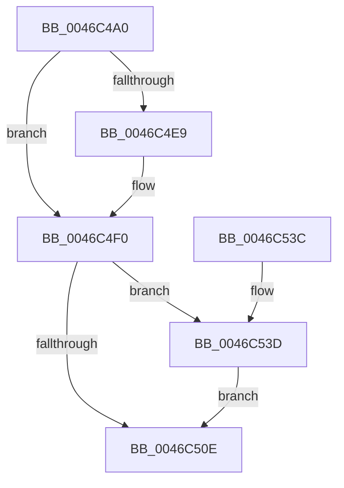

# MiCreateNewProcessTopLevelMappings

- RVA: `0x0046C4A0`–`0x0046C543` (길이 `163` bytes)
- VA: `0x000000014046C4A0`
- 실행 섹션: `.text`
- PDB 이름 있음: `예`; PDB Function 태그: `아니요`
- unwind 정보 RVA: `0x00071254`
- 디코드: `39`개 명령, `163/163` bytes 표시
- 미해석 바이트: `0` (있으면 어셈블리에 `.byte`로 보존)

> 이 문서는 커널 이미지의 기계어와 PDB 기호를 분석해 생성했습니다. 4번과 5번은 함수 원형과 자료형을 바이너리 사용 방식에서 추정한 C 해석이며 원본 소스 복구 결과는 아닙니다.

## 1. Dependencies

- 직접 호출 지점: **3**; 고유 호출 대상: **3**
- 직접 호출자로 확인된 함수: **1**
- RIP 상대 이미지 참조: **5**

### Outgoing calls
- `0x0046C4BC` → [ExAcquireSpinLockExclusive](../24/ExAcquireSpinLockExclusive_function_00248690.md) (function, `0x00248690`)
- `0x0046C4CA` → [MiCopyTopLevelMappings](MiCopyTopLevelMappings_function_0046C54C.md) (function, `0x0046C54C`)
- `0x0046C527` → [MiReleaseSpinLockExclusive](../24/MiReleaseSpinLockExclusive_function_002482C0.md) (function, `0x002482C0`)

### Direct callers
- [MmCreateProcessAddressSpace](../../page/A5/MmCreateProcessAddressSpace_function_00A5EE5C.md) at `0x00A5F05F`

### Static image references
- `0x0046C4B5` → RVA `0x00E374C0` (`.data`; read)
- `0x0046C4CF` → RVA `0x00E2DB60` (`.data`; read)
- `0x0046C4D6` → RVA `0x00E2DB58` (`.data`; read)
- `0x0046C4FB` → RVA `0x00FC6A87` (`ALMOSTRO`; read)
- `0x0046C505` → RVA `0x00E2DB60` (`.data`; write)

## 2. Other-region calls and transfers

- 다른 실행 섹션으로 향하는 call: **0**
- 별도 외부 분기/꼬리 이동을 확인하지 못했습니다.

## 3. Assembly (complete function range)

```asm
0046C4A0  48 89 5C 24 08                  mov qword ptr [rsp + 8], rbx
0046C4A5  48 89 74 24 10                  mov qword ptr [rsp + 0x10], rsi
0046C4AA  57                              push rdi
0046C4AB  48 83 EC 20                     sub rsp, 0x20
0046C4AF  48 8B F9                        mov rdi, rcx
0046C4B2  48 8B DA                        mov rbx, rdx
0046C4B5  48 8D 0D 04 B0 9C 00            lea rcx, [rip + 0x9cb004]
0046C4BC  E8 CF C1 DD FF                  call 0x140248690
0046C4C1  48 8B D3                        mov rdx, rbx
0046C4C4  48 8B CF                        mov rcx, rdi
0046C4C7  40 8A F0                        mov sil, al
0046C4CA  E8 7D 00 00 00                  call 0x14046c54c
0046C4CF  48 8B 15 8A 16 9C 00            mov rdx, qword ptr [rip + 0x9c168a]
0046C4D6  48 8D 05 7B 16 9C 00            lea rax, [rip + 0x9c167b]
0046C4DD  48 8D 8F 40 05 00 00            lea rcx, [rdi + 0x540]
0046C4E4  48 39 02                        cmp qword ptr [rdx], rax
0046C4E7  74 07                           je 0x14046c4f0
0046C4E9  B9 03 00 00 00                  mov ecx, 3
0046C4EE  CD 29                           int 0x29
0046C4F0  48 89 01                        mov qword ptr [rcx], rax
0046C4F3  48 89 51 08                     mov qword ptr [rcx + 8], rdx
0046C4F7  48 C1 E3 0C                     shl rbx, 0xc
0046C4FB  80 3D 85 A5 B5 00 00            cmp byte ptr [rip + 0xb5a585], 0
0046C502  48 89 0A                        mov qword ptr [rdx], rcx
0046C505  48 89 0D 54 16 9C 00            mov qword ptr [rip + 0x9c1654], rcx
0046C50C  75 2F                           jne 0x14046c53d
0046C50E  48 89 5F 28                     mov qword ptr [rdi + 0x28], rbx
0046C512  F0 81 8F F4 01 00 00 00 08 00 00  lock or dword ptr [rdi + 0x1f4], 0x800
0046C51D  40 8A D6                        mov dl, sil
0046C520  48 8D 0D 99 AF 9C 00            lea rcx, [rip + 0x9caf99]
0046C527  E8 94 BD DD FF                  call 0x1402482c0
0046C52C  48 8B 5C 24 30                  mov rbx, qword ptr [rsp + 0x30]
0046C531  48 8B 74 24 38                  mov rsi, qword ptr [rsp + 0x38]
0046C536  48 83 C4 20                     add rsp, 0x20
0046C53A  5F                              pop rdi
0046C53B  C3                              ret
0046C53C  CC                              int3
0046C53D  48 83 CB 02                     or rbx, 2
0046C541  EB CB                           jmp 0x14046c50e
```

## 4. C-style interpretation (structured pseudocode)

```c
__int64 __fastcall MiCreateNewProcessTopLevelMappings(__int64 a1, __int64 a2)
{
    __int64 result;
    __int64 v_rbx;
    __int64 v_rsp;
    unsigned __int64 v_stack_p10;
    unsigned __int64 v_stack_p8;

    v_stack_p8 = v_rbx;
    v_stack_p10 = v_rsi;
    v_rsp = (v_rsp) - (32);
    result = ExAcquireSpinLockExclusive(v_rip + 10268676, a2, a3, a4);
    result = MiCopyTopLevelMappings(a1, a2, a3, a4);
    if ((*(unsigned __int64 *)(*(unsigned __int64 *)(v_rip + 10229386))) != (v_rip + 10229371)) {
        a1 = 3;
    }
    *(unsigned __int64 *)(a1) = v_rip + 10229371;
    *(unsigned __int64 *)(a1 + 8) = *(unsigned __int64 *)(v_rip + 10229386);
    v_rbx = (a2) << (12);
    *(unsigned __int64 *)(*(unsigned __int64 *)(v_rip + 10229386)) = a1;
    *(unsigned __int64 *)(v_rip + 10229332) = a1;
    if ((*(unsigned __int8 *)(v_rip + 11904389)) != 0) goto loc_0046C53D;
loc_0046C50E:
    *(unsigned __int64 *)(a1 + 40) = v_rbx;
    result = MiReleaseSpinLockExclusive(v_rip + 10268569, (unsigned __int8)((unsigned __int8)(result)), a3, a4);
    v_rsp = (v_rsp) + (32);
    return result;
loc_0046C53D:
    v_rbx = (v_stack_p8) | (2);
    goto loc_0046C50E;
}
```

## 5. (Beta) C Style

```c
int64_t MiCreateNewProcessTopLevelMappings(void *Arg1, int64_t Arg2)
{
    uint8_t *arg1 = (uint8_t *)Arg1;

    int64_t result;
    int64_t local_rbx;
    int64_t local_rsp;
    uint64_t v_stack_p10;
    uint64_t v_stack_p8;

    v_stack_p8 = local_rbx;
    v_stack_p10 = local_rsi;
    local_rsp = (local_rsp) - (32);
    result = ExAcquireSpinLockExclusive(v_rip + 10268676, Arg2, a3, a4);
    result = MiCopyTopLevelMappings(Arg1, Arg2, a3, a4);
    if ((*(uint64_t *)(*(uint64_t *)(v_rip + 0x9C168A))) != (v_rip + 10229371)) {
        Arg1 = 3;
    }
    *(uint64_t *)(arg1) = v_rip + 10229371;
    *(uint64_t *)(arg1 + 0x8) = *(uint64_t *)(v_rip + 0x9C168A);
    local_rbx = (Arg2) << (12);
    *(void **)(*(uint64_t *)(v_rip + 0x9C168A)) = Arg1;
    *(void **)(v_rip + 0x9C1654) = Arg1;
    if ((*(uint8_t *)(v_rip + 0xB5A585)) != 0) goto loc_0046C53D;
loc_0046C50E:
    *(uint64_t *)(arg1 + 0x28) = local_rbx;
    result = MiReleaseSpinLockExclusive(v_rip + 10268569, (uint8_t)((uint8_t)(result)), a3, a4);
    local_rsp = (local_rsp) + (32);
    return result;
loc_0046C53D:
    local_rbx = (v_stack_p8) | (2);
    goto loc_0046C50E;
}
```

### 관측된 메모리 오프셋

구조체 형식이 확인되지 않은 접근은 인자 기준의 오프셋으로만 기록했습니다.

| 기준 인자 | 오프셋 표현 | 폭 (bit) | 접근 |
|---|---:|---:|---|
| `Arg1` | `+ 0x28` | `64` | `W` |
| `Arg1` | `+ 0x1F4` | `32` | `R/W` |
| `Arg1` | `+ 0x540` | `64` | `R` |

## 6. Execution-region graph

[열기: 2D/3D 그래프와 함수 탐색 컨트롤 패널](../../../control-panel.html?section=text&rva=0x0046C4A0&view=graph)

- 2D 그래프는 위에서 아래로 흐르고, 3D 그래프는 빈 공간을 드래그해 회전합니다. Shift+드래그는 이동, 휠은 확대·축소, 함수 노드 선택은 대상 보고서 이동입니다.

### Static fallback


