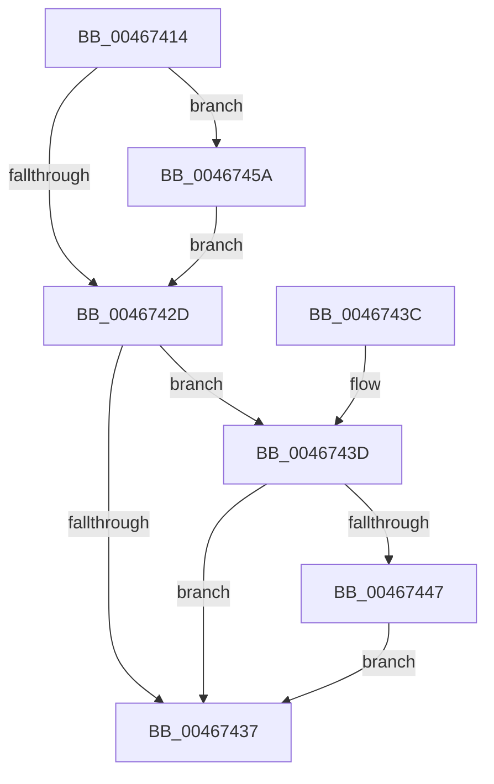

# MiDecrementControlAreaCount

- RVA: `0x00467414`–`0x00467463` (길이 `79` bytes)
- VA: `0x0000000140467414`
- 실행 섹션: `.text`
- PDB 이름 있음: `예`; PDB Function 태그: `아니요`
- unwind 정보 RVA: `0x0006E5EC`
- 디코드: `22`개 명령, `79/79` bytes 표시
- 미해석 바이트: `0` (있으면 어셈블리에 `.byte`로 보존)

> 이 문서는 커널 이미지의 기계어와 PDB 기호를 분석해 생성했습니다. 4번과 5번은 함수 원형과 자료형을 바이너리 사용 방식에서 추정한 C 해석이며 원본 소스 복구 결과는 아닙니다.

## 1. Dependencies

- 직접 호출 지점: **1**; 고유 호출 대상: **1**
- 직접 호출자로 확인된 함수: **1**
- RIP 상대 이미지 참조: **0**

### Outgoing calls
- `0x00467453` → [KeSetEvent](../33/KeSetEvent_function_0033F310.md) (function, `0x0033F310`)

### Direct callers
- [MiDrainCrossPartitionUsage](../69/MiDrainCrossPartitionUsage_function_00690984.md) at `0x00690A0E`
- [MiDrainCrossPartitionUsage](../69/MiDrainCrossPartitionUsage_function_00690984.md) at `0x00690A1D`

### Static image references
- 디코드된 RIP-relative 메모리 참조가 없습니다.

## 2. Other-region calls and transfers

- 다른 실행 섹션으로 향하는 call: **0**
- 별도 외부 분기/꼬리 이동을 확인하지 못했습니다.

## 3. Assembly (complete function range)

```asm
00467414  48 83 EC 28                     sub rsp, 0x28
00467418  4C 8B C9                        mov r9, rcx
0046741B  48 83 C8 FF                     or rax, 0xffffffffffffffff
0046741F  F0 48 0F C1 02                  lock xadd qword ptr [rdx], rax
00467424  48 FF C8                        dec rax
00467427  48 83 F8 FF                     cmp rax, -1
0046742B  7E 2D                           jle 0x14046745a
0046742D  49 83 B9 C8 06 00 00 00         cmp qword ptr [r9 + 0x6c8], 0
00467435  74 06                           je 0x14046743d
00467437  48 83 C4 28                     add rsp, 0x28
0046743B  C3                              ret
0046743C  CC                              int3
0046743D  49 83 B9 D0 06 00 00 00         cmp qword ptr [r9 + 0x6d0], 0
00467445  75 F0                           jne 0x140467437
00467447  49 8B 89 E0 0A 00 00            mov rcx, qword ptr [r9 + 0xae0]
0046744E  45 33 C0                        xor r8d, r8d
00467451  33 D2                           xor edx, edx
00467453  E8 B8 7E ED FF                  call 0x14033f310
00467458  EB DD                           jmp 0x140467437
0046745A  B9 0E 00 00 00                  mov ecx, 0xe
0046745F  CD 29                           int 0x29
00467461  EB CA                           jmp 0x14046742d
```

## 4. C-style interpretation (structured pseudocode)

```c
__int64 __fastcall MiDecrementControlAreaCount(__int64 a1, __int64 a2, int a3)
{
    __int64 result;
    __int64 v_rsp;

    v_rsp = (v_rsp) - (40);
    result = (result) | (-1);
    result = (result) - 1;
    if (result <= -1) goto loc_0046745A;
loc_0046742D:
    if ((*(unsigned __int64 *)(a1 + 1736)) == 0) goto loc_0046743D;
loc_00467437:
    v_rsp = (v_rsp) + (40);
    return result;
loc_0046743D:
    if ((*(unsigned __int64 *)(a1 + 1744)) != 0) goto loc_00467437;
    a3 = 0;
    a2 = 0;
    result = KeSetEvent(*(unsigned __int64 *)(a1 + 2784), a2, a3, a1);
    goto loc_00467437;
loc_0046745A:
    goto loc_0046742D;
}
```

## 5. (Beta) C Style

```c
int64_t MiDecrementControlAreaCount(void *Arg1, void *Arg2, int32_t Arg3)
{
    uint8_t *arg1 = (uint8_t *)Arg1;
    uint8_t *arg2 = (uint8_t *)Arg2;

    int64_t result;
    int64_t local_rsp;

    local_rsp = (local_rsp) - (40);
    result = (result) | (-1);
    result = (result) - 1;
    if (result <= -1) goto loc_0046745A;
loc_0046742D:
    if ((*(uint64_t *)(arg1 + 0x6C8)) == 0) goto loc_0046743D;
loc_00467437:
    local_rsp = (local_rsp) + (40);
    return result;
loc_0046743D:
    if ((*(uint64_t *)(arg1 + 0x6D0)) != 0) goto loc_00467437;
    Arg3 = 0;
    Arg2 = 0;
    result = KeSetEvent(*(uint64_t *)(arg1 + 0xAE0), Arg2, Arg3, Arg1);
    goto loc_00467437;
loc_0046745A:
    goto loc_0046742D;
}
```

### 관측된 메모리 오프셋

구조체 형식이 확인되지 않은 접근은 인자 기준의 오프셋으로만 기록했습니다.

| 기준 인자 | 오프셋 표현 | 폭 (bit) | 접근 |
|---|---:|---:|---|
| `Arg1` | `+ 0x6C8` | `64` | `R` |
| `Arg1` | `+ 0x6D0` | `64` | `R` |
| `Arg1` | `+ 0xAE0` | `64` | `R` |
| `Arg2` | `+ 0x0` | `64` | `R/W` |

## 6. Execution-region graph

[열기: 2D/3D 그래프와 함수 탐색 컨트롤 패널](../../../control-panel.html?section=text&rva=0x00467414&view=graph)

- 2D 그래프는 위에서 아래로 흐르고, 3D 그래프는 빈 공간을 드래그해 회전합니다. Shift+드래그는 이동, 휠은 확대·축소, 함수 노드 선택은 대상 보고서 이동입니다.

### Static fallback


