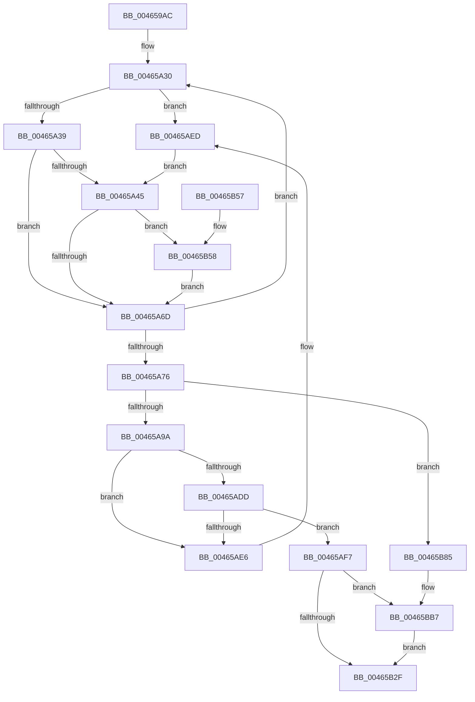

# MiDeleteFinalPageTables

- RVA: `0x004659AC`–`0x00465BBF` (길이 `531` bytes)
- VA: `0x00000001404659AC`
- 실행 섹션: `.text`
- PDB 이름 있음: `예`; PDB Function 태그: `아니요`
- unwind 정보 RVA: `0x000AABDC`
- 디코드: `130`개 명령, `531/531` bytes 표시
- 미해석 바이트: `0` (있으면 어셈블리에 `.byte`로 보존)

> 이 문서는 커널 이미지의 기계어와 PDB 기호를 분석해 생성했습니다. 4번과 5번은 함수 원형과 자료형을 바이너리 사용 방식에서 추정한 C 해석이며 원본 소스 복구 결과는 아닙니다.

## 1. Dependencies

- 직접 호출 지점: **15**; 고유 호출 대상: **15**
- 직접 호출자로 확인된 함수: **1**
- RIP 상대 이미지 참조: **3**

### Outgoing calls
- `0x00465A28` → [KiStackAttachProcess](../21/KiStackAttachProcess_function_00216820.md) (function, `0x00216820`)
- `0x00465A5F` → [MI_READ_PTE_LOCK_FREE](../28/MI_READ_PTE_LOCK_FREE_function_002828A0.md) (function, `0x002828A0`)
- `0x00465A79` → [MiDeleteVadBitmap](../../page/A4/MiDeleteVadBitmap_function_00A45F18.md) (function, `0x00A45F18`)
- `0x00465AA0` → [MiDeleteProcessShadow](MiDeleteProcessShadow_function_00465BF8.md) (function, `0x00465BF8`)
- `0x00465AAB` → [KiUnstackDetachProcess](../21/KiUnstackDetachProcess_function_00217D30.md) (function, `0x00217D30`)
- `0x00465ABC` → [PsUnlinkProcessFromSession](../../page/A8/PsUnlinkProcessFromSession_function_00A8AA88.md) (function, `0x00A8AA88`)
- `0x00465AC8` → [ExAcquireSpinLockExclusive](../24/ExAcquireSpinLockExclusive_function_00248690.md) (function, `0x00248690`)
- `0x00465B07` → [MiReleaseSpinLockExclusive](../24/MiReleaseSpinLockExclusive_function_002482C0.md) (function, `0x002482C0`)
- `0x00465B10` → [KeFlushProcessTb](KeFlushProcessTb_function_00465BC8.md) (function, `0x00465BC8`)
- `0x00465B1D` → [MiDeleteTopLevelPage](MiDeleteTopLevelPage_function_00465E7C.md) (function, `0x00465E7C`)
- `0x00465B36` → [_security_check_cookie](../6A/_security_check_cookie_function_006AC640.md) (function, `0x006AC640`)
- `0x00465B5E` → [LOCK_ADDRESS_SPACE](../2A/LOCK_ADDRESS_SPACE_function_002A4944.md) (function, `0x002A4944`)
- `0x00465B70` → [MiDeleteVirtualAddresses](../2A/MiDeleteVirtualAddresses_function_002A9640.md) (function, `0x002A9640`)
- `0x00465B7B` → [UNLOCK_ADDRESS_SPACE](../2A/UNLOCK_ADDRESS_SPACE_function_002A4844.md) (function, `0x002A4844`)
- `0x00465BB1` → [KeBugCheckEx](../4F/KeBugCheckEx_function_004FD660.md) (function, `0x004FD660`)

### Direct callers
- [MmDeleteProcessAddressSpace](../../page/AC/MmDeleteProcessAddressSpace_function_00AC804C.md) at `0x00AC8142`

### Static image references
- `0x004659CA` → RVA `0x00E0A740` (`.data`; read)
- `0x00465A39` → RVA `0x00E2DB78` (`.data`; read)
- `0x00465AC1` → RVA `0x00E374C0` (`.data`; read)

## 2. Other-region calls and transfers

- 다른 실행 섹션으로 향하는 call: **2**
  - `0x00465A79` → [MiDeleteVadBitmap](../../page/A4/MiDeleteVadBitmap_function_00A45F18.md) (`.text` → `PAGE`)
  - `0x00465ABC` → [PsUnlinkProcessFromSession](../../page/A8/PsUnlinkProcessFromSession_function_00A8AA88.md) (`.text` → `PAGE`)
- 별도 외부 분기/꼬리 이동을 확인하지 못했습니다.

## 3. Assembly (complete function range)

```asm
004659AC  48 89 5C 24 10                  mov qword ptr [rsp + 0x10], rbx
004659B1  48 89 74 24 18                  mov qword ptr [rsp + 0x18], rsi
004659B6  55                              push rbp
004659B7  57                              push rdi
004659B8  41 54                           push r12
004659BA  41 56                           push r14
004659BC  41 57                           push r15
004659BE  48 8D 6C 24 C9                  lea rbp, [rsp - 0x37]
004659C3  48 81 EC A0 00 00 00            sub rsp, 0xa0
004659CA  48 8B 05 6F 4D 9A 00            mov rax, qword ptr [rip + 0x9a4d6f]
004659D1  48 33 C4                        xor rax, rsp
004659D4  48 89 45 2F                     mov qword ptr [rbp + 0x2f], rax
004659D8  33 C0                           xor eax, eax
004659DA  0F 57 C0                        xorps xmm0, xmm0
004659DD  0F 57 C9                        xorps xmm1, xmm1
004659E0  48 89 45 F7                     mov qword ptr [rbp - 9], rax
004659E4  48 8B 41 28                     mov rax, qword ptr [rcx + 0x28]
004659E8  48 8B D9                        mov rbx, rcx
004659EB  48 C1 E8 0C                     shr rax, 0xc
004659EF  0F 11 45 FF                     movups xmmword ptr [rbp - 1], xmm0
004659F3  0F 11 45 0F                     movups xmmword ptr [rbp + 0xf], xmm0
004659F7  48 8D 3C 40                     lea rdi, [rax + rax*2]
004659FB  48 C1 E7 04                     shl rdi, 4
004659FF  0F 11 45 1F                     movups xmmword ptr [rbp + 0x1f], xmm0
00465A03  0F 11 4D C7                     movups xmmword ptr [rbp - 0x39], xmm1
00465A07  0F 11 4D D7                     movups xmmword ptr [rbp - 0x29], xmm1
00465A0B  0F 11 4D E7                     movups xmmword ptr [rbp - 0x19], xmm1
00465A0F  49 BC 00 00 00 00 00 DE FF FF   movabs r12, 0xffffde0000000000
00465A19  65 4C 8B 3C 25 88 01 00 00      mov r15, qword ptr gs:[0x188]
00465A22  4C 8D 45 FF                     lea r8, [rbp - 1]
00465A26  33 D2                           xor edx, edx
00465A28  E8 F3 0D DB FF                  call 0x140216820
00465A2D  45 33 F6                        xor r14d, r14d
00465A30  45 85 F6                        test r14d, r14d
00465A33  0F 84 B4 00 00 00               je 0x140465aed
00465A39  48 8B 35 38 81 9C 00            mov rsi, qword ptr [rip + 0x9c8138]
00465A40  48 85 F6                        test rsi, rsi
00465A43  74 28                           je 0x140465a6d
00465A45  48 8B C6                        mov rax, rsi
00465A48  48 C1 E8 27                     shr rax, 0x27
00465A4C  25 FF 01 00 00                  and eax, 0x1ff
00465A51  48 B9 00 D0 BE 7D FB F6 FF FF   movabs rcx, 0xfffff6fb7dbed000
00465A5B  48 8D 0C C1                     lea rcx, [rcx + rax*8]
00465A5F  E8 3C CE E1 FF                  call 0x1402828a0
00465A64  48 85 C0                        test rax, rax
00465A67  0F 85 EB 00 00 00               jne 0x140465b58
00465A6D  41 FF C6                        inc r14d
00465A70  41 83 FE 02                     cmp r14d, 2
00465A74  7C BA                           jl 0x140465a30
00465A76  48 8B CB                        mov rcx, rbx
00465A79  E8 9A 04 5E 00                  call 0x140a45f18
00465A7E  4A 8B 44 27 18                  mov rax, qword ptr [rdi + r12 + 0x18]
00465A83  48 B9 FF FF FF FF FF FF FF 3F   movabs rcx, 0x3fffffffffffffff
00465A8D  48 23 C1                        and rax, rcx
00465A90  48 83 F8 02                     cmp rax, 2
00465A94  0F 85 EB 00 00 00               jne 0x140465b85
00465A9A  8D 50 FF                        lea edx, [rax - 1]
00465A9D  48 8B CB                        mov rcx, rbx
00465AA0  E8 53 01 00 00                  call 0x140465bf8
00465AA5  33 D2                           xor edx, edx
00465AA7  48 8D 4D FF                     lea rcx, [rbp - 1]
00465AAB  E8 80 22 DB FF                  call 0x140217d30
00465AB0  F0 0F BA AB 88 00 00 00 0B      lock bts dword ptr [rbx + 0x88], 0xb
00465AB9  48 8B CB                        mov rcx, rbx
00465ABC  E8 C7 4F 62 00                  call 0x140a8aa88
00465AC1  48 8D 0D F8 19 9D 00            lea rcx, [rip + 0x9d19f8]
00465AC8  E8 C3 2B DE FF                  call 0x140248690
00465ACD  48 8D 93 40 05 00 00            lea rdx, [rbx + 0x540]
00465AD4  4C 8B 0A                        mov r9, qword ptr [rdx]
00465AD7  49 39 51 08                     cmp qword ptr [r9 + 8], rdx
00465ADB  75 09                           jne 0x140465ae6
00465ADD  4C 8B 42 08                     mov r8, qword ptr [rdx + 8]
00465AE1  49 39 10                        cmp qword ptr [r8], rdx
00465AE4  74 11                           je 0x140465af7
00465AE6  B9 03 00 00 00                  mov ecx, 3
00465AEB  CD 29                           int 0x29
00465AED  BE 00 00 FE 7F                  mov esi, 0x7ffe0000
00465AF2  E9 4E FF FF FF                  jmp 0x140465a45
00465AF7  4D 89 08                        mov qword ptr [r8], r9
00465AFA  48 8D 0D BF 19 9D 00            lea rcx, [rip + 0x9d19bf]
00465B01  8A D0                           mov dl, al
00465B03  4D 89 41 08                     mov qword ptr [r9 + 8], r8
00465B07  E8 B4 27 DE FF                  call 0x1402482c0
00465B0C  48 8B 4B 28                     mov rcx, qword ptr [rbx + 0x28]
00465B10  E8 B3 00 00 00                  call 0x140465bc8
00465B15  48 8B 53 28                     mov rdx, qword ptr [rbx + 0x28]
00465B19  48 C1 EA 0C                     shr rdx, 0xc
00465B1D  E8 5A 03 00 00                  call 0x140465e7c
00465B22  83 F8 03                        cmp eax, 3
00465B25  48 8B 45 CF                     mov rax, qword ptr [rbp - 0x31]
00465B29  0F 84 88 00 00 00               je 0x140465bb7
00465B2F  48 8B 4D 2F                     mov rcx, qword ptr [rbp + 0x2f]
00465B33  48 33 CC                        xor rcx, rsp
00465B36  E8 05 6B 24 00                  call 0x1406ac640
00465B3B  4C 8D 9C 24 A0 00 00 00         lea r11, [rsp + 0xa0]
00465B43  49 8B 5B 38                     mov rbx, qword ptr [r11 + 0x38]
00465B47  49 8B 73 40                     mov rsi, qword ptr [r11 + 0x40]
00465B4B  49 8B E3                        mov rsp, r11
00465B4E  41 5F                           pop r15
00465B50  41 5E                           pop r14
00465B52  41 5C                           pop r12
00465B54  5F                              pop rdi
00465B55  5D                              pop rbp
00465B56  C3                              ret
00465B57  CC                              int3
00465B58  48 8B D3                        mov rdx, rbx
00465B5B  49 8B CF                        mov rcx, r15
00465B5E  E8 E1 ED E3 FF                  call 0x1402a4944
00465B63  4C 8D 4D C7                     lea r9, [rbp - 0x39]
00465B67  45 33 C0                        xor r8d, r8d
00465B6A  48 8B D6                        mov rdx, rsi
00465B6D  48 8B CE                        mov rcx, rsi
00465B70  E8 CB 3A E4 FF                  call 0x1402a9640
00465B75  48 8B D3                        mov rdx, rbx
00465B78  49 8B CF                        mov rcx, r15
00465B7B  E8 C4 EC E3 FF                  call 0x1402a4844
00465B80  E9 E8 FE FF FF                  jmp 0x140465a6d
00465B85  4A 8B 44 27 18                  mov rax, qword ptr [rdi + r12 + 0x18]
00465B8A  49 B9 AB AA AA AA AA AA AA AA   movabs r9, 0xaaaaaaaaaaaaaaab
00465B94  48 23 C1                        and rax, rcx
00465B97  48 C1 FF 04                     sar rdi, 4
00465B9B  4C 0F AF CF                     imul r9, rdi
00465B9F  4C 8B C3                        mov r8, rbx
00465BA2  48 89 44 24 20                  mov qword ptr [rsp + 0x20], rax
00465BA7  BA 53 34 00 00                  mov edx, 0x3453
00465BAC  B9 1A 00 00 00                  mov ecx, 0x1a
00465BB1  E8 AA 7A 09 00                  call 0x1404fd660
00465BB6  CC                              int3
00465BB7  48 FF C0                        inc rax
00465BBA  E9 70 FF FF FF                  jmp 0x140465b2f
```

## 4. C-style interpretation (structured pseudocode)

```c
__int64 __fastcall MiDeleteFinalPageTables(__int64 a1, int a2)
{
    __int64 result;
    __int64 v_r14;
    __int64 v_rdi;
    __int64 v_rsp;
    unsigned __int64 v_stack_m28;
    unsigned __int64 v_stack_m30;
    unsigned __int64 v_stack_m40;
    unsigned __int64 v_stack_m50;
    unsigned __int64 v_stack_m5F;
    unsigned __int64 v_stack_m60;
    unsigned __int64 v_stack_m68;
    unsigned __int64 v_stack_m78;
    unsigned __int64 v_stack_m80;
    unsigned __int64 v_stack_m88;
    unsigned __int64 v_stack_m90;
    unsigned __int64 v_stack_m98;
    unsigned __int64 v_stack_p10;
    unsigned __int64 v_stack_p18;

    v_stack_p10 = v_rbx;
    v_stack_p18 = v_rsi;
    v_rsp = (v_rsp) - (160);
    result = (*(unsigned __int64 *)(v_rip + 10112367)) ^ (v_rsp);
    v_stack_m30 = result;
    result = 0;
    v_stack_m68 = 0;
    result = (*(unsigned __int64 *)(a1 + 40)) >> (12);
    v_stack_m60 = v_xmm0;
    v_stack_m50 = v_xmm0;
    v_rdi = (result + result * 2) << (4);
    v_stack_m40 = v_xmm0;
    v_stack_m98 = v_xmm1;
    v_stack_m88 = v_xmm1;
    v_stack_m78 = v_xmm1;
    a2 = 0;
    result = KiStackAttachProcess(a1, a2, v_stack_m60, a4);
    v_r14 = 0;
loc_00465A30:
    if (0 == 0) goto loc_00465AED;
    if (*(unsigned __int64 *)(v_rip + 10256696) == 0) goto loc_00465A6D;
loc_00465A45:
    result = (*(unsigned __int64 *)(v_rip + 10256696)) >> (39);
    result = (unsigned int)((result) & (511));
    result = MI_READ_PTE_LOCK_FREE(a1 + result * 8, a2, v_stack_m60, a4);
    if (result != 0) goto loc_00465B58;
loc_00465A6D:
    v_r14 = (unsigned int)((v_r14) + 1);
    if (((unsigned int)(v_r14)) < 2) goto loc_00465A30;
    result = MiDeleteVadBitmap(a1, a2, v_stack_m60, a4);
    result = (*(unsigned __int64 *)(v_rdi + v_r12 * 1 + 24)) & (a1);
    if (result != 2) goto loc_00465B85;
    result = MiDeleteProcessShadow(a1, result - 1, v_stack_m60, a4);
    a2 = 0;
    result = KiUnstackDetachProcess(v_stack_m60, a2, v_stack_m60, a4);
    result = PsUnlinkProcessFromSession(a1, a2, v_stack_m60, a4);
    result = ExAcquireSpinLockExclusive(v_rip + 10295800, a2, v_stack_m60, a4);
    if ((*(unsigned __int64 *)(*(unsigned __int64 *)(a1 + 1344) + 8)) != (a1 + 1344)) goto loc_00465AE6;
    if ((*(unsigned __int64 *)(*(unsigned __int64 *)(a1 + 1344 + 8))) == (a1 + 1344)) goto loc_00465AF7;
loc_00465AE6:
loc_00465AED:
    goto loc_00465A45;
loc_00465AF7:
    *(unsigned __int64 *)(*(unsigned __int64 *)(a1 + 1344 + 8)) = *(unsigned __int64 *)(a1 + 1344);
    *(unsigned __int64 *)(*(unsigned __int64 *)(a1 + 1344) + 8) = *(unsigned __int64 *)(a1 + 1344 + 8);
    result = MiReleaseSpinLockExclusive(v_rip + 10295743, (unsigned __int8)(result), *(unsigned __int64 *)(a1 + 1344 + 8), *(unsigned __int64 *)(a1 + 1344));
    result = KeFlushProcessTb(*(unsigned __int64 *)(a1 + 40), (unsigned __int8)(result), *(unsigned __int64 *)(a1 + 1344 + 8), *(unsigned __int64 *)(a1 + 1344));
    a2 = (*(unsigned __int64 *)(a1 + 40)) >> (12);
    result = MiDeleteTopLevelPage(*(unsigned __int64 *)(a1 + 40), a2, *(unsigned __int64 *)(a1 + 1344 + 8), *(unsigned __int64 *)(a1 + 1344));
    if (((unsigned int)(result)) == 3) goto loc_00465BB7;
loc_00465B2F:
    a1 = (v_stack_m30) ^ (v_rsp);
    result = _security_check_cookie(a1, a2, *(unsigned __int64 *)(a1 + 1344 + 8), *(unsigned __int64 *)(a1 + 1344));
    return result;
loc_00465B58:
    result = LOCK_ADDRESS_SPACE(*(unsigned __int64 *)(gs_base + (0 + 392)), *(unsigned __int64 *)(v_stack_m28 + 56), *(unsigned __int64 *)(a1 + 1344 + 8), *(unsigned __int64 *)(a1 + 1344));
    a3 = 0;
    result = MiDeleteVirtualAddresses(*(unsigned __int64 *)(v_stack_m28 + 64), *(unsigned __int64 *)(v_stack_m28 + 64), a3, v_stack_m98);
    result = UNLOCK_ADDRESS_SPACE(*(unsigned __int64 *)(gs_base + (0 + 392)), *(unsigned __int64 *)(v_stack_m28 + 56), a3, v_stack_m98);
    goto loc_00465A6D;
loc_00465B85:
    result = (*(unsigned __int64 *)(v_rdi + v_r12 * 1 + 24)) & (*(unsigned __int64 *)(gs_base + (0 + 392)));
    v_rdi = (v_rdi) >> (4);
    a4 = (v_stack_m98) * (v_rdi);
    v_stack_m80 = result;
    result = KeBugCheckEx(26, (unsigned int)(0x3453ULL), *(unsigned __int64 *)(v_stack_m28 + 56), a4);
loc_00465BB7:
    result = (result) + 1;
    goto loc_00465B2F;
}
```

## 5. (Beta) C Style

```c
int64_t MiDeleteFinalPageTables(void *Arg1, int32_t Arg2)
{
    uint8_t *arg1 = (uint8_t *)Arg1;

    int64_t result;
    int64_t local_r14;
    int64_t local_rdi;
    int64_t local_rsp;
    uint64_t v_stack_m28;
    uint64_t v_stack_m30;
    uint64_t v_stack_m40;
    uint64_t v_stack_m50;
    uint64_t v_stack_m5F;
    uint64_t v_stack_m60;
    uint64_t v_stack_m68;
    uint64_t v_stack_m78;
    uint64_t v_stack_m80;
    uint64_t v_stack_m88;
    uint64_t v_stack_m90;
    uint64_t v_stack_m98;
    uint64_t v_stack_p10;
    uint64_t v_stack_p18;

    v_stack_p10 = local_rbx;
    v_stack_p18 = local_rsi;
    local_rsp = (local_rsp) - (160);
    result = (*(uint64_t *)(v_rip + 0x9A4D6F)) ^ (local_rsp);
    v_stack_m30 = result;
    result = 0;
    v_stack_m68 = 0;
    result = (*(uint64_t *)(arg1 + 0x28)) >> (12);
    v_stack_m60 = v_xmm0;
    v_stack_m50 = v_xmm0;
    local_rdi = (result + result * 2) << (4);
    v_stack_m40 = v_xmm0;
    v_stack_m98 = v_xmm1;
    v_stack_m88 = v_xmm1;
    v_stack_m78 = v_xmm1;
    Arg2 = 0;
    result = KiStackAttachProcess(Arg1, Arg2, v_stack_m60, a4);
    local_r14 = 0;
loc_00465A30:
    if (0 == 0) goto loc_00465AED;
    if (*(uint64_t *)(v_rip + 0x9C8138) == 0) goto loc_00465A6D;
loc_00465A45:
    result = (*(uint64_t *)(v_rip + 0x9C8138)) >> (39);
    result = (uint32_t)((result) & (511));
    result = MI_READ_PTE_LOCK_FREE(Arg1 + result * 8, Arg2, v_stack_m60, a4);
    if (result != 0) goto loc_00465B58;
loc_00465A6D:
    local_r14 = (uint32_t)((local_r14) + 1);
    if (((uint32_t)(local_r14)) < 2) goto loc_00465A30;
    result = MiDeleteVadBitmap(Arg1, Arg2, v_stack_m60, a4);
    result = (*(uint64_t *)(local_rdi + local_r12 * 1 + 0x18)) & (Arg1);
    if (result != 2) goto loc_00465B85;
    result = MiDeleteProcessShadow(Arg1, result - 1, v_stack_m60, a4);
    Arg2 = 0;
    result = KiUnstackDetachProcess(v_stack_m60, Arg2, v_stack_m60, a4);
    result = PsUnlinkProcessFromSession(Arg1, Arg2, v_stack_m60, a4);
    result = ExAcquireSpinLockExclusive(v_rip + 10295800, Arg2, v_stack_m60, a4);
    if ((*(uint64_t *)(*(uint64_t *)(arg1 + 0x540) + 0x8)) != (Arg1 + 1344)) goto loc_00465AE6;
    if ((*(uint64_t *)(*(uint64_t *)(arg1 + 0x540 + 0x8))) == (Arg1 + 1344)) goto loc_00465AF7;
loc_00465AE6:
loc_00465AED:
    goto loc_00465A45;
loc_00465AF7:
    *(uint64_t *)(*(uint64_t *)(arg1 + 0x540 + 0x8)) = *(uint64_t *)(arg1 + 0x540);
    *(uint64_t *)(*(uint64_t *)(arg1 + 0x540) + 0x8) = *(uint64_t *)(arg1 + 0x540 + 0x8);
    result = MiReleaseSpinLockExclusive(v_rip + 10295743, (uint8_t)(result), *(uint64_t *)(arg1 + 0x540 + 0x8), *(uint64_t *)(arg1 + 0x540));
    result = KeFlushProcessTb(*(uint64_t *)(arg1 + 0x28), (uint8_t)(result), *(uint64_t *)(arg1 + 0x540 + 0x8), *(uint64_t *)(arg1 + 0x540));
    Arg2 = (*(uint64_t *)(arg1 + 0x28)) >> (12);
    result = MiDeleteTopLevelPage(*(uint64_t *)(arg1 + 0x28), Arg2, *(uint64_t *)(arg1 + 0x540 + 0x8), *(uint64_t *)(arg1 + 0x540));
    if (((uint32_t)(result)) == 3) goto loc_00465BB7;
loc_00465B2F:
    Arg1 = (v_stack_m30) ^ (local_rsp);
    result = _security_check_cookie(Arg1, Arg2, *(uint64_t *)(arg1 + 0x540 + 0x8), *(uint64_t *)(arg1 + 0x540));
    return result;
loc_00465B58:
    result = LOCK_ADDRESS_SPACE(*(uint64_t *)(gs_base + (0 + 0x188)), *(uint64_t *)(v_stack_m28 + 0x38), *(uint64_t *)(arg1 + 0x540 + 0x8), *(uint64_t *)(arg1 + 0x540));
    a3 = 0;
    result = MiDeleteVirtualAddresses(*(uint64_t *)(v_stack_m28 + 0x40), *(uint64_t *)(v_stack_m28 + 0x40), a3, v_stack_m98);
    result = UNLOCK_ADDRESS_SPACE(*(uint64_t *)(gs_base + (0 + 0x188)), *(uint64_t *)(v_stack_m28 + 0x38), a3, v_stack_m98);
    goto loc_00465A6D;
loc_00465B85:
    result = (*(uint64_t *)(local_rdi + local_r12 * 1 + 0x18)) & (*(uint64_t *)(gs_base + (0 + 0x188)));
    local_rdi = (local_rdi) >> (4);
    a4 = (v_stack_m98) * (local_rdi);
    v_stack_m80 = result;
    result = KeBugCheckEx(26, (uint32_t)(0x3453ULL), *(uint64_t *)(v_stack_m28 + 0x38), a4);
loc_00465BB7:
    result = (result) + 1;
    goto loc_00465B2F;
}
```

### 관측된 메모리 오프셋

구조체 형식이 확인되지 않은 접근은 인자 기준의 오프셋으로만 기록했습니다.

| 기준 인자 | 오프셋 표현 | 폭 (bit) | 접근 |
|---|---:|---:|---|
| `Arg1` | `+ 0x0` | `64` | `R` |
| `Arg1` | `+ 0x8` | `64` | `R` |
| `Arg1` | `+ 0x28` | `64` | `R` |
| `Arg1` | `+ 0x88` | `32` | `R/W` |
| `Arg1` | `+ 0x540` | `64` | `R` |

## 6. Execution-region graph

[열기: 2D/3D 그래프와 함수 탐색 컨트롤 패널](../../../control-panel.html?section=text&rva=0x004659AC&view=graph)

- 2D 그래프는 위에서 아래로 흐르고, 3D 그래프는 빈 공간을 드래그해 회전합니다. Shift+드래그는 이동, 휠은 확대·축소, 함수 노드 선택은 대상 보고서 이동입니다.

### Static fallback


