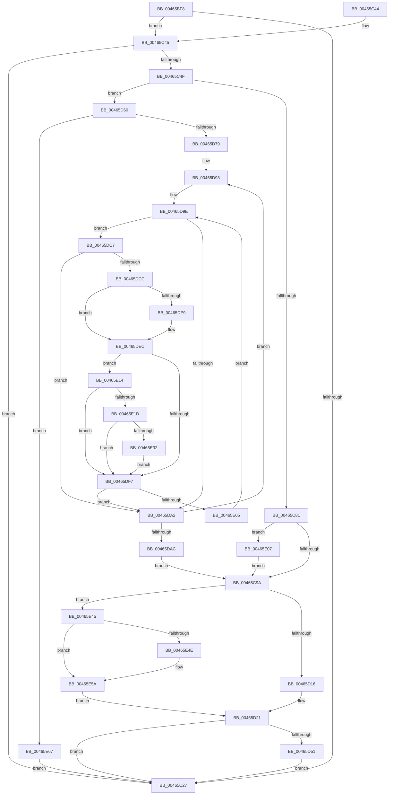

# MiDeleteProcessShadow

- RVA: `0x00465BF8`–`0x00465E76` (길이 `638` bytes)
- VA: `0x0000000140465BF8`
- 실행 섹션: `.text`
- PDB 이름 있음: `예`; PDB Function 태그: `아니요`
- unwind 정보 RVA: `0x000AAC04`
- 디코드: `146`개 명령, `638/638` bytes 표시
- 미해석 바이트: `0` (있으면 어셈블리에 `.byte`로 보존)

> 이 문서는 커널 이미지의 기계어와 PDB 기호를 분석해 생성했습니다. 4번과 5번은 함수 원형과 자료형을 바이너리 사용 방식에서 추정한 C 해석이며 원본 소스 복구 결과는 아닙니다.

## 1. Dependencies

- 직접 호출 지점: **14**; 고유 호출 대상: **12**
- 직접 호출자로 확인된 함수: **3**
- RIP 상대 이미지 참조: **6**

### Outgoing calls
- `0x00465CA1` → [ExAcquireSpinLockExclusiveAtDpcLevel](../24/ExAcquireSpinLockExclusiveAtDpcLevel_function_00248E80.md) (function, `0x00248E80`)
- `0x00465CC7` → [MI_READ_PTE_LOCK_FREE](../28/MI_READ_PTE_LOCK_FREE_function_002828A0.md) (function, `0x002828A0`)
- `0x00465CF6` → [ExReleaseSpinLockExclusiveFromDpcLevel](../24/ExReleaseSpinLockExclusiveFromDpcLevel_function_002497E0.md) (function, `0x002497E0`)
- `0x00465D1C` → [MiUnlockWorkingSetExclusive](../27/MiUnlockWorkingSetExclusive_function_0027EC70.md) (function, `0x0027EC70`)
- `0x00465D33` → [MiReleasePtes](../24/MiReleasePtes_function_00247240.md) (function, `0x00247240`)
- `0x00465D3B` → [KeFlushProcessTb](KeFlushProcessTb_function_00465BC8.md) (function, `0x00465BC8`)
- `0x00465D43` → [MiDeleteTopLevelPage](MiDeleteTopLevelPage_function_00465E7C.md) (function, `0x00465E7C`)
- `0x00465D56` → [MiReleaseNonPagedResources](../32/MiReleaseNonPagedResources_function_0032299C.md) (function, `0x0032299C`)
- `0x00465D63` → [MiLockWorkingSetExclusive](../32/MiLockWorkingSetExclusive_function_003238A0.md) (function, `0x003238A0`)
- `0x00465D96` → [MI_READ_PTE_LOCK_FREE](../28/MI_READ_PTE_LOCK_FREE_function_002828A0.md) (function, `0x002828A0`)
- `0x00465E0A` → [KiRaiseIrqlProcessIrqlFlags](../4F/KiRaiseIrqlProcessIrqlFlags_function_004F56FC.md) (function, `0x004F56FC`)
- `0x00465E3E` → [MiCheckLinearProtectedPteAccessedBit](../29/MiCheckLinearProtectedPteAccessedBit_function_00292D80.md) (function, `0x00292D80`)
- `0x00465E55` → [KiLowerIrqlProcessIrqlFlags](../4F/KiLowerIrqlProcessIrqlFlags_function_004F5698.md) (function, `0x004F5698`)
- `0x00465E6C` → [MiUnlockWorkingSetExclusive](../27/MiUnlockWorkingSetExclusive_function_0027EC70.md) (function, `0x0027EC70`)

### Direct callers
- [MiDeleteFinalPageTables](MiDeleteFinalPageTables_function_004659AC.md) at `0x00465AA0`
- [MmCreateProcessAddressSpace](../../page/A5/MmCreateProcessAddressSpace_function_00A5EE5C.md) at `0x00A5F08A`
- [MmSynchronizeAddressPolicy](../../page/AA/MmSynchronizeAddressPolicy_function_00AA0484.md) at `0x00AA0496`

### Static image references
- `0x00465C14` → RVA `0x00FC6A88` (`ALMOSTRO`; read)
- `0x00465C5E` → RVA `0x00E30088` (`.data`; read)
- `0x00465C8D` → RVA `0x00FC6D20` (`ALMOSTRO`; read)
- `0x00465C9A` → RVA `0x00E374C0` (`.data`; read)
- `0x00465CFD` → RVA `0x00FC6A87` (`ALMOSTRO`; read)
- `0x00465D26` → RVA `0x00E37668` (`.data`; read)

## 2. Other-region calls and transfers

- 다른 실행 섹션으로 향하는 call: **0**
- 별도 외부 분기/꼬리 이동을 확인하지 못했습니다.

## 3. Assembly (complete function range)

```asm
00465BF8  48 89 5C 24 08                  mov qword ptr [rsp + 8], rbx
00465BFD  48 89 6C 24 10                  mov qword ptr [rsp + 0x10], rbp
00465C02  48 89 74 24 20                  mov qword ptr [rsp + 0x20], rsi
00465C07  57                              push rdi
00465C08  41 54                           push r12
00465C0A  41 55                           push r13
00465C0C  41 56                           push r14
00465C0E  41 57                           push r15
00465C10  48 83 EC 20                     sub rsp, 0x20
00465C14  48 F7 05 69 0E B6 00 00 00 60 00  test qword ptr [rip + 0xb60e69], 0x600000
00465C1F  44 8B EA                        mov r13d, edx
00465C22  4C 8B F1                        mov r14, rcx
00465C25  75 1E                           jne 0x140465c45
00465C27  48 8B 5C 24 50                  mov rbx, qword ptr [rsp + 0x50]
00465C2C  48 8B 6C 24 58                  mov rbp, qword ptr [rsp + 0x58]
00465C31  48 8B 74 24 68                  mov rsi, qword ptr [rsp + 0x68]
00465C36  48 83 C4 20                     add rsp, 0x20
00465C3A  41 5F                           pop r15
00465C3C  41 5E                           pop r14
00465C3E  41 5D                           pop r13
00465C40  41 5C                           pop r12
00465C42  5F                              pop rdi
00465C43  C3                              ret
00465C44  CC                              int3
00465C45  48 83 B9 08 05 00 00 00         cmp qword ptr [rcx + 0x508], 0
00465C4D  74 D8                           je 0x140465c27
00465C4F  44 0F B7 81 AE 04 00 00         movzx r8d, word ptr [rcx + 0x4ae]
00465C57  4C 8D B9 00 04 00 00            lea r15, [rcx + 0x400]
00465C5E  48 8B 05 23 A4 9C 00            mov rax, qword ptr [rip + 0x9ca423]
00465C65  48 BF 00 00 00 00 80 F6 FF FF   movabs rdi, 0xfffff68000000000
00465C6F  4E 8B 24 C0                     mov r12, qword ptr [rax + r8*8]
00465C73  4C 89 64 24 60                  mov qword ptr [rsp + 0x60], r12
00465C78  45 85 ED                        test r13d, r13d
00465C7B  0F 85 DF 00 00 00               jne 0x140465d60
00465C81  44 0F 20 C6                     mov rsi, cr8
00465C85  41 8D 55 02                     lea edx, [r13 + 2]
00465C89  44 0F 22 C2                     mov cr8, rdx
00465C8D  44 39 2D 8C 10 B6 00            cmp dword ptr [rip + 0xb6108c], r13d
00465C94  0F 85 6D 01 00 00               jne 0x140465e07
00465C9A  48 8D 0D 1F 18 9D 00            lea rcx, [rip + 0x9d181f]
00465CA1  E8 DA 31 DE FF                  call 0x140248e80
00465CA6  49 8B 9E 08 05 00 00            mov rbx, qword ptr [r14 + 0x508]
00465CAD  48 B8 F8 FF FF FF 7F 00 00 00   movabs rax, 0x7ffffffff8
00465CB7  48 C1 EB 09                     shr rbx, 9
00465CBB  48 23 D8                        and rbx, rax
00465CBE  48 8B C7                        mov rax, rdi
00465CC1  48 03 D8                        add rbx, rax
00465CC4  48 8B CB                        mov rcx, rbx
00465CC7  E8 D4 CB E1 FF                  call 0x1402828a0
00465CCC  49 83 A6 08 05 00 00 00         and qword ptr [r14 + 0x508], 0
00465CD4  48 8D 0D E5 17 9D 00            lea rcx, [rip + 0x9d17e5]
00465CDB  48 8B F8                        mov rdi, rax
00465CDE  48 B8 FF FF FF FF FF 00 00 00   movabs rax, 0xffffffffff
00465CE8  48 C1 EF 0C                     shr rdi, 0xc
00465CEC  48 23 F8                        and rdi, rax
00465CEF  48 8B EF                        mov rbp, rdi
00465CF2  48 C1 E5 0C                     shl rbp, 0xc
00465CF6  E8 E5 3A DE FF                  call 0x1402497e0
00465CFB  33 C0                           xor eax, eax
00465CFD  38 05 84 0D B6 00               cmp byte ptr [rip + 0xb60d84], al
00465D03  0F 95 C0                        setne al
00465D06  49 89 86 58 01 00 00            mov qword ptr [r14 + 0x158], rax
00465D0D  45 85 ED                        test r13d, r13d
00465D10  0F 84 2F 01 00 00               je 0x140465e45
00465D16  40 8A D6                        mov dl, sil
00465D19  49 8B CF                        mov rcx, r15
00465D1C  E8 4F 8F E1 FF                  call 0x14027ec70
00465D21  BE 01 00 00 00                  mov esi, 1
00465D26  48 8D 0D 3B 19 9D 00            lea rcx, [rip + 0x9d193b]
00465D2D  44 8B C6                        mov r8d, esi
00465D30  48 8B D3                        mov rdx, rbx
00465D33  E8 08 15 DE FF                  call 0x140247240
00465D38  48 8B CD                        mov rcx, rbp
00465D3B  E8 88 FE FF FF                  call 0x140465bc8
00465D40  48 8B D7                        mov rdx, rdi
00465D43  E8 34 01 00 00                  call 0x140465e7c
00465D48  83 F8 03                        cmp eax, 3
00465D4B  0F 84 D6 FE FF FF               je 0x140465c27
00465D51  8B D6                           mov edx, esi
00465D53  49 8B CC                        mov rcx, r12
00465D56  E8 41 CC EB FF                  call 0x14032299c
00465D5B  E9 C7 FE FF FF                  jmp 0x140465c27
00465D60  49 8B CF                        mov rcx, r15
00465D63  E8 38 DB EB FF                  call 0x1403238a0
00465D68  49 83 BE 08 05 00 00 00         cmp qword ptr [r14 + 0x508], 0
00465D70  40 8A F0                        mov sil, al
00465D73  0F 84 EE 00 00 00               je 0x140465e67
00465D79  48 BD 00 D0 BE 7D FB F6 FF FF   movabs rbp, 0xfffff6fb7dbed000
00465D83  41 BC 00 01 00 00               mov r12d, 0x100
00465D89  49 BF 00 00 00 00 80 F6 FF FF   movabs r15, 0xfffff68000000000
00465D93  48 8B CD                        mov rcx, rbp
00465D96  E8 05 CB E1 FF                  call 0x1402828a0
00465D9B  48 8B D8                        mov rbx, rax
00465D9E  A8 01                           test al, 1
00465DA0  75 25                           jne 0x140465dc7
00465DA2  48 83 C5 08                     add rbp, 8
00465DA6  49 83 EC 01                     sub r12, 1
00465DAA  75 E7                           jne 0x140465d93
00465DAC  4C 8B 64 24 60                  mov r12, qword ptr [rsp + 0x60]
00465DB1  4D 8D BE 00 04 00 00            lea r15, [r14 + 0x400]
00465DB8  48 BF 00 00 00 00 80 F6 FF FF   movabs rdi, 0xfffff68000000000
00465DC2  E9 D3 FE FF FF                  jmp 0x140465c9a
00465DC7  48 85 DB                        test rbx, rbx
00465DCA  79 D6                           jns 0x140465da2
00465DCC  48 8B FB                        mov rdi, rbx
00465DCF  48 B8 FF FF FF FF FF FF FF 7F   movabs rax, 0x7fffffffffffffff
00465DD9  48 23 F8                        and rdi, rax
00465DDC  48 F7 05 A1 0C B6 00 00 00 00 02  test qword ptr [rip + 0xb60ca1], 0x2000000
00465DE7  74 03                           je 0x140465dec
00465DE9  0F AE E8                        lfence
00465DEC  48 0F BA 25 93 0C B6 00 24      bt qword ptr [rip + 0xb60c93], 0x24
00465DF5  72 1D                           jb 0x140465e14
00465DF7  48 8B C3                        mov rax, rbx
00465DFA  F0 48 0F B1 7D 00               lock cmpxchg qword ptr [rbp], rdi
00465E00  48 8B D8                        mov rbx, rax
00465E03  74 9D                           je 0x140465da2
00465E05  EB 97                           jmp 0x140465d9e
00465E07  40 8A CE                        mov cl, sil
00465E0A  E8 ED F8 08 00                  call 0x1404f56fc
00465E0F  E9 86 FE FF FF                  jmp 0x140465c9a
00465E14  40 8A C7                        mov al, dil
00465E17  24 21                           and al, 0x21
00465E19  3C 01                           cmp al, 1
00465E1B  75 DA                           jne 0x140465df7
00465E1D  49 8B C7                        mov rax, r15
00465E20  48 B9 00 00 00 00 40 00 00 00   movabs rcx, 0x4000000000
00465E2A  48 03 C1                        add rax, rcx
00465E2D  48 3B E8                        cmp rbp, rax
00465E30  72 C5                           jb 0x140465df7
00465E32  41 B8 80 00 00 00               mov r8d, 0x80
00465E38  48 8B D7                        mov rdx, rdi
00465E3B  48 8B CD                        mov rcx, rbp
00465E3E  E8 3D CF E2 FF                  call 0x140292d80
00465E43  EB B2                           jmp 0x140465df7
00465E45  83 3D D4 0E B6 00 00            cmp dword ptr [rip + 0xb60ed4], 0
00465E4C  74 0C                           je 0x140465e5a
00465E4E  44 0F 20 C1                     mov rcx, cr8
00465E52  40 8A D6                        mov dl, sil
00465E55  E8 3E F8 08 00                  call 0x1404f5698
00465E5A  40 0F B6 C6                     movzx eax, sil
00465E5E  44 0F 22 C0                     mov cr8, rax
00465E62  E9 BA FE FF FF                  jmp 0x140465d21
00465E67  8A D0                           mov dl, al
00465E69  49 8B CF                        mov rcx, r15
00465E6C  E8 FF 8D E1 FF                  call 0x14027ec70
00465E71  E9 B1 FD FF FF                  jmp 0x140465c27
```

## 4. C-style interpretation (structured pseudocode)

```c
__int64 __fastcall MiDeleteProcessShadow(__int64 a1, int a2)
{
    __int64 result;
    __int64 v_r12;
    __int64 v_rbp;
    __int64 v_rbx;
    __int64 v_rdi;
    __int64 v_rsp;
    unsigned __int64 v_stack_p10;
    unsigned __int64 v_stack_p20;
    unsigned __int64 v_stack_p60;
    unsigned __int64 v_stack_p8;

    v_stack_p8 = v_rbx;
    v_stack_p10 = v_rbp;
    v_stack_p20 = v_rsi;
    v_rsp = (v_rsp) - (32);
    if (((*(unsigned __int64 *)(v_rip + 11931241)) & (0x600000ULL)) != 0) goto loc_00465C45;
loc_00465C27:
    v_rsp = (v_rsp) + (32);
    return result;
loc_00465C45:
    if ((*(unsigned __int64 *)(a1 + 1288)) == 0) goto loc_00465C27;
    v_stack_p60 = *(unsigned __int64 *)(*(unsigned __int64 *)(v_rip + 10265635) + *(unsigned __int16 *)(a1 + 1198) * 8);
    if ((unsigned int)((unsigned int)(a2)) != 0) goto loc_00465D60;
    if ((*(unsigned int *)(v_rip + 11931788)) != ((unsigned int)((unsigned int)(a2)))) goto loc_00465E07;
loc_00465C9A:
    result = ExAcquireSpinLockExclusiveAtDpcLevel(v_rip + 10295327, (unsigned int)(a2) + 2, *(unsigned __int16 *)(a1 + 1198), a4);
    v_rbx = (*(unsigned __int64 *)(a1 + 1288)) >> (9);
    v_rbx = (v_rbx) & (result);
    v_rbx = (v_rbx) + (v_rdi);
    result = MI_READ_PTE_LOCK_FREE(v_rbx, (unsigned int)(a2) + 2, *(unsigned __int16 *)(a1 + 1198), a4);
    v_rdi = (result) >> (12);
    v_rdi = (v_rdi) & (result);
    v_rbp = (v_rdi) << (12);
    result = ExReleaseSpinLockExclusiveFromDpcLevel(v_rip + 10295269, (unsigned int)(a2) + 2, *(unsigned __int16 *)(a1 + 1198), a4);
    result = 0;
    result = ((*(unsigned __int8 *)(v_rip + 11931012)) != 0) ? 1 : 0;
    *(unsigned __int64 *)(a1 + 344) = result;
    if ((unsigned int)((unsigned int)(a2)) == 0) goto loc_00465E45;
    result = MiUnlockWorkingSetExclusive(a1 + 1024, (unsigned __int8)(v_cr8), *(unsigned __int16 *)(a1 + 1198), a4);
loc_00465D21:
    result = MiReleasePtes(v_rip + 10295611, v_rbx, 1, a4);
    result = KeFlushProcessTb(v_rbp, v_rbx, 1, a4);
    result = MiDeleteTopLevelPage(v_rbp, v_rdi, 1, a4);
    if (((unsigned int)(result)) == 3) goto loc_00465C27;
    result = MiReleaseNonPagedResources(*(unsigned __int64 *)(*(unsigned __int64 *)(v_rip + 10265635) + *(unsigned __int16 *)(a1 + 1198) * 8), 1, 1, a4);
    goto loc_00465C27;
loc_00465D60:
    result = MiLockWorkingSetExclusive(a1 + 1024, 1, 1, a4);
    if ((*(unsigned __int64 *)(a1 + 1288)) == 0) goto loc_00465E67;
loc_00465D93:
    result = MI_READ_PTE_LOCK_FREE(v_rbp, 1, 1, a4);
loc_00465D9E:
    if ((((unsigned __int8)(result)) & (1)) != 0) goto loc_00465DC7;
loc_00465DA2:
    v_rbp = (v_rbp) + (8);
    v_r12 = (256) - (1);
    if (condition_is_not_equal) goto loc_00465D93;
    goto loc_00465C9A;
loc_00465DC7:
    if (!sign_flag) goto loc_00465DA2;
    v_rdi = (result) & (result);
    if (((*(unsigned __int64 *)(v_rip + 11930785)) & (0x2000000ULL)) != 0) {
    }
    if (condition_is_below) goto loc_00465E14;
loc_00465DF7:
    if (((*(unsigned __int64 *)(v_rip + 11930785)) & (0x2000000ULL)) == 0) goto loc_00465DA2;
    goto loc_00465D9E;
loc_00465E07:
    result = KiRaiseIrqlProcessIrqlFlags((unsigned __int8)((unsigned __int8)(result)), 1, 1, a4);
    goto loc_00465C9A;
loc_00465E14:
    result = (unsigned __int8)(((unsigned __int8)(v_rdi)) & (33));
    if (((unsigned __int8)(result)) != 1) goto loc_00465DF7;
    result = (a1 + 1024) + ((unsigned __int8)((unsigned __int8)(result)));
    if (v_rbp < result) goto loc_00465DF7;
    result = MiCheckLinearProtectedPteAccessedBit(v_rbp, v_rdi, 128, a4);
    goto loc_00465DF7;
loc_00465E45:
    if ((*(unsigned int *)(v_rip + 11931348)) != 0) {
        a1 = (unsigned int)(a2) + 2;
        a2 = (unsigned __int8)((unsigned __int8)(result));
        result = KiLowerIrqlProcessIrqlFlags(a1, a2, 128, a4);
    }
    goto loc_00465D21;
loc_00465E67:
    result = MiUnlockWorkingSetExclusive(a1 + 1024, (unsigned __int8)((unsigned __int8)((unsigned __int8)(result))), 128, a4);
    goto loc_00465C27;
}
```

## 5. (Beta) C Style

```c
int64_t MiDeleteProcessShadow(void *Arg1, int32_t Arg2)
{
    uint8_t *arg1 = (uint8_t *)Arg1;

    int64_t result;
    int64_t local_r12;
    int64_t local_rbp;
    int64_t local_rbx;
    int64_t local_rdi;
    int64_t local_rsp;
    uint64_t v_stack_p10;
    uint64_t v_stack_p20;
    uint64_t v_stack_p60;
    uint64_t v_stack_p8;

    v_stack_p8 = local_rbx;
    v_stack_p10 = local_rbp;
    v_stack_p20 = local_rsi;
    local_rsp = (local_rsp) - (32);
    if (((*(uint64_t *)(v_rip + 0xB60E69)) & (0x600000ULL)) != 0) goto loc_00465C45;
loc_00465C27:
    local_rsp = (local_rsp) + (32);
    return result;
loc_00465C45:
    if ((*(uint64_t *)(arg1 + 0x508)) == 0) goto loc_00465C27;
    v_stack_p60 = *(uint64_t *)(*(uint64_t *)(v_rip + 0x9CA423) + *(uint16_t *)(arg1 + 0x4AE) * 8);
    if ((uint32_t)((uint32_t)(Arg2)) != 0) goto loc_00465D60;
    if ((*(uint32_t *)(v_rip + 0xB6108C)) != ((uint32_t)((uint32_t)(Arg2)))) goto loc_00465E07;
loc_00465C9A:
    result = ExAcquireSpinLockExclusiveAtDpcLevel(v_rip + 10295327, (uint32_t)(Arg2) + 2, *(uint16_t *)(arg1 + 0x4AE), a4);
    local_rbx = (*(uint64_t *)(arg1 + 0x508)) >> (9);
    local_rbx = (local_rbx) & (result);
    local_rbx = (local_rbx) + (local_rdi);
    result = MI_READ_PTE_LOCK_FREE(local_rbx, (uint32_t)(Arg2) + 2, *(uint16_t *)(arg1 + 0x4AE), a4);
    local_rdi = (result) >> (12);
    local_rdi = (local_rdi) & (result);
    local_rbp = (local_rdi) << (12);
    result = ExReleaseSpinLockExclusiveFromDpcLevel(v_rip + 10295269, (uint32_t)(Arg2) + 2, *(uint16_t *)(arg1 + 0x4AE), a4);
    result = 0;
    result = ((*(uint8_t *)(v_rip + 0xB60D84)) != 0) ? 1 : 0;
    *(uint64_t *)(arg1 + 0x158) = result;
    if ((uint32_t)((uint32_t)(Arg2)) == 0) goto loc_00465E45;
    result = MiUnlockWorkingSetExclusive(Arg1 + 1024, (uint8_t)(v_cr8), *(uint16_t *)(arg1 + 0x4AE), a4);
loc_00465D21:
    result = MiReleasePtes(v_rip + 10295611, local_rbx, 1, a4);
    result = KeFlushProcessTb(local_rbp, local_rbx, 1, a4);
    result = MiDeleteTopLevelPage(local_rbp, local_rdi, 1, a4);
    if (((uint32_t)(result)) == 3) goto loc_00465C27;
    result = MiReleaseNonPagedResources(*(uint64_t *)(*(uint64_t *)(v_rip + 0x9CA423) + *(uint16_t *)(arg1 + 0x4AE) * 8), 1, 1, a4);
    goto loc_00465C27;
loc_00465D60:
    result = MiLockWorkingSetExclusive(Arg1 + 1024, 1, 1, a4);
    if ((*(uint64_t *)(arg1 + 0x508)) == 0) goto loc_00465E67;
loc_00465D93:
    result = MI_READ_PTE_LOCK_FREE(local_rbp, 1, 1, a4);
loc_00465D9E:
    if ((((uint8_t)(result)) & (1)) != 0) goto loc_00465DC7;
loc_00465DA2:
    local_rbp = (local_rbp) + (8);
    local_r12 = (256) - (1);
    if (condition_is_not_equal) goto loc_00465D93;
    goto loc_00465C9A;
loc_00465DC7:
    if (!sign_flag) goto loc_00465DA2;
    local_rdi = (result) & (result);
    if (((*(uint64_t *)(v_rip + 0xB60CA1)) & (0x2000000ULL)) != 0) {
    }
    if (condition_is_below) goto loc_00465E14;
loc_00465DF7:
    if (((*(uint64_t *)(v_rip + 0xB60CA1)) & (0x2000000ULL)) == 0) goto loc_00465DA2;
    goto loc_00465D9E;
loc_00465E07:
    result = KiRaiseIrqlProcessIrqlFlags((uint8_t)((uint8_t)(result)), 1, 1, a4);
    goto loc_00465C9A;
loc_00465E14:
    result = (uint8_t)(((uint8_t)(local_rdi)) & (33));
    if (((uint8_t)(result)) != 1) goto loc_00465DF7;
    result = (Arg1 + 1024) + ((uint8_t)((uint8_t)(result)));
    if (local_rbp < result) goto loc_00465DF7;
    result = MiCheckLinearProtectedPteAccessedBit(local_rbp, local_rdi, 128, a4);
    goto loc_00465DF7;
loc_00465E45:
    if ((*(uint32_t *)(v_rip + 0xB60ED4)) != 0) {
        Arg1 = (uint32_t)(Arg2) + 2;
        Arg2 = (uint8_t)((uint8_t)(result));
        result = KiLowerIrqlProcessIrqlFlags(Arg1, Arg2, 128, a4);
    }
    goto loc_00465D21;
loc_00465E67:
    result = MiUnlockWorkingSetExclusive(Arg1 + 1024, (uint8_t)((uint8_t)((uint8_t)(result))), 128, a4);
    goto loc_00465C27;
}
```

### 관측된 메모리 오프셋

구조체 형식이 확인되지 않은 접근은 인자 기준의 오프셋으로만 기록했습니다.

| 기준 인자 | 오프셋 표현 | 폭 (bit) | 접근 |
|---|---:|---:|---|
| `Arg1` | `+ 0x158` | `64` | `W` |
| `Arg1` | `+ 0x400` | `64` | `R` |
| `Arg1` | `+ 0x4AE` | `16` | `R` |
| `Arg1` | `+ 0x508` | `64` | `R` |
| `Arg1` | `+ 0x508` | `64` | `R/W` |

## 6. Execution-region graph

[열기: 2D/3D 그래프와 함수 탐색 컨트롤 패널](../../../control-panel.html?section=text&rva=0x00465BF8&view=graph)

- 2D 그래프는 위에서 아래로 흐르고, 3D 그래프는 빈 공간을 드래그해 회전합니다. Shift+드래그는 이동, 휠은 확대·축소, 함수 노드 선택은 대상 보고서 이동입니다.

### Static fallback


