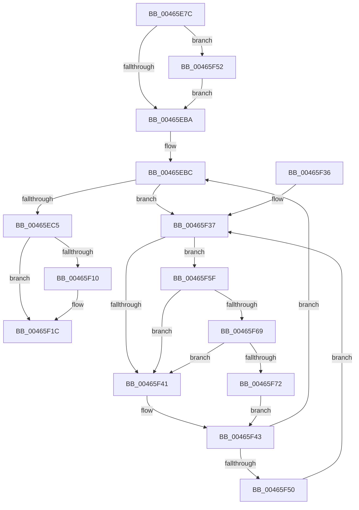

# MiDeleteTopLevelPage

- RVA: `0x00465E7C`–`0x00465F7B` (길이 `255` bytes)
- VA: `0x0000000140465E7C`
- 실행 섹션: `.text`
- PDB 이름 있음: `예`; PDB Function 태그: `아니요`
- unwind 정보 RVA: `0x0007A7BC`
- 디코드: `65`개 명령, `255/255` bytes 표시
- 미해석 바이트: `0` (있으면 어셈블리에 `.byte`로 보존)

> 이 문서는 커널 이미지의 기계어와 PDB 기호를 분석해 생성했습니다. 4번과 5번은 함수 원형과 자료형을 바이너리 사용 방식에서 추정한 C 해석이며 원본 소스 복구 결과는 아닙니다.

## 1. Dependencies

- 직접 호출 지점: **7**; 고유 호출 대상: **6**
- 직접 호출자로 확인된 함수: **2**
- RIP 상대 이미지 참조: **3**

### Outgoing calls
- `0x00465EC8` → [MiClearContainingMapping](MiClearContainingMapping_function_00465F84.md) (function, `0x00465F84`)
- `0x00465EE7` → [MiDecrementShareCountEx](../33/MiDecrementShareCountEx_function_00333F70.md) (function, `0x00333F70`)
- `0x00465EF1` → [MiDecrementShareCountEx](../33/MiDecrementShareCountEx_function_00333F70.md) (function, `0x00333F70`)
- `0x00465F17` → [KiLowerIrqlProcessIrqlFlags](../4F/KiLowerIrqlProcessIrqlFlags_function_004F5698.md) (function, `0x004F5698`)
- `0x00465F55` → [KiRaiseIrqlProcessIrqlFlags](../4F/KiRaiseIrqlProcessIrqlFlags_function_004F56FC.md) (function, `0x004F56FC`)
- `0x00465F69` → [KiCheckVpBackingLongSpinWaitHypercall](../30/KiCheckVpBackingLongSpinWaitHypercall_function_0030F490.md) (function, `0x0030F490`)
- `0x00465F74` → [HvlNotifyLongSpinWait](../30/HvlNotifyLongSpinWait_function_0030F460.md) (function, `0x0030F460`)

### Direct callers
- [MiDeleteFinalPageTables](MiDeleteFinalPageTables_function_004659AC.md) at `0x00465B1D`
- [MiDeleteProcessShadow](MiDeleteProcessShadow_function_00465BF8.md) at `0x00465D43`

### Static image references
- `0x00465EAD` → RVA `0x00FC6D20` (`ALMOSTRO`; read)
- `0x00465F39` → RVA `0x00FC52AC` (`ALMOSTRO`; reference)
- `0x00465F5F` → RVA `0x00FC6AB8` (`ALMOSTRO`; read)

## 2. Other-region calls and transfers

- 다른 실행 섹션으로 향하는 call: **0**
- 별도 외부 분기/꼬리 이동을 확인하지 못했습니다.

## 3. Assembly (complete function range)

```asm
00465E7C  48 89 5C 24 08                  mov qword ptr [rsp + 8], rbx
00465E81  48 89 74 24 10                  mov qword ptr [rsp + 0x10], rsi
00465E86  57                              push rdi
00465E87  48 83 EC 20                     sub rsp, 0x20
00465E8B  48 8D 1C 52                     lea rbx, [rdx + rdx*2]
00465E8F  48 C1 E3 04                     shl rbx, 4
00465E93  48 B8 00 00 00 00 00 DE FF FF   movabs rax, 0xffffde0000000000
00465E9D  48 03 D8                        add rbx, rax
00465EA0  44 0F 20 C6                     mov rsi, cr8
00465EA4  BA 02 00 00 00                  mov edx, 2
00465EA9  44 0F 22 C2                     mov cr8, rdx
00465EAD  83 3D 6C 0E B6 00 00            cmp dword ptr [rip + 0xb60e6c], 0
00465EB4  0F 85 98 00 00 00               jne 0x140465f52
00465EBA  33 FF                           xor edi, edi
00465EBC  F0 48 0F BA 6B 18 3F            lock bts qword ptr [rbx + 0x18], 0x3f
00465EC3  72 72                           jb 0x140465f37
00465EC5  48 8B CB                        mov rcx, rbx
00465EC8  E8 B7 00 00 00                  call 0x140465f84
00465ECD  48 8B 43 18                     mov rax, qword ptr [rbx + 0x18]
00465ED1  48 B9 00 00 00 00 00 00 00 40   movabs rcx, 0x4000000000000000
00465EDB  48 0B C1                        or rax, rcx
00465EDE  33 D2                           xor edx, edx
00465EE0  48 8B CB                        mov rcx, rbx
00465EE3  48 89 43 18                     mov qword ptr [rbx + 0x18], rax
00465EE7  E8 84 E0 EC FF                  call 0x140333f70
00465EEC  33 D2                           xor edx, edx
00465EEE  48 8B CB                        mov rcx, rbx
00465EF1  E8 7A E0 EC FF                  call 0x140333f70
00465EF6  8B F8                           mov edi, eax
00465EF8  48 B8 FF FF FF FF FF FF FF 7F   movabs rax, 0x7fffffffffffffff
00465F02  F0 48 21 43 18                  lock and qword ptr [rbx + 0x18], rax
00465F07  83 3D 12 0E B6 00 00            cmp dword ptr [rip + 0xb60e12], 0
00465F0E  74 0C                           je 0x140465f1c
00465F10  44 0F 20 C1                     mov rcx, cr8
00465F14  40 8A D6                        mov dl, sil
00465F17  E8 7C F7 08 00                  call 0x1404f5698
00465F1C  40 0F B6 CE                     movzx ecx, sil
00465F20  44 0F 22 C1                     mov cr8, rcx
00465F24  48 8B 5C 24 30                  mov rbx, qword ptr [rsp + 0x30]
00465F29  8B C7                           mov eax, edi
00465F2B  48 8B 74 24 38                  mov rsi, qword ptr [rsp + 0x38]
00465F30  48 83 C4 20                     add rsp, 0x20
00465F34  5F                              pop rdi
00465F35  C3                              ret
00465F36  CC                              int3
00465F37  FF C7                           inc edi
00465F39  85 3D 6D F3 B5 00               test dword ptr [rip + 0xb5f36d], edi
00465F3F  74 1E                           je 0x140465f5f
00465F41  F3 90                           pause
00465F43  48 8B 43 18                     mov rax, qword ptr [rbx + 0x18]
00465F47  48 85 C0                        test rax, rax
00465F4A  0F 89 6C FF FF FF               jns 0x140465ebc
00465F50  EB E5                           jmp 0x140465f37
00465F52  40 8A CE                        mov cl, sil
00465F55  E8 A2 F7 08 00                  call 0x1404f56fc
00465F5A  E9 5B FF FF FF                  jmp 0x140465eba
00465F5F  8B 05 53 0B B6 00               mov eax, dword ptr [rip + 0xb60b53]
00465F65  A8 40                           test al, 0x40
00465F67  74 D8                           je 0x140465f41
00465F69  E8 22 95 EA FF                  call 0x14030f490
00465F6E  84 C0                           test al, al
00465F70  74 CF                           je 0x140465f41
00465F72  8B CF                           mov ecx, edi
00465F74  E8 E7 94 EA FF                  call 0x14030f460
00465F79  EB C8                           jmp 0x140465f43
```

## 4. C-style interpretation (structured pseudocode)

```c
__int64 __fastcall MiDeleteTopLevelPage(__int64 a1, __int64 a2)
{
    __int64 result;
    __int64 v_rbx;
    __int64 v_rdi;
    __int64 v_rsp;
    unsigned __int64 v_stack_p10;
    unsigned __int64 v_stack_p8;

    v_stack_p8 = v_rbx;
    v_stack_p10 = v_rsi;
    v_rsp = (v_rsp) - (32);
    v_rbx = (a2 + a2 * 2) << (4);
    v_rbx = (v_rbx) + (result);
    if ((*(unsigned int *)(v_rip + 11931244)) != 0) goto loc_00465F52;
loc_00465EBA:
    v_rdi = 0;
loc_00465EBC:
    if (condition_is_below) goto loc_00465F37;
    result = MiClearContainingMapping(v_rbx, 2, a3, a4);
    result = (*(unsigned __int64 *)(v_rbx + 24)) | (v_rbx);
    a2 = 0;
    *(unsigned __int64 *)(v_rbx + 24) = result;
    result = MiDecrementShareCountEx(v_rbx, a2, a3, a4);
    a2 = 0;
    result = MiDecrementShareCountEx(v_rbx, a2, a3, a4);
    if ((*(unsigned int *)(v_rip + 11931154)) != 0) {
        a1 = 2;
        a2 = (unsigned __int8)(v_cr8);
        result = KiLowerIrqlProcessIrqlFlags(a1, a2, a3, a4);
    }
    v_rsp = (v_rsp) + (32);
    return (unsigned int)((unsigned int)((unsigned int)((unsigned int)(result))));
loc_00465F37:
    v_rdi = (unsigned int)(((unsigned int)((unsigned int)(result))) + 1);
    if (((*(unsigned int *)(v_rip + 11924333)) & ((unsigned int)(v_rdi))) == 0) goto loc_00465F5F;
loc_00465F41:
loc_00465F43:
    if (!sign_flag) goto loc_00465EBC;
    goto loc_00465F37;
loc_00465F52:
    result = KiRaiseIrqlProcessIrqlFlags((unsigned __int8)(v_stack_p10), a2, a3, a4);
    goto loc_00465EBA;
loc_00465F5F:
    if ((((unsigned __int8)((unsigned int)(*(unsigned int *)(v_rip + 11930451)))) & (64)) == 0) goto loc_00465F41;
    result = KiCheckVpBackingLongSpinWaitHypercall((unsigned __int8)(v_stack_p10), a2, a3, a4);
    if ((unsigned __int8)(result) == 0) goto loc_00465F41;
    result = HvlNotifyLongSpinWait((unsigned int)((unsigned int)(v_rdi)), a2, a3, a4);
    goto loc_00465F43;
}
```

## 5. (Beta) C Style

```c
int64_t MiDeleteTopLevelPage(int64_t Arg1, void *Arg2)
{
    uint8_t *arg2 = (uint8_t *)Arg2;

    int64_t result;
    int64_t local_rbx;
    int64_t local_rdi;
    int64_t local_rsp;
    uint64_t v_stack_p10;
    uint64_t v_stack_p8;

    v_stack_p8 = local_rbx;
    v_stack_p10 = local_rsi;
    local_rsp = (local_rsp) - (32);
    local_rbx = (Arg2 + Arg2 * 2) << (4);
    local_rbx = (local_rbx) + (result);
    if ((*(uint32_t *)(v_rip + 0xB60E6C)) != 0) goto loc_00465F52;
loc_00465EBA:
    local_rdi = 0;
loc_00465EBC:
    if (condition_is_below) goto loc_00465F37;
    result = MiClearContainingMapping(local_rbx, 2, a3, a4);
    result = (*(uint64_t *)(local_rbx + 0x18)) | (local_rbx);
    Arg2 = 0;
    *(uint64_t *)(local_rbx + 0x18) = result;
    result = MiDecrementShareCountEx(local_rbx, Arg2, a3, a4);
    Arg2 = 0;
    result = MiDecrementShareCountEx(local_rbx, Arg2, a3, a4);
    if ((*(uint32_t *)(v_rip + 0xB60E12)) != 0) {
        Arg1 = 2;
        Arg2 = (uint8_t)(v_cr8);
        result = KiLowerIrqlProcessIrqlFlags(Arg1, Arg2, a3, a4);
    }
    local_rsp = (local_rsp) + (32);
    return (uint32_t)((uint32_t)((uint32_t)((uint32_t)(result))));
loc_00465F37:
    local_rdi = (uint32_t)(((uint32_t)((uint32_t)(result))) + 1);
    if (((*(uint32_t *)(v_rip + 0xB5F36D)) & ((uint32_t)(local_rdi))) == 0) goto loc_00465F5F;
loc_00465F41:
loc_00465F43:
    if (!sign_flag) goto loc_00465EBC;
    goto loc_00465F37;
loc_00465F52:
    result = KiRaiseIrqlProcessIrqlFlags((uint8_t)(v_stack_p10), Arg2, a3, a4);
    goto loc_00465EBA;
loc_00465F5F:
    if ((((uint8_t)((uint32_t)(*(uint32_t *)(v_rip + 0xB60B53)))) & (64)) == 0) goto loc_00465F41;
    result = KiCheckVpBackingLongSpinWaitHypercall((uint8_t)(v_stack_p10), Arg2, a3, a4);
    if ((uint8_t)(result) == 0) goto loc_00465F41;
    result = HvlNotifyLongSpinWait((uint32_t)((uint32_t)(local_rdi)), Arg2, a3, a4);
    goto loc_00465F43;
}
```

### 관측된 메모리 오프셋

구조체 형식이 확인되지 않은 접근은 인자 기준의 오프셋으로만 기록했습니다.

| 기준 인자 | 오프셋 표현 | 폭 (bit) | 접근 |
|---|---:|---:|---|
| `Arg2` | `+ 0x0 + rdx*2` | `64` | `R` |

## 6. Execution-region graph

[열기: 2D/3D 그래프와 함수 탐색 컨트롤 패널](../../../control-panel.html?section=text&rva=0x00465E7C&view=graph)

- 2D 그래프는 위에서 아래로 흐르고, 3D 그래프는 빈 공간을 드래그해 회전합니다. Shift+드래그는 이동, 휠은 확대·축소, 함수 노드 선택은 대상 보고서 이동입니다.

### Static fallback


