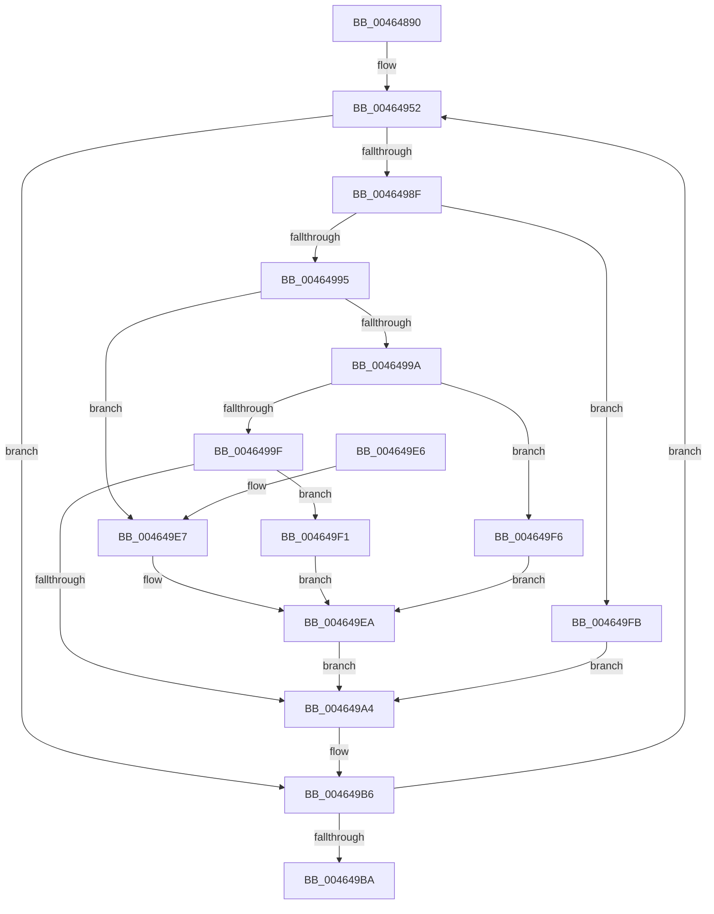

# MiDereferenceSegmentThread

- RVA: `0x00464890`–`0x00464A1D` (길이 `397` bytes)
- VA: `0x0000000140464890`
- 실행 섹션: `.text`
- PDB 이름 있음: `예`; PDB Function 태그: `아니요`
- unwind 정보 RVA: `0x000AA948`
- 디코드: `97`개 명령, `397/397` bytes 표시
- 미해석 바이트: `0` (있으면 어셈블리에 `.byte`로 보존)

> 이 문서는 커널 이미지의 기계어와 PDB 기호를 분석해 생성했습니다. 4번과 5번은 함수 원형과 자료형을 바이너리 사용 방식에서 추정한 C 해석이며 원본 소스 복구 결과는 아닙니다.

## 1. Dependencies

- 직접 호출 지점: **8**; 고유 호출 대상: **8**
- 직접 호출자로 확인된 함수: **0**
- RIP 상대 이미지 참조: **2**

### Outgoing calls
- `0x004648D6` → [KeSetPriorityThread](../2C/KeSetPriorityThread_function_002C76E0.md) (function, `0x002C76E0`)
- `0x00464983` → [KeWaitForMultipleObjects](../20/KeWaitForMultipleObjects_function_0020D110.md) (function, `0x0020D110`)
- `0x004649A9` → [MiIssueSegmentDereferenceWork](MiIssueSegmentDereferenceWork_function_00464AB0.md) (function, `0x00464AB0`)
- `0x004649B1` → [MiSetDeleteOnCloseTimer](MiSetDeleteOnCloseTimer_function_00464A24.md) (function, `0x00464A24`)
- `0x004649C5` → [_security_check_cookie](../6A/_security_check_cookie_function_006AC640.md) (function, `0x006AC640`)
- `0x004649EA` → [KeResetEvent](../24/KeResetEvent_function_00248350.md) (function, `0x00248350`)
- `0x00464A05` → [ExAcquireSpinLockExclusive](../24/ExAcquireSpinLockExclusive_function_00248690.md) (function, `0x00248690`)
- `0x00464A16` → [MiReleaseSpinLockExclusive](../24/MiReleaseSpinLockExclusive_function_002482C0.md) (function, `0x002482C0`)

### Direct callers
- 이 함수 시작 RVA로 연결되는 직접 call은 확인되지 않았습니다. 간접 호출은 완전히 역산할 수 없습니다.

### Static image references
- `0x004648A9` → RVA `0x00E0A740` (`.data`; read)
- `0x004648EB` → RVA `0x00E38D00` (`.data`; read)

## 2. Other-region calls and transfers

- 다른 실행 섹션으로 향하는 call: **0**
- 별도 외부 분기/꼬리 이동을 확인하지 못했습니다.

## 3. Assembly (complete function range)

```asm
00464890  48 89 5C 24 10                  mov qword ptr [rsp + 0x10], rbx
00464895  48 89 6C 24 18                  mov qword ptr [rsp + 0x18], rbp
0046489A  56                              push rsi
0046489B  57                              push rdi
0046489C  41 54                           push r12
0046489E  41 56                           push r14
004648A0  41 57                           push r15
004648A2  48 81 EC 10 02 00 00            sub rsp, 0x210
004648A9  48 8B 05 90 5E 9A 00            mov rax, qword ptr [rip + 0x9a5e90]
004648B0  48 33 C4                        xor rax, rsp
004648B3  48 89 84 24 00 02 00 00         mov qword ptr [rsp + 0x200], rax
004648BB  C6 81 29 08 00 00 01            mov byte ptr [rcx + 0x829], 1
004648C2  48 8B F9                        mov rdi, rcx
004648C5  65 48 8B 1C 25 88 01 00 00      mov rbx, qword ptr gs:[0x188]
004648CE  BA 13 00 00 00                  mov edx, 0x13
004648D3  48 8B CB                        mov rcx, rbx
004648D6  E8 05 2E E6 FF                  call 0x1402c76e0
004648DB  83 8B A4 05 00 00 02            or dword ptr [rbx + 0x5a4], 2
004648E2  48 8D 47 58                     lea rax, [rdi + 0x58]
004648E6  48 89 44 24 40                  mov qword ptr [rsp + 0x40], rax
004648EB  48 8D 0D 0E 44 9D 00            lea rcx, [rip + 0x9d440e]
004648F2  48 8D 87 70 07 00 00            lea rax, [rdi + 0x770]
004648F9  48 89 44 24 50                  mov qword ptr [rsp + 0x50], rax
004648FE  48 8D AF E0 06 00 00            lea rbp, [rdi + 0x6e0]
00464905  48 8D 87 E8 07 00 00            lea rax, [rdi + 0x7e8]
0046490C  48 89 6C 24 48                  mov qword ptr [rsp + 0x48], rbp
00464911  48 89 44 24 60                  mov qword ptr [rsp + 0x60], rax
00464916  4C 8D B7 F8 06 00 00            lea r14, [rdi + 0x6f8]
0046491D  48 8D 87 60 08 00 00            lea rax, [rdi + 0x860]
00464924  4C 89 74 24 58                  mov qword ptr [rsp + 0x58], r14
00464929  48 89 44 24 68                  mov qword ptr [rsp + 0x68], rax
0046492E  4C 8D BF 80 09 00 00            lea r15, [rdi + 0x980]
00464935  48 8D 87 40 09 00 00            lea rax, [rdi + 0x940]
0046493C  4C 89 7C 24 78                  mov qword ptr [rsp + 0x78], r15
00464941  48 89 44 24 70                  mov qword ptr [rsp + 0x70], rax
00464946  48 8B C7                        mov rax, rdi
00464949  48 2B C1                        sub rax, rcx
0046494C  48 F7 D8                        neg rax
0046494F  45 1B E4                        sbb r12d, r12d
00464952  41 B9 12 00 00 00               mov r9d, 0x12
00464958  48 8D 84 24 80 00 00 00         lea rax, [rsp + 0x80]
00464960  48 89 44 24 38                  mov qword ptr [rsp + 0x38], rax
00464965  48 8D 54 24 40                  lea rdx, [rsp + 0x40]
0046496A  48 83 64 24 30 00               and qword ptr [rsp + 0x30], 0
00464970  41 8D 4C 24 08                  lea ecx, [r12 + 8]
00464975  C6 44 24 28 00                  mov byte ptr [rsp + 0x28], 0
0046497A  45 8D 41 EF                     lea r8d, [r9 - 0x11]
0046497E  C6 44 24 20 00                  mov byte ptr [rsp + 0x20], 0
00464983  E8 88 87 DA FF                  call 0x14020d110
00464988  8B F0                           mov esi, eax
0046498A  83 F8 08                        cmp eax, 8
0046498D  7D 27                           jge 0x1404649b6
0046498F  8B D0                           mov edx, eax
00464991  85 C0                           test eax, eax
00464993  74 66                           je 0x1404649fb
00464995  83 EA 01                        sub edx, 1
00464998  74 4D                           je 0x1404649e7
0046499A  83 EA 02                        sub edx, 2
0046499D  74 57                           je 0x1404649f6
0046499F  83 FA 04                        cmp edx, 4
004649A2  74 4D                           je 0x1404649f1
004649A4  8B D6                           mov edx, esi
004649A6  48 8B CF                        mov rcx, rdi
004649A9  E8 02 01 00 00                  call 0x140464ab0
004649AE  48 8B CF                        mov rcx, rdi
004649B1  E8 6E 00 00 00                  call 0x140464a24
004649B6  85 F6                           test esi, esi
004649B8  75 98                           jne 0x140464952
004649BA  48 8B 8C 24 00 02 00 00         mov rcx, qword ptr [rsp + 0x200]
004649C2  48 33 CC                        xor rcx, rsp
004649C5  E8 76 7C 24 00                  call 0x1406ac640
004649CA  4C 8D 9C 24 10 02 00 00         lea r11, [rsp + 0x210]
004649D2  49 8B 5B 38                     mov rbx, qword ptr [r11 + 0x38]
004649D6  49 8B 6B 40                     mov rbp, qword ptr [r11 + 0x40]
004649DA  49 8B E3                        mov rsp, r11
004649DD  41 5F                           pop r15
004649DF  41 5E                           pop r14
004649E1  41 5C                           pop r12
004649E3  5F                              pop rdi
004649E4  5E                              pop rsi
004649E5  C3                              ret
004649E6  CC                              int3
004649E7  48 8B CD                        mov rcx, rbp
004649EA  E8 61 39 DE FF                  call 0x140248350
004649EF  EB B3                           jmp 0x1404649a4
004649F1  49 8B CF                        mov rcx, r15
004649F4  EB F4                           jmp 0x1404649ea
004649F6  49 8B CE                        mov rcx, r14
004649F9  EB EF                           jmp 0x1404649ea
004649FB  48 8D 9F C0 06 00 00            lea rbx, [rdi + 0x6c0]
00464A02  48 8B CB                        mov rcx, rbx
00464A05  E8 86 3C DE FF                  call 0x140248690
00464A0A  8A D0                           mov dl, al
00464A0C  C6 87 28 08 00 00 01            mov byte ptr [rdi + 0x828], 1
00464A13  48 8B CB                        mov rcx, rbx
00464A16  E8 A5 38 DE FF                  call 0x1402482c0
00464A1B  EB 87                           jmp 0x1404649a4
```

## 4. C-style interpretation (structured pseudocode)

```c
__int64 __fastcall MiDereferenceSegmentThread(__int64 a1)
{
    __int64 result;
    __int64 v_rsp;
    unsigned __int64 v_stack_m1B8;
    unsigned __int64 v_stack_m1C0;
    unsigned __int64 v_stack_m1C8;
    unsigned __int64 v_stack_m1D0;
    unsigned __int64 v_stack_m1D8;
    unsigned __int64 v_stack_m1E0;
    unsigned __int64 v_stack_m1E8;
    unsigned __int64 v_stack_m1F0;
    unsigned __int64 v_stack_m1F8;
    unsigned __int64 v_stack_m200;
    unsigned __int64 v_stack_m208;
    unsigned __int8 v_stack_m210;
    unsigned __int8 v_stack_m218;
    unsigned __int64 v_stack_m28;
    unsigned __int64 v_stack_m38;
    unsigned __int64 v_stack_p10;
    unsigned __int64 v_stack_p18;

    v_stack_p10 = v_rbx;
    v_stack_p18 = v_rbp;
    v_rsp = (v_rsp) - (528);
    result = (*(unsigned __int64 *)(v_rip + 10116752)) ^ (v_rsp);
    v_stack_m38 = result;
    *(unsigned __int8 *)(a1 + 2089) = 1;
    result = KeSetPriorityThread(*(unsigned __int64 *)(gs_base + (0 + 392)), 19, a3, a4);
    v_stack_m1F8 = a1 + 88;
    v_stack_m1E8 = a1 + 1904;
    v_stack_m1F0 = a1 + 1760;
    v_stack_m1D8 = a1 + 2024;
    v_stack_m1E0 = a1 + 1784;
    v_stack_m1D0 = a1 + 2144;
    v_stack_m1C0 = a1 + 2432;
    v_stack_m1C8 = a1 + 2368;
    result = (a1) - (v_rip + 10306574);
    result = -(result);
loc_00464952:
    v_stack_m200 = v_stack_m1B8;
    v_stack_m210 = 0;
    v_stack_m218 = 0;
    result = KeWaitForMultipleObjects(v_r12 + 8, v_stack_m1F8, 18 - 17, 18);
    if (((unsigned int)(result)) >= 8) goto loc_004649B6;
    if ((unsigned int)(result) == 0) goto loc_004649FB;
    a2 = (unsigned int)(((unsigned int)((unsigned int)(result))) - (1));
    if (condition_is_equal) goto loc_004649E7;
    a2 = (unsigned int)((a2) - (2));
    if (condition_is_equal) goto loc_004649F6;
    if (((unsigned int)(a2)) == 4) goto loc_004649F1;
loc_004649A4:
    result = MiIssueSegmentDereferenceWork(a1, (unsigned int)((unsigned int)((unsigned int)((unsigned int)(result)))), 18 - 17, 18);
    result = MiSetDeleteOnCloseTimer(a1, (unsigned int)((unsigned int)((unsigned int)((unsigned int)(result)))), 18 - 17, 18);
loc_004649B6:
    if ((unsigned int)((unsigned int)((unsigned int)(result))) != 0) goto loc_00464952;
    a1 = (v_stack_m38) ^ (v_rsp);
    result = _security_check_cookie(a1, (unsigned int)((unsigned int)((unsigned int)((unsigned int)(result)))), 18 - 17, 18);
    return result;
loc_004649E7:
loc_004649EA:
    result = KeResetEvent(*(unsigned __int64 *)(v_stack_m28 + 64), (unsigned int)((unsigned int)((unsigned int)((unsigned int)(result)))), 18 - 17, 18);
    goto loc_004649A4;
loc_004649F1:
    goto loc_004649EA;
loc_004649F6:
    goto loc_004649EA;
loc_004649FB:
    result = ExAcquireSpinLockExclusive(a1 + 1728, (unsigned int)((unsigned int)((unsigned int)((unsigned int)(result)))), 18 - 17, 18);
    *(unsigned __int8 *)(a1 + 2088) = 1;
    result = MiReleaseSpinLockExclusive(a1 + 1728, (unsigned __int8)(result), 18 - 17, 18);
    goto loc_004649A4;
}
```

## 5. (Beta) C Style

```c
int64_t MiDereferenceSegmentThread(void *Arg1)
{
    uint8_t *arg1 = (uint8_t *)Arg1;

    int64_t result;
    int64_t local_rsp;
    uint64_t v_stack_m1B8;
    uint64_t v_stack_m1C0;
    uint64_t v_stack_m1C8;
    uint64_t v_stack_m1D0;
    uint64_t v_stack_m1D8;
    uint64_t v_stack_m1E0;
    uint64_t v_stack_m1E8;
    uint64_t v_stack_m1F0;
    uint64_t v_stack_m1F8;
    uint64_t v_stack_m200;
    uint64_t v_stack_m208;
    uint8_t v_stack_m210;
    uint8_t v_stack_m218;
    uint64_t v_stack_m28;
    uint64_t v_stack_m38;
    uint64_t v_stack_p10;
    uint64_t v_stack_p18;

    v_stack_p10 = local_rbx;
    v_stack_p18 = local_rbp;
    local_rsp = (local_rsp) - (528);
    result = (*(uint64_t *)(v_rip + 0x9A5E90)) ^ (local_rsp);
    v_stack_m38 = result;
    *(uint8_t *)(arg1 + 0x829) = 1;
    result = KeSetPriorityThread(*(uint64_t *)(gs_base + (0 + 0x188)), 19, a3, a4);
    v_stack_m1F8 = Arg1 + 88;
    v_stack_m1E8 = Arg1 + 1904;
    v_stack_m1F0 = Arg1 + 1760;
    v_stack_m1D8 = Arg1 + 2024;
    v_stack_m1E0 = Arg1 + 1784;
    v_stack_m1D0 = Arg1 + 2144;
    v_stack_m1C0 = Arg1 + 2432;
    v_stack_m1C8 = Arg1 + 2368;
    result = (Arg1) - (v_rip + 10306574);
    result = -(result);
loc_00464952:
    v_stack_m200 = v_stack_m1B8;
    v_stack_m210 = 0;
    v_stack_m218 = 0;
    result = KeWaitForMultipleObjects(local_r12 + 8, v_stack_m1F8, 18 - 17, 18);
    if (((uint32_t)(result)) >= 8) goto loc_004649B6;
    if ((uint32_t)(result) == 0) goto loc_004649FB;
    a2 = (uint32_t)(((uint32_t)((uint32_t)(result))) - (1));
    if (condition_is_equal) goto loc_004649E7;
    a2 = (uint32_t)((a2) - (2));
    if (condition_is_equal) goto loc_004649F6;
    if (((uint32_t)(a2)) == 4) goto loc_004649F1;
loc_004649A4:
    result = MiIssueSegmentDereferenceWork(Arg1, (uint32_t)((uint32_t)((uint32_t)((uint32_t)(result)))), 18 - 17, 18);
    result = MiSetDeleteOnCloseTimer(Arg1, (uint32_t)((uint32_t)((uint32_t)((uint32_t)(result)))), 18 - 17, 18);
loc_004649B6:
    if ((uint32_t)((uint32_t)((uint32_t)(result))) != 0) goto loc_00464952;
    Arg1 = (v_stack_m38) ^ (local_rsp);
    result = _security_check_cookie(Arg1, (uint32_t)((uint32_t)((uint32_t)((uint32_t)(result)))), 18 - 17, 18);
    return result;
loc_004649E7:
loc_004649EA:
    result = KeResetEvent(*(uint64_t *)(v_stack_m28 + 0x40), (uint32_t)((uint32_t)((uint32_t)((uint32_t)(result)))), 18 - 17, 18);
    goto loc_004649A4;
loc_004649F1:
    goto loc_004649EA;
loc_004649F6:
    goto loc_004649EA;
loc_004649FB:
    result = ExAcquireSpinLockExclusive(Arg1 + 1728, (uint32_t)((uint32_t)((uint32_t)((uint32_t)(result)))), 18 - 17, 18);
    *(uint8_t *)(arg1 + 0x828) = 1;
    result = MiReleaseSpinLockExclusive(Arg1 + 1728, (uint8_t)(result), 18 - 17, 18);
    goto loc_004649A4;
}
```

### 관측된 메모리 오프셋

구조체 형식이 확인되지 않은 접근은 인자 기준의 오프셋으로만 기록했습니다.

| 기준 인자 | 오프셋 표현 | 폭 (bit) | 접근 |
|---|---:|---:|---|
| `Arg1` | `+ 0x58` | `64` | `R` |
| `Arg1` | `+ 0x6C0` | `64` | `R` |
| `Arg1` | `+ 0x6E0` | `64` | `R` |
| `Arg1` | `+ 0x6F8` | `64` | `R` |
| `Arg1` | `+ 0x770` | `64` | `R` |
| `Arg1` | `+ 0x7E8` | `64` | `R` |
| `Arg1` | `+ 0x828` | `8` | `W` |
| `Arg1` | `+ 0x829` | `8` | `W` |
| `Arg1` | `+ 0x860` | `64` | `R` |
| `Arg1` | `+ 0x940` | `64` | `R` |
| `Arg1` | `+ 0x980` | `64` | `R` |

## 6. Execution-region graph

[열기: 2D/3D 그래프와 함수 탐색 컨트롤 패널](../../../control-panel.html?section=text&rva=0x00464890&view=graph)

- 2D 그래프는 위에서 아래로 흐르고, 3D 그래프는 빈 공간을 드래그해 회전합니다. Shift+드래그는 이동, 휠은 확대·축소, 함수 노드 선택은 대상 보고서 이동입니다.

### Static fallback


