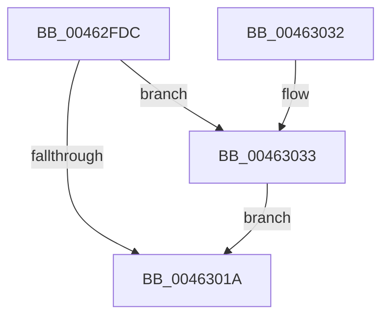

# MiDestroySection

- RVA: `0x00462FDC`–`0x0046303D` (길이 `97` bytes)
- VA: `0x0000000140462FDC`
- 실행 섹션: `.text`
- PDB 이름 있음: `예`; PDB Function 태그: `아니요`
- unwind 정보 RVA: `0x0005C748`
- 디코드: `29`개 명령, `97/97` bytes 표시
- 미해석 바이트: `0` (있으면 어셈블리에 `.byte`로 보존)

> 이 문서는 커널 이미지의 기계어와 PDB 기호를 분석해 생성했습니다. 4번과 5번은 함수 원형과 자료형을 바이너리 사용 방식에서 추정한 C 해석이며 원본 소스 복구 결과는 아닙니다.

## 1. Dependencies

- 직접 호출 지점: **5**; 고유 호출 대상: **5**
- 직접 호출자로 확인된 함수: **4**
- RIP 상대 이미지 참조: **0**

### Outgoing calls
- `0x00462FFC` → [MiDrainControlAreaWrites](MiDrainControlAreaWrites_function_0046317C.md) (function, `0x0046317C`)
- `0x00463004` → [MiClearFilePointer](MiClearFilePointer_function_00463044.md) (function, `0x00463044`)
- `0x00463010` → [MiReleaseSpinLockExclusive](../24/MiReleaseSpinLockExclusive_function_002482C0.md) (function, `0x002482C0`)
- `0x0046301D` → [MiSegmentDelete](../../page/A1/MiSegmentDelete_function_00A1FBB4.md) (function, `0x00A1FBB4`)
- `0x00463036` → [MiDeleteDebuggerPatches](../4B/MiDeleteDebuggerPatches_function_004B7EAC.md) (function, `0x004B7EAC`)

### Direct callers
- [MiEntireSubsectionIsPurged](../29/MiEntireSubsectionIsPurged_function_00297C04.md) at `0x00297CBB`
- [MiCleanSection](MiCleanSection_function_00462E1C.md) at `0x00462FB3`
- [MiDeleteCachedEntries](../67/MiDeleteCachedEntries_function_00677A28.md) at `0x00677C3E`
- [MiProcessDeleteOnClose](../67/MiProcessDeleteOnClose_function_006783D8.md) at `0x006784A2`

### Static image references
- 디코드된 RIP-relative 메모리 참조가 없습니다.

## 2. Other-region calls and transfers

- 다른 실행 섹션으로 향하는 call: **1**
  - `0x0046301D` → [MiSegmentDelete](../../page/A1/MiSegmentDelete_function_00A1FBB4.md) (`.text` → `PAGE`)
- 별도 외부 분기/꼬리 이동을 확인하지 못했습니다.

## 3. Assembly (complete function range)

```asm
00462FDC  48 89 5C 24 08                  mov qword ptr [rsp + 8], rbx
00462FE1  48 89 74 24 10                  mov qword ptr [rsp + 0x10], rsi
00462FE6  57                              push rdi
00462FE7  48 83 EC 20                     sub rsp, 0x20
00462FEB  8B 59 38                        mov ebx, dword ptr [rcx + 0x38]
00462FEE  40 8A FA                        mov dil, dl
00462FF1  8B C3                           mov eax, ebx
00462FF3  48 8B F1                        mov rsi, rcx
00462FF6  83 C8 09                        or eax, 9
00462FF9  89 41 38                        mov dword ptr [rcx + 0x38], eax
00462FFC  E8 7B 01 00 00                  call 0x14046317c
00463001  48 8B CE                        mov rcx, rsi
00463004  E8 3B 00 00 00                  call 0x140463044
00463009  48 8D 4E 48                     lea rcx, [rsi + 0x48]
0046300D  40 8A D7                        mov dl, dil
00463010  E8 AB 52 DE FF                  call 0x1402482c0
00463015  F6 C3 20                        test bl, 0x20
00463018  75 19                           jne 0x140463033
0046301A  48 8B CE                        mov rcx, rsi
0046301D  E8 92 CB 5B 00                  call 0x140a1fbb4
00463022  48 8B 5C 24 30                  mov rbx, qword ptr [rsp + 0x30]
00463027  48 8B 74 24 38                  mov rsi, qword ptr [rsp + 0x38]
0046302C  48 83 C4 20                     add rsp, 0x20
00463030  5F                              pop rdi
00463031  C3                              ret
00463032  CC                              int3
00463033  48 8B CE                        mov rcx, rsi
00463036  E8 71 4E 05 00                  call 0x1404b7eac
0046303B  EB DD                           jmp 0x14046301a
```

## 4. C-style interpretation (structured pseudocode)

```c
__int64 __fastcall MiDestroySection(__int64 a1, unsigned __int8 a2)
{
    __int64 result;
    __int64 v_rsp;
    unsigned __int64 v_stack_p10;
    unsigned __int64 v_stack_p8;

    v_stack_p8 = v_rbx;
    v_stack_p10 = v_rsi;
    v_rsp = (v_rsp) - (32);
    result = (unsigned int)(((unsigned int)((unsigned int)((unsigned int)(*(unsigned int *)(a1 + 56))))) | (9));
    *(unsigned int *)(a1 + 56) = (unsigned int)(result);
    result = MiDrainControlAreaWrites(a1, a2, a3, a4);
    result = MiClearFilePointer(a1, a2, a3, a4);
    result = MiReleaseSpinLockExclusive(a1 + 72, a2, a3, a4);
    if ((((unsigned __int8)((unsigned int)(*(unsigned int *)(a1 + 56)))) & (32)) != 0) goto loc_00463033;
loc_0046301A:
    result = MiSegmentDelete(a1, a2, a3, a4);
    v_rsp = (v_rsp) + (32);
    return result;
loc_00463033:
    result = MiDeleteDebuggerPatches(v_stack_p10, a2, a3, a4);
    goto loc_0046301A;
}
```

## 5. (Beta) C Style

```c
int64_t MiDestroySection(void *Arg1, uint8_t Arg2)
{
    uint8_t *arg1 = (uint8_t *)Arg1;

    int64_t result;
    int64_t local_rsp;
    uint64_t v_stack_p10;
    uint64_t v_stack_p8;

    v_stack_p8 = local_rbx;
    v_stack_p10 = local_rsi;
    local_rsp = (local_rsp) - (32);
    result = (uint32_t)(((uint32_t)((uint32_t)((uint32_t)(*(uint32_t *)(arg1 + 0x38))))) | (9));
    *(uint32_t *)(arg1 + 0x38) = (uint32_t)(result);
    result = MiDrainControlAreaWrites(Arg1, Arg2, a3, a4);
    result = MiClearFilePointer(Arg1, Arg2, a3, a4);
    result = MiReleaseSpinLockExclusive(Arg1 + 72, Arg2, a3, a4);
    if ((((uint8_t)((uint32_t)(*(uint32_t *)(arg1 + 0x38)))) & (32)) != 0) goto loc_00463033;
loc_0046301A:
    result = MiSegmentDelete(Arg1, Arg2, a3, a4);
    local_rsp = (local_rsp) + (32);
    return result;
loc_00463033:
    result = MiDeleteDebuggerPatches(v_stack_p10, Arg2, a3, a4);
    goto loc_0046301A;
}
```

### 관측된 메모리 오프셋

구조체 형식이 확인되지 않은 접근은 인자 기준의 오프셋으로만 기록했습니다.

| 기준 인자 | 오프셋 표현 | 폭 (bit) | 접근 |
|---|---:|---:|---|
| `Arg1` | `+ 0x38` | `32` | `R` |
| `Arg1` | `+ 0x38` | `32` | `W` |
| `Arg1` | `+ 0x48` | `64` | `R` |

## 6. Execution-region graph

[열기: 2D/3D 그래프와 함수 탐색 컨트롤 패널](../../../control-panel.html?section=text&rva=0x00462FDC&view=graph)

- 2D 그래프는 위에서 아래로 흐르고, 3D 그래프는 빈 공간을 드래그해 회전합니다. Shift+드래그는 이동, 휠은 확대·축소, 함수 노드 선택은 대상 보고서 이동입니다.

### Static fallback


