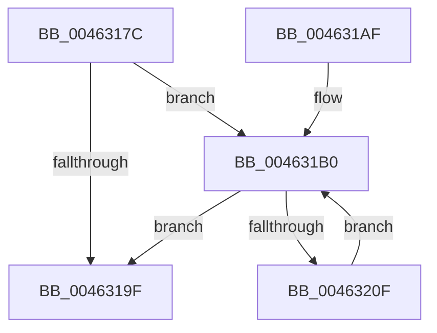

# MiDrainControlAreaWrites

- RVA: `0x0046317C`–`0x00463211` (길이 `149` bytes)
- VA: `0x000000014046317C`
- 실행 섹션: `.text`
- PDB 이름 있음: `예`; PDB Function 태그: `아니요`
- unwind 정보 RVA: `0x000AA638`
- 디코드: `40`개 명령, `149/149` bytes 표시
- 미해석 바이트: `0` (있으면 어셈블리에 `.byte`로 보존)

> 이 문서는 커널 이미지의 기계어와 PDB 기호를 분석해 생성했습니다. 4번과 5번은 함수 원형과 자료형을 바이너리 사용 방식에서 추정한 C 해석이며 원본 소스 복구 결과는 아닙니다.

## 1. Dependencies

- 직접 호출 지점: **3**; 고유 호출 대상: **3**
- 직접 호출자로 확인된 함수: **2**
- RIP 상대 이미지 참조: **0**

### Outgoing calls
- `0x004631E9` → [MiReleaseSpinLockExclusive](../24/MiReleaseSpinLockExclusive_function_002482C0.md) (function, `0x002482C0`)
- `0x004631F9` → [KeWaitForGate](../2C/KeWaitForGate_function_002CA794.md) (function, `0x002CA794`)
- `0x00463202` → [ExAcquireSpinLockExclusive](../24/ExAcquireSpinLockExclusive_function_00248690.md) (function, `0x00248690`)

### Direct callers
- [MiDestroySection](MiDestroySection_function_00462FDC.md) at `0x00462FFC`
- [MiPrepareSegmentForDeletion](MiPrepareSegmentForDeletion_function_004630A8.md) at `0x004630E5`

### Static image references
- 디코드된 RIP-relative 메모리 참조가 없습니다.

## 2. Other-region calls and transfers

- 다른 실행 섹션으로 향하는 call: **0**
- 별도 외부 분기/꼬리 이동을 확인하지 못했습니다.

## 3. Assembly (complete function range)

```asm
0046317C  48 89 5C 24 08                  mov qword ptr [rsp + 8], rbx
00463181  48 89 7C 24 10                  mov qword ptr [rsp + 0x10], rdi
00463186  55                              push rbp
00463187  48 8B EC                        mov rbp, rsp
0046318A  48 83 EC 50                     sub rsp, 0x50
0046318E  83 65 DC 00                     and dword ptr [rbp - 0x24], 0
00463192  48 8B D9                        mov rbx, rcx
00463195  83 79 4C 00                     cmp dword ptr [rcx + 0x4c], 0
00463199  C6 45 E3 00                     mov byte ptr [rbp - 0x1d], 0
0046319D  75 11                           jne 0x1404631b0
0046319F  48 8B 5C 24 60                  mov rbx, qword ptr [rsp + 0x60]
004631A4  48 8B 7C 24 68                  mov rdi, qword ptr [rsp + 0x68]
004631A9  48 83 C4 50                     add rsp, 0x50
004631AD  5D                              pop rbp
004631AE  C3                              ret
004631AF  CC                              int3
004631B0  83 65 E4 00                     and dword ptr [rbp - 0x1c], 0
004631B4  48 8D 45 E8                     lea rax, [rbp - 0x18]
004631B8  48 89 45 F0                     mov qword ptr [rbp - 0x10], rax
004631BC  48 8D 4B 48                     lea rcx, [rbx + 0x48]
004631C0  48 8D 45 E8                     lea rax, [rbp - 0x18]
004631C4  C7 45 D8 08 00 00 00            mov dword ptr [rbp - 0x28], 8
004631CB  48 89 45 E8                     mov qword ptr [rbp - 0x18], rax
004631CF  48 8B 43 50                     mov rax, qword ptr [rbx + 0x50]
004631D3  48 89 45 D0                     mov qword ptr [rbp - 0x30], rax
004631D7  48 8D 45 D0                     lea rax, [rbp - 0x30]
004631DB  48 89 43 50                     mov qword ptr [rbx + 0x50], rax
004631DF  66 C7 45 E0 07 01               mov word ptr [rbp - 0x20], 0x107
004631E5  C6 45 E2 06                     mov byte ptr [rbp - 0x1e], 6
004631E9  E8 D2 50 DE FF                  call 0x1402482c0
004631EE  45 33 C0                        xor r8d, r8d
004631F1  48 8D 4D E0                     lea rcx, [rbp - 0x20]
004631F5  41 8D 50 12                     lea edx, [r8 + 0x12]
004631F9  E8 96 75 E6 FF                  call 0x1402ca794
004631FE  48 8D 4B 48                     lea rcx, [rbx + 0x48]
00463202  E8 89 54 DE FF                  call 0x140248690
00463207  83 7B 4C 00                     cmp dword ptr [rbx + 0x4c], 0
0046320B  8A D0                           mov dl, al
0046320D  74 90                           je 0x14046319f
0046320F  EB 9F                           jmp 0x1404631b0
```

## 4. C-style interpretation (structured pseudocode)

```c
__int64 __fastcall MiDrainControlAreaWrites(__int64 a1, __int64 a2, int a3)
{
    __int64 result;
    __int64 v_rsp;
    unsigned __int64 v_stack_m18;
    unsigned __int64 v_stack_m20;
    unsigned int v_stack_m24;
    unsigned __int8 v_stack_m25;
    unsigned __int8 v_stack_m26;
    unsigned __int16 v_stack_m28;
    unsigned int v_stack_m2C;
    unsigned int v_stack_m30;
    unsigned __int64 v_stack_m38;
    unsigned __int64 v_stack_p10;
    unsigned __int64 v_stack_p8;

    v_stack_p8 = v_rbx;
    v_stack_p10 = v_rdi;
    v_rsp = (v_rsp) - (80);
    v_stack_m25 = 0;
    if ((*(unsigned int *)(a1 + 76)) != 0) goto loc_004631B0;
loc_0046319F:
    v_rsp = (v_rsp) + (80);
    return result;
loc_004631B0:
    v_stack_m18 = v_stack_m20;
    v_stack_m30 = 8;
    v_stack_m20 = v_stack_m20;
    v_stack_m38 = *(unsigned __int64 *)(v_stack_p8 + 80);
    *(unsigned __int64 *)(v_stack_p8 + 80) = v_stack_m38;
    v_stack_m28 = 263;
    v_stack_m26 = 6;
    result = MiReleaseSpinLockExclusive(v_stack_p8 + 72, a2, a3, a4);
    a3 = 0;
    result = KeWaitForGate(v_stack_m28, a3 + 18, a3, a4);
    result = ExAcquireSpinLockExclusive(v_stack_p8 + 72, a3 + 18, a3, a4);
    if ((*(unsigned int *)(v_stack_p8 + 76)) == 0) goto loc_0046319F;
    goto loc_004631B0;
}
```

## 5. (Beta) C Style

```c
int64_t MiDrainControlAreaWrites(void *Arg1, int64_t Arg2, int32_t Arg3)
{
    uint8_t *arg1 = (uint8_t *)Arg1;

    int64_t result;
    int64_t local_rsp;
    uint64_t v_stack_m18;
    uint64_t v_stack_m20;
    uint32_t v_stack_m24;
    uint8_t v_stack_m25;
    uint8_t v_stack_m26;
    uint16_t v_stack_m28;
    uint32_t v_stack_m2C;
    uint32_t v_stack_m30;
    uint64_t v_stack_m38;
    uint64_t v_stack_p10;
    uint64_t v_stack_p8;

    v_stack_p8 = local_rbx;
    v_stack_p10 = local_rdi;
    local_rsp = (local_rsp) - (80);
    v_stack_m25 = 0;
    if ((*(uint32_t *)(arg1 + 0x4C)) != 0) goto loc_004631B0;
loc_0046319F:
    local_rsp = (local_rsp) + (80);
    return result;
loc_004631B0:
    v_stack_m18 = v_stack_m20;
    v_stack_m30 = 8;
    v_stack_m20 = v_stack_m20;
    v_stack_m38 = *(uint64_t *)(v_stack_p8 + 0x50);
    *(uint64_t *)(v_stack_p8 + 0x50) = v_stack_m38;
    v_stack_m28 = 263;
    v_stack_m26 = 6;
    result = MiReleaseSpinLockExclusive(v_stack_p8 + 72, Arg2, Arg3, a4);
    Arg3 = 0;
    result = KeWaitForGate(v_stack_m28, Arg3 + 18, Arg3, a4);
    result = ExAcquireSpinLockExclusive(v_stack_p8 + 72, Arg3 + 18, Arg3, a4);
    if ((*(uint32_t *)(v_stack_p8 + 0x4C)) == 0) goto loc_0046319F;
    goto loc_004631B0;
}
```

### 관측된 메모리 오프셋

구조체 형식이 확인되지 않은 접근은 인자 기준의 오프셋으로만 기록했습니다.

| 기준 인자 | 오프셋 표현 | 폭 (bit) | 접근 |
|---|---:|---:|---|
| `Arg1` | `+ 0x48` | `64` | `R` |
| `Arg1` | `+ 0x4C` | `32` | `R` |
| `Arg1` | `+ 0x50` | `64` | `R` |
| `Arg1` | `+ 0x50` | `64` | `W` |

## 6. Execution-region graph

[열기: 2D/3D 그래프와 함수 탐색 컨트롤 패널](../../../control-panel.html?section=text&rva=0x0046317C&view=graph)

- 2D 그래프는 위에서 아래로 흐르고, 3D 그래프는 빈 공간을 드래그해 회전합니다. Shift+드래그는 이동, 휠은 확대·축소, 함수 노드 선택은 대상 보고서 이동입니다.

### Static fallback


