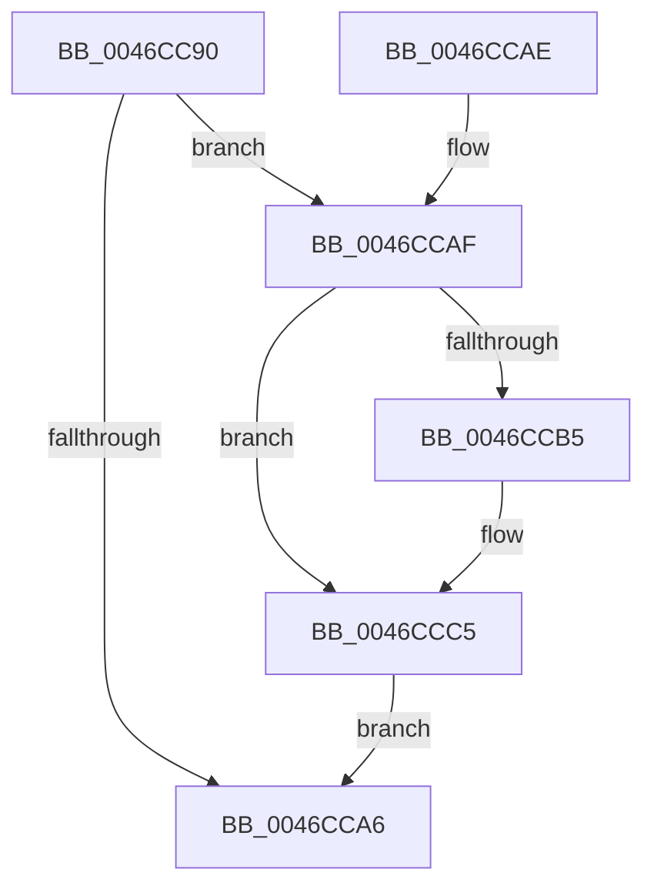

# MiEmptyWorkingSetTail

- RVA: `0x0046CC90`–`0x0046CCD1` (길이 `65` bytes)
- VA: `0x000000014046CC90`
- 실행 섹션: `.text`
- PDB 이름 있음: `예`; PDB Function 태그: `아니요`
- unwind 정보 RVA: `0x00092364`
- 디코드: `20`개 명령, `65/65` bytes 표시
- 미해석 바이트: `0` (있으면 어셈블리에 `.byte`로 보존)

> 이 문서는 커널 이미지의 기계어와 PDB 기호를 분석해 생성했습니다. 4번과 5번은 함수 원형과 자료형을 바이너리 사용 방식에서 추정한 C 해석이며 원본 소스 복구 결과는 아닙니다.

## 1. Dependencies

- 직접 호출 지점: **2**; 고유 호출 대상: **2**
- 직접 호출자로 확인된 함수: **0**
- RIP 상대 이미지 참조: **0**

### Outgoing calls
- `0x0046CCC0` → [MiFreeWsleList](../24/MiFreeWsleList_function_00241168.md) (function, `0x00241168`)
- `0x0046CCC5` → [MiReleaseProcessorFlushList](../31/MiReleaseProcessorFlushList_function_00313C70.md) (function, `0x00313C70`)

### Direct callers
- 이 함수 시작 RVA로 연결되는 직접 call은 확인되지 않았습니다. 간접 호출은 완전히 역산할 수 없습니다.

### Static image references
- 디코드된 RIP-relative 메모리 참조가 없습니다.

## 2. Other-region calls and transfers

- 다른 실행 섹션으로 향하는 call: **0**
- 별도 외부 분기/꼬리 이동을 확인하지 못했습니다.

## 3. Assembly (complete function range)

```asm
0046CC90  40 53                           push rbx
0046CC92  48 83 EC 20                     sub rsp, 0x20
0046CC96  48 8B 99 B8 00 00 00            mov rbx, qword ptr [rcx + 0xb8]
0046CC9D  48 8B 53 08                     mov rdx, qword ptr [rbx + 8]
0046CCA1  48 85 D2                        test rdx, rdx
0046CCA4  75 09                           jne 0x14046ccaf
0046CCA6  33 C0                           xor eax, eax
0046CCA8  48 83 C4 20                     add rsp, 0x20
0046CCAC  5B                              pop rbx
0046CCAD  C3                              ret
0046CCAE  CC                              int3
0046CCAF  83 7A 1C 00                     cmp dword ptr [rdx + 0x1c], 0
0046CCB3  74 10                           je 0x14046ccc5
0046CCB5  44 8B 03                        mov r8d, dword ptr [rbx]
0046CCB8  48 8B 49 20                     mov rcx, qword ptr [rcx + 0x20]
0046CCBC  41 83 E0 04                     and r8d, 4
0046CCC0  E8 A3 44 DD FF                  call 0x140241168
0046CCC5  E8 A6 6F EA FF                  call 0x140313c70
0046CCCA  48 83 63 08 00                  and qword ptr [rbx + 8], 0
0046CCCF  EB D5                           jmp 0x14046cca6
```

## 4. C-style interpretation (structured pseudocode)

```c
__int64 __fastcall MiEmptyWorkingSetTail(__int64 a1)
{
    __int64 result;
    __int64 v_rsp;

    v_rsp = (v_rsp) - (32);
    if (*(unsigned __int64 *)(*(unsigned __int64 *)(a1 + 184) + 8) != 0) goto loc_0046CCAF;
loc_0046CCA6:
    result = 0;
    v_rsp = (v_rsp) + (32);
    return result;
loc_0046CCAF:
    if ((*(unsigned int *)(*(unsigned __int64 *)(*(unsigned __int64 *)(a1 + 184) + 8) + 28)) != 0) {
        a3 = *(unsigned int *)(*(unsigned __int64 *)(a1 + 184));
        a1 = *(unsigned __int64 *)(a1 + 32);
        a3 = (unsigned int)((a3) & (4));
        result = MiFreeWsleList(a1, *(unsigned __int64 *)(*(unsigned __int64 *)(a1 + 184) + 8), a3, a4);
    }
    result = MiReleaseProcessorFlushList(a1, *(unsigned __int64 *)(*(unsigned __int64 *)(a1 + 184) + 8), a3, a4);
    goto loc_0046CCA6;
}
```

## 5. (Beta) C Style

```c
int64_t MiEmptyWorkingSetTail(void *Arg1)
{
    uint8_t *arg1 = (uint8_t *)Arg1;

    int64_t result;
    int64_t local_rsp;

    local_rsp = (local_rsp) - (32);
    if (*(uint64_t *)(*(uint64_t *)(arg1 + 0xB8) + 0x8) != 0) goto loc_0046CCAF;
loc_0046CCA6:
    result = 0;
    local_rsp = (local_rsp) + (32);
    return result;
loc_0046CCAF:
    if ((*(uint32_t *)(*(uint64_t *)(*(uint64_t *)(arg1 + 0xB8) + 0x8) + 0x1C)) != 0) {
        a3 = *(uint32_t *)(*(uint64_t *)(arg1 + 0xB8));
        Arg1 = *(uint64_t *)(arg1 + 0x20);
        a3 = (uint32_t)((a3) & (4));
        result = MiFreeWsleList(Arg1, *(uint64_t *)(*(uint64_t *)(arg1 + 0xB8) + 0x8), a3, a4);
    }
    result = MiReleaseProcessorFlushList(Arg1, *(uint64_t *)(*(uint64_t *)(arg1 + 0xB8) + 0x8), a3, a4);
    goto loc_0046CCA6;
}
```

### 관측된 메모리 오프셋

구조체 형식이 확인되지 않은 접근은 인자 기준의 오프셋으로만 기록했습니다.

| 기준 인자 | 오프셋 표현 | 폭 (bit) | 접근 |
|---|---:|---:|---|
| `Arg1` | `+ 0x20` | `64` | `R` |
| `Arg1` | `+ 0xB8` | `64` | `R` |

## 6. Execution-region graph

[열기: 2D/3D 그래프와 함수 탐색 컨트롤 패널](../../../control-panel.html?section=text&rva=0x0046CC90&view=graph)

- 2D 그래프는 위에서 아래로 흐르고, 3D 그래프는 빈 공간을 드래그해 회전합니다. Shift+드래그는 이동, 휠은 확대·축소, 함수 노드 선택은 대상 보고서 이동입니다.

### Static fallback


