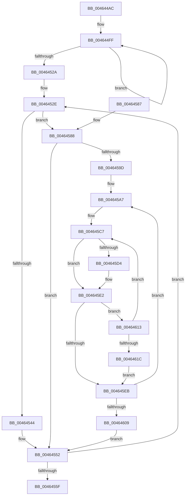

# MiFillHyperPtes

- RVA: `0x004644AC`–`0x0046461E` (길이 `370` bytes)
- VA: `0x00000001404644AC`
- 실행 섹션: `.text`
- PDB 이름 있음: `예`; PDB Function 태그: `아니요`
- unwind 정보 RVA: `0x000AA880`
- 디코드: `99`개 명령, `370/370` bytes 표시
- 미해석 바이트: `0` (있으면 어셈블리에 `.byte`로 보존)

> 이 문서는 커널 이미지의 기계어와 PDB 기호를 분석해 생성했습니다. 4번과 5번은 함수 원형과 자료형을 바이너리 사용 방식에서 추정한 C 해석이며 원본 소스 복구 결과는 아닙니다.

## 1. Dependencies

- 직접 호출 지점: **5**; 고유 호출 대상: **5**
- 직접 호출자로 확인된 함수: **1**
- RIP 상대 이미지 참조: **1**

### Outgoing calls
- `0x00464567` → [_security_check_cookie](../6A/_security_check_cookie_function_006AC640.md) (function, `0x006AC640`)
- `0x004645C2` → [MiMakeSystemAddressValid](../27/MiMakeSystemAddressValid_function_0027FF70.md) (function, `0x0027FF70`)
- `0x004645CA` → [MI_READ_PTE_LOCK_FREE](../28/MI_READ_PTE_LOCK_FREE_function_002828A0.md) (function, `0x002828A0`)
- `0x004645DD` → [MiMakeHyperPteDemandZero](MiMakeHyperPteDemandZero_function_00464624.md) (function, `0x00464624`)
- `0x004645F5` → [MiUnlockPageTable](../21/MiUnlockPageTable_function_00216EC0.md) (function, `0x00216EC0`)

### Direct callers
- [MiMakeHyperRangeAccessible](../27/MiMakeHyperRangeAccessible_function_0027CE10.md) at `0x0027D001`

### Static image references
- `0x004644C3` → RVA `0x00E0A740` (`.data`; read)

## 2. Other-region calls and transfers

- 다른 실행 섹션으로 향하는 call: **0**
- 별도 외부 분기/꼬리 이동을 확인하지 못했습니다.

## 3. Assembly (complete function range)

```asm
004644AC  48 89 5C 24 10                  mov qword ptr [rsp + 0x10], rbx
004644B1  55                              push rbp
004644B2  56                              push rsi
004644B3  57                              push rdi
004644B4  41 54                           push r12
004644B6  41 55                           push r13
004644B8  41 56                           push r14
004644BA  41 57                           push r15
004644BC  48 81 EC 80 00 00 00            sub rsp, 0x80
004644C3  48 8B 05 76 62 9A 00            mov rax, qword ptr [rip + 0x9a6276]
004644CA  48 33 C4                        xor rax, rsp
004644CD  48 89 44 24 70                  mov qword ptr [rsp + 0x70], rax
004644D2  41 BC 04 00 00 00               mov r12d, 4
004644D8  49 8B E9                        mov rbp, r9
004644DB  45 8A E8                        mov r13b, r8b
004644DE  4C 89 64 24 20                  mov qword ptr [rsp + 0x20], r12
004644E3  45 8B D4                        mov r10d, r12d
004644E6  49 B8 00 00 00 00 80 F6 FF FF   movabs r8, 0xfffff68000000000
004644F0  4C 8D 4C 24 38                  lea r9, [rsp + 0x38]
004644F5  49 BB F8 FF FF FF 7F 00 00 00   movabs r11, 0x7ffffffff8
004644FF  49 89 49 F8                     mov qword ptr [r9 - 8], rcx
00464503  48 C1 E9 09                     shr rcx, 9
00464507  49 23 CB                        and rcx, r11
0046450A  49 89 11                        mov qword ptr [r9], rdx
0046450D  49 8B C0                        mov rax, r8
00464510  48 C1 EA 09                     shr rdx, 9
00464514  48 03 C8                        add rcx, rax
00464517  49 23 D3                        and rdx, r11
0046451A  49 8B C0                        mov rax, r8
0046451D  48 03 D0                        add rdx, rax
00464520  4D 8D 49 10                     lea r9, [r9 + 0x10]
00464524  49 83 EA 01                     sub r10, 1
00464528  75 D5                           jne 0x1404644ff
0046452A  41 8D 72 03                     lea esi, [r10 + 3]
0046452E  48 63 C6                        movsxd rax, esi
00464531  48 03 C0                        add rax, rax
00464534  83 7D 00 00                     cmp dword ptr [rbp], 0
00464538  48 8B 7C C4 30                  mov rdi, qword ptr [rsp + rax*8 + 0x30]
0046453D  48 8B 5C C4 38                  mov rbx, qword ptr [rsp + rax*8 + 0x38]
00464542  75 44                           jne 0x140464588
00464544  48 2B DF                        sub rbx, rdi
00464547  48 C1 FB 03                     sar rbx, 3
0046454B  48 FF C3                        inc rbx
0046454E  48 01 5D 08                     add qword ptr [rbp + 8], rbx
00464552  FF CE                           dec esi
00464554  49 83 EC 01                     sub r12, 1
00464558  4C 89 64 24 20                  mov qword ptr [rsp + 0x20], r12
0046455D  75 CF                           jne 0x14046452e
0046455F  48 8B 4C 24 70                  mov rcx, qword ptr [rsp + 0x70]
00464564  48 33 CC                        xor rcx, rsp
00464567  E8 D4 80 24 00                  call 0x1406ac640
0046456C  48 8B 9C 24 C8 00 00 00         mov rbx, qword ptr [rsp + 0xc8]
00464574  48 81 C4 80 00 00 00            add rsp, 0x80
0046457B  41 5F                           pop r15
0046457D  41 5E                           pop r14
0046457F  41 5D                           pop r13
00464581  41 5C                           pop r12
00464583  5F                              pop rdi
00464584  5E                              pop rsi
00464585  5D                              pop rbp
00464586  C3                              ret
00464587  CC                              int3
00464588  65 48 8B 04 25 88 01 00 00      mov rax, qword ptr gs:[0x188]
00464591  4C 8B B0 B8 00 00 00            mov r14, qword ptr [rax + 0xb8]
00464598  48 3B FB                        cmp rdi, rbx
0046459B  77 B5                           ja 0x140464552
0046459D  49 BC 00 00 00 00 80 F6 FF FF   movabs r12, 0xfffff68000000000
004645A7  4C 8B FF                        mov r15, rdi
004645AA  49 C1 EF 09                     shr r15, 9
004645AE  4D 23 FB                        and r15, r11
004645B1  49 8B C4                        mov rax, r12
004645B4  4C 03 F8                        add r15, rax
004645B7  45 33 C9                        xor r9d, r9d
004645BA  45 8A C5                        mov r8b, r13b
004645BD  33 D2                           xor edx, edx
004645BF  48 8B CF                        mov rcx, rdi
004645C2  E8 A9 B9 E1 FF                  call 0x14027ff70
004645C7  48 8B CF                        mov rcx, rdi
004645CA  E8 D1 E2 E1 FF                  call 0x1402828a0
004645CF  48 85 C0                        test rax, rax
004645D2  75 0E                           jne 0x1404645e2
004645D4  4C 8B CD                        mov r9, rbp
004645D7  44 8B C6                        mov r8d, esi
004645DA  48 8B CF                        mov rcx, rdi
004645DD  E8 42 00 00 00                  call 0x140464624
004645E2  48 83 C7 08                     add rdi, 8
004645E6  48 3B FB                        cmp rdi, rbx
004645E9  76 28                           jbe 0x140464613
004645EB  49 8B D7                        mov rdx, r15
004645EE  49 8D 8E 00 04 00 00            lea rcx, [r14 + 0x400]
004645F5  E8 C6 28 DB FF                  call 0x140216ec0
004645FA  49 BB F8 FF FF FF 7F 00 00 00   movabs r11, 0x7ffffffff8
00464604  48 3B FB                        cmp rdi, rbx
00464607  76 9E                           jbe 0x1404645a7
00464609  4C 8B 64 24 20                  mov r12, qword ptr [rsp + 0x20]
0046460E  E9 3F FF FF FF                  jmp 0x140464552
00464613  48 F7 C7 FF 0F 00 00            test rdi, 0xfff
0046461A  75 AB                           jne 0x1404645c7
0046461C  EB CD                           jmp 0x1404645eb
```

## 4. C-style interpretation (structured pseudocode)

```c
__int64 __fastcall MiFillHyperPtes(__int64 a1, __int64 a2, unsigned __int8 a3, __int64 a4)
{
    __int64 result;
    __int64 v_r10;
    __int64 v_r12;
    __int64 v_r15;
    __int64 v_rbx;
    __int64 v_rdi;
    __int64 v_rsi;
    __int64 v_rsp;
    unsigned __int64 v_stack_m48;
    unsigned __int64 v_stack_m80;
    unsigned __int64 v_stack_m98;
    unsigned __int64 v_stack_p10;
    unsigned __int64 v_stack_p20;

    v_stack_p10 = v_rbx;
    v_rsp = (v_rsp) - (128);
    result = (*(unsigned __int64 *)(v_rip + 10117750)) ^ (v_rsp);
    v_stack_m48 = result;
    v_stack_m98 = 4;
loc_004644FF:
    *(unsigned __int64 *)(v_stack_m80 - 8) = a1;
    a1 = (a1) >> (9);
    a1 = (a1) & (v_r11);
    *(unsigned __int64 *)(v_stack_m80) = a2;
    a2 = (a2) >> (9);
    a1 = (a1) + (a3);
    a2 = (a2) & (v_r11);
    a2 = (a2) + (a3);
    v_r10 = (4) - (1);
    if (condition_is_not_equal) goto loc_004644FF;
loc_0046452E:
    result = ((int)((unsigned int)(v_r10 + 3))) + ((int)((unsigned int)(v_r10 + 3)));
    if ((*(unsigned int *)(a4)) != 0) goto loc_00464588;
    v_rbx = (*(unsigned __int64 *)(v_rsp + result * 8 + 56)) - (*(unsigned __int64 *)(v_rsp + result * 8 + 48));
    v_rbx = (v_rbx) >> (3);
    v_rbx = (v_rbx) + 1;
loc_00464552:
    v_rsi = (unsigned int)((v_r10 + 3) - 1);
    v_r12 = (4) - (1);
    v_stack_m98 = v_r12;
    if (condition_is_not_equal) goto loc_0046452E;
    a1 = (v_stack_m48) ^ (v_rsp);
    result = _security_check_cookie(a1, a2, a3, v_stack_m80 + 16);
    v_rsp = (v_rsp) + (128);
    return result;
loc_00464588:
    if ((*(unsigned __int64 *)(v_rsp + result * 8 + 48)) > v_stack_p10) goto loc_00464552;
loc_004645A7:
    v_r15 = (*(unsigned __int64 *)(v_rsp + result * 8 + 48)) >> (9);
    v_r15 = (v_r15) & (v_r11);
    v_r15 = (v_r15) + (v_r12);
    a4 = 0;
    a2 = 0;
    result = MiMakeSystemAddressValid(*(unsigned __int64 *)(v_rsp + result * 8 + 48), a2, a3, a4);
loc_004645C7:
    result = MI_READ_PTE_LOCK_FREE(*(unsigned __int64 *)(v_rsp + result * 8 + 48), a2, a3, a4);
    if (result == 0) {
        a4 = 0;
        a3 = (unsigned int)(v_rsi);
        a1 = *(unsigned __int64 *)(v_rsp + result * 8 + 48);
        result = MiMakeHyperPteDemandZero(a1, a2, a3, a4);
    }
    v_rdi = (*(unsigned __int64 *)(v_rsp + result * 8 + 48)) + (8);
    if (v_rdi <= v_stack_p10) goto loc_00464613;
loc_004645EB:
    result = MiUnlockPageTable(*(unsigned __int64 *)(*(unsigned __int64 *)(gs_base + (0 + 392)) + 184) + 1024, v_r15, a3, a4);
    if (v_rdi <= v_stack_p10) goto loc_004645A7;
    goto loc_00464552;
loc_00464613:
    if (((v_rdi) & (0xFFFULL)) != 0) goto loc_004645C7;
    goto loc_004645EB;
}
```

## 5. (Beta) C Style

```c
int64_t MiFillHyperPtes(int64_t Arg1, int64_t Arg2, uint8_t Arg3, void *Arg4)
{
    uint8_t *arg4 = (uint8_t *)Arg4;

    int64_t result;
    int64_t local_r10;
    int64_t local_r12;
    int64_t local_r15;
    int64_t local_rbx;
    int64_t local_rdi;
    int64_t local_rsi;
    int64_t local_rsp;
    uint64_t v_stack_m48;
    uint64_t v_stack_m80;
    uint64_t v_stack_m98;
    uint64_t v_stack_p10;
    uint64_t v_stack_p20;

    v_stack_p10 = local_rbx;
    local_rsp = (local_rsp) - (128);
    result = (*(uint64_t *)(v_rip + 0x9A6276)) ^ (local_rsp);
    v_stack_m48 = result;
    v_stack_m98 = 4;
loc_004644FF:
    *(uint64_t *)(v_stack_m80 - 0x8) = Arg1;
    Arg1 = (Arg1) >> (9);
    Arg1 = (Arg1) & (local_r11);
    *(uint64_t *)(v_stack_m80) = Arg2;
    Arg2 = (Arg2) >> (9);
    Arg1 = (Arg1) + (Arg3);
    Arg2 = (Arg2) & (local_r11);
    Arg2 = (Arg2) + (Arg3);
    local_r10 = (4) - (1);
    if (condition_is_not_equal) goto loc_004644FF;
loc_0046452E:
    result = ((int32_t)((uint32_t)(local_r10 + 3))) + ((int32_t)((uint32_t)(local_r10 + 3)));
    if ((*(uint32_t *)(arg4)) != 0) goto loc_00464588;
    local_rbx = (*(uint64_t *)(local_rsp + result * 8 + 0x38)) - (*(uint64_t *)(local_rsp + result * 8 + 0x30));
    local_rbx = (local_rbx) >> (3);
    local_rbx = (local_rbx) + 1;
loc_00464552:
    local_rsi = (uint32_t)((local_r10 + 3) - 1);
    local_r12 = (4) - (1);
    v_stack_m98 = local_r12;
    if (condition_is_not_equal) goto loc_0046452E;
    Arg1 = (v_stack_m48) ^ (local_rsp);
    result = _security_check_cookie(Arg1, Arg2, Arg3, v_stack_m80 + 16);
    local_rsp = (local_rsp) + (128);
    return result;
loc_00464588:
    if ((*(uint64_t *)(local_rsp + result * 8 + 0x30)) > v_stack_p10) goto loc_00464552;
loc_004645A7:
    local_r15 = (*(uint64_t *)(local_rsp + result * 8 + 0x30)) >> (9);
    local_r15 = (local_r15) & (local_r11);
    local_r15 = (local_r15) + (local_r12);
    Arg4 = 0;
    Arg2 = 0;
    result = MiMakeSystemAddressValid(*(uint64_t *)(local_rsp + result * 8 + 0x30), Arg2, Arg3, Arg4);
loc_004645C7:
    result = MI_READ_PTE_LOCK_FREE(*(uint64_t *)(local_rsp + result * 8 + 0x30), Arg2, Arg3, Arg4);
    if (result == 0) {
        Arg4 = 0;
        Arg3 = (uint32_t)(local_rsi);
        Arg1 = *(uint64_t *)(local_rsp + result * 8 + 0x30);
        result = MiMakeHyperPteDemandZero(Arg1, Arg2, Arg3, Arg4);
    }
    local_rdi = (*(uint64_t *)(local_rsp + result * 8 + 0x30)) + (8);
    if (local_rdi <= v_stack_p10) goto loc_00464613;
loc_004645EB:
    result = MiUnlockPageTable(*(uint64_t *)(*(uint64_t *)(gs_base + (0 + 0x188)) + 0xB8) + 1024, local_r15, Arg3, Arg4);
    if (local_rdi <= v_stack_p10) goto loc_004645A7;
    goto loc_00464552;
loc_00464613:
    if (((local_rdi) & (0xFFFULL)) != 0) goto loc_004645C7;
    goto loc_004645EB;
}
```

### 관측된 메모리 오프셋

구조체 형식이 확인되지 않은 접근은 인자 기준의 오프셋으로만 기록했습니다.

| 기준 인자 | 오프셋 표현 | 폭 (bit) | 접근 |
|---|---:|---:|---|
| `Arg4` | `+ 0x0` | `32` | `R` |
| `Arg4` | `+ 0x8` | `64` | `R/W` |

## 6. Execution-region graph

[열기: 2D/3D 그래프와 함수 탐색 컨트롤 패널](../../../control-panel.html?section=text&rva=0x004644AC&view=graph)

- 2D 그래프는 위에서 아래로 흐르고, 3D 그래프는 빈 공간을 드래그해 회전합니다. Shift+드래그는 이동, 휠은 확대·축소, 함수 노드 선택은 대상 보고서 이동입니다.

### Static fallback


