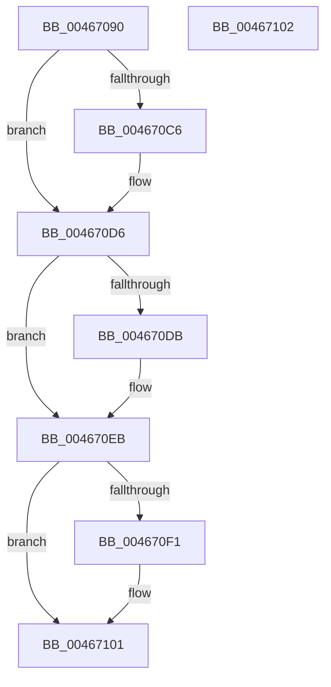

# MiFillVirtualFaultInfo

- RVA: `0x00467090`–`0x00467103` (길이 `115` bytes)
- VA: `0x0000000140467090`
- 실행 섹션: `.text`
- PDB 이름 있음: `예`; PDB Function 태그: `아니요`
- unwind 정보 RVA: `0x000DB714`
- 디코드: `26`개 명령, `115/115` bytes 표시
- 미해석 바이트: `0` (있으면 어셈블리에 `.byte`로 보존)

> 이 문서는 커널 이미지의 기계어와 PDB 기호를 분석해 생성했습니다. 4번과 5번은 함수 원형과 자료형을 바이너리 사용 방식에서 추정한 C 해석이며 원본 소스 복구 결과는 아닙니다.

## 1. Dependencies

- 직접 호출 지점: **0**; 고유 호출 대상: **0**
- 직접 호출자로 확인된 함수: **2**
- RIP 상대 이미지 참조: **0**

### Outgoing calls
- 직접 디코드된 call 명령이 없습니다.

### Direct callers
- [MiAllocateWsle](../33/MiAllocateWsle_function_003332C0.md) at `0x00333DF7`
- [MiValidVirtualizationFault](MiValidVirtualizationFault_function_00466EC0.md) at `0x00466F2E`

### Static image references
- 디코드된 RIP-relative 메모리 참조가 없습니다.

## 2. Other-region calls and transfers

- 다른 실행 섹션으로 향하는 call: **0**
- 별도 외부 분기/꼬리 이동을 확인하지 못했습니다.

## 3. Assembly (complete function range)

```asm
00467090  48 8B 01                        mov rax, qword ptr [rcx]
00467093  49 B9 00 00 00 00 00 00 F0 FF   movabs r9, 0xfff0000000000000
0046709D  49 23 C1                        and rax, r9
004670A0  49 B9 00 00 00 00 00 00 10 00   movabs r9, 0x10000000000000
004670AA  49 0B C1                        or rax, r9
004670AD  49 B9 FF FF FF FF FF FF 0F 00   movabs r9, 0xfffffffffffff
004670B7  49 23 D1                        and rdx, r9
004670BA  48 33 C2                        xor rax, rdx
004670BD  48 89 01                        mov qword ptr [rcx], rax
004670C0  41 F6 C0 42                     test r8b, 0x42
004670C4  74 10                           je 0x1404670d6
004670C6  48 BA 00 00 00 00 00 00 20 00   movabs rdx, 0x20000000000000
004670D0  48 0B C2                        or rax, rdx
004670D3  48 89 01                        mov qword ptr [rcx], rax
004670D6  4D 85 C0                        test r8, r8
004670D9  78 10                           js 0x1404670eb
004670DB  48 BA 00 00 00 00 00 00 40 00   movabs rdx, 0x40000000000000
004670E5  48 0B C2                        or rax, rdx
004670E8  48 89 01                        mov qword ptr [rcx], rax
004670EB  41 F6 C0 18                     test r8b, 0x18
004670EF  74 10                           je 0x140467101
004670F1  48 BA 00 00 00 00 00 00 80 00   movabs rdx, 0x80000000000000
004670FB  48 0B C2                        or rax, rdx
004670FE  48 89 01                        mov qword ptr [rcx], rax
00467101  C3                              ret
00467102  CC                              int3
```

## 4. C-style interpretation (structured pseudocode)

```c
__int64 __fastcall MiFillVirtualFaultInfo(__int64 a1, __int64 a2, __int64 a3)
{
    __int64 result;

    result = (*(unsigned __int64 *)(a1)) & (a4);
    result = (result) | (a4);
    a2 = (a2) & (a4);
    result = (result) ^ (a2);
    *(unsigned __int64 *)(a1) = result;
    if ((((unsigned __int8)(a3)) & (66)) != 0) {
        result = (result) | (a2);
        *(unsigned __int64 *)(a1) = result;
    }
    if (!(sign_flag)) {
        result = (result) | (a2);
        *(unsigned __int64 *)(a1) = result;
    }
    if ((((unsigned __int8)(a3)) & (24)) != 0) {
        result = (result) | (a2);
        *(unsigned __int64 *)(a1) = result;
    }
    return result;
}
```

## 5. (Beta) C Style

```c
int64_t MiFillVirtualFaultInfo(void *Arg1, int64_t Arg2, int64_t Arg3)
{
    uint8_t *arg1 = (uint8_t *)Arg1;

    int64_t result;

    result = (*(uint64_t *)(arg1)) & (a4);
    result = (result) | (a4);
    Arg2 = (Arg2) & (a4);
    result = (result) ^ (Arg2);
    *(uint64_t *)(arg1) = result;
    if ((((uint8_t)(Arg3)) & (66)) != 0) {
        result = (result) | (Arg2);
        *(uint64_t *)(arg1) = result;
    }
    if (!(sign_flag)) {
        result = (result) | (Arg2);
        *(uint64_t *)(arg1) = result;
    }
    if ((((uint8_t)(Arg3)) & (24)) != 0) {
        result = (result) | (Arg2);
        *(uint64_t *)(arg1) = result;
    }
    return result;
}
```

### 관측된 메모리 오프셋

구조체 형식이 확인되지 않은 접근은 인자 기준의 오프셋으로만 기록했습니다.

| 기준 인자 | 오프셋 표현 | 폭 (bit) | 접근 |
|---|---:|---:|---|
| `Arg1` | `+ 0x0` | `64` | `R` |
| `Arg1` | `+ 0x0` | `64` | `W` |

## 6. Execution-region graph

[열기: 2D/3D 그래프와 함수 탐색 컨트롤 패널](../../../control-panel.html?section=text&rva=0x00467090&view=graph)

- 2D 그래프는 위에서 아래로 흐르고, 3D 그래프는 빈 공간을 드래그해 회전합니다. Shift+드래그는 이동, 휠은 확대·축소, 함수 노드 선택은 대상 보고서 이동입니다.

### Static fallback


