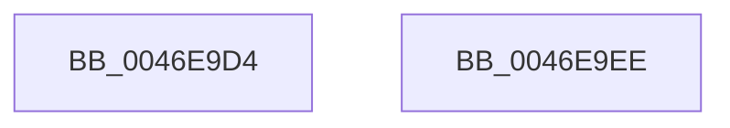

# MiGetControlAreaLoadConfig

- RVA: `0x0046E9D4`–`0x0046E9EF` (길이 `27` bytes)
- VA: `0x000000014046E9D4`
- 실행 섹션: `.text`
- PDB 이름 있음: `예`; PDB Function 태그: `아니요`
- unwind 정보 RVA: `0x000DB714`
- 디코드: `9`개 명령, `27/27` bytes 표시
- 미해석 바이트: `0` (있으면 어셈블리에 `.byte`로 보존)

> 이 문서는 커널 이미지의 기계어와 PDB 기호를 분석해 생성했습니다. 4번과 5번은 함수 원형과 자료형을 바이너리 사용 방식에서 추정한 C 해석이며 원본 소스 복구 결과는 아닙니다.

## 1. Dependencies

- 직접 호출 지점: **0**; 고유 호출 대상: **0**
- 직접 호출자로 확인된 함수: **7**
- RIP 상대 이미지 참조: **0**

### Outgoing calls
- 직접 디코드된 call 명령이 없습니다.

### Direct callers
- [MiAllowImageMap](../../page/8C/MiAllowImageMap_function_008C8B10.md) at `0x008C8B67`
- [MiDoesImageContainFunctionOverrideFixups](../../page/8D/MiDoesImageContainFunctionOverrideFixups_function_008D05D8.md) at `0x008D05DC`
- [MiMarkPrivateImageCfgBits](../../page/8D/MiMarkPrivateImageCfgBits_function_008D07FC.md) at `0x008D087E`
- [MiMarkSharedImageCfgBits](../../page/8D/MiMarkSharedImageCfgBits_function_008D0CC4.md) at `0x008D0D23`
- [MmGetSectionInformation](../../page/92/MmGetSectionInformation_function_00921910.md) at `0x009219DA`
- [MiRelocateImageAgain](../../page/98/MiRelocateImageAgain_function_009885C8.md) at `0x009886AE`
- [MiSwitchBaseAddress](../../page/98/MiSwitchBaseAddress_function_00988CDC.md) at `0x00988D3D`

### Static image references
- 디코드된 RIP-relative 메모리 참조가 없습니다.

## 2. Other-region calls and transfers

- 다른 실행 섹션으로 향하는 call: **0**
- 별도 외부 분기/꼬리 이동을 확인하지 못했습니다.

## 3. Assembly (complete function range)

```asm
0046E9D4  48 8B 41 60                     mov rax, qword ptr [rcx + 0x60]
0046E9D8  48 83 E0 F8                     and rax, 0xfffffffffffffff8
0046E9DC  48 8B 50 20                     mov rdx, qword ptr [rax + 0x20]
0046E9E0  48 8D 4A 48                     lea rcx, [rdx + 0x48]
0046E9E4  48 F7 DA                        neg rdx
0046E9E7  48 1B C0                        sbb rax, rax
0046E9EA  48 23 C1                        and rax, rcx
0046E9ED  C3                              ret
0046E9EE  CC                              int3
```

## 4. C-style interpretation (structured pseudocode)

```c
__int64 __fastcall MiGetControlAreaLoadConfig(__int64 a1)
{
    __int64 result;

    result = (*(unsigned __int64 *)(a1 + 96)) & (-8);
    a2 = -(*(unsigned __int64 *)(result + 32));
    result = (result) & (*(unsigned __int64 *)(result + 32) + 72);
    return result;
}
```

## 5. (Beta) C Style

```c
int64_t MiGetControlAreaLoadConfig(void *Arg1)
{
    uint8_t *arg1 = (uint8_t *)Arg1;

    int64_t result;

    result = (*(uint64_t *)(arg1 + 0x60)) & (-8);
    a2 = -(*(uint64_t *)(result + 0x20));
    result = (result) & (*(uint64_t *)(result + 0x20) + 72);
    return result;
}
```

### 관측된 메모리 오프셋

구조체 형식이 확인되지 않은 접근은 인자 기준의 오프셋으로만 기록했습니다.

| 기준 인자 | 오프셋 표현 | 폭 (bit) | 접근 |
|---|---:|---:|---|
| `Arg1` | `+ 0x60` | `64` | `R` |

## 6. Execution-region graph

[열기: 2D/3D 그래프와 함수 탐색 컨트롤 패널](../../../control-panel.html?section=text&rva=0x0046E9D4&view=graph)

- 2D 그래프는 위에서 아래로 흐르고, 3D 그래프는 빈 공간을 드래그해 회전합니다. Shift+드래그는 이동, 휠은 확대·축소, 함수 노드 선택은 대상 보고서 이동입니다.

### Static fallback


