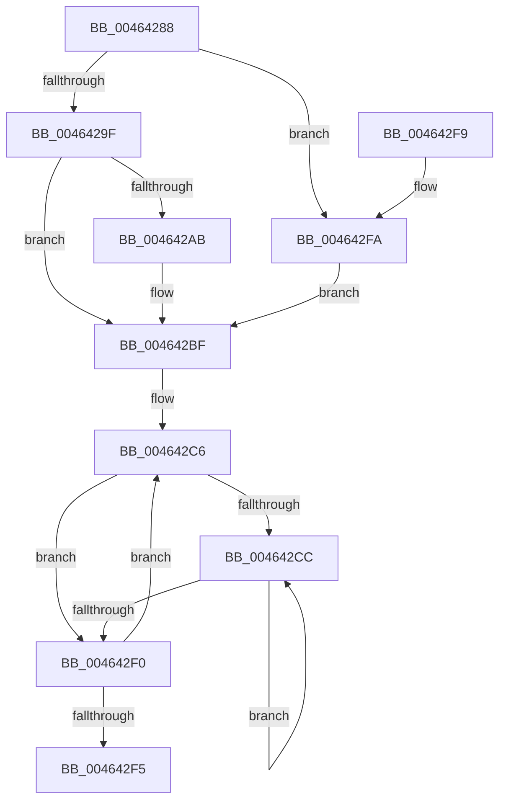

# MiGetNumberOfCachedPtes

- RVA: `0x00464288`–`0x00464302` (길이 `122` bytes)
- VA: `0x0000000140464288`
- 실행 섹션: `.text`
- PDB 이름 있음: `예`; PDB Function 태그: `아니요`
- unwind 정보 RVA: `0x000DB714`
- 디코드: `36`개 명령, `122/122` bytes 표시
- 미해석 바이트: `0` (있으면 어셈블리에 `.byte`로 보존)

> 이 문서는 커널 이미지의 기계어와 PDB 기호를 분석해 생성했습니다. 4번과 5번은 함수 원형과 자료형을 바이너리 사용 방식에서 추정한 C 해석이며 원본 소스 복구 결과는 아닙니다.

## 1. Dependencies

- 직접 호출 지점: **0**; 고유 호출 대상: **0**
- 직접 호출자로 확인된 함수: **2**
- RIP 상대 이미지 참조: **3**

### Outgoing calls
- 직접 디코드된 call 명령이 없습니다.

### Direct callers
- [MmGetNumberOfFreeSystemPtes](MmGetNumberOfFreeSystemPtes_function_004640D0.md) at `0x004640F6`
- [MiPteBinsNeedTrimming](MiPteBinsNeedTrimming_function_00464228.md) at `0x00464231`

### Static image references
- `0x0046428C` → RVA `0x00E37668` (`.data`; read)
- `0x004642AB` → RVA `0x00E35E80` (`.data`; read)
- `0x004642BF` → RVA `0x00FC5000` (`ALMOSTRO`; read)

## 2. Other-region calls and transfers

- 다른 실행 섹션으로 향하는 call: **0**
- 별도 외부 분기/꼬리 이동을 확인하지 못했습니다.

## 3. Assembly (complete function range)

```asm
00464288  4C 8B 51 50                     mov r10, qword ptr [rcx + 0x50]
0046428C  48 8D 05 D5 33 9D 00            lea rax, [rip + 0x9d33d5]
00464293  45 33 C9                        xor r9d, r9d
00464296  45 8D 59 01                     lea r11d, [r9 + 1]
0046429A  48 3B C8                        cmp rcx, rax
0046429D  74 5B                           je 0x1404642fa
0046429F  8B 41 28                        mov eax, dword ptr [rcx + 0x28]
004642A2  45 8D 41 02                     lea r8d, [r9 + 2]
004642A6  41 84 C3                        test r11b, al
004642A9  75 14                           jne 0x1404642bf
004642AB  48 8D 15 CE 1B 9D 00            lea rdx, [rip + 0x9d1bce]
004642B2  41 8B C3                        mov eax, r11d
004642B5  48 3B CA                        cmp rcx, rdx
004642B8  41 0F 44 C0                     cmove eax, r8d
004642BC  44 8B C0                        mov r8d, eax
004642BF  0F B7 05 3A 0D B6 00            movzx eax, word ptr [rip + 0xb60d3a]
004642C6  33 C9                           xor ecx, ecx
004642C8  85 C0                           test eax, eax
004642CA  74 24                           je 0x1404642f0
004642CC  49 8B 42 40                     mov rax, qword ptr [r10 + 0x40]
004642D0  48 85 C0                        test rax, rax
004642D3  4A 8D 14 08                     lea rdx, [rax + r9]
004642D7  0F B7 05 22 0D B6 00            movzx eax, word ptr [rip + 0xb60d22]
004642DE  49 0F 4E D1                     cmovle rdx, r9
004642E2  49 83 C2 48                     add r10, 0x48
004642E6  41 03 CB                        add ecx, r11d
004642E9  4C 8B CA                        mov r9, rdx
004642EC  3B C8                           cmp ecx, eax
004642EE  72 DC                           jb 0x1404642cc
004642F0  4D 2B C3                        sub r8, r11
004642F3  75 D1                           jne 0x1404642c6
004642F5  49 8B C1                        mov rax, r9
004642F8  C3                              ret
004642F9  CC                              int3
004642FA  41 B8 03 00 00 00               mov r8d, 3
00464300  EB BD                           jmp 0x1404642bf
```

## 4. C-style interpretation (structured pseudocode)

```c
__int64 __fastcall MiGetNumberOfCachedPtes(__int64 a1, __int64 a2, __int64 a3, int a4)
{
    __int64 result;
    __int64 v_r10;

    a4 = 0;
    if (a1 == (v_rip + 10302421)) goto loc_004642FA;
    result = (unsigned int)(*(unsigned int *)(a1 + 40));
    if ((((unsigned __int8)(a4 + 1)) & ((unsigned __int8)((unsigned int)(*(unsigned int *)(a1 + 40))))) == 0) {
        a2 = v_rip + 10296270;
        result = (unsigned int)(a4 + 1);
        if (a1 == a2) { result = (unsigned int)(a4 + 2); }
        a3 = (unsigned int)(result);
    }
loc_004642C6:
    a1 = 0;
    if ((unsigned int)(*(unsigned __int16 *)(v_rip + 11930938)) == 0) goto loc_004642F0;
loc_004642CC:
    a2 = *(unsigned __int64 *)(*(unsigned __int64 *)(a1 + 80) + 64) + a4 * 1;
    if (condition_is_less_or_equal) { a2 = 0; }
    v_r10 = (*(unsigned __int64 *)(a1 + 80)) + (72);
    a1 = (unsigned int)((a1) + ((unsigned int)(a4 + 1)));
    if (((unsigned int)(a1)) < ((unsigned int)(*(unsigned __int16 *)(v_rip + 11930914)))) goto loc_004642CC;
loc_004642F0:
    a3 = (a3) - (a4 + 1);
    if (condition_is_not_equal) goto loc_004642C6;
    return a2;
loc_004642FA:
    goto loc_004642BF;
}
```

## 5. (Beta) C Style

```c
int64_t MiGetNumberOfCachedPtes(void *Arg1, int64_t Arg2, int64_t Arg3, int32_t Arg4)
{
    uint8_t *arg1 = (uint8_t *)Arg1;

    int64_t result;
    int64_t local_r10;

    Arg4 = 0;
    if (Arg1 == (v_rip + 10302421)) goto loc_004642FA;
    result = (uint32_t)(*(uint32_t *)(arg1 + 0x28));
    if ((((uint8_t)(Arg4 + 1)) & ((uint8_t)((uint32_t)(*(uint32_t *)(arg1 + 0x28))))) == 0) {
        Arg2 = v_rip + 10296270;
        result = (uint32_t)(Arg4 + 1);
        if (Arg1 == Arg2) { result = (uint32_t)(Arg4 + 2); }
        Arg3 = (uint32_t)(result);
    }
loc_004642C6:
    Arg1 = 0;
    if ((uint32_t)(*(uint16_t *)(v_rip + 0xB60D3A)) == 0) goto loc_004642F0;
loc_004642CC:
    Arg2 = *(uint64_t *)(*(uint64_t *)(arg1 + 0x50) + 0x40) + Arg4 * 1;
    if (condition_is_less_or_equal) { Arg2 = 0; }
    local_r10 = (*(uint64_t *)(arg1 + 0x50)) + (72);
    Arg1 = (uint32_t)((Arg1) + ((uint32_t)(Arg4 + 1)));
    if (((uint32_t)(Arg1)) < ((uint32_t)(*(uint16_t *)(v_rip + 0xB60D22)))) goto loc_004642CC;
loc_004642F0:
    Arg3 = (Arg3) - (Arg4 + 1);
    if (condition_is_not_equal) goto loc_004642C6;
    return Arg2;
loc_004642FA:
    goto loc_004642BF;
}
```

### 관측된 메모리 오프셋

구조체 형식이 확인되지 않은 접근은 인자 기준의 오프셋으로만 기록했습니다.

| 기준 인자 | 오프셋 표현 | 폭 (bit) | 접근 |
|---|---:|---:|---|
| `Arg1` | `+ 0x50` | `64` | `R` |

## 6. Execution-region graph

[열기: 2D/3D 그래프와 함수 탐색 컨트롤 패널](../../../control-panel.html?section=text&rva=0x00464288&view=graph)

- 2D 그래프는 위에서 아래로 흐르고, 3D 그래프는 빈 공간을 드래그해 회전합니다. Shift+드래그는 이동, 휠은 확대·축소, 함수 노드 선택은 대상 보고서 이동입니다.

### Static fallback


