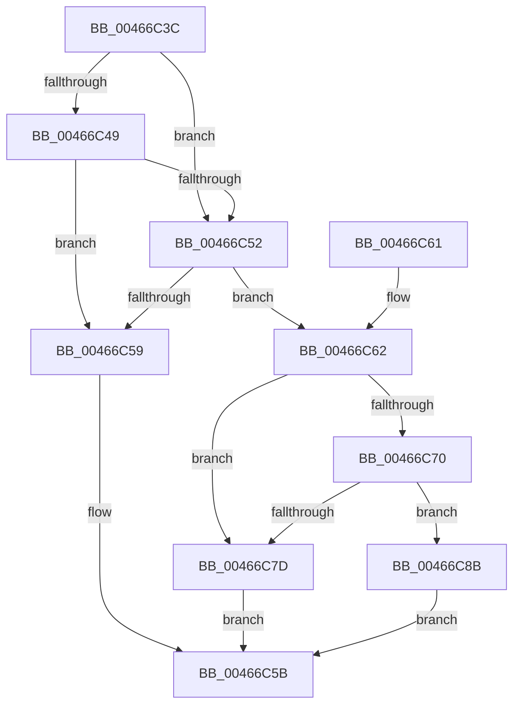

# MiGetPageChainYield

- RVA: `0x00466C3C`–`0x00466C92` (길이 `86` bytes)
- VA: `0x0000000140466C3C`
- 실행 섹션: `.text`
- PDB 이름 있음: `예`; PDB Function 태그: `아니요`
- unwind 정보 RVA: `0x000AAE6C`
- 디코드: `32`개 명령, `86/86` bytes 표시
- 미해석 바이트: `0` (있으면 어셈블리에 `.byte`로 보존)

> 이 문서는 커널 이미지의 기계어와 PDB 기호를 분석해 생성했습니다. 4번과 5번은 함수 원형과 자료형을 바이너리 사용 방식에서 추정한 C 해석이며 원본 소스 복구 결과는 아닙니다.

## 1. Dependencies

- 직접 호출 지점: **2**; 고유 호출 대상: **2**
- 직접 호출자로 확인된 함수: **1**
- RIP 상대 이미지 참조: **0**

### Outgoing calls
- `0x00466C74` → [MiWorkingSetIsContended](../2A/MiWorkingSetIsContended_function_002AE520.md) (function, `0x002AE520`)
- `0x00466C7D` → [KeShouldYieldProcessor](../27/KeShouldYieldProcessor_function_002773E0.md) (function, `0x002773E0`)

### Direct callers
- [MiGetPageChain](../33/MiGetPageChain_function_00330130.md) at `0x0033054A`
- [MiGetPageChain](../33/MiGetPageChain_function_00330130.md) at `0x003305AD`

### Static image references
- 디코드된 RIP-relative 메모리 참조가 없습니다.

## 2. Other-region calls and transfers

- 다른 실행 섹션으로 향하는 call: **0**
- 별도 외부 분기/꼬리 이동을 확인하지 못했습니다.

## 3. Assembly (complete function range)

```asm
00466C3C  40 53                           push rbx
00466C3E  48 83 EC 20                     sub rsp, 0x20
00466C42  33 DB                           xor ebx, ebx
00466C44  48 85 D2                        test rdx, rdx
00466C47  74 09                           je 0x140466c52
00466C49  48 FF CA                        dec rdx
00466C4C  48 85 51 68                     test qword ptr [rcx + 0x68], rdx
00466C50  75 07                           jne 0x140466c59
00466C52  8B 41 20                        mov eax, dword ptr [rcx + 0x20]
00466C55  A8 01                           test al, 1
00466C57  75 09                           jne 0x140466c62
00466C59  33 C0                           xor eax, eax
00466C5B  48 83 C4 20                     add rsp, 0x20
00466C5F  5B                              pop rbx
00466C60  C3                              ret
00466C61  CC                              int3
00466C62  8B 51 1C                        mov edx, dword ptr [rcx + 0x1c]
00466C65  C1 EA 04                        shr edx, 4
00466C68  83 E2 03                        and edx, 3
00466C6B  83 FA 02                        cmp edx, 2
00466C6E  74 0D                           je 0x140466c7d
00466C70  48 8B 49 08                     mov rcx, qword ptr [rcx + 8]
00466C74  E8 A7 78 E4 FF                  call 0x1402ae520
00466C79  85 C0                           test eax, eax
00466C7B  75 0E                           jne 0x140466c8b
00466C7D  E8 5E 07 E1 FF                  call 0x1402773e0
00466C82  85 C0                           test eax, eax
00466C84  0F 95 C3                        setne bl
00466C87  8B C3                           mov eax, ebx
00466C89  EB D0                           jmp 0x140466c5b
00466C8B  B8 01 00 00 00                  mov eax, 1
00466C90  EB C9                           jmp 0x140466c5b
```

## 4. C-style interpretation (structured pseudocode)

```c
__int64 __fastcall MiGetPageChainYield(__int64 a1, __int64 a2)
{
    __int64 result;
    __int64 v_rbx;
    __int64 v_rsp;

    v_rsp = (v_rsp) - (32);
    v_rbx = 0;
    if (a2 == 0) goto loc_00466C52;
    a2 = (a2) - 1;
    if (((*(unsigned __int64 *)(a1 + 104)) & (a2)) != 0) goto loc_00466C59;
loc_00466C52:
    if ((((unsigned __int8)((unsigned int)(*(unsigned int *)(a1 + 32)))) & (1)) != 0) goto loc_00466C62;
loc_00466C59:
    result = 0;
loc_00466C5B:
    v_rsp = (v_rsp) + (32);
    return result;
loc_00466C62:
    a2 = (unsigned int)(((unsigned int)(*(unsigned int *)(a1 + 28))) >> (4));
    a2 = (unsigned int)((a2) & (3));
    if (((unsigned int)(a2)) == 2) goto loc_00466C7D;
    result = MiWorkingSetIsContended(*(unsigned __int64 *)(a1 + 8), a2, a3, a4);
    if ((unsigned int)(result) != 0) goto loc_00466C8B;
loc_00466C7D:
    result = KeShouldYieldProcessor(*(unsigned __int64 *)(a1 + 8), a2, a3, a4);
    v_rbx = ((unsigned int)(result) != 0) ? 1 : 0;
    goto loc_00466C5B;
loc_00466C8B:
    goto loc_00466C5B;
}
```

## 5. (Beta) C Style

```c
int64_t MiGetPageChainYield(void *Arg1, int64_t Arg2)
{
    uint8_t *arg1 = (uint8_t *)Arg1;

    int64_t result;
    int64_t local_rbx;
    int64_t local_rsp;

    local_rsp = (local_rsp) - (32);
    local_rbx = 0;
    if (Arg2 == 0) goto loc_00466C52;
    Arg2 = (Arg2) - 1;
    if (((*(uint64_t *)(arg1 + 0x68)) & (Arg2)) != 0) goto loc_00466C59;
loc_00466C52:
    if ((((uint8_t)((uint32_t)(*(uint32_t *)(arg1 + 0x20)))) & (1)) != 0) goto loc_00466C62;
loc_00466C59:
    result = 0;
loc_00466C5B:
    local_rsp = (local_rsp) + (32);
    return result;
loc_00466C62:
    Arg2 = (uint32_t)(((uint32_t)(*(uint32_t *)(arg1 + 0x1C))) >> (4));
    Arg2 = (uint32_t)((Arg2) & (3));
    if (((uint32_t)(Arg2)) == 2) goto loc_00466C7D;
    result = MiWorkingSetIsContended(*(uint64_t *)(arg1 + 0x8), Arg2, a3, a4);
    if ((uint32_t)(result) != 0) goto loc_00466C8B;
loc_00466C7D:
    result = KeShouldYieldProcessor(*(uint64_t *)(arg1 + 0x8), Arg2, a3, a4);
    local_rbx = ((uint32_t)(result) != 0) ? 1 : 0;
    goto loc_00466C5B;
loc_00466C8B:
    goto loc_00466C5B;
}
```

### 관측된 메모리 오프셋

구조체 형식이 확인되지 않은 접근은 인자 기준의 오프셋으로만 기록했습니다.

| 기준 인자 | 오프셋 표현 | 폭 (bit) | 접근 |
|---|---:|---:|---|
| `Arg1` | `+ 0x8` | `64` | `R` |
| `Arg1` | `+ 0x1C` | `32` | `R` |
| `Arg1` | `+ 0x20` | `32` | `R` |
| `Arg1` | `+ 0x68` | `64` | `R` |

## 6. Execution-region graph

[열기: 2D/3D 그래프와 함수 탐색 컨트롤 패널](../../../control-panel.html?section=text&rva=0x00466C3C&view=graph)

- 2D 그래프는 위에서 아래로 흐르고, 3D 그래프는 빈 공간을 드래그해 회전합니다. Shift+드래그는 이동, 휠은 확대·축소, 함수 노드 선택은 대상 보고서 이동입니다.

### Static fallback


