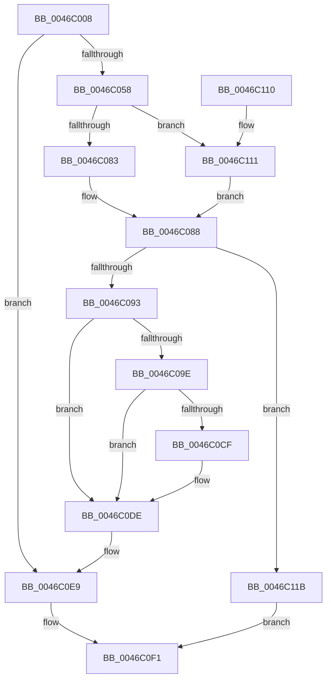

# MiGetPfnPageSizeIndexUnsynchronized

- RVA: `0x0046C008`–`0x0046C129` (길이 `289` bytes)
- VA: `0x000000014046C008`
- 실행 섹션: `.text`
- PDB 이름 있음: `예`; PDB Function 태그: `아니요`
- unwind 정보 RVA: `0x000AB574`
- 디코드: `75`개 명령, `289/289` bytes 표시
- 미해석 바이트: `0` (있으면 어셈블리에 `.byte`로 보존)

> 이 문서는 커널 이미지의 기계어와 PDB 기호를 분석해 생성했습니다. 4번과 5번은 함수 원형과 자료형을 바이너리 사용 방식에서 추정한 C 해석이며 원본 소스 복구 결과는 아닙니다.

## 1. Dependencies

- 직접 호출 지점: **5**; 고유 호출 대상: **5**
- 직접 호출자로 확인된 함수: **7**
- RIP 상대 이미지 참조: **0**

### Outgoing calls
- `0x0046C083` → [MiSafeLockPageAtDpc](../31/MiSafeLockPageAtDpc_function_0031C67C.md) (function, `0x0031C67C`)
- `0x0046C0A1` → [MiGetBaseResidentPage](../31/MiGetBaseResidentPage_function_0031C750.md) (function, `0x0031C750`)
- `0x0046C0C3` → [MiGetPfnPageSizeIndex](../31/MiGetPfnPageSizeIndex_function_0031C710.md) (function, `0x0031C710`)
- `0x0046C0E4` → [MiUnlockPage](../31/MiUnlockPage_function_0031A3E0.md) (function, `0x0031A3E0`)
- `0x0046C111` → [MiSafeLockPage](../32/MiSafeLockPage_function_00321620.md) (function, `0x00321620`)

### Direct callers
- [sub_0023DED5](../23/Unknown_function_0023DED5.md) at `0x0023E033`
- [MiLegitimatePageForDriversToMap](../23/MiLegitimatePageForDriversToMap_function_0023ECE0.md) at `0x0023ED44`
- [MiFillSystemPtes](../31/MiFillSystemPtes_function_00319850.md) at `0x00319F98`
- [MiActivePageClaimCandidate](../31/MiActivePageClaimCandidate_function_0031BB00.md) at `0x0031C4F9`
- [MiGetPagesRemainingInResidentPage](../68/MiGetPagesRemainingInResidentPage_function_0068AC14.md) at `0x0068ACBA`
- [MiZeroPageMakeHot](../69/MiZeroPageMakeHot_function_00696C08.md) at `0x00696CF4`
- [MiCombineAllPhysicalMemory](../../page/9F/MiCombineAllPhysicalMemory_function_009F6B6C.md) at `0x009F6E64`

### Static image references
- 디코드된 RIP-relative 메모리 참조가 없습니다.

## 2. Other-region calls and transfers

- 다른 실행 섹션으로 향하는 call: **0**
- 별도 외부 분기/꼬리 이동을 확인하지 못했습니다.

## 3. Assembly (complete function range)

```asm
0046C008  48 89 5C 24 08                  mov qword ptr [rsp + 8], rbx
0046C00D  48 89 6C 24 10                  mov qword ptr [rsp + 0x10], rbp
0046C012  48 89 74 24 18                  mov qword ptr [rsp + 0x18], rsi
0046C017  57                              push rdi
0046C018  41 54                           push r12
0046C01A  41 55                           push r13
0046C01C  41 56                           push r14
0046C01E  41 57                           push r15
0046C020  48 83 EC 20                     sub rsp, 0x20
0046C024  8B 41 20                        mov eax, dword ptr [rcx + 0x20]
0046C027  4D 8B E0                        mov r12, r8
0046C02A  44 0F B6 71 22                  movzx r14d, byte ptr [rcx + 0x22]
0046C02F  4C 8B EA                        mov r13, rdx
0046C032  C1 E8 10                        shr eax, 0x10
0046C035  41 83 E6 07                     and r14d, 7
0046C039  44 0F B6 F8                     movzx r15d, al
0046C03D  48 8B F1                        mov rsi, rcx
0046C040  48 8B 41 28                     mov rax, qword ptr [rcx + 0x28]
0046C044  BF 03 00 00 00                  mov edi, 3
0046C049  41 C1 EF 06                     shr r15d, 6
0046C04D  48 0F BA E0 28                  bt rax, 0x28
0046C052  0F 83 91 00 00 00               jae 0x14046c0e9
0046C058  44 0F 20 C0                     mov rax, cr8
0046C05C  48 BA 00 00 00 00 00 DE FF FF   movabs rdx, 0xffffde0000000000
0046C066  48 2B CA                        sub rcx, rdx
0046C069  48 BA AB AA AA AA AA AA AA AA   movabs rdx, 0xaaaaaaaaaaaaaaab
0046C073  48 C1 F9 04                     sar rcx, 4
0046C077  48 0F AF CA                     imul rcx, rdx
0046C07B  3C 02                           cmp al, 2
0046C07D  0F 82 8E 00 00 00               jb 0x14046c111
0046C083  E8 F4 05 EB FF                  call 0x14031c67c
0046C088  40 8A E8                        mov bpl, al
0046C08B  3C 11                           cmp al, 0x11
0046C08D  0F 84 88 00 00 00               je 0x14046c11b
0046C093  48 8B 46 28                     mov rax, qword ptr [rsi + 0x28]
0046C097  48 0F BA E0 28                  bt rax, 0x28
0046C09C  73 40                           jae 0x14046c0de
0046C09E  48 8B CE                        mov rcx, rsi
0046C0A1  E8 AA 06 EB FF                  call 0x14031c750
0046C0A6  48 8B D8                        mov rbx, rax
0046C0A9  48 8B CB                        mov rcx, rbx
0046C0AC  44 0F B6 70 22                  movzx r14d, byte ptr [rax + 0x22]
0046C0B1  8B 40 20                        mov eax, dword ptr [rax + 0x20]
0046C0B4  41 83 E6 07                     and r14d, 7
0046C0B8  C1 E8 10                        shr eax, 0x10
0046C0BB  44 0F B6 F8                     movzx r15d, al
0046C0BF  41 C1 EF 06                     shr r15d, 6
0046C0C3  E8 48 06 EB FF                  call 0x14031c710
0046C0C8  8B F8                           mov edi, eax
0046C0CA  48 3B DE                        cmp rbx, rsi
0046C0CD  74 0F                           je 0x14046c0de
0046C0CF  48 B8 FF FF FF FF FF FF FF 7F   movabs rax, 0x7fffffffffffffff
0046C0D9  F0 48 21 43 18                  lock and qword ptr [rbx + 0x18], rax
0046C0DE  40 8A D5                        mov dl, bpl
0046C0E1  48 8B CE                        mov rcx, rsi
0046C0E4  E8 F7 E2 EA FF                  call 0x14031a3e0
0046C0E9  45 89 75 00                     mov dword ptr [r13], r14d
0046C0ED  45 89 3C 24                     mov dword ptr [r12], r15d
0046C0F1  48 8B 5C 24 50                  mov rbx, qword ptr [rsp + 0x50]
0046C0F6  8B C7                           mov eax, edi
0046C0F8  48 8B 6C 24 58                  mov rbp, qword ptr [rsp + 0x58]
0046C0FD  48 8B 74 24 60                  mov rsi, qword ptr [rsp + 0x60]
0046C102  48 83 C4 20                     add rsp, 0x20
0046C106  41 5F                           pop r15
0046C108  41 5E                           pop r14
0046C10A  41 5D                           pop r13
0046C10C  41 5C                           pop r12
0046C10E  5F                              pop rdi
0046C10F  C3                              ret
0046C110  CC                              int3
0046C111  E8 0A 55 EB FF                  call 0x140321620
0046C116  E9 6D FF FF FF                  jmp 0x14046c088
0046C11B  41 C7 45 00 05 00 00 00         mov dword ptr [r13], 5
0046C123  41 89 3C 24                     mov dword ptr [r12], edi
0046C127  EB C8                           jmp 0x14046c0f1
```

## 4. C-style interpretation (structured pseudocode)

```c
__int64 __fastcall MiGetPfnPageSizeIndexUnsynchronized(__int64 a1, __int64 a2, __int64 a3)
{
    __int64 result;
    __int64 v_r14;
    __int64 v_r15;
    __int64 v_rsp;
    unsigned __int64 v_stack_p10;
    unsigned __int64 v_stack_p18;
    unsigned __int64 v_stack_p8;

    v_stack_p8 = v_rbx;
    v_stack_p10 = v_rbp;
    v_stack_p18 = v_rsi;
    v_rsp = (v_rsp) - (32);
    result = (unsigned int)(((unsigned int)(*(unsigned int *)(a1 + 32))) >> (16));
    v_r14 = (unsigned int)((*(unsigned __int8 *)(a1 + 34)) & (7));
    v_r15 = (unsigned int)(((unsigned __int8)(result)) >> (6));
    if (condition_is_above_or_equal) goto loc_0046C0E9;
    a1 = (a1) - (a2);
    a1 = (a1) >> (4);
    a1 = (a1) * (a2);
    if (((unsigned __int8)(v_cr8)) < 2) goto loc_0046C111;
    result = MiSafeLockPageAtDpc(a1, a2, a3, a4);
loc_0046C088:
    if (((unsigned __int8)(result)) == 17) goto loc_0046C11B;
    if (((unsigned __int8)(result)) >= 17) goto loc_0046C0DE;
    result = MiGetBaseResidentPage(a1, a2, a3, a4);
    v_r14 = (unsigned int)((*(unsigned __int8 *)(result + 34)) & (7));
    result = (unsigned int)(((unsigned int)(*(unsigned int *)(result + 32))) >> (16));
    v_r15 = (unsigned int)(((unsigned __int8)(result)) >> (6));
    result = MiGetPfnPageSizeIndex(result, a2, a3, a4);
    if (result != a1) {
    }
    result = MiUnlockPage(a1, (unsigned __int8)((unsigned __int8)(result)), a3, a4);
loc_0046C0E9:
    *(unsigned int *)(a2) = (unsigned int)(v_r14);
    *(unsigned int *)(a3) = (unsigned int)(v_r15);
loc_0046C0F1:
    v_rsp = (v_rsp) + (32);
    return (unsigned int)((unsigned int)((unsigned int)((unsigned int)(result))));
loc_0046C111:
    result = MiSafeLockPage(a1, (unsigned __int8)((unsigned __int8)(result)), a3, a4);
    goto loc_0046C088;
loc_0046C11B:
    *(unsigned int *)(a2) = 5;
    *(unsigned int *)(a3) = (unsigned int)((unsigned int)((unsigned int)(result)));
    goto loc_0046C0F1;
}
```

## 5. (Beta) C Style

```c
int64_t MiGetPfnPageSizeIndexUnsynchronized(void *Arg1, void *Arg2, void *Arg3)
{
    uint8_t *arg1 = (uint8_t *)Arg1;
    uint8_t *arg2 = (uint8_t *)Arg2;
    uint8_t *arg3 = (uint8_t *)Arg3;

    int64_t result;
    int64_t local_r14;
    int64_t local_r15;
    int64_t local_rsp;
    uint64_t v_stack_p10;
    uint64_t v_stack_p18;
    uint64_t v_stack_p8;

    v_stack_p8 = local_rbx;
    v_stack_p10 = local_rbp;
    v_stack_p18 = local_rsi;
    local_rsp = (local_rsp) - (32);
    result = (uint32_t)(((uint32_t)(*(uint32_t *)(arg1 + 0x20))) >> (16));
    local_r14 = (uint32_t)((*(uint8_t *)(arg1 + 0x22)) & (7));
    local_r15 = (uint32_t)(((uint8_t)(result)) >> (6));
    if (condition_is_above_or_equal) goto loc_0046C0E9;
    Arg1 = (Arg1) - (Arg2);
    Arg1 = (Arg1) >> (4);
    Arg1 = (Arg1) * (Arg2);
    if (((uint8_t)(v_cr8)) < 2) goto loc_0046C111;
    result = MiSafeLockPageAtDpc(Arg1, Arg2, Arg3, a4);
loc_0046C088:
    if (((uint8_t)(result)) == 17) goto loc_0046C11B;
    if (((uint8_t)(result)) >= 17) goto loc_0046C0DE;
    result = MiGetBaseResidentPage(Arg1, Arg2, Arg3, a4);
    local_r14 = (uint32_t)((*(uint8_t *)(result + 0x22)) & (7));
    result = (uint32_t)(((uint32_t)(*(uint32_t *)(result + 0x20))) >> (16));
    local_r15 = (uint32_t)(((uint8_t)(result)) >> (6));
    result = MiGetPfnPageSizeIndex(result, Arg2, Arg3, a4);
    if (result != Arg1) {
    }
    result = MiUnlockPage(Arg1, (uint8_t)((uint8_t)(result)), Arg3, a4);
loc_0046C0E9:
    *(uint32_t *)(arg2) = (uint32_t)(local_r14);
    *(uint32_t *)(arg3) = (uint32_t)(local_r15);
loc_0046C0F1:
    local_rsp = (local_rsp) + (32);
    return (uint32_t)((uint32_t)((uint32_t)((uint32_t)(result))));
loc_0046C111:
    result = MiSafeLockPage(Arg1, (uint8_t)((uint8_t)(result)), Arg3, a4);
    goto loc_0046C088;
loc_0046C11B:
    *(uint32_t *)(arg2) = 5;
    *(uint32_t *)(arg3) = (uint32_t)((uint32_t)((uint32_t)(result)));
    goto loc_0046C0F1;
}
```

### 관측된 메모리 오프셋

구조체 형식이 확인되지 않은 접근은 인자 기준의 오프셋으로만 기록했습니다.

| 기준 인자 | 오프셋 표현 | 폭 (bit) | 접근 |
|---|---:|---:|---|
| `Arg1` | `+ 0x20` | `32` | `R` |
| `Arg1` | `+ 0x22` | `8` | `R` |
| `Arg1` | `+ 0x28` | `64` | `R` |
| `Arg2` | `+ 0x0` | `32` | `W` |
| `Arg3` | `+ 0x0` | `32` | `W` |

## 6. Execution-region graph

[열기: 2D/3D 그래프와 함수 탐색 컨트롤 패널](../../../control-panel.html?section=text&rva=0x0046C008&view=graph)

- 2D 그래프는 위에서 아래로 흐르고, 3D 그래프는 빈 공간을 드래그해 회전합니다. Shift+드래그는 이동, 휠은 확대·축소, 함수 노드 선택은 대상 보고서 이동입니다.

### Static fallback


