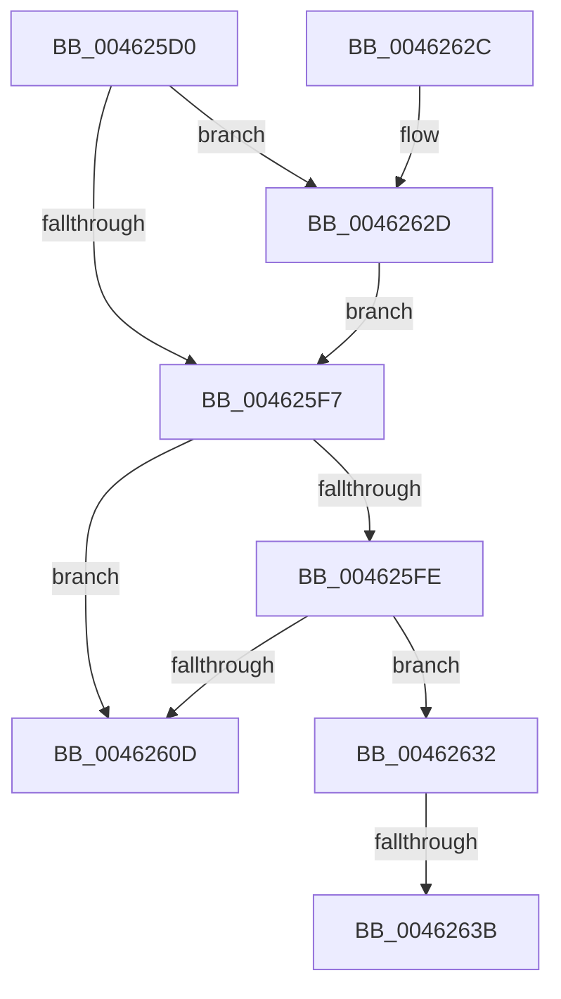

# MiGetSpecialPurposeMemoryPartitionForCaching

- RVA: `0x004625D0`–`0x00462644` (길이 `116` bytes)
- VA: `0x00000001404625D0`
- 실행 섹션: `.text`
- PDB 이름 있음: `예`; PDB Function 태그: `예`
- unwind 정보 RVA: `0x000AA270`
- 디코드: `38`개 명령, `116/116` bytes 표시
- 미해석 바이트: `0` (있으면 어셈블리에 `.byte`로 보존)

> 이 문서는 커널 이미지의 기계어와 PDB 기호를 분석해 생성했습니다. 4번과 5번은 함수 원형과 자료형을 바이너리 사용 방식에서 추정한 C 해석이며 원본 소스 복구 결과는 아닙니다.

## 1. Dependencies

- 직접 호출 지점: **0**; 고유 호출 대상: **0**
- 직접 호출자로 확인된 함수: **1**
- RIP 상대 이미지 참조: **0**

### Outgoing calls
- 직접 디코드된 call 명령이 없습니다.

### Direct callers
- [MiCreatePagefileMemoryExtents](../../page/80/MiCreatePagefileMemoryExtents_function_0080F1BC.md) at `0x0080F1FC`

### Static image references
- 디코드된 RIP-relative 메모리 참조가 없습니다.

## 2. Other-region calls and transfers

- 다른 실행 섹션으로 향하는 call: **0**
- call이 아닌 외부 분기/꼬리 이동: **2**
  - `0x00462635` → [sub_006F2710](../6F/Unknown_function_006F2710.md) (`tail-transfer`)
  - `0x0046263F` → [sub_006F2710 + 0xAA](../6F/Unknown_function_006F2710.md) (`tail-transfer`)

## 3. Assembly (complete function range)

```asm
004625D0  48 89 5C 24 10                  mov qword ptr [rsp + 0x10], rbx
004625D5  48 89 6C 24 18                  mov qword ptr [rsp + 0x18], rbp
004625DA  48 89 74 24 20                  mov qword ptr [rsp + 0x20], rsi
004625DF  57                              push rdi
004625E0  41 54                           push r12
004625E2  41 55                           push r13
004625E4  41 56                           push r14
004625E6  41 57                           push r15
004625E8  48 83 EC 20                     sub rsp, 0x20
004625EC  45 33 E4                        xor r12d, r12d
004625EF  48 8B FA                        mov rdi, rdx
004625F2  48 85 D2                        test rdx, rdx
004625F5  75 36                           jne 0x14046262d
004625F7  8B 41 04                        mov eax, dword ptr [rcx + 4]
004625FA  84 C0                           test al, al
004625FC  78 0F                           js 0x14046260d
004625FE  48 8D B1 E8 44 00 00            lea rsi, [rcx + 0x44e8]
00462605  48 8B 06                        mov rax, qword ptr [rsi]
00462608  48 3B C6                        cmp rax, rsi
0046260B  75 25                           jne 0x140462632
0046260D  33 C0                           xor eax, eax
0046260F  48 8B 5C 24 58                  mov rbx, qword ptr [rsp + 0x58]
00462614  48 8B 6C 24 60                  mov rbp, qword ptr [rsp + 0x60]
00462619  48 8B 74 24 68                  mov rsi, qword ptr [rsp + 0x68]
0046261E  48 83 C4 20                     add rsp, 0x20
00462622  41 5F                           pop r15
00462624  41 5E                           pop r14
00462626  41 5D                           pop r13
00462628  41 5C                           pop r12
0046262A  5F                              pop rdi
0046262B  C3                              ret
0046262C  CC                              int3
0046262D  4C 89 22                        mov qword ptr [rdx], r12
00462630  EB C5                           jmp 0x1404625f7
00462632  48 85 FF                        test rdi, rdi
00462635  0F 85 D5 00 29 00               jne 0x1406f2710
0046263B  4C 8B 70 F8                     mov r14, qword ptr [rax - 8]
0046263F  E9 76 01 29 00                  jmp 0x1406f27ba
```

## 4. C-style interpretation (structured pseudocode)

```c
__int64 __fastcall MiGetSpecialPurposeMemoryPartitionForCaching(__int64 a1, __int64 a2)
{
    __int64 result;
    __int64 v_r12;
    __int64 v_rsp;
    unsigned __int64 v_stack_p10;
    unsigned __int64 v_stack_p18;
    unsigned __int64 v_stack_p20;

    v_stack_p10 = v_rbx;
    v_stack_p18 = v_rbp;
    v_stack_p20 = v_rsi;
    v_rsp = (v_rsp) - (32);
    v_r12 = 0;
    if (a2 != 0) goto loc_0046262D;
loc_004625F7:
    if (sign_flag) goto loc_0046260D;
    if ((*(unsigned __int64 *)(a1 + 17640)) != (a1 + 17640)) goto loc_00462632;
loc_0046260D:
    result = 0;
    v_rsp = (v_rsp) + (32);
    return result;
loc_0046262D:
    *(unsigned __int64 *)(a2) = 0;
    goto loc_004625F7;
loc_00462632:
}
```

## 5. (Beta) C Style

```c
int64_t MiGetSpecialPurposeMemoryPartitionForCaching(void *Arg1, int64_t Arg2)
{
    uint8_t *arg1 = (uint8_t *)Arg1;

    int64_t result;
    int64_t local_r12;
    int64_t local_rsp;
    uint64_t v_stack_p10;
    uint64_t v_stack_p18;
    uint64_t v_stack_p20;

    v_stack_p10 = local_rbx;
    v_stack_p18 = local_rbp;
    v_stack_p20 = local_rsi;
    local_rsp = (local_rsp) - (32);
    local_r12 = 0;
    if (Arg2 != 0) goto loc_0046262D;
loc_004625F7:
    if (sign_flag) goto loc_0046260D;
    if ((*(uint64_t *)(arg1 + 0x44E8)) != (Arg1 + 17640)) goto loc_00462632;
loc_0046260D:
    result = 0;
    local_rsp = (local_rsp) + (32);
    return result;
loc_0046262D:
    *(uint64_t *)(Arg2) = 0;
    goto loc_004625F7;
loc_00462632:
}
```

### 관측된 메모리 오프셋

구조체 형식이 확인되지 않은 접근은 인자 기준의 오프셋으로만 기록했습니다.

| 기준 인자 | 오프셋 표현 | 폭 (bit) | 접근 |
|---|---:|---:|---|
| `Arg1` | `+ 0x0` | `64` | `R` |
| `Arg1` | `+ 0x4` | `32` | `R` |
| `Arg1` | `+ 0x44E8` | `64` | `R` |

## 6. Execution-region graph

[열기: 2D/3D 그래프와 함수 탐색 컨트롤 패널](../../../control-panel.html?section=text&rva=0x004625D0&view=graph)

- 2D 그래프는 위에서 아래로 흐르고, 3D 그래프는 빈 공간을 드래그해 회전합니다. Shift+드래그는 이동, 휠은 확대·축소, 함수 노드 선택은 대상 보고서 이동입니다.

### Static fallback


