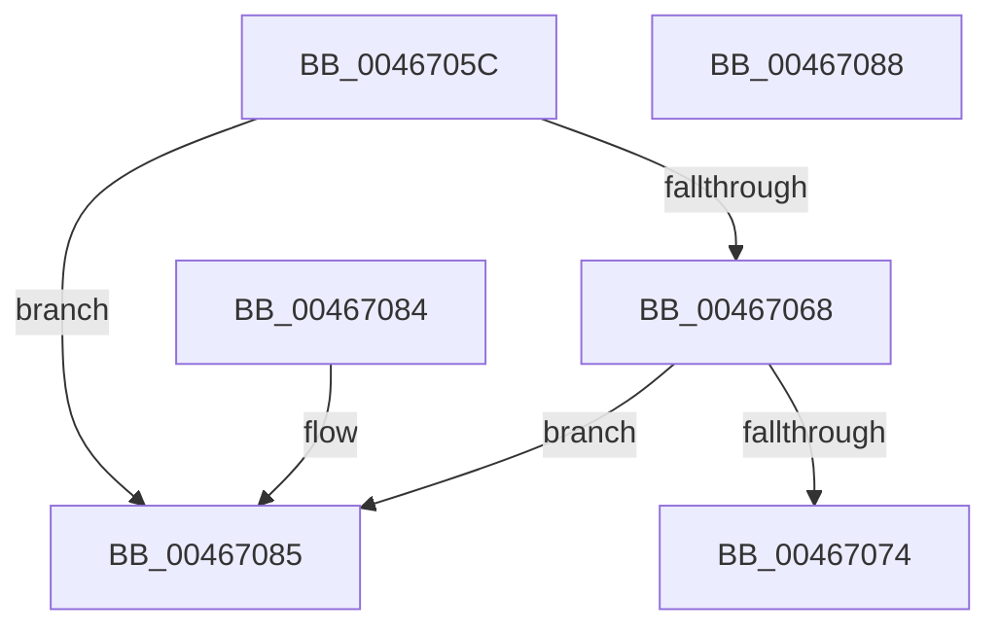

# MiGetVirtualFaultPageInfo

- RVA: `0x0046705C`–`0x00467089` (길이 `45` bytes)
- VA: `0x000000014046705C`
- 실행 섹션: `.text`
- PDB 이름 있음: `예`; PDB Function 태그: `아니요`
- unwind 정보 RVA: `0x000DB714`
- 디코드: `17`개 명령, `45/45` bytes 표시
- 미해석 바이트: `0` (있으면 어셈블리에 `.byte`로 보존)

> 이 문서는 커널 이미지의 기계어와 PDB 기호를 분석해 생성했습니다. 4번과 5번은 함수 원형과 자료형을 바이너리 사용 방식에서 추정한 C 해석이며 원본 소스 복구 결과는 아닙니다.

## 1. Dependencies

- 직접 호출 지점: **0**; 고유 호출 대상: **0**
- 직접 호출자로 확인된 함수: **3**
- RIP 상대 이미지 참조: **0**

### Outgoing calls
- 직접 디코드된 call 명령이 없습니다.

### Direct callers
- [MiAllocateWsle](../33/MiAllocateWsle_function_003332C0.md) at `0x00333CE7`
- [MiLargePageFault](../3F/MiLargePageFault_function_003F01C4.md) at `0x003F040F`
- [MiValidVirtualizationFault](MiValidVirtualizationFault_function_00466EC0.md) at `0x00466EE1`

### Static image references
- 디코드된 RIP-relative 메모리 참조가 없습니다.

## 2. Other-region calls and transfers

- 다른 실행 섹션으로 향하는 call: **0**
- 별도 외부 분기/꼬리 이동을 확인하지 못했습니다.

## 3. Assembly (complete function range)

```asm
0046705C  48 8B 41 08                     mov rax, qword ptr [rcx + 8]
00467060  4C 8B 08                        mov r9, qword ptr [rax]
00467063  49 3B D1                        cmp rdx, r9
00467066  72 1D                           jb 0x140467085
00467068  4C 8B 40 08                     mov r8, qword ptr [rax + 8]
0046706C  4D 03 C1                        add r8, r9
0046706F  49 3B D0                        cmp rdx, r8
00467072  73 11                           jae 0x140467085
00467074  48 8B 41 28                     mov rax, qword ptr [rcx + 0x28]
00467078  49 2B D1                        sub rdx, r9
0046707B  48 C1 EA 0C                     shr rdx, 0xc
0046707F  48 8D 04 D0                     lea rax, [rax + rdx*8]
00467083  C3                              ret
00467084  CC                              int3
00467085  33 C0                           xor eax, eax
00467087  C3                              ret
00467088  CC                              int3
```

## 4. C-style interpretation (structured pseudocode)

```c
__int64 __fastcall MiGetVirtualFaultPageInfo(__int64 a1, __int64 a2)
{
    __int64 result;

    if (a2 < (*(unsigned __int64 *)(*(unsigned __int64 *)(a1 + 8)))) goto loc_00467085;
    a3 = (*(unsigned __int64 *)(*(unsigned __int64 *)(a1 + 8) + 8)) + (*(unsigned __int64 *)(*(unsigned __int64 *)(a1 + 8)));
    if (a2 >= a3) goto loc_00467085;
    a2 = (a2) - (*(unsigned __int64 *)(*(unsigned __int64 *)(a1 + 8)));
    a2 = (a2) >> (12);
    return *(unsigned __int64 *)(a1 + 40) + a2 * 8;
loc_00467085:
    result = 0;
    return result;
}
```

## 5. (Beta) C Style

```c
int64_t MiGetVirtualFaultPageInfo(void *Arg1, int64_t Arg2)
{
    uint8_t *arg1 = (uint8_t *)Arg1;

    int64_t result;

    if (Arg2 < (*(uint64_t *)(*(uint64_t *)(arg1 + 0x8)))) goto loc_00467085;
    a3 = (*(uint64_t *)(*(uint64_t *)(arg1 + 0x8) + 0x8)) + (*(uint64_t *)(*(uint64_t *)(arg1 + 0x8)));
    if (Arg2 >= a3) goto loc_00467085;
    Arg2 = (Arg2) - (*(uint64_t *)(*(uint64_t *)(arg1 + 0x8)));
    Arg2 = (Arg2) >> (12);
    return *(uint64_t *)(arg1 + 0x28) + Arg2 * 8;
loc_00467085:
    result = 0;
    return result;
}
```

### 관측된 메모리 오프셋

구조체 형식이 확인되지 않은 접근은 인자 기준의 오프셋으로만 기록했습니다.

| 기준 인자 | 오프셋 표현 | 폭 (bit) | 접근 |
|---|---:|---:|---|
| `Arg1` | `+ 0x8` | `64` | `R` |
| `Arg1` | `+ 0x28` | `64` | `R` |

## 6. Execution-region graph

[열기: 2D/3D 그래프와 함수 탐색 컨트롤 패널](../../../control-panel.html?section=text&rva=0x0046705C&view=graph)

- 2D 그래프는 위에서 아래로 흐르고, 3D 그래프는 빈 공간을 드래그해 회전합니다. Shift+드래그는 이동, 휠은 확대·축소, 함수 노드 선택은 대상 보고서 이동입니다.

### Static fallback


