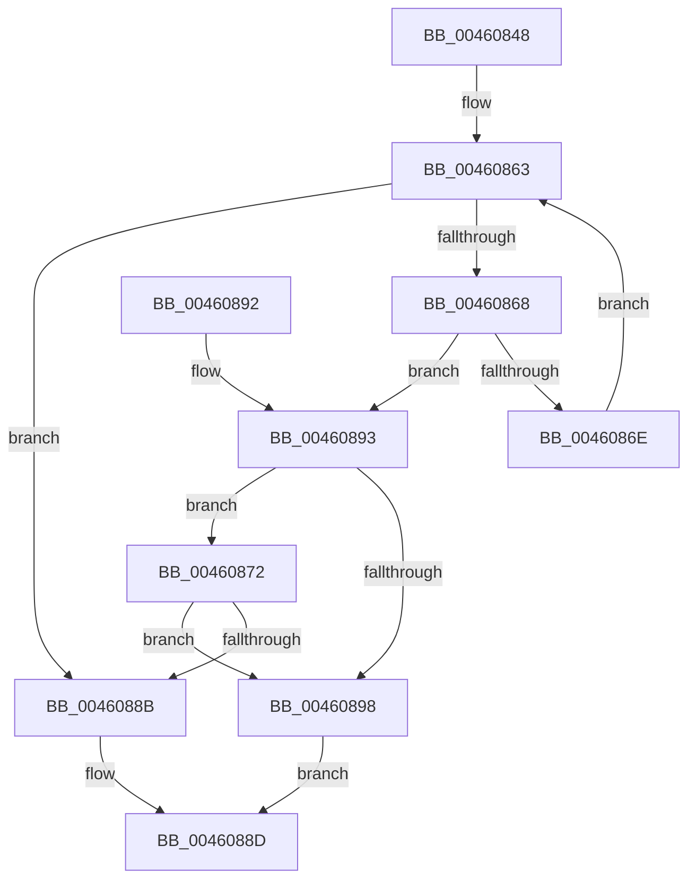

# MiHashIsCommon

- RVA: `0x00460848`–`0x0046089F` (길이 `87` bytes)
- VA: `0x0000000140460848`
- 실행 섹션: `.text`
- PDB 이름 있음: `예`; PDB Function 태그: `아니요`
- unwind 정보 RVA: `0x00090138`
- 디코드: `26`개 명령, `87/87` bytes 표시
- 미해석 바이트: `0` (있으면 어셈블리에 `.byte`로 보존)

> 이 문서는 커널 이미지의 기계어와 PDB 기호를 분석해 생성했습니다. 4번과 5번은 함수 원형과 자료형을 바이너리 사용 방식에서 추정한 C 해석이며 원본 소스 복구 결과는 아닙니다.

## 1. Dependencies

- 직접 호출 지점: **1**; 고유 호출 대상: **1**
- 직접 호출자로 확인된 함수: **1**
- RIP 상대 이미지 참조: **0**

### Outgoing calls
- `0x0046087E` → [RtlCompareMemoryUlong](../6B/RtlCompareMemoryUlong_function_006BA6F0.md) (function, `0x006BA6F0`)

### Direct callers
- [MiCombineInitialInstance](../22/MiCombineInitialInstance_function_0022BC0C.md) at `0x0022C9DF`

### Static image references
- 디코드된 RIP-relative 메모리 참조가 없습니다.

## 2. Other-region calls and transfers

- 다른 실행 섹션으로 향하는 call: **0**
- 별도 외부 분기/꼬리 이동을 확인하지 못했습니다.

## 3. Assembly (complete function range)

```asm
00460848  48 83 EC 28                     sub rsp, 0x28
0046084C  44 8B 91 88 00 00 00            mov r10d, dword ptr [rcx + 0x88]
00460853  4D 8B C8                        mov r9, r8
00460856  4C 8B 59 78                     mov r11, qword ptr [rcx + 0x78]
0046085A  33 C0                           xor eax, eax
0046085C  48 8B 89 80 00 00 00            mov rcx, qword ptr [rcx + 0x80]
00460863  41 3B C2                        cmp eax, r10d
00460866  73 23                           jae 0x14046088b
00460868  49 3B 14 C3                     cmp rdx, qword ptr [r11 + rax*8]
0046086C  74 25                           je 0x140460893
0046086E  FF C0                           inc eax
00460870  EB F1                           jmp 0x140460863
00460872  44 8B 04 81                     mov r8d, dword ptr [rcx + rax*4]
00460876  BA 00 10 00 00                  mov edx, 0x1000
0046087B  49 8B C9                        mov rcx, r9
0046087E  E8 6D 9E 25 00                  call 0x1406ba6f0
00460883  48 3D 00 10 00 00               cmp rax, 0x1000
00460889  74 0D                           je 0x140460898
0046088B  33 C0                           xor eax, eax
0046088D  48 83 C4 28                     add rsp, 0x28
00460891  C3                              ret
00460892  CC                              int3
00460893  4D 85 C9                        test r9, r9
00460896  75 DA                           jne 0x140460872
00460898  B8 01 00 00 00                  mov eax, 1
0046089D  EB EE                           jmp 0x14046088d
```

## 4. C-style interpretation (structured pseudocode)

```c
__int64 __fastcall MiHashIsCommon(__int64 a1, __int64 a2, __int64 a3)
{
    __int64 result;
    __int64 v_rsp;

    v_rsp = (v_rsp) - (40);
    result = 0;
loc_00460863:
    if (0 >= ((unsigned int)((unsigned int)(*(unsigned int *)(a1 + 136))))) goto loc_0046088B;
    if (a2 == (*(unsigned __int64 *)(*(unsigned __int64 *)(a1 + 120) + result * 8))) goto loc_00460893;
    result = (unsigned int)((result) + 1);
    goto loc_00460863;
loc_00460872:
    result = RtlCompareMemoryUlong(a3, (unsigned int)(0x1000ULL), (unsigned int)(*(unsigned int *)(*(unsigned __int64 *)(a1 + 128) + result * 4)), a3);
    if (result == 0x1000ULL) goto loc_00460898;
loc_0046088B:
    result = 0;
loc_0046088D:
    v_rsp = (v_rsp) + (40);
    return result;
loc_00460893:
    if (a3 != 0) goto loc_00460872;
loc_00460898:
    goto loc_0046088D;
}
```

## 5. (Beta) C Style

```c
int64_t MiHashIsCommon(void *Arg1, int64_t Arg2, int64_t Arg3)
{
    uint8_t *arg1 = (uint8_t *)Arg1;

    int64_t result;
    int64_t local_rsp;

    local_rsp = (local_rsp) - (40);
    result = 0;
loc_00460863:
    if (0 >= ((uint32_t)((uint32_t)(*(uint32_t *)(arg1 + 0x88))))) goto loc_0046088B;
    if (Arg2 == (*(uint64_t *)(*(uint64_t *)(arg1 + 0x78) + result * 8))) goto loc_00460893;
    result = (uint32_t)((result) + 1);
    goto loc_00460863;
loc_00460872:
    result = RtlCompareMemoryUlong(Arg3, (uint32_t)(0x1000ULL), (uint32_t)(*(uint32_t *)(*(uint64_t *)(arg1 + 0x80) + result * 4)), Arg3);
    if (result == 0x1000ULL) goto loc_00460898;
loc_0046088B:
    result = 0;
loc_0046088D:
    local_rsp = (local_rsp) + (40);
    return result;
loc_00460893:
    if (Arg3 != 0) goto loc_00460872;
loc_00460898:
    goto loc_0046088D;
}
```

### 관측된 메모리 오프셋

구조체 형식이 확인되지 않은 접근은 인자 기준의 오프셋으로만 기록했습니다.

| 기준 인자 | 오프셋 표현 | 폭 (bit) | 접근 |
|---|---:|---:|---|
| `Arg1` | `+ 0x78` | `64` | `R` |
| `Arg1` | `+ 0x80` | `64` | `R` |
| `Arg1` | `+ 0x88` | `32` | `R` |

## 6. Execution-region graph

[열기: 2D/3D 그래프와 함수 탐색 컨트롤 패널](../../../control-panel.html?section=text&rva=0x00460848&view=graph)

- 2D 그래프는 위에서 아래로 흐르고, 3D 그래프는 빈 공간을 드래그해 회전합니다. Shift+드래그는 이동, 휠은 확대·축소, 함수 노드 선택은 대상 보고서 이동입니다.

### Static fallback


