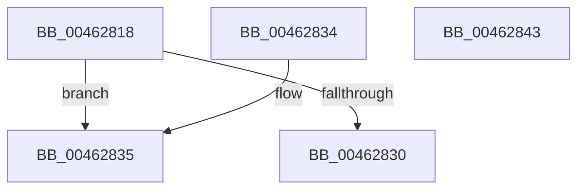

# MiHonorRangeStraddleRequirement

- RVA: `0x00462818`–`0x00462844` (길이 `44` bytes)
- VA: `0x0000000140462818`
- 실행 섹션: `.text`
- PDB 이름 있음: `예`; PDB Function 태그: `아니요`
- unwind 정보 RVA: `0x000DB714`
- 디코드: `17`개 명령, `44/44` bytes 표시
- 미해석 바이트: `0` (있으면 어셈블리에 `.byte`로 보존)

> 이 문서는 커널 이미지의 기계어와 PDB 기호를 분석해 생성했습니다. 4번과 5번은 함수 원형과 자료형을 바이너리 사용 방식에서 추정한 C 해석이며 원본 소스 복구 결과는 아닙니다.

## 1. Dependencies

- 직접 호출 지점: **0**; 고유 호출 대상: **0**
- 직접 호출자로 확인된 함수: **4**
- RIP 상대 이미지 참조: **0**

### Outgoing calls
- 직접 디코드된 call 명령이 없습니다.

### Direct callers
- [sub_00886963](../../page/88/Unknown_function_00886963.md) at `0x00886974`
- [sub_00886A23](../../page/88/Unknown_function_00886A23.md) at `0x00886A37`
- [sub_00886A7C](../../page/88/Unknown_function_00886A7C.md) at `0x00886A90`
- [MiFindEmptyAddressRangeInTree](../../page/A2/MiFindEmptyAddressRangeInTree_function_00A26328.md) at `0x00A26390`
- [MiFindEmptyAddressRangeInTree](../../page/A2/MiFindEmptyAddressRangeInTree_function_00A26328.md) at `0x00A26462`
- [MiFindEmptyAddressRangeInTree](../../page/A2/MiFindEmptyAddressRangeInTree_function_00A26328.md) at `0x00A26532`

### Static image references
- 디코드된 RIP-relative 메모리 참조가 없습니다.

## 2. Other-region calls and transfers

- 다른 실행 섹션으로 향하는 call: **0**
- 별도 외부 분기/꼬리 이동을 확인하지 못했습니다.

## 3. Assembly (complete function range)

```asm
00462818  49 FF C8                        dec r8
0046281B  4C 8D 52 FF                     lea r10, [rdx - 1]
0046281F  49 F7 D0                        not r8
00462822  4C 03 D1                        add r10, rcx
00462825  4D 23 D0                        and r10, r8
00462828  4C 23 C1                        and r8, rcx
0046282B  4D 3B D0                        cmp r10, r8
0046282E  75 05                           jne 0x140462835
00462830  48 8B C1                        mov rax, rcx
00462833  C3                              ret
00462834  CC                              int3
00462835  49 8B C2                        mov rax, r10
00462838  48 2B C2                        sub rax, rdx
0046283B  45 85 C9                        test r9d, r9d
0046283E  49 0F 44 C2                     cmove rax, r10
00462842  C3                              ret
00462843  CC                              int3
```

## 4. C-style interpretation (structured pseudocode)

```c
__int64 __fastcall MiHonorRangeStraddleRequirement(__int64 a1, __int64 a2, __int64 a3, int a4)
{
    __int64 result;
    __int64 v_r10;

    a3 = (a3) - 1;
    a3 = ~(a3);
    v_r10 = (a2 - 1) + (a1);
    v_r10 = (v_r10) & (a3);
    a3 = (a3) & (a1);
    if (v_r10 != a3) goto loc_00462835;
    return a1;
loc_00462835:
    result = (v_r10) - (a2);
    if (a4 == 0) { result = v_r10; }
    return result;
}
```

## 5. (Beta) C Style

```c
int64_t MiHonorRangeStraddleRequirement(int64_t Arg1, void *Arg2, int64_t Arg3, int32_t Arg4)
{
    uint8_t *arg2 = (uint8_t *)Arg2;

    int64_t result;
    int64_t local_r10;

    Arg3 = (Arg3) - 1;
    Arg3 = ~(Arg3);
    local_r10 = (Arg2 - 1) + (Arg1);
    local_r10 = (local_r10) & (Arg3);
    Arg3 = (Arg3) & (Arg1);
    if (local_r10 != Arg3) goto loc_00462835;
    return Arg1;
loc_00462835:
    result = (local_r10) - (Arg2);
    if (Arg4 == 0) { result = local_r10; }
    return result;
}
```

### 관측된 메모리 오프셋

구조체 형식이 확인되지 않은 접근은 인자 기준의 오프셋으로만 기록했습니다.

| 기준 인자 | 오프셋 표현 | 폭 (bit) | 접근 |
|---|---:|---:|---|
| `Arg2` | `- 0x1` | `64` | `R` |

## 6. Execution-region graph

[열기: 2D/3D 그래프와 함수 탐색 컨트롤 패널](../../../control-panel.html?section=text&rva=0x00462818&view=graph)

- 2D 그래프는 위에서 아래로 흐르고, 3D 그래프는 빈 공간을 드래그해 회전합니다. Shift+드래그는 이동, 휠은 확대·축소, 함수 노드 선택은 대상 보고서 이동입니다.

### Static fallback


