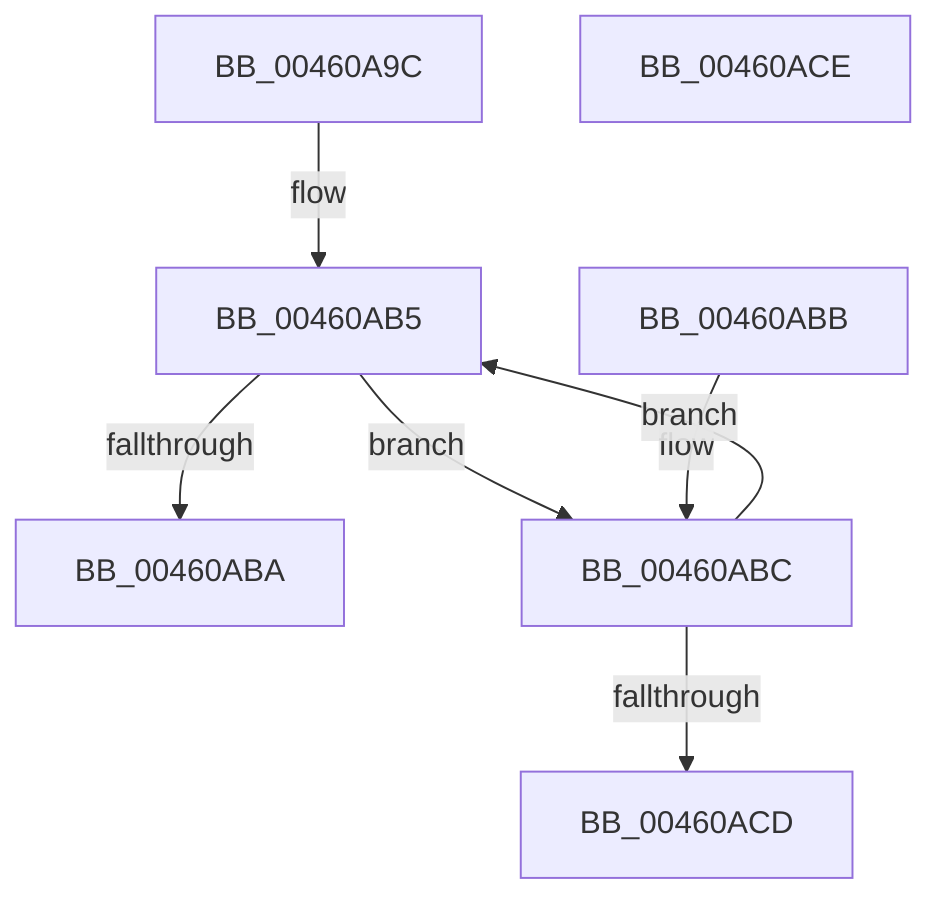

# MiIncreaseExposedCommit

- RVA: `0x00460A9C`–`0x00460ACF` (길이 `51` bytes)
- VA: `0x0000000140460A9C`
- 실행 섹션: `.text`
- PDB 이름 있음: `예`; PDB Function 태그: `아니요`
- unwind 정보 RVA: `0x000DB714`
- 디코드: `15`개 명령, `51/51` bytes 표시
- 미해석 바이트: `0` (있으면 어셈블리에 `.byte`로 보존)

> 이 문서는 커널 이미지의 기계어와 PDB 기호를 분석해 생성했습니다. 4번과 5번은 함수 원형과 자료형을 바이너리 사용 방식에서 추정한 C 해석이며 원본 소스 복구 결과는 아닙니다.

## 1. Dependencies

- 직접 호출 지점: **0**; 고유 호출 대상: **0**
- 직접 호출자로 확인된 함수: **1**
- RIP 상대 이미지 참조: **0**

### Outgoing calls
- 직접 디코드된 call 명령이 없습니다.

### Direct callers
- [MiInsertPartitionPages](../69/MiInsertPartitionPages_function_006911A0.md) at `0x00691361`

### Static image references
- 디코드된 RIP-relative 메모리 참조가 없습니다.

## 2. Other-region calls and transfers

- 다른 실행 섹션으로 향하는 call: **0**
- 별도 외부 분기/꼬리 이동을 확인하지 못했습니다.

## 3. Assembly (complete function range)

```asm
00460A9C  4C 8B C9                        mov r9, rcx
00460A9F  4C 8B C2                        mov r8, rdx
00460AA2  F0 4C 0F C1 81 80 4B 00 00      lock xadd qword ptr [rcx + 0x4b80], r8
00460AAB  48 8B 81 C0 41 00 00            mov rax, qword ptr [rcx + 0x41c0]
00460AB2  4C 03 C2                        add r8, rdx
00460AB5  4C 3B C0                        cmp r8, rax
00460AB8  77 02                           ja 0x140460abc
00460ABA  C3                              ret
00460ABB  CC                              int3
00460ABC  48 8B C8                        mov rcx, rax
00460ABF  F0 4D 0F B1 81 C0 41 00 00      lock cmpxchg qword ptr [r9 + 0x41c0], r8
00460AC8  48 3B C8                        cmp rcx, rax
00460ACB  75 E8                           jne 0x140460ab5
00460ACD  C3                              ret
00460ACE  CC                              int3
```

## 4. C-style interpretation (structured pseudocode)

```c
__int64 __fastcall MiIncreaseExposedCommit(__int64 a1, __int64 a2)
{
    a3 = (a2) + (a2);
loc_00460AB5:
    if (a3 > (*(unsigned __int64 *)(a1 + 16832))) goto loc_00460ABC;
    return *(unsigned __int64 *)(a1 + 16832);
loc_00460ABC:
    if ((*(unsigned __int64 *)(a1 + 16832)) != (*(unsigned __int64 *)(a1 + 16832))) goto loc_00460AB5;
    return *(unsigned __int64 *)(a1 + 16832);
}
```

## 5. (Beta) C Style

```c
int64_t MiIncreaseExposedCommit(void *Arg1, int64_t Arg2)
{
    uint8_t *arg1 = (uint8_t *)Arg1;

    a3 = (Arg2) + (Arg2);
loc_00460AB5:
    if (a3 > (*(uint64_t *)(arg1 + 0x41C0))) goto loc_00460ABC;
    return *(uint64_t *)(arg1 + 0x41C0);
loc_00460ABC:
    if ((*(uint64_t *)(arg1 + 0x41C0)) != (*(uint64_t *)(arg1 + 0x41C0))) goto loc_00460AB5;
    return *(uint64_t *)(arg1 + 0x41C0);
}
```

### 관측된 메모리 오프셋

구조체 형식이 확인되지 않은 접근은 인자 기준의 오프셋으로만 기록했습니다.

| 기준 인자 | 오프셋 표현 | 폭 (bit) | 접근 |
|---|---:|---:|---|
| `Arg1` | `+ 0x41C0` | `64` | `R` |
| `Arg1` | `+ 0x4B80` | `64` | `R/W` |

## 6. Execution-region graph

[열기: 2D/3D 그래프와 함수 탐색 컨트롤 패널](../../../control-panel.html?section=text&rva=0x00460A9C&view=graph)

- 2D 그래프는 위에서 아래로 흐르고, 3D 그래프는 빈 공간을 드래그해 회전합니다. Shift+드래그는 이동, 휠은 확대·축소, 함수 노드 선택은 대상 보고서 이동입니다.

### Static fallback


