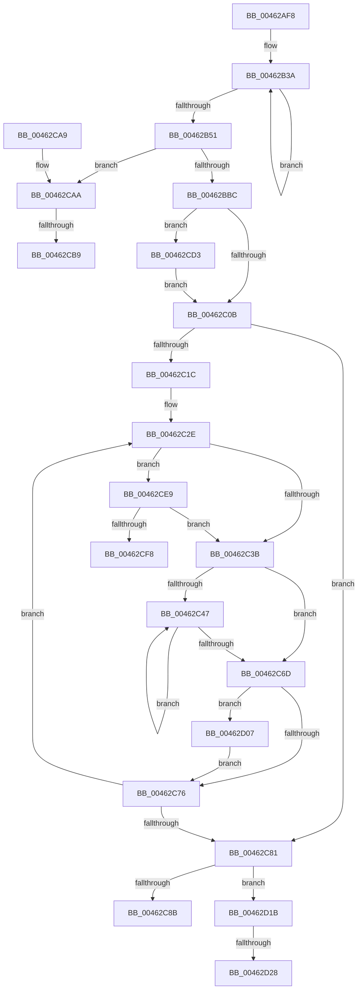

# MiInitializeAllResidentPageBasePfns

- RVA: `0x00462AF8`–`0x00462D3A` (길이 `578` bytes)
- VA: `0x0000000140462AF8`
- 실행 섹션: `.text`
- PDB 이름 있음: `예`; PDB Function 태그: `예`
- unwind 정보 RVA: `0x000AA3C4`
- 디코드: `148`개 명령, `578/578` bytes 표시
- 미해석 바이트: `0` (있으면 어셈블리에 `.byte`로 보존)

> 이 문서는 커널 이미지의 기계어와 PDB 기호를 분석해 생성했습니다. 4번과 5번은 함수 원형과 자료형을 바이너리 사용 방식에서 추정한 C 해석이며 원본 소스 복구 결과는 아닙니다.

## 1. Dependencies

- 직접 호출 지점: **2**; 고유 호출 대상: **2**
- 직접 호출자로 확인된 함수: **4**
- RIP 상대 이미지 참조: **3**

### Outgoing calls
- `0x00462CDC` → [MiSetFreeZeroPfnCold](../37/MiSetFreeZeroPfnCold_function_00379428.md) (function, `0x00379428`)
- `0x00462D2F` → [KiLowerIrqlProcessIrqlFlags](../4F/KiLowerIrqlProcessIrqlFlags_function_004F5698.md) (function, `0x004F5698`)

### Direct callers
- [MiCoalesceFreeSmallPages](../33/MiCoalesceFreeSmallPages_function_00336340.md) at `0x0033690E`
- [MiDeleteSectionCluster](../37/MiDeleteSectionCluster_function_00373DF0.md) at `0x0037427F`
- [MiInitializeDynamicPfns](../67/MiInitializeDynamicPfns_function_00672BD0.md) at `0x00672CC3`
- [MxInsertFreePages](../../init/C6/MxInsertFreePages_function_00C63AD0.md) at `0x00C63C45`

### Static image references
- `0x00462B1A` → RVA `0x00000000` (`image boundary/outside`; read)
- `0x00462CAA` → RVA `0x00FC6A88` (`ALMOSTRO`; read)
- `0x00462D1B` → RVA `0x00FC6D20` (`ALMOSTRO`; read)

## 2. Other-region calls and transfers

- 다른 실행 섹션으로 향하는 call: **0**
- call이 아닌 외부 분기/꼬리 이동: **5**
  - `0x00462CB3` → [sub_006F285A](../6F/Unknown_function_006F285A.md) (`tail-transfer`)
  - `0x00462CCE` → [sub_006F285A](../6F/Unknown_function_006F285A.md) (`tail-transfer`)
  - `0x00462D02` → [sub_006F285A + 0x28](../6F/Unknown_function_006F285A.md) (`tail-transfer`)
  - `0x00462D22` → [sub_006F285A + 0x49](../6F/Unknown_function_006F285A.md) (`tail-transfer`)
  - `0x00462D35` → [sub_006F285A + 0x49](../6F/Unknown_function_006F285A.md) (`tail-transfer`)

## 3. Assembly (complete function range)

```asm
00462AF8  48 89 5C 24 08                  mov qword ptr [rsp + 8], rbx
00462AFD  48 89 74 24 10                  mov qword ptr [rsp + 0x10], rsi
00462B02  48 89 7C 24 18                  mov qword ptr [rsp + 0x18], rdi
00462B07  55                              push rbp
00462B08  41 54                           push r12
00462B0A  41 55                           push r13
00462B0C  41 56                           push r14
00462B0E  41 57                           push r15
00462B10  48 8B EC                        mov rbp, rsp
00462B13  48 83 EC 50                     sub rsp, 0x50
00462B17  0F 57 C0                        xorps xmm0, xmm0
00462B1A  4C 8D 2D DF D4 B9 FF            lea r13, [rip - 0x462b21]
00462B21  45 33 D2                        xor r10d, r10d
00462B24  4D 8B E0                        mov r12, r8
00462B27  4C 8B C2                        mov r8, rdx
00462B2A  0F 11 45 D0                     movups xmmword ptr [rbp - 0x30], xmm0
00462B2E  45 8D 5A 06                     lea r11d, [r10 + 6]
00462B32  0F 11 45 E0                     movups xmmword ptr [rbp - 0x20], xmm0
00462B36  0F 11 45 F0                     movups xmmword ptr [rbp - 0x10], xmm0
00462B3A  4B 8B 84 2A 70 FF E2 00         mov rax, qword ptr [r10 + r13 + 0xe2ff70]
00462B42  4A 89 44 15 D0                  mov qword ptr [rbp + r10 - 0x30], rax
00462B47  4D 8D 52 08                     lea r10, [r10 + 8]
00462B4B  49 83 EB 01                     sub r11, 1
00462B4F  75 E9                           jne 0x140462b3a
00462B51  0F B7 11                        movzx edx, word ptr [rcx]
00462B54  4B 8D 1C 40                     lea rbx, [r8 + r8*2]
00462B58  48 C1 E2 2B                     shl rdx, 0x2b
00462B5C  41 8B C1                        mov eax, r9d
00462B5F  48 8B CA                        mov rcx, rdx
00462B62  41 F6 D1                        not r9b
00462B65  48 C1 E3 04                     shl rbx, 4
00462B69  4D 8B AC C5 60 1C 01 00         mov r13, qword ptr [r13 + rax*8 + 0x11c60]
00462B71  48 8B 45 F8                     mov rax, qword ptr [rbp - 8]
00462B75  48 33 C8                        xor rcx, rax
00462B78  48 B8 FF FF FF FF FF 07 E0 FF   movabs rax, 0xffe007ffffffffff
00462B82  48 23 C8                        and rcx, rax
00462B85  48 33 CA                        xor rcx, rdx
00462B88  41 0F B6 D1                     movzx edx, r9b
00462B8C  48 89 4D F8                     mov qword ptr [rbp - 8], rcx
00462B90  8B 45 F4                        mov eax, dword ptr [rbp - 0xc]
00462B93  C1 E2 1B                        shl edx, 0x1b
00462B96  8B CA                           mov ecx, edx
00462B98  33 C8                           xor ecx, eax
00462B9A  81 E1 FF FF FF E7               and ecx, 0xe7ffffff
00462BA0  33 CA                           xor ecx, edx
00462BA2  89 4D F4                        mov dword ptr [rbp - 0xc], ecx
00462BA5  48 B9 00 00 00 00 00 DE FF FF   movabs rcx, 0xffffde0000000000
00462BAF  48 03 D9                        add rbx, rcx
00462BB2  44 39 5D 60                     cmp dword ptr [rbp + 0x60], r11d
00462BB6  0F 84 EE 00 00 00               je 0x140462caa
00462BBC  48 8B 45 E8                     mov rax, qword ptr [rbp - 0x18]
00462BC0  48 B9 00 00 00 00 00 00 00 80   movabs rcx, 0x8000000000000000
00462BCA  48 0B C1                        or rax, rcx
00462BCD  40 B7 11                        mov dil, 0x11
00462BD0  48 89 45 E8                     mov qword ptr [rbp - 0x18], rax
00462BD4  8B 4D F0                        mov ecx, dword ptr [rbp - 0x10]
00462BD7  8A 45 50                        mov al, byte ptr [rbp + 0x50]
00462BDA  89 4D 48                        mov dword ptr [rbp + 0x48], ecx
00462BDD  C1 E9 10                        shr ecx, 0x10
00462BE0  80 E1 3F                        and cl, 0x3f
00462BE3  C0 E0 06                        shl al, 6
00462BE6  0A C8                           or cl, al
00462BE8  88 4D 4A                        mov byte ptr [rbp + 0x4a], cl
00462BEB  8B 45 48                        mov eax, dword ptr [rbp + 0x48]
00462BEE  89 45 F0                        mov dword ptr [rbp - 0x10], eax
00462BF1  44 8A 5D F2                     mov r11b, byte ptr [rbp - 0xe]
00462BF5  41 8A CB                        mov cl, r11b
00462BF8  80 E1 FD                        and cl, 0xfd
00462BFB  80 C9 05                        or cl, 5
00462BFE  83 7D 58 00                     cmp dword ptr [rbp + 0x58], 0
00462C02  88 4D F2                        mov byte ptr [rbp - 0xe], cl
00462C05  0F 84 C8 00 00 00               je 0x140462cd3
00462C0B  8A C1                           mov al, cl
00462C0D  41 32 C3                        xor al, r11b
00462C10  24 07                           and al, 7
00462C12  32 C8                           xor cl, al
00462C14  88 4D F2                        mov byte ptr [rbp - 0xe], cl
00462C17  4D 85 E4                        test r12, r12
00462C1A  74 65                           je 0x140462c81
00462C1C  4E 8D 34 6D 00 00 00 00         lea r14, [r13*2]
00462C24  48 8B F3                        mov rsi, rbx
00462C27  4D 03 F5                        add r14, r13
00462C2A  49 C1 E6 04                     shl r14, 4
00462C2E  45 33 FF                        xor r15d, r15d
00462C31  44 39 7D 60                     cmp dword ptr [rbp + 0x60], r15d
00462C35  0F 84 AE 00 00 00               je 0x140462ce9
00462C3B  48 8D 4B 30                     lea rcx, [rbx + 0x30]
00462C3F  48 8B C3                        mov rax, rbx
00462C42  48 3B D9                        cmp rbx, rcx
00462C45  74 26                           je 0x140462c6d
00462C47  F3 0F 6F 45 D0                  movdqu xmm0, xmmword ptr [rbp - 0x30]
00462C4C  F3 0F 6F 4D E0                  movdqu xmm1, xmmword ptr [rbp - 0x20]
00462C51  F3 0F 7F 00                     movdqu xmmword ptr [rax], xmm0
00462C55  F3 0F 6F 45 F0                  movdqu xmm0, xmmword ptr [rbp - 0x10]
00462C5A  F3 0F 7F 48 10                  movdqu xmmword ptr [rax + 0x10], xmm1
00462C5F  F3 0F 7F 40 20                  movdqu xmmword ptr [rax + 0x20], xmm0
00462C64  48 83 C0 30                     add rax, 0x30
00462C68  48 3B C1                        cmp rax, rcx
00462C6B  75 DA                           jne 0x140462c47
00462C6D  45 85 FF                        test r15d, r15d
00462C70  0F 85 91 00 00 00               jne 0x140462d07
00462C76  49 03 F6                        add rsi, r14
00462C79  48 8B DE                        mov rbx, rsi
00462C7C  4D 2B E5                        sub r12, r13
00462C7F  75 AD                           jne 0x140462c2e
00462C81  40 80 FF 11                     cmp dil, 0x11
00462C85  0F 85 90 00 00 00               jne 0x140462d1b
00462C8B  4C 8D 5C 24 50                  lea r11, [rsp + 0x50]
00462C90  49 8B 5B 30                     mov rbx, qword ptr [r11 + 0x30]
00462C94  49 8B 73 38                     mov rsi, qword ptr [r11 + 0x38]
00462C98  49 8B 7B 40                     mov rdi, qword ptr [r11 + 0x40]
00462C9C  49 8B E3                        mov rsp, r11
00462C9F  41 5F                           pop r15
00462CA1  41 5E                           pop r14
00462CA3  41 5D                           pop r13
00462CA5  41 5C                           pop r12
00462CA7  5D                              pop rbp
00462CA8  C3                              ret
00462CA9  CC                              int3
00462CAA  48 8B 05 D7 3D B6 00            mov rax, qword ptr [rip + 0xb63dd7]
00462CB1  A8 30                           test al, 0x30
00462CB3  0F 84 A1 FB 28 00               je 0x1406f285a
00462CB9  48 8B 45 E8                     mov rax, qword ptr [rbp - 0x18]
00462CBD  48 B9 00 00 00 00 00 00 00 80   movabs rcx, 0x8000000000000000
00462CC7  48 0B C1                        or rax, rcx
00462CCA  48 89 45 E8                     mov qword ptr [rbp - 0x18], rax
00462CCE  E9 87 FB 28 00                  jmp 0x1406f285a
00462CD3  BA 01 00 00 00                  mov edx, 1
00462CD8  48 8D 4D D0                     lea rcx, [rbp - 0x30]
00462CDC  E8 47 67 F1 FF                  call 0x140379428
00462CE1  8A 4D F2                        mov cl, byte ptr [rbp - 0xe]
00462CE4  E9 22 FF FF FF                  jmp 0x140462c0b
00462CE9  48 8B 05 98 3D B6 00            mov rax, qword ptr [rip + 0xb63d98]
00462CF0  A8 30                           test al, 0x30
00462CF2  0F 84 43 FF FF FF               je 0x140462c3b
00462CF8  83 65 50 00                     and dword ptr [rbp + 0x50], 0
00462CFC  41 BF 01 00 00 00               mov r15d, 1
00462D02  E9 7B FB 28 00                  jmp 0x1406f2882
00462D07  48 B8 FF FF FF FF FF FF FF 7F   movabs rax, 0x7fffffffffffffff
00462D11  F0 48 21 43 18                  lock and qword ptr [rbx + 0x18], rax
00462D16  E9 5B FF FF FF                  jmp 0x140462c76
00462D1B  83 3D FE 3F B6 00 00            cmp dword ptr [rip + 0xb63ffe], 0
00462D22  0F 84 7B FB 28 00               je 0x1406f28a3
00462D28  44 0F 20 C1                     mov rcx, cr8
00462D2C  40 8A D7                        mov dl, dil
00462D2F  E8 64 29 09 00                  call 0x1404f5698
00462D34  90                              nop
00462D35  E9 69 FB 28 00                  jmp 0x1406f28a3
```

## 4. C-style interpretation (structured pseudocode)

```c
__int64 __fastcall MiInitializeAllResidentPageBasePfns(__int64 a1, __int64 a2, __int64 a3, int a4, unsigned __int8 a5, unsigned int a6, unsigned int a7)
{
    __int64 result;
    __int64 v_r10;
    __int64 v_r11;
    __int64 v_r12;
    __int64 v_r14;
    __int64 v_r15;
    __int64 v_rbx;
    __int64 v_rsi;
    __int64 v_rsp;
    unsigned __int64 v_stack_m28;
    unsigned __int64 v_stack_m30;
    unsigned int v_stack_m34;
    unsigned __int8 v_stack_m36;
    unsigned __int64 v_stack_m38;
    unsigned __int64 v_stack_m40;
    unsigned __int64 v_stack_m48;
    unsigned __int64 v_stack_m58;
    unsigned __int64 v_stack_p10;
    unsigned __int64 v_stack_p18;
    unsigned int v_stack_p20;
    unsigned __int8 v_stack_p22;
    unsigned __int64 v_stack_p8;

    v_stack_p8 = v_rbx;
    v_stack_p10 = v_rsi;
    v_stack_p18 = v_rdi;
    v_rsp = (v_rsp) - (80);
    v_r10 = 0;
    v_stack_m58 = v_xmm0;
    v_stack_m48 = v_xmm0;
    v_stack_m38 = v_xmm0;
loc_00462B3A:
    *(unsigned __int64 *)(v_rsp + v_r10 * 1 - 48) = *(unsigned __int64 *)(v_r10 + v_rip - 4598561 * 1 + 14876528);
    v_r11 = (v_r10 + 6) - (1);
    if (condition_is_not_equal) goto loc_00462B3A;
    a2 = (*(unsigned __int16 *)(a1)) << (43);
    a4 = (unsigned __int8)(~(a4));
    v_rbx = (a2 + a2 * 2) << (4);
    a1 = (a2) ^ (v_stack_m30);
    a1 = (a1) & (v_stack_m30);
    a1 = (a1) ^ (a2);
    v_stack_m30 = a1;
    a2 = (unsigned int)(((unsigned __int8)(a4)) << (27));
    a1 = (unsigned int)(((unsigned int)((unsigned int)(a2))) ^ ((unsigned int)((unsigned int)(v_stack_m34))));
    a1 = (unsigned int)((a1) & (0xE7FFFFFFULL));
    a1 = (unsigned int)((a1) ^ ((unsigned int)(a2)));
    v_stack_m34 = (unsigned int)(a1);
    v_rbx = (v_rbx) + (a1);
    if (a7 == ((unsigned int)(v_r11))) goto loc_00462CAA;
    result = (v_stack_m40) | (a1);
    v_stack_m40 = result;
    v_stack_p20 = (unsigned int)((unsigned int)(v_stack_m38));
    a1 = (unsigned int)(((unsigned int)(v_stack_m38)) >> (16));
    a1 = (unsigned __int8)((a1) & (63));
    result = (unsigned __int8)((a5) << (6));
    a1 = (unsigned __int8)((a1) | ((unsigned __int8)(result)));
    v_stack_p22 = (unsigned __int8)(a1);
    v_stack_m38 = (unsigned int)((unsigned int)(v_stack_p20));
    a1 = (unsigned __int8)(((unsigned __int8)(v_stack_m36)) & (253));
    a1 = (unsigned __int8)((a1) | (5));
    v_stack_m36 = (unsigned __int8)(a1);
    if (a6 == 0) goto loc_00462CD3;
loc_00462C0B:
    result = (unsigned __int8)(((unsigned __int8)(a1)) ^ ((unsigned __int8)(v_stack_m36)));
    result = (unsigned __int8)((result) & (7));
    a1 = (unsigned __int8)((a1) ^ ((unsigned __int8)(result)));
    v_stack_m36 = (unsigned __int8)(a1);
    if (a3 == 0) goto loc_00462C81;
    v_r14 = (*(unsigned __int64 *)(v_rip - 4598561 + (unsigned int)(a4) * 8 + 72800) * 2) + (*(unsigned __int64 *)(v_rip - 4598561 + (unsigned int)(a4) * 8 + 72800));
    v_r14 = (v_r14) << (4);
loc_00462C2E:
    v_r15 = 0;
    if (a7 == 0) goto loc_00462CE9;
loc_00462C3B:
    if (v_rbx == (v_rbx + 48)) goto loc_00462C6D;
loc_00462C47:
    *(unsigned __int64 *)(v_rbx) = v_xmm0;
    *(unsigned __int64 *)(v_rbx + 16) = v_xmm1;
    *(unsigned __int64 *)(v_rbx + 32) = v_xmm0;
    result = (v_rbx) + (48);
    if (result != (v_rbx + 48)) goto loc_00462C47;
loc_00462C6D:
    if (0 != 0) goto loc_00462D07;
loc_00462C76:
    v_rsi = (v_rbx) + (v_r14);
    v_r12 = (a3) - (*(unsigned __int64 *)(v_rip - 4598561 + (unsigned int)(a4) * 8 + 72800));
    if (condition_is_not_equal) goto loc_00462C2E;
loc_00462C81:
    if (17 != 17) goto loc_00462D1B;
    return result;
loc_00462CAA:
    result = (v_stack_m40) | (v_rbx + 48);
    v_stack_m40 = result;
loc_00462CD3:
    result = MiSetFreeZeroPfnCold(v_stack_m58, 1, a2, a4);
    goto loc_00462C0B;
loc_00462CE9:
    if ((((unsigned __int8)(*(unsigned __int64 *)(v_rip + 11943320))) & (48)) == 0) goto loc_00462C3B;
loc_00462D07:
    goto loc_00462C76;
loc_00462D1B:
    result = KiLowerIrqlProcessIrqlFlags(v_cr8, (unsigned __int8)(*(unsigned __int64 *)(v_stack_m28 + 64)), a2, a4);
}
```

## 5. (Beta) C Style

```c
int64_t MiInitializeAllResidentPageBasePfns(void *Arg1, void *Arg2, int64_t Arg3, int32_t Arg4, uint8_t Arg5, uint32_t Arg6, uint32_t Arg7)
{
    uint8_t *arg1 = (uint8_t *)Arg1;
    uint8_t *arg2 = (uint8_t *)Arg2;

    int64_t result;
    int64_t local_r10;
    int64_t local_r11;
    int64_t local_r12;
    int64_t local_r14;
    int64_t local_r15;
    int64_t local_rbx;
    int64_t local_rsi;
    int64_t local_rsp;
    uint64_t v_stack_m28;
    uint64_t v_stack_m30;
    uint32_t v_stack_m34;
    uint8_t v_stack_m36;
    uint64_t v_stack_m38;
    uint64_t v_stack_m40;
    uint64_t v_stack_m48;
    uint64_t v_stack_m58;
    uint64_t v_stack_p10;
    uint64_t v_stack_p18;
    uint32_t v_stack_p20;
    uint8_t v_stack_p22;
    uint64_t v_stack_p8;

    v_stack_p8 = local_rbx;
    v_stack_p10 = local_rsi;
    v_stack_p18 = local_rdi;
    local_rsp = (local_rsp) - (80);
    local_r10 = 0;
    v_stack_m58 = v_xmm0;
    v_stack_m48 = v_xmm0;
    v_stack_m38 = v_xmm0;
loc_00462B3A:
    *(uint64_t *)(local_rsp + local_r10 * 1 - 0x30) = *(uint64_t *)(local_r10 + v_rip - 0x462B21 * 1 + 0xE2FF70);
    local_r11 = (local_r10 + 6) - (1);
    if (condition_is_not_equal) goto loc_00462B3A;
    Arg2 = (*(uint16_t *)(arg1)) << (43);
    Arg4 = (uint8_t)(~(Arg4));
    local_rbx = (Arg2 + Arg2 * 2) << (4);
    Arg1 = (Arg2) ^ (v_stack_m30);
    Arg1 = (Arg1) & (v_stack_m30);
    Arg1 = (Arg1) ^ (Arg2);
    v_stack_m30 = Arg1;
    Arg2 = (uint32_t)(((uint8_t)(Arg4)) << (27));
    Arg1 = (uint32_t)(((uint32_t)((uint32_t)(Arg2))) ^ ((uint32_t)((uint32_t)(v_stack_m34))));
    Arg1 = (uint32_t)((Arg1) & (0xE7FFFFFFULL));
    Arg1 = (uint32_t)((Arg1) ^ ((uint32_t)(Arg2)));
    v_stack_m34 = (uint32_t)(Arg1);
    local_rbx = (local_rbx) + (Arg1);
    if (Arg7 == ((uint32_t)(local_r11))) goto loc_00462CAA;
    result = (v_stack_m40) | (Arg1);
    v_stack_m40 = result;
    v_stack_p20 = (uint32_t)((uint32_t)(v_stack_m38));
    Arg1 = (uint32_t)(((uint32_t)(v_stack_m38)) >> (16));
    Arg1 = (uint8_t)((Arg1) & (63));
    result = (uint8_t)((Arg5) << (6));
    Arg1 = (uint8_t)((Arg1) | ((uint8_t)(result)));
    v_stack_p22 = (uint8_t)(Arg1);
    v_stack_m38 = (uint32_t)((uint32_t)(v_stack_p20));
    Arg1 = (uint8_t)(((uint8_t)(v_stack_m36)) & (253));
    Arg1 = (uint8_t)((Arg1) | (5));
    v_stack_m36 = (uint8_t)(Arg1);
    if (Arg6 == 0) goto loc_00462CD3;
loc_00462C0B:
    result = (uint8_t)(((uint8_t)(Arg1)) ^ ((uint8_t)(v_stack_m36)));
    result = (uint8_t)((result) & (7));
    Arg1 = (uint8_t)((Arg1) ^ ((uint8_t)(result)));
    v_stack_m36 = (uint8_t)(Arg1);
    if (Arg3 == 0) goto loc_00462C81;
    local_r14 = (*(uint64_t *)(v_rip - 0x462B21 + (uint32_t)(Arg4) * 8 + 0x11C60) * 2) + (*(uint64_t *)(v_rip - 0x462B21 + (uint32_t)(Arg4) * 8 + 0x11C60));
    local_r14 = (local_r14) << (4);
loc_00462C2E:
    local_r15 = 0;
    if (Arg7 == 0) goto loc_00462CE9;
loc_00462C3B:
    if (local_rbx == (local_rbx + 48)) goto loc_00462C6D;
loc_00462C47:
    *(uint64_t *)(local_rbx) = v_xmm0;
    *(uint64_t *)(local_rbx + 0x10) = v_xmm1;
    *(uint64_t *)(local_rbx + 0x20) = v_xmm0;
    result = (local_rbx) + (48);
    if (result != (local_rbx + 48)) goto loc_00462C47;
loc_00462C6D:
    if (0 != 0) goto loc_00462D07;
loc_00462C76:
    local_rsi = (local_rbx) + (local_r14);
    local_r12 = (Arg3) - (*(uint64_t *)(v_rip - 0x462B21 + (uint32_t)(Arg4) * 8 + 0x11C60));
    if (condition_is_not_equal) goto loc_00462C2E;
loc_00462C81:
    if (17 != 17) goto loc_00462D1B;
    return result;
loc_00462CAA:
    result = (v_stack_m40) | (local_rbx + 48);
    v_stack_m40 = result;
loc_00462CD3:
    result = MiSetFreeZeroPfnCold(v_stack_m58, 1, Arg2, Arg4);
    goto loc_00462C0B;
loc_00462CE9:
    if ((((uint8_t)(*(uint64_t *)(v_rip + 0xB63D98))) & (48)) == 0) goto loc_00462C3B;
loc_00462D07:
    goto loc_00462C76;
loc_00462D1B:
    result = KiLowerIrqlProcessIrqlFlags(v_cr8, (uint8_t)(*(uint64_t *)(v_stack_m28 + 0x40)), Arg2, Arg4);
}
```

### 관측된 메모리 오프셋

구조체 형식이 확인되지 않은 접근은 인자 기준의 오프셋으로만 기록했습니다.

| 기준 인자 | 오프셋 표현 | 폭 (bit) | 접근 |
|---|---:|---:|---|
| `Arg1` | `+ 0x0` | `16` | `R` |
| `Arg2` | `+ 0x0 + r8*2` | `64` | `R` |

## 6. Execution-region graph

[열기: 2D/3D 그래프와 함수 탐색 컨트롤 패널](../../../control-panel.html?section=text&rva=0x00462AF8&view=graph)

- 2D 그래프는 위에서 아래로 흐르고, 3D 그래프는 빈 공간을 드래그해 회전합니다. Shift+드래그는 이동, 휠은 확대·축소, 함수 노드 선택은 대상 보고서 이동입니다.

### Static fallback


