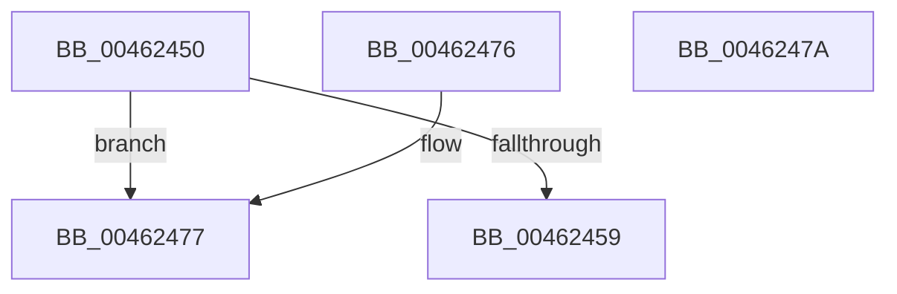

# MiIsPfn

- RVA: `0x00462450`–`0x0046247B` (길이 `43` bytes)
- VA: `0x0000000140462450`
- 실행 섹션: `.text`
- PDB 이름 있음: `예`; PDB Function 태그: `아니요`
- unwind 정보 RVA: `0x000DB714`
- 디코드: `13`개 명령, `43/43` bytes 표시
- 미해석 바이트: `0` (있으면 어셈블리에 `.byte`로 보존)

> 이 문서는 커널 이미지의 기계어와 PDB 기호를 분석해 생성했습니다. 4번과 5번은 함수 원형과 자료형을 바이너리 사용 방식에서 추정한 C 해석이며 원본 소스 복구 결과는 아닙니다.

## 1. Dependencies

- 직접 호출 지점: **0**; 고유 호출 대상: **0**
- 직접 호출자로 확인된 함수: **14**
- RIP 상대 이미지 참조: **1**

### Outgoing calls
- 직접 디코드된 call 명령이 없습니다.

### Direct callers
- [MiIsExtentDangling](../../page/80/MiIsExtentDangling_function_008010A0.md) at `0x008010F5`
- [MmRelocatePfnList](../../page/90/MmRelocatePfnList_function_00901E70.md) at `0x00901F6F`
- [MiMapViewOfPhysicalSection](../../page/97/MiMapViewOfPhysicalSection_function_0097F984.md) at `0x0097FB85`
- [MiMapLockedPagesInUserSpace](../../page/97/MiMapLockedPagesInUserSpace_function_0097FE04.md) at `0x0097FFEC`
- [MiRotateToFrameBuffer](../../page/A3/MiRotateToFrameBuffer_function_00A38214.md) at `0x00A3829B`
- [MiRotateToFrameBuffer](../../page/A3/MiRotateToFrameBuffer_function_00A38214.md) at `0x00A38506`
- [MiRotateToFrameBufferNoCopy](../../page/A3/MiRotateToFrameBufferNoCopy_function_00A38530.md) at `0x00A385BD`
- [MiReplaceRotateWithDemandZero](../../page/A7/MiReplaceRotateWithDemandZero_function_00A7C010.md) at `0x00A7C1DC`
- [sub_00B2A492](../../page/B2/Unknown_function_00B2A492.md) at `0x00B2A495`
- [sub_00B2A4DA](../../page/B2/Unknown_function_00B2A4DA.md) at `0x00B2A4EF`
- [sub_00B3A200](../../page/B3/Unknown_function_00B3A200.md) at `0x00B3A203`
- [MiMarkHiberNotCachedPte](../../pagelk/B7/MiMarkHiberNotCachedPte_function_00B73EC0.md) at `0x00B73EFE`
- [MiMarkNonPagedHiberPhasePte](../../pagelk/B7/MiMarkNonPagedHiberPhasePte_function_00B74080.md) at `0x00B740BF`
- [sub_00B8079E](../../pagelk/B8/Unknown_function_00B8079E.md) at `0x00B807C7`
- [MmIsMdlPageLocked](../../pagevrfy/BB/MmIsMdlPageLocked_function_00BB46E8.md) at `0x00BB46FF`

### Static image references
- `0x00462450` → RVA `0x00E2DCE0` (`.data`; read)

## 2. Other-region calls and transfers

- 다른 실행 섹션으로 향하는 call: **0**
- 별도 외부 분기/꼬리 이동을 확인하지 못했습니다.

## 3. Assembly (complete function range)

```asm
00462450  48 3B 0D 89 B8 9C 00            cmp rcx, qword ptr [rip + 0x9cb889]
00462457  77 1E                           ja 0x140462477
00462459  48 8D 04 49                     lea rax, [rcx + rcx*2]
0046245D  48 03 C0                        add rax, rax
00462460  48 B9 28 00 00 00 00 DE FF FF   movabs rcx, 0xffffde0000000028
0046246A  48 8B 04 C1                     mov rax, qword ptr [rcx + rax*8]
0046246E  48 C1 E8 36                     shr rax, 0x36
00462472  83 E0 01                        and eax, 1
00462475  C3                              ret
00462476  CC                              int3
00462477  33 C0                           xor eax, eax
00462479  C3                              ret
0046247A  CC                              int3
```

## 4. C-style interpretation (structured pseudocode)

```c
__int64 __fastcall MiIsPfn(__int64 a1)
{
    __int64 result;

    if (a1 > (*(unsigned __int64 *)(v_rip + 10270857))) goto loc_00462477;
    result = (a1 + a1 * 2) + (a1 + a1 * 2);
    result = (*(unsigned __int64 *)(a1 + result * 8)) >> (54);
    result = (unsigned int)((result) & (1));
    return result;
loc_00462477:
    result = 0;
    return result;
}
```

## 5. (Beta) C Style

```c
int64_t MiIsPfn(int64_t Arg1)
{
    int64_t result;

    if (Arg1 > (*(uint64_t *)(v_rip + 0x9CB889))) goto loc_00462477;
    result = (Arg1 + Arg1 * 2) + (Arg1 + Arg1 * 2);
    result = (*(uint64_t *)(Arg1 + result * 8)) >> (54);
    result = (uint32_t)((result) & (1));
    return result;
loc_00462477:
    result = 0;
    return result;
}
```

## 6. Execution-region graph

[열기: 2D/3D 그래프와 함수 탐색 컨트롤 패널](../../../control-panel.html?section=text&rva=0x00462450&view=graph)

- 2D 그래프는 위에서 아래로 흐르고, 3D 그래프는 빈 공간을 드래그해 회전합니다. Shift+드래그는 이동, 휠은 확대·축소, 함수 노드 선택은 대상 보고서 이동입니다.

### Static fallback


