# MiIssueSegmentDereferenceWork

- RVA: `0x00464AB0`–`0x00464D2D` (길이 `637` bytes)
- VA: `0x0000000140464AB0`
- 실행 섹션: `.text`
- PDB 이름 있음: `예`; PDB Function 태그: `아니요`
- unwind 정보 RVA: `0x000AA984`
- 디코드: `166`개 명령, `637/637` bytes 표시
- 미해석 바이트: `0` (있으면 어셈블리에 `.byte`로 보존)

> 이 문서는 커널 이미지의 기계어와 PDB 기호를 분석해 생성했습니다. 4번과 5번은 함수 원형과 자료형을 바이너리 사용 방식에서 추정한 C 해석이며 원본 소스 복구 결과는 아닙니다.

## 1. Dependencies

- 직접 호출 지점: **16**; 고유 호출 대상: **13**
- 직접 호출자로 확인된 함수: **1**
- RIP 상대 이미지 참조: **3**

### Outgoing calls
- `0x00464AF9` → [memset](../6C/memset_function_006C6C40.md) (function, `0x006C6C40`)
- `0x00464B37` → [MiAllocatePool](../35/MiAllocatePool_function_0035B540.md) (function, `0x0035B540`)
- `0x00464B51` → [memset](../6C/memset_function_006C6C40.md) (function, `0x006C6C40`)
- `0x00464B6B` → [KeQueryPerformanceCounter](../37/KeQueryPerformanceCounter_function_0037E7E0.md) (function, `0x0037E7E0`)
- `0x00464BBD` → [MiComputeUnusedSegmentReduction](MiComputeUnusedSegmentReduction_function_00464E58.md) (function, `0x00464E58`)
- `0x00464C0A` → [ExAcquireSpinLockExclusive](../24/ExAcquireSpinLockExclusive_function_00248690.md) (function, `0x00248690`)
- `0x00464C28` → [MiReleaseSpinLockExclusive](../24/MiReleaseSpinLockExclusive_function_002482C0.md) (function, `0x002482C0`)
- `0x00464C4A` → [ExQueueWorkItem](../2F/ExQueueWorkItem_function_002F9520.md) (function, `0x002F9520`)
- `0x00464C64` → [MiSegmentDereferenceWorker](MiSegmentDereferenceWorker_function_00464D40.md) (function, `0x00464D40`)
- `0x00464C98` → [KeWaitForMultipleObjects](../20/KeWaitForMultipleObjects_function_0020D110.md) (function, `0x0020D110`)
- `0x00464CA8` → [ExAcquireSpinLockExclusive](../24/ExAcquireSpinLockExclusive_function_00248690.md) (function, `0x00248690`)
- `0x00464CBA` → [MiReleaseSpinLockExclusive](../24/MiReleaseSpinLockExclusive_function_002482C0.md) (function, `0x002482C0`)
- `0x00464CCE` → [ExFreePoolWithTag](../../poolcode/B8/ExFreePoolWithTag_function_00B82870.md) (function, `0x00B82870`)
- `0x00464CDE` → [_security_check_cookie](../6A/_security_check_cookie_function_006AC640.md) (function, `0x006AC640`)
- `0x00464D15` → [MiSaveUnusedSegmentCalibration](MiSaveUnusedSegmentCalibration_function_00465034.md) (function, `0x00465034`)
- `0x00464D1F` → [MiPrepareDeleteOnClose](../67/MiPrepareDeleteOnClose_function_0067835C.md) (function, `0x0067835C`)

### Direct callers
- [MiDereferenceSegmentThread](MiDereferenceSegmentThread_function_00464890.md) at `0x004649A9`

### Static image references
- `0x00464ACF` → RVA `0x00E0A740` (`.data`; read)
- `0x00464AFE` → RVA `0x00FC6A80` (`ALMOSTRO`; read)
- `0x00464C36` → RVA `0x00464D40` (`MiSegmentDereferenceWorker`; read)

## 2. Other-region calls and transfers

- 다른 실행 섹션으로 향하는 call: **1**
  - `0x00464CCE` → [ExFreePoolWithTag](../../poolcode/B8/ExFreePoolWithTag_function_00B82870.md) (`.text` → `POOLCODE`)
- 별도 외부 분기/꼬리 이동을 확인하지 못했습니다.

## 3. Assembly (complete function range)

```asm
00464AB0  48 89 5C 24 10                  mov qword ptr [rsp + 0x10], rbx
00464AB5  48 89 6C 24 18                  mov qword ptr [rsp + 0x18], rbp
00464ABA  48 89 74 24 20                  mov qword ptr [rsp + 0x20], rsi
00464ABF  57                              push rdi
00464AC0  41 54                           push r12
00464AC2  41 55                           push r13
00464AC4  41 56                           push r14
00464AC6  41 57                           push r15
00464AC8  48 81 EC 20 01 00 00            sub rsp, 0x120
00464ACF  48 8B 05 6A 5C 9A 00            mov rax, qword ptr [rip + 0x9a5c6a]
00464AD6  48 33 C4                        xor rax, rsp
00464AD9  48 89 84 24 10 01 00 00         mov qword ptr [rsp + 0x110], rax
00464AE1  8B EA                           mov ebp, edx
00464AE3  4C 8B E9                        mov r13, rcx
00464AE6  33 C0                           xor eax, eax
00464AE8  48 8D 4C 24 50                  lea rcx, [rsp + 0x50]
00464AED  33 D2                           xor edx, edx
00464AEF  89 44 24 54                     mov dword ptr [rsp + 0x54], eax
00464AF3  41 B8 BC 00 00 00               mov r8d, 0xbc
00464AF9  E8 42 21 26 00                  call 0x1406c6c40
00464AFE  8B 3D 7C 1F B6 00               mov edi, dword ptr [rip + 0xb61f7c]
00464B04  B8 04 00 00 00                  mov eax, 4
00464B09  C1 EF 02                        shr edi, 2
00464B0C  85 FF                           test edi, edi
00464B0E  0F 84 F1 01 00 00               je 0x140464d05
00464B14  3B F8                           cmp edi, eax
00464B16  0F 47 F8                        cmova edi, eax
00464B19  83 FD 07                        cmp ebp, 7
00464B1C  74 26                           je 0x140464b44
00464B1E  83 FF 01                        cmp edi, 1
00464B21  74 21                           je 0x140464b44
00464B23  69 D7 98 00 00 00               imul edx, edi, 0x98
00464B29  B9 40 00 00 00                  mov ecx, 0x40
00464B2E  41 B8 4D 69 44 72               mov r8d, 0x7244694d
00464B34  83 C2 18                        add edx, 0x18
00464B37  E8 04 6A EF FF                  call 0x14035b540
00464B3C  48 8B F0                        mov rsi, rax
00464B3F  48 85 C0                        test rax, rax
00464B42  75 1C                           jne 0x140464b60
00464B44  33 D2                           xor edx, edx
00464B46  48 8D 4C 24 50                  lea rcx, [rsp + 0x50]
00464B4B  41 B8 C0 00 00 00               mov r8d, 0xc0
00464B51  E8 EA 20 26 00                  call 0x1406c6c40
00464B56  48 8D 74 24 50                  lea rsi, [rsp + 0x50]
00464B5B  BF 01 00 00 00                  mov edi, 1
00464B60  48 83 64 24 48 00               and qword ptr [rsp + 0x48], 0
00464B66  48 8D 4C 24 48                  lea rcx, [rsp + 0x48]
00464B6B  E8 70 9C F1 FF                  call 0x14037e7e0
00464B70  48 81 7C 24 48 80 96 98 00      cmp qword ptr [rsp + 0x48], 0x989680
00464B79  48 8B D8                        mov rbx, rax
00464B7C  74 11                           je 0x140464b8f
00464B7E  48 69 C3 80 96 98 00            imul rax, rbx, 0x989680
00464B85  48 99                           cqo
00464B87  48 F7 7C 24 48                  idiv qword ptr [rsp + 0x48]
00464B8C  48 8B D8                        mov rbx, rax
00464B8F  44 8B FF                        mov r15d, edi
00464B92  4C 8D 76 18                     lea r14, [rsi + 0x18]
00464B96  89 3E                           mov dword ptr [rsi], edi
00464B98  4F 8D 24 7F                     lea r12, [r15 + r15*2]
00464B9C  49 C1 E4 05                     shl r12, 5
00464BA0  4D 03 E6                        add r12, r14
00464BA3  4B 8D 04 FC                     lea rax, [r12 + r15*8]
00464BA7  48 89 44 24 48                  mov qword ptr [rsp + 0x48], rax
00464BAC  8D 45 FE                        lea eax, [rbp - 2]
00464BAF  83 F8 01                        cmp eax, 1
00464BB2  77 0E                           ja 0x140464bc2
00464BB4  4C 8D 46 08                     lea r8, [rsi + 8]
00464BB8  8B D5                           mov edx, ebp
00464BBA  49 8B CD                        mov rcx, r13
00464BBD  E8 96 02 00 00                  call 0x140464e58
00464BC2  85 FF                           test edi, edi
00464BC4  74 3A                           je 0x140464c00
00464BC6  4D 8B C4                        mov r8, r12
00464BC9  49 8D 56 21                     lea rdx, [r14 + 0x21]
00464BCD  89 6A 17                        mov dword ptr [rdx + 0x17], ebp
00464BD0  48 8D 4A FF                     lea rcx, [rdx - 1]
00464BD4  83 62 03 00                     and dword ptr [rdx + 3], 0
00464BD8  48 8D 42 07                     lea rax, [rdx + 7]
00464BDC  66 C7 02 00 06                  mov word ptr [rdx], 0x600
00464BE1  48 8D 52 60                     lea rdx, [rdx + 0x60]
00464BE5  C6 01 00                        mov byte ptr [rcx], 0
00464BE8  48 89 42 AF                     mov qword ptr [rdx - 0x51], rax
00464BEC  48 89 00                        mov qword ptr [rax], rax
00464BEF  4C 89 6A BF                     mov qword ptr [rdx - 0x41], r13
00464BF3  49 89 08                        mov qword ptr [r8], rcx
00464BF6  4D 8D 40 08                     lea r8, [r8 + 8]
00464BFA  49 83 EF 01                     sub r15, 1
00464BFE  75 CD                           jne 0x140464bcd
00464C00  4D 8D BD C0 06 00 00            lea r15, [r13 + 0x6c0]
00464C07  49 8B CF                        mov rcx, r15
00464C0A  E8 81 3A DE FF                  call 0x140248690
00464C0F  88 44 24 40                     mov byte ptr [rsp + 0x40], al
00464C13  49 89 B5 30 08 00 00            mov qword ptr [r13 + 0x830], rsi
00464C1A  83 FD 04                        cmp ebp, 4
00464C1D  0F 84 F9 00 00 00               je 0x140464d1c
00464C23  8A D0                           mov dl, al
00464C25  49 8B CF                        mov rcx, r15
00464C28  E8 93 36 DE FF                  call 0x1402482c0
00464C2D  83 EF 01                        sub edi, 1
00464C30  74 27                           je 0x140464c59
00464C32  49 83 26 00                     and qword ptr [r14], 0
00464C36  48 8D 05 03 01 00 00            lea rax, [rip + 0x103]
00464C3D  33 D2                           xor edx, edx
00464C3F  49 89 46 10                     mov qword ptr [r14 + 0x10], rax
00464C43  49 8B CE                        mov rcx, r14
00464C46  4D 89 76 18                     mov qword ptr [r14 + 0x18], r14
00464C4A  E8 D1 48 E9 FF                  call 0x1402f9520
00464C4F  49 83 C6 60                     add r14, 0x60
00464C53  48 83 EF 01                     sub rdi, 1
00464C57  75 D9                           jne 0x140464c32
00464C59  49 8B CE                        mov rcx, r14
00464C5C  49 C7 46 10 01 00 00 00         mov qword ptr [r14 + 0x10], 1
00464C64  E8 D7 00 00 00                  call 0x140464d40
00464C69  48 8D 44 24 50                  lea rax, [rsp + 0x50]
00464C6E  48 3B F0                        cmp rsi, rax
00464C71  74 2A                           je 0x140464c9d
00464C73  48 8B 44 24 48                  mov rax, qword ptr [rsp + 0x48]
00464C78  45 33 C9                        xor r9d, r9d
00464C7B  8B 0E                           mov ecx, dword ptr [rsi]
00464C7D  45 33 C0                        xor r8d, r8d
00464C80  48 89 44 24 38                  mov qword ptr [rsp + 0x38], rax
00464C85  49 8B D4                        mov rdx, r12
00464C88  48 83 64 24 30 00               and qword ptr [rsp + 0x30], 0
00464C8E  C6 44 24 28 00                  mov byte ptr [rsp + 0x28], 0
00464C93  C6 44 24 20 00                  mov byte ptr [rsp + 0x20], 0
00464C98  E8 73 84 DA FF                  call 0x14020d110
00464C9D  8D 45 FE                        lea eax, [rbp - 2]
00464CA0  83 F8 01                        cmp eax, 1
00464CA3  76 6A                           jbe 0x140464d0f
00464CA5  49 8B CF                        mov rcx, r15
00464CA8  E8 E3 39 DE FF                  call 0x140248690
00464CAD  49 83 A5 30 08 00 00 00         and qword ptr [r13 + 0x830], 0
00464CB5  8A D0                           mov dl, al
00464CB7  49 8B CF                        mov rcx, r15
00464CBA  E8 01 36 DE FF                  call 0x1402482c0
00464CBF  48 8D 44 24 50                  lea rax, [rsp + 0x50]
00464CC4  48 3B F0                        cmp rsi, rax
00464CC7  74 0A                           je 0x140464cd3
00464CC9  33 D2                           xor edx, edx
00464CCB  48 8B CE                        mov rcx, rsi
00464CCE  E8 9D DB 71 00                  call 0x140b82870
00464CD3  48 8B 8C 24 10 01 00 00         mov rcx, qword ptr [rsp + 0x110]
00464CDB  48 33 CC                        xor rcx, rsp
00464CDE  E8 5D 79 24 00                  call 0x1406ac640
00464CE3  4C 8D 9C 24 20 01 00 00         lea r11, [rsp + 0x120]
00464CEB  49 8B 5B 38                     mov rbx, qword ptr [r11 + 0x38]
00464CEF  49 8B 6B 40                     mov rbp, qword ptr [r11 + 0x40]
00464CF3  49 8B 73 48                     mov rsi, qword ptr [r11 + 0x48]
00464CF7  49 8B E3                        mov rsp, r11
00464CFA  41 5F                           pop r15
00464CFC  41 5E                           pop r14
00464CFE  41 5D                           pop r13
00464D00  41 5C                           pop r12
00464D02  5F                              pop rdi
00464D03  C3                              ret
00464D04  CC                              int3
00464D05  BF 01 00 00 00                  mov edi, 1
00464D0A  E9 0A FE FF FF                  jmp 0x140464b19
00464D0F  48 8B D3                        mov rdx, rbx
00464D12  48 8B CE                        mov rcx, rsi
00464D15  E8 1A 03 00 00                  call 0x140465034
00464D1A  EB 89                           jmp 0x140464ca5
00464D1C  49 8B CD                        mov rcx, r13
00464D1F  E8 38 36 21 00                  call 0x14067835c
00464D24  8A 44 24 40                     mov al, byte ptr [rsp + 0x40]
00464D28  E9 F6 FE FF FF                  jmp 0x140464c23
```

## 4. C-style interpretation (structured pseudocode)

```c
__int64 __fastcall MiIssueSegmentDereferenceWork(__int64 a1, int a2, __int64 a3, int a4)
{
    __int64 result;
    __int64 v_r12;
    __int64 v_r14;
    __int64 v_r15;
    __int64 v_rbx;
    __int64 v_rdi;
    __int64 v_rsi;
    __int64 v_rsp;
    unsigned __int64 v_stack_m100;
    unsigned __int8 v_stack_m108;
    unsigned __int64 v_stack_m110;
    unsigned __int64 v_stack_m118;
    unsigned __int8 v_stack_m120;
    unsigned __int8 v_stack_m128;
    unsigned __int64 v_stack_m28;
    unsigned __int64 v_stack_m38;
    unsigned __int8 v_stack_mE0;
    unsigned int v_stack_mF4;
    unsigned __int64 v_stack_mF8;
    unsigned __int64 v_stack_p10;
    unsigned __int64 v_stack_p18;
    unsigned __int64 v_stack_p20;

    v_stack_p10 = v_rbx;
    v_stack_p18 = v_rbp;
    v_stack_p20 = v_rsi;
    v_rsp = (v_rsp) - (288);
    result = (*(unsigned __int64 *)(v_rip + 10116202)) ^ (v_rsp);
    v_stack_m38 = result;
    result = 0;
    a2 = 0;
    v_stack_mF4 = 0;
    result = memset(v_stack_mF8, a2, 188, a4);
    v_rdi = (unsigned int)(((unsigned int)(*(unsigned int *)(v_rip + 11935612))) >> (2));
    if ((unsigned int)(v_rdi) == 0) goto loc_00464D05;
    if (((unsigned int)(v_rdi)) > 4) { v_rdi = 4; }
loc_00464B19:
    if (((unsigned int)((unsigned int)(a2))) == 7) goto loc_00464B44;
    if (((unsigned int)(v_rdi)) == 1) goto loc_00464B44;
    a2 = (unsigned int)((a2) * ((unsigned int)(v_rdi)));
    a2 = (unsigned int)((a2) + (24));
    result = MiAllocatePool(64, a2, (unsigned int)(0x7244694DULL), a4);
    v_rsi = result;
    if (result == 0) {
        a2 = 0;
        a1 = v_stack_mF8;
        a3 = 192;
        result = memset(a1, a2, a3, a4);
        v_rsi = v_stack_mF8;
        v_rdi = 1;
    }
    result = KeQueryPerformanceCounter(v_stack_m100, a2, a3, a4);
    v_rbx = result;
    if (v_stack_m100 != 0x989680ULL) {
        result = (result) * (result);
        v_rbx = result;
    }
    *(unsigned int *)(v_rsi) = (unsigned int)(v_rdi);
    v_r12 = ((unsigned int)((unsigned int)(v_rdi)) + (unsigned int)((unsigned int)(v_rdi)) * 2) << (5);
    v_r12 = (v_r12) + (v_rsi + 24);
    v_stack_m100 = v_r12 + (unsigned int)((unsigned int)(v_rdi)) * 8;
    result = (unsigned int)(a2) - 2;
    if (((unsigned int)((unsigned int)(a2) - 2)) <= 1) {
        a3 = v_rsi + 8;
        a2 = (unsigned int)((unsigned int)(a2));
        a1 = a1;
        result = MiComputeUnusedSegmentReduction(a1, a2, a3, a4);
    }
    if ((unsigned int)(v_rdi) == 0) goto loc_00464C00;
loc_00464BCD:
    *(unsigned int *)(v_rsi + 24 + 33 + 23) = (unsigned int)((unsigned int)(a2));
    *(unsigned __int16 *)(v_rsi + 24 + 33) = 0x600ULL;
    *(unsigned __int8 *)(v_rsi + 24 + 33 - 1) = 0;
    *(unsigned __int64 *)(v_rsi + 24 + 33 + 96 - 81) = v_rsi + 24 + 33 + 7;
    *(unsigned __int64 *)(v_rsi + 24 + 33 + 7) = v_rsi + 24 + 33 + 7;
    *(unsigned __int64 *)(v_rsi + 24 + 33 + 96 - 65) = a1;
    *(unsigned __int64 *)(v_r12) = v_rsi + 24 + 33 - 1;
    v_r15 = ((unsigned int)((unsigned int)(v_rdi))) - (1);
    if (condition_is_not_equal) goto loc_00464BCD;
loc_00464C00:
    result = ExAcquireSpinLockExclusive(a1 + 1728, v_rsi + 24 + 33 + 96, v_r12 + 8, a4);
    v_stack_m108 = (unsigned __int8)(result);
    *(unsigned __int64 *)(a1 + 2096) = v_rsi;
    if (((unsigned int)((unsigned int)(a2))) == 4) goto loc_00464D1C;
loc_00464C23:
    result = MiReleaseSpinLockExclusive(a1 + 1728, (unsigned __int8)(result), v_r12 + 8, a4);
    v_rdi = (unsigned int)((v_rdi) - (1));
    if (condition_is_equal) goto loc_00464C59;
loc_00464C32:
    a2 = 0;
    *(unsigned __int64 *)(v_rsi + 24 + 16) = v_rip + 259;
    *(unsigned __int64 *)(v_rsi + 24 + 24) = v_rsi + 24;
    result = ExQueueWorkItem(v_rsi + 24, a2, v_r12 + 8, a4);
    v_r14 = (v_rsi + 24) + (96);
    v_rdi = (v_rdi) - (1);
    if (condition_is_not_equal) goto loc_00464C32;
loc_00464C59:
    *(unsigned __int64 *)(v_r14 + 16) = 1;
    result = MiSegmentDereferenceWorker(v_r14, a2, v_r12 + 8, a4);
    result = v_stack_mF8;
    if (v_rsi != v_stack_mF8) {
        result = v_stack_m100;
        a4 = 0;
        a1 = *(unsigned int *)(v_rsi);
        a3 = 0;
        v_stack_m110 = result;
        a2 = v_r12;
        v_stack_m120 = 0;
        v_stack_m128 = 0;
        result = KeWaitForMultipleObjects(a1, a2, a3, a4);
    }
    if (((unsigned int)((unsigned int)(a2) - 2)) <= 1) goto loc_00464D0F;
loc_00464CA5:
    result = ExAcquireSpinLockExclusive(a1 + 1728, a2, a3, a4);
    result = MiReleaseSpinLockExclusive(a1 + 1728, (unsigned __int8)(result), a3, a4);
    result = v_stack_mF8;
    if (v_rsi != v_stack_mF8) {
        a2 = 0;
        a1 = v_rsi;
        result = ExFreePoolWithTag(a1, a2, a3, a4);
    }
    a1 = (v_stack_m38) ^ (v_rsp);
    result = _security_check_cookie(a1, a2, a3, a4);
    return result;
loc_00464D05:
    goto loc_00464B19;
loc_00464D0F:
    result = MiSaveUnusedSegmentCalibration(*(unsigned __int64 *)(v_stack_m28 + 72), *(unsigned __int64 *)(v_stack_m28 + 56), a3, a4);
    goto loc_00464CA5;
loc_00464D1C:
    result = MiPrepareDeleteOnClose(a1, *(unsigned __int64 *)(v_stack_m28 + 56), a3, a4);
    goto loc_00464C23;
}
```

## 5. (Beta) C Style

```c
int64_t MiIssueSegmentDereferenceWork(void *Arg1, int32_t Arg2, int64_t Arg3, int32_t Arg4)
{
    uint8_t *arg1 = (uint8_t *)Arg1;

    int64_t result;
    int64_t local_r12;
    int64_t local_r14;
    int64_t local_r15;
    int64_t local_rbx;
    int64_t local_rdi;
    int64_t local_rsi;
    int64_t local_rsp;
    uint64_t v_stack_m100;
    uint8_t v_stack_m108;
    uint64_t v_stack_m110;
    uint64_t v_stack_m118;
    uint8_t v_stack_m120;
    uint8_t v_stack_m128;
    uint64_t v_stack_m28;
    uint64_t v_stack_m38;
    uint8_t v_stack_mE0;
    uint32_t v_stack_mF4;
    uint64_t v_stack_mF8;
    uint64_t v_stack_p10;
    uint64_t v_stack_p18;
    uint64_t v_stack_p20;

    v_stack_p10 = local_rbx;
    v_stack_p18 = local_rbp;
    v_stack_p20 = local_rsi;
    local_rsp = (local_rsp) - (288);
    result = (*(uint64_t *)(v_rip + 0x9A5C6A)) ^ (local_rsp);
    v_stack_m38 = result;
    result = 0;
    Arg2 = 0;
    v_stack_mF4 = 0;
    result = memset(v_stack_mF8, Arg2, 188, Arg4);
    local_rdi = (uint32_t)(((uint32_t)(*(uint32_t *)(v_rip + 0xB61F7C))) >> (2));
    if ((uint32_t)(local_rdi) == 0) goto loc_00464D05;
    if (((uint32_t)(local_rdi)) > 4) { local_rdi = 4; }
loc_00464B19:
    if (((uint32_t)((uint32_t)(Arg2))) == 7) goto loc_00464B44;
    if (((uint32_t)(local_rdi)) == 1) goto loc_00464B44;
    Arg2 = (uint32_t)((Arg2) * ((uint32_t)(local_rdi)));
    Arg2 = (uint32_t)((Arg2) + (24));
    result = MiAllocatePool(64, Arg2, (uint32_t)(0x7244694DULL), Arg4);
    local_rsi = result;
    if (result == 0) {
        Arg2 = 0;
        Arg1 = v_stack_mF8;
        Arg3 = 192;
        result = memset(Arg1, Arg2, Arg3, Arg4);
        local_rsi = v_stack_mF8;
        local_rdi = 1;
    }
    result = KeQueryPerformanceCounter(v_stack_m100, Arg2, Arg3, Arg4);
    local_rbx = result;
    if (v_stack_m100 != 0x989680ULL) {
        result = (result) * (result);
        local_rbx = result;
    }
    *(uint32_t *)(local_rsi) = (uint32_t)(local_rdi);
    local_r12 = ((uint32_t)((uint32_t)(local_rdi)) + (uint32_t)((uint32_t)(local_rdi)) * 2) << (5);
    local_r12 = (local_r12) + (local_rsi + 24);
    v_stack_m100 = local_r12 + (uint32_t)((uint32_t)(local_rdi)) * 8;
    result = (uint32_t)(Arg2) - 2;
    if (((uint32_t)((uint32_t)(Arg2) - 2)) <= 1) {
        Arg3 = local_rsi + 8;
        Arg2 = (uint32_t)((uint32_t)(Arg2));
        Arg1 = Arg1;
        result = MiComputeUnusedSegmentReduction(Arg1, Arg2, Arg3, Arg4);
    }
    if ((uint32_t)(local_rdi) == 0) goto loc_00464C00;
loc_00464BCD:
    *(uint32_t *)(local_rsi + 0x18 + 0x21 + 0x17) = (uint32_t)((uint32_t)(Arg2));
    *(uint16_t *)(local_rsi + 0x18 + 0x21) = 0x600ULL;
    *(uint8_t *)(local_rsi + 0x18 + 0x21 - 0x1) = 0;
    *(uint64_t *)(local_rsi + 0x18 + 0x21 + 0x60 - 0x51) = local_rsi + 24 + 33 + 7;
    *(uint64_t *)(local_rsi + 0x18 + 0x21 + 0x7) = local_rsi + 24 + 33 + 7;
    *(void **)(local_rsi + 0x18 + 0x21 + 0x60 - 0x41) = Arg1;
    *(uint64_t *)(local_r12) = local_rsi + 24 + 33 - 1;
    local_r15 = ((uint32_t)((uint32_t)(local_rdi))) - (1);
    if (condition_is_not_equal) goto loc_00464BCD;
loc_00464C00:
    result = ExAcquireSpinLockExclusive(Arg1 + 1728, local_rsi + 24 + 33 + 96, local_r12 + 8, Arg4);
    v_stack_m108 = (uint8_t)(result);
    *(uint64_t *)(arg1 + 0x830) = local_rsi;
    if (((uint32_t)((uint32_t)(Arg2))) == 4) goto loc_00464D1C;
loc_00464C23:
    result = MiReleaseSpinLockExclusive(Arg1 + 1728, (uint8_t)(result), local_r12 + 8, Arg4);
    local_rdi = (uint32_t)((local_rdi) - (1));
    if (condition_is_equal) goto loc_00464C59;
loc_00464C32:
    Arg2 = 0;
    *(uint64_t *)(local_rsi + 0x18 + 0x10) = v_rip + 259;
    *(uint64_t *)(local_rsi + 0x18 + 0x18) = local_rsi + 24;
    result = ExQueueWorkItem(local_rsi + 24, Arg2, local_r12 + 8, Arg4);
    local_r14 = (local_rsi + 24) + (96);
    local_rdi = (local_rdi) - (1);
    if (condition_is_not_equal) goto loc_00464C32;
loc_00464C59:
    *(uint64_t *)(local_r14 + 0x10) = 1;
    result = MiSegmentDereferenceWorker(local_r14, Arg2, local_r12 + 8, Arg4);
    result = v_stack_mF8;
    if (local_rsi != v_stack_mF8) {
        result = v_stack_m100;
        Arg4 = 0;
        Arg1 = *(uint32_t *)(local_rsi);
        Arg3 = 0;
        v_stack_m110 = result;
        Arg2 = local_r12;
        v_stack_m120 = 0;
        v_stack_m128 = 0;
        result = KeWaitForMultipleObjects(Arg1, Arg2, Arg3, Arg4);
    }
    if (((uint32_t)((uint32_t)(Arg2) - 2)) <= 1) goto loc_00464D0F;
loc_00464CA5:
    result = ExAcquireSpinLockExclusive(Arg1 + 1728, Arg2, Arg3, Arg4);
    result = MiReleaseSpinLockExclusive(Arg1 + 1728, (uint8_t)(result), Arg3, Arg4);
    result = v_stack_mF8;
    if (local_rsi != v_stack_mF8) {
        Arg2 = 0;
        Arg1 = local_rsi;
        result = ExFreePoolWithTag(Arg1, Arg2, Arg3, Arg4);
    }
    Arg1 = (v_stack_m38) ^ (local_rsp);
    result = _security_check_cookie(Arg1, Arg2, Arg3, Arg4);
    return result;
loc_00464D05:
    goto loc_00464B19;
loc_00464D0F:
    result = MiSaveUnusedSegmentCalibration(*(uint64_t *)(v_stack_m28 + 0x48), *(uint64_t *)(v_stack_m28 + 0x38), Arg3, Arg4);
    goto loc_00464CA5;
loc_00464D1C:
    result = MiPrepareDeleteOnClose(Arg1, *(uint64_t *)(v_stack_m28 + 0x38), Arg3, Arg4);
    goto loc_00464C23;
}
```

### 관측된 메모리 오프셋

구조체 형식이 확인되지 않은 접근은 인자 기준의 오프셋으로만 기록했습니다.

| 기준 인자 | 오프셋 표현 | 폭 (bit) | 접근 |
|---|---:|---:|---|
| `Arg1` | `+ 0x6C0` | `64` | `R` |
| `Arg1` | `+ 0x830` | `64` | `R/W` |
| `Arg1` | `+ 0x830` | `64` | `W` |

## 6. Execution-region graph

[열기: 2D/3D 그래프와 함수 탐색 컨트롤 패널](../../../control-panel.html?section=text&rva=0x00464AB0&view=graph)

- 2D 그래프는 위에서 아래로 흐르고, 3D 그래프는 빈 공간을 드래그해 회전합니다. Shift+드래그는 이동, 휠은 확대·축소, 함수 노드 선택은 대상 보고서 이동입니다.

### Static fallback

```mermaid
flowchart TD
  bb_00464AB0[BB_00464AB0]
  bb_00464B14[BB_00464B14]
  bb_00464B19[BB_00464B19]
  bb_00464B1E[BB_00464B1E]
  bb_00464B23[BB_00464B23]
  bb_00464B44[BB_00464B44]
  bb_00464B60[BB_00464B60]
  bb_00464B7E[BB_00464B7E]
  bb_00464B8F[BB_00464B8F]
  bb_00464BB4[BB_00464BB4]
  bb_00464BC2[BB_00464BC2]
  bb_00464BC6[BB_00464BC6]
  bb_00464BCD[BB_00464BCD]
  bb_00464C00[BB_00464C00]
  bb_00464C23[BB_00464C23]
  bb_00464C32[BB_00464C32]
  bb_00464C59[BB_00464C59]
  bb_00464C73[BB_00464C73]
  bb_00464C9D[BB_00464C9D]
  bb_00464CA5[BB_00464CA5]
  bb_00464CC9[BB_00464CC9]
  bb_00464CD3[BB_00464CD3]
  bb_00464D04[BB_00464D04]
  bb_00464D05[BB_00464D05]
  bb_00464D0F[BB_00464D0F]
  bb_00464D1C[BB_00464D1C]
  bb_00464AB0 -->|branch| bb_00464D05
  bb_00464AB0 -->|fallthrough| bb_00464B14
  bb_00464B14 -->|flow| bb_00464B19
  bb_00464B19 -->|branch| bb_00464B44
  bb_00464B19 -->|fallthrough| bb_00464B1E
  bb_00464B1E -->|branch| bb_00464B44
  bb_00464B1E -->|fallthrough| bb_00464B23
  bb_00464B23 -->|branch| bb_00464B60
  bb_00464B23 -->|fallthrough| bb_00464B44
  bb_00464B44 -->|flow| bb_00464B60
  bb_00464B60 -->|branch| bb_00464B8F
  bb_00464B60 -->|fallthrough| bb_00464B7E
  bb_00464B7E -->|flow| bb_00464B8F
  bb_00464B8F -->|branch| bb_00464BC2
  bb_00464B8F -->|fallthrough| bb_00464BB4
  bb_00464BB4 -->|flow| bb_00464BC2
  bb_00464BC2 -->|branch| bb_00464C00
  bb_00464BC2 -->|fallthrough| bb_00464BC6
  bb_00464BC6 -->|flow| bb_00464BCD
  bb_00464BCD -->|branch| bb_00464BCD
  bb_00464BCD -->|fallthrough| bb_00464C00
  bb_00464C00 -->|branch| bb_00464D1C
  bb_00464C00 -->|fallthrough| bb_00464C23
  bb_00464C23 -->|branch| bb_00464C59
  bb_00464C23 -->|fallthrough| bb_00464C32
  bb_00464C32 -->|branch| bb_00464C32
  bb_00464C32 -->|fallthrough| bb_00464C59
  bb_00464C59 -->|branch| bb_00464C9D
  bb_00464C59 -->|fallthrough| bb_00464C73
  bb_00464C73 -->|flow| bb_00464C9D
  bb_00464C9D -->|branch| bb_00464D0F
  bb_00464C9D -->|fallthrough| bb_00464CA5
  bb_00464CA5 -->|branch| bb_00464CD3
  bb_00464CA5 -->|fallthrough| bb_00464CC9
  bb_00464CC9 -->|flow| bb_00464CD3
  bb_00464D04 -->|flow| bb_00464D05
  bb_00464D05 -->|branch| bb_00464B19
  bb_00464D0F -->|branch| bb_00464CA5
  bb_00464D1C -->|branch| bb_00464C23
```


