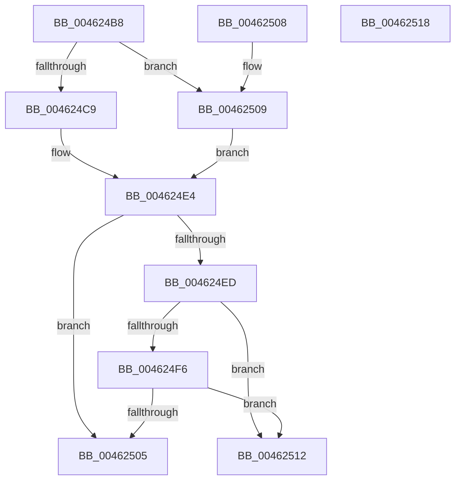

# MiLargeCoalesceCandidatesExist

- RVA: `0x004624B8`–`0x00462519` (길이 `97` bytes)
- VA: `0x00000001404624B8`
- 실행 섹션: `.text`
- PDB 이름 있음: `예`; PDB Function 태그: `아니요`
- unwind 정보 RVA: `0x000DB714`
- 디코드: `27`개 명령, `97/97` bytes 표시
- 미해석 바이트: `0` (있으면 어셈블리에 `.byte`로 보존)

> 이 문서는 커널 이미지의 기계어와 PDB 기호를 분석해 생성했습니다. 4번과 5번은 함수 원형과 자료형을 바이너리 사용 방식에서 추정한 C 해석이며 원본 소스 복구 결과는 아닙니다.

## 1. Dependencies

- 직접 호출 지점: **0**; 고유 호출 대상: **0**
- 직접 호출자로 확인된 함수: **1**
- RIP 상대 이미지 참조: **1**

### Outgoing calls
- 직접 디코드된 call 명령이 없습니다.

### Direct callers
- [MiPerformOnDemandLargePageCoalesce](../37/MiPerformOnDemandLargePageCoalesce_function_00379678.md) at `0x00379701`
- [MiPerformOnDemandLargePageCoalesce](../37/MiPerformOnDemandLargePageCoalesce_function_00379678.md) at `0x003797DC`

### Static image references
- `0x004624CC` → RVA `0x00E38D10` (`.data`; read)

## 2. Other-region calls and transfers

- 다른 실행 섹션으로 향하는 call: **0**
- 별도 외부 분기/꼬리 이동을 확인하지 못했습니다.

## 3. Assembly (complete function range)

```asm
004624B8  4C 8B 49 18                     mov r9, qword ptr [rcx + 0x18]
004624BC  4C 8D 41 0C                     lea r8, [rcx + 0xc]
004624C0  4C 8B 51 20                     mov r10, qword ptr [rcx + 0x20]
004624C4  83 FA 02                        cmp edx, 2
004624C7  75 40                           jne 0x140462509
004624C9  41 8B 00                        mov eax, dword ptr [r8]
004624CC  4C 8B 1D 3D 68 9D 00            mov r11, qword ptr [rip + 0x9d683d]
004624D3  48 69 C8 80 DF 00 00            imul rcx, rax, 0xdf80
004624DA  49 81 C3 18 DF 00 00            add r11, 0xdf18
004624E1  4C 03 D9                        add r11, rcx
004624E4  8B CA                           mov ecx, edx
004624E6  49 83 3C CB 00                  cmp qword ptr [r11 + rcx*8], 0
004624EB  7E 18                           jle 0x140462505
004624ED  41 8B 00                        mov eax, dword ptr [r8]
004624F0  41 39 04 8A                     cmp dword ptr [r10 + rcx*4], eax
004624F4  75 1C                           jne 0x140462512
004624F6  49 8B 44 CA 10                  mov rax, qword ptr [r10 + rcx*8 + 0x10]
004624FB  49 39 84 C9 30 DF 00 00         cmp qword ptr [r9 + rcx*8 + 0xdf30], rax
00462503  77 0D                           ja 0x140462512
00462505  33 C0                           xor eax, eax
00462507  C3                              ret
00462508  CC                              int3
00462509  4D 8D 99 18 DF 00 00            lea r11, [r9 + 0xdf18]
00462510  EB D2                           jmp 0x1404624e4
00462512  B8 01 00 00 00                  mov eax, 1
00462517  C3                              ret
00462518  CC                              int3
```

## 4. C-style interpretation (structured pseudocode)

```c
__int64 __fastcall MiLargeCoalesceCandidatesExist(__int64 a1, int a2)
{
    __int64 result;
    __int64 v_r11;

    if (a2 != 2) goto loc_00462509;
    a1 = (a1) * ((unsigned int)(*(unsigned int *)(a1 + 12)));
    v_r11 = (*(unsigned __int64 *)(v_rip + 10315837)) + (0xDF18ULL);
    v_r11 = (v_r11) + (a1);
loc_004624E4:
    if ((*(unsigned __int64 *)(v_r11 + (unsigned int)(a2) * 8)) <= 0) goto loc_00462505;
    if ((*(unsigned int *)(*(unsigned __int64 *)(a1 + 32) + (unsigned int)(a2) * 4)) != ((unsigned int)((unsigned int)(*(unsigned int *)(a1 + 12))))) goto loc_00462512;
    if ((*(unsigned __int64 *)(*(unsigned __int64 *)(a1 + 24) + (unsigned int)(a2) * 8 + 57136)) > (*(unsigned __int64 *)(*(unsigned __int64 *)(a1 + 32) + (unsigned int)(a2) * 8 + 16))) goto loc_00462512;
loc_00462505:
    result = 0;
    return result;
loc_00462509:
    goto loc_004624E4;
loc_00462512:
    return 1;
}
```

## 5. (Beta) C Style

```c
int64_t MiLargeCoalesceCandidatesExist(void *Arg1, int32_t Arg2)
{
    uint8_t *arg1 = (uint8_t *)Arg1;

    int64_t result;
    int64_t local_r11;

    if (Arg2 != 2) goto loc_00462509;
    Arg1 = (Arg1) * ((uint32_t)(*(uint32_t *)(arg1 + 0xC)));
    local_r11 = (*(uint64_t *)(v_rip + 0x9D683D)) + (0xDF18ULL);
    local_r11 = (local_r11) + (Arg1);
loc_004624E4:
    if ((*(uint64_t *)(local_r11 + (uint32_t)(Arg2) * 8)) <= 0) goto loc_00462505;
    if ((*(uint32_t *)(*(uint64_t *)(arg1 + 0x20) + (uint32_t)(Arg2) * 4)) != ((uint32_t)((uint32_t)(*(uint32_t *)(arg1 + 0xC))))) goto loc_00462512;
    if ((*(uint64_t *)(*(uint64_t *)(arg1 + 0x18) + (uint32_t)(Arg2) * 8 + 0xDF30)) > (*(uint64_t *)(*(uint64_t *)(arg1 + 0x20) + (uint32_t)(Arg2) * 8 + 0x10))) goto loc_00462512;
loc_00462505:
    result = 0;
    return result;
loc_00462509:
    goto loc_004624E4;
loc_00462512:
    return 1;
}
```

### 관측된 메모리 오프셋

구조체 형식이 확인되지 않은 접근은 인자 기준의 오프셋으로만 기록했습니다.

| 기준 인자 | 오프셋 표현 | 폭 (bit) | 접근 |
|---|---:|---:|---|
| `Arg1` | `+ 0x0` | `32` | `R` |
| `Arg1` | `+ 0xC` | `64` | `R` |
| `Arg1` | `+ 0x18` | `64` | `R` |
| `Arg1` | `+ 0x20` | `64` | `R` |

## 6. Execution-region graph

[열기: 2D/3D 그래프와 함수 탐색 컨트롤 패널](../../../control-panel.html?section=text&rva=0x004624B8&view=graph)

- 2D 그래프는 위에서 아래로 흐르고, 3D 그래프는 빈 공간을 드래그해 회전합니다. Shift+드래그는 이동, 휠은 확대·축소, 함수 노드 선택은 대상 보고서 이동입니다.

### Static fallback


