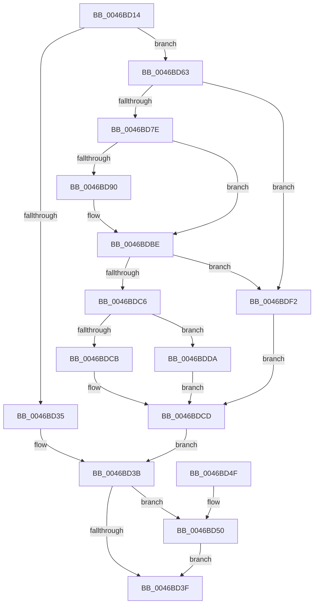

# MiLogStandbyRepurpose

- RVA: `0x0046BD14`–`0x0046BDFA` (길이 `230` bytes)
- VA: `0x000000014046BD14`
- 실행 섹션: `.text`
- PDB 이름 있음: `예`; PDB Function 태그: `아니요`
- unwind 정보 RVA: `0x000AB554`
- 디코드: `58`개 명령, `230/230` bytes 표시
- 미해석 바이트: `0` (있으면 어셈블리에 `.byte`로 보존)

> 이 문서는 커널 이미지의 기계어와 PDB 기호를 분석해 생성했습니다. 4번과 5번은 함수 원형과 자료형을 바이너리 사용 방식에서 추정한 C 해석이며 원본 소스 복구 결과는 아닙니다.

## 1. Dependencies

- 직접 호출 지점: **3**; 고유 호출 대상: **3**
- 직접 호출자로 확인된 함수: **1**
- RIP 상대 이미지 참조: **0**

### Outgoing calls
- `0x0046BD5C` → [KeInsertQueueDpc](../20/KeInsertQueueDpc_function_00207C50.md) (function, `0x00207C50`)
- `0x0046BD6D` → [ExAcquireSpinLockExclusiveAtDpcLevel](../24/ExAcquireSpinLockExclusiveAtDpcLevel_function_00248E80.md) (function, `0x00248E80`)
- `0x0046BDD0` → [ExReleaseSpinLockExclusiveFromDpcLevel](../24/ExReleaseSpinLockExclusiveFromDpcLevel_function_002497E0.md) (function, `0x002497E0`)

### Direct callers
- [MiRestoreTransitionPte](../33/MiRestoreTransitionPte_function_0033DD90.md) at `0x0033E013`

### Static image references
- 디코드된 RIP-relative 메모리 참조가 없습니다.

## 2. Other-region calls and transfers

- 다른 실행 섹션으로 향하는 call: **0**
- 별도 외부 분기/꼬리 이동을 확인하지 못했습니다.

## 3. Assembly (complete function range)

```asm
0046BD14  48 89 5C 24 08                  mov qword ptr [rsp + 8], rbx
0046BD19  48 89 74 24 10                  mov qword ptr [rsp + 0x10], rsi
0046BD1E  57                              push rdi
0046BD1F  48 83 EC 20                     sub rsp, 0x20
0046BD23  48 8B 81 38 44 00 00            mov rax, qword ptr [rcx + 0x4438]
0046BD2A  48 8B FA                        mov rdi, rdx
0046BD2D  48 8B D9                        mov rbx, rcx
0046BD30  48 85 C0                        test rax, rax
0046BD33  75 2E                           jne 0x14046bd63
0046BD35  8B B9 2C 44 00 00               mov edi, dword ptr [rcx + 0x442c]
0046BD3B  85 FF                           test edi, edi
0046BD3D  75 11                           jne 0x14046bd50
0046BD3F  48 8B 5C 24 30                  mov rbx, qword ptr [rsp + 0x30]
0046BD44  48 8B 74 24 38                  mov rsi, qword ptr [rsp + 0x38]
0046BD49  48 83 C4 20                     add rsp, 0x20
0046BD4D  5F                              pop rdi
0046BD4E  C3                              ret
0046BD4F  CC                              int3
0046BD50  48 8D 8B 40 44 00 00            lea rcx, [rbx + 0x4440]
0046BD57  45 33 C0                        xor r8d, r8d
0046BD5A  33 D2                           xor edx, edx
0046BD5C  E8 EF BE D9 FF                  call 0x140207c50
0046BD61  EB DC                           jmp 0x14046bd3f
0046BD63  48 8D B1 80 44 00 00            lea rsi, [rcx + 0x4480]
0046BD6A  48 8B CE                        mov rcx, rsi
0046BD6D  E8 0E D1 DD FF                  call 0x140248e80
0046BD72  48 8B 8B 38 44 00 00            mov rcx, qword ptr [rbx + 0x4438]
0046BD79  48 85 C9                        test rcx, rcx
0046BD7C  74 74                           je 0x14046bdf2
0046BD7E  48 8B 51 20                     mov rdx, qword ptr [rcx + 0x20]
0046BD82  41 B8 FF 0F 00 00               mov r8d, 0xfff
0046BD88  48 8B C2                        mov rax, rdx
0046BD8B  49 23 C0                        and rax, r8
0046BD8E  74 2E                           je 0x14046bdbe
0046BD90  48 B8 00 00 00 00 00 DE FF FF   movabs rax, 0xffffde0000000000
0046BD9A  48 2B F8                        sub rdi, rax
0046BD9D  48 B8 AB AA AA AA AA AA AA AA   movabs rax, 0xaaaaaaaaaaaaaaab
0046BDA7  48 C1 FF 04                     sar rdi, 4
0046BDAB  48 0F AF F8                     imul rdi, rax
0046BDAF  48 89 3A                        mov qword ptr [rdx], rdi
0046BDB2  48 83 41 20 08                  add qword ptr [rcx + 0x20], 8
0046BDB7  48 8B 41 20                     mov rax, qword ptr [rcx + 0x20]
0046BDBB  49 23 C0                        and rax, r8
0046BDBE  48 3D 00 0C 00 00               cmp rax, 0xc00
0046BDC4  73 2C                           jae 0x14046bdf2
0046BDC6  48 85 C0                        test rax, rax
0046BDC9  74 0F                           je 0x14046bdda
0046BDCB  33 FF                           xor edi, edi
0046BDCD  48 8B CE                        mov rcx, rsi
0046BDD0  E8 0B DA DD FF                  call 0x1402497e0
0046BDD5  E9 61 FF FF FF                  jmp 0x14046bd3b
0046BDDA  48 B8 20 03 00 00 80 F7 FF FF   movabs rax, 0xfffff78000000320
0046BDE4  BF 01 00 00 00                  mov edi, 1
0046BDE9  48 8B 00                        mov rax, qword ptr [rax]
0046BDEC  48 89 41 18                     mov qword ptr [rcx + 0x18], rax
0046BDF0  EB DB                           jmp 0x14046bdcd
0046BDF2  8B BB 2C 44 00 00               mov edi, dword ptr [rbx + 0x442c]
0046BDF8  EB D3                           jmp 0x14046bdcd
```

## 4. C-style interpretation (structured pseudocode)

```c
__int64 __fastcall MiLogStandbyRepurpose(__int64 a1, __int64 a2, int a3)
{
    __int64 result;
    __int64 v_rdi;
    __int64 v_rsp;
    unsigned __int64 v_stack_p10;
    unsigned __int64 v_stack_p8;

    v_stack_p8 = v_rbx;
    v_stack_p10 = v_rsi;
    v_rsp = (v_rsp) - (32);
    if (*(unsigned __int64 *)(a1 + 17464) != 0) goto loc_0046BD63;
loc_0046BD3B:
    if ((unsigned int)((unsigned int)(*(unsigned int *)(a1 + 17452))) != 0) goto loc_0046BD50;
loc_0046BD3F:
    v_rsp = (v_rsp) + (32);
    return *(unsigned __int64 *)(a1 + 17464);
loc_0046BD50:
    a3 = 0;
    a2 = 0;
    result = KeInsertQueueDpc(v_stack_p8 + 17472, a2, a3, a4);
    goto loc_0046BD3F;
loc_0046BD63:
    result = ExAcquireSpinLockExclusiveAtDpcLevel(v_stack_p8 + 17472 + 17536, a2, a3, a4);
    if (*(unsigned __int64 *)(v_stack_p8 + 17464) == 0) goto loc_0046BDF2;
    result = (*(unsigned __int64 *)(*(unsigned __int64 *)(v_stack_p8 + 17464) + 32)) & ((unsigned int)(0xFFFULL));
    v_rdi = (unsigned int)(*(unsigned int *)(a1 + 17452));
    if (!(condition_is_equal)) {
        v_rdi = ((unsigned int)(*(unsigned int *)(a1 + 17452))) - (result);
        v_rdi = (v_rdi) >> (4);
        v_rdi = (v_rdi) * (result);
        *(unsigned __int64 *)(*(unsigned __int64 *)(*(unsigned __int64 *)(v_stack_p8 + 17464) + 32)) = v_rdi;
        result = *(unsigned __int64 *)(*(unsigned __int64 *)(v_stack_p8 + 17464) + 32);
        result = (result) & ((unsigned int)(0xFFFULL));
    }
    if (result >= 0xC00ULL) goto loc_0046BDF2;
    if (result == 0) goto loc_0046BDDA;
    v_rdi = 0;
loc_0046BDCD:
    result = ExReleaseSpinLockExclusiveFromDpcLevel(v_stack_p8 + 17472 + 17536, *(unsigned __int64 *)(*(unsigned __int64 *)(v_stack_p8 + 17464) + 32), (unsigned int)(0xFFFULL), a4);
    goto loc_0046BD3B;
loc_0046BDDA:
    *(unsigned __int64 *)(v_stack_p8 + 17472 + 17536 + 24) = *(unsigned __int64 *)(result);
    goto loc_0046BDCD;
loc_0046BDF2:
    goto loc_0046BDCD;
}
```

## 5. (Beta) C Style

```c
int64_t MiLogStandbyRepurpose(void *Arg1, int64_t Arg2, int32_t Arg3)
{
    uint8_t *arg1 = (uint8_t *)Arg1;

    int64_t result;
    int64_t local_rdi;
    int64_t local_rsp;
    uint64_t v_stack_p10;
    uint64_t v_stack_p8;

    v_stack_p8 = local_rbx;
    v_stack_p10 = local_rsi;
    local_rsp = (local_rsp) - (32);
    if (*(uint64_t *)(arg1 + 0x4438) != 0) goto loc_0046BD63;
loc_0046BD3B:
    if ((uint32_t)((uint32_t)(*(uint32_t *)(arg1 + 0x442C))) != 0) goto loc_0046BD50;
loc_0046BD3F:
    local_rsp = (local_rsp) + (32);
    return *(uint64_t *)(arg1 + 0x4438);
loc_0046BD50:
    Arg3 = 0;
    Arg2 = 0;
    result = KeInsertQueueDpc(v_stack_p8 + 17472, Arg2, Arg3, a4);
    goto loc_0046BD3F;
loc_0046BD63:
    result = ExAcquireSpinLockExclusiveAtDpcLevel(v_stack_p8 + 17472 + 17536, Arg2, Arg3, a4);
    if (*(uint64_t *)(v_stack_p8 + 0x4438) == 0) goto loc_0046BDF2;
    result = (*(uint64_t *)(*(uint64_t *)(v_stack_p8 + 0x4438) + 0x20)) & ((uint32_t)(0xFFFULL));
    local_rdi = (uint32_t)(*(uint32_t *)(arg1 + 0x442C));
    if (!(condition_is_equal)) {
        local_rdi = ((uint32_t)(*(uint32_t *)(arg1 + 0x442C))) - (result);
        local_rdi = (local_rdi) >> (4);
        local_rdi = (local_rdi) * (result);
        *(uint64_t *)(*(uint64_t *)(*(uint64_t *)(v_stack_p8 + 0x4438) + 0x20)) = local_rdi;
        result = *(uint64_t *)(*(uint64_t *)(v_stack_p8 + 0x4438) + 0x20);
        result = (result) & ((uint32_t)(0xFFFULL));
    }
    if (result >= 0xC00ULL) goto loc_0046BDF2;
    if (result == 0) goto loc_0046BDDA;
    local_rdi = 0;
loc_0046BDCD:
    result = ExReleaseSpinLockExclusiveFromDpcLevel(v_stack_p8 + 17472 + 17536, *(uint64_t *)(*(uint64_t *)(v_stack_p8 + 0x4438) + 0x20), (uint32_t)(0xFFFULL), a4);
    goto loc_0046BD3B;
loc_0046BDDA:
    *(uint64_t *)(v_stack_p8 + 0x4440 + 0x4480 + 0x18) = *(uint64_t *)(result);
    goto loc_0046BDCD;
loc_0046BDF2:
    goto loc_0046BDCD;
}
```

### 관측된 메모리 오프셋

구조체 형식이 확인되지 않은 접근은 인자 기준의 오프셋으로만 기록했습니다.

| 기준 인자 | 오프셋 표현 | 폭 (bit) | 접근 |
|---|---:|---:|---|
| `Arg1` | `+ 0x442C` | `32` | `R` |
| `Arg1` | `+ 0x4438` | `64` | `R` |
| `Arg1` | `+ 0x4440` | `64` | `R` |
| `Arg1` | `+ 0x4480` | `64` | `R` |

## 6. Execution-region graph

[열기: 2D/3D 그래프와 함수 탐색 컨트롤 패널](../../../control-panel.html?section=text&rva=0x0046BD14&view=graph)

- 2D 그래프는 위에서 아래로 흐르고, 3D 그래프는 빈 공간을 드래그해 회전합니다. Shift+드래그는 이동, 휠은 확대·축소, 함수 노드 선택은 대상 보고서 이동입니다.

### Static fallback


