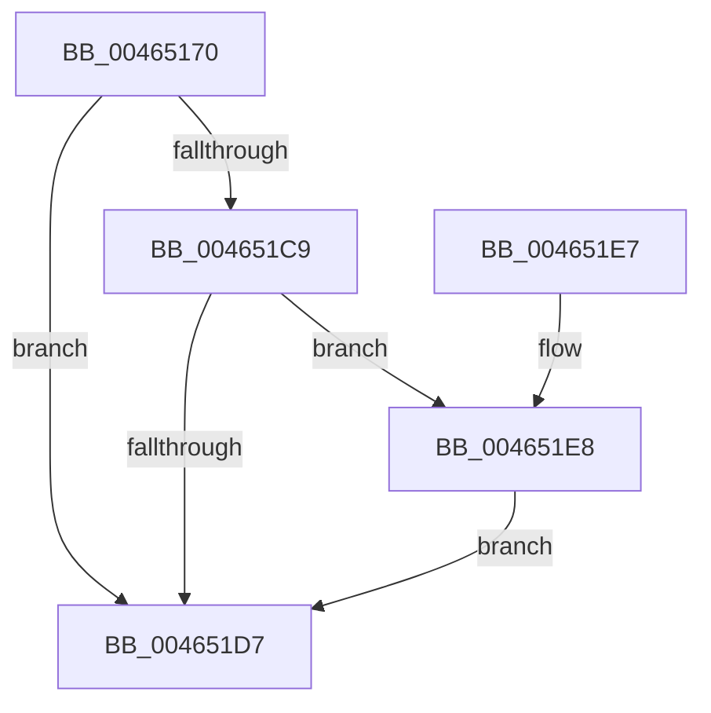

# MiMakeCombineCandidateClean

- RVA: `0x00465170`–`0x0046521E` (길이 `174` bytes)
- VA: `0x0000000140465170`
- 실행 섹션: `.text`
- PDB 이름 있음: `예`; PDB Function 태그: `아니요`
- unwind 정보 RVA: `0x00078384`
- 디코드: `43`개 명령, `174/174` bytes 표시
- 미해석 바이트: `0` (있으면 어셈블리에 `.byte`로 보존)

> 이 문서는 커널 이미지의 기계어와 PDB 기호를 분석해 생성했습니다. 4번과 5번은 함수 원형과 자료형을 바이너리 사용 방식에서 추정한 C 해석이며 원본 소스 복구 결과는 아닙니다.

## 1. Dependencies

- 직접 호출 지점: **3**; 고유 호출 대상: **3**
- 직접 호출자로 확인된 함수: **2**
- RIP 상대 이미지 참조: **0**

### Outgoing calls
- `0x004651A0` → [MiWriteValidPteNewProtection](../28/MiWriteValidPteNewProtection_function_00281810.md) (function, `0x00281810`)
- `0x004651BF` → [MiLockPageAndSetDirty](../28/MiLockPageAndSetDirty_function_002857A0.md) (function, `0x002857A0`)
- `0x00465217` → [MiCaptureWriteWatchDirtyBit](MiCaptureWriteWatchDirtyBit_function_00465224.md) (function, `0x00465224`)

### Direct callers
- [MiSharePages](../31/MiSharePages_function_00315110.md) at `0x00315F85`
- [MiCrcStillIntact](../31/MiCrcStillIntact_function_00317028.md) at `0x003171E7`

### Static image references
- 디코드된 RIP-relative 메모리 참조가 없습니다.

## 2. Other-region calls and transfers

- 다른 실행 섹션으로 향하는 call: **0**
- 별도 외부 분기/꼬리 이동을 확인하지 못했습니다.

## 3. Assembly (complete function range)

```asm
00465170  48 89 5C 24 08                  mov qword ptr [rsp + 8], rbx
00465175  48 89 74 24 10                  mov qword ptr [rsp + 0x10], rsi
0046517A  57                              push rdi
0046517B  48 83 EC 20                     sub rsp, 0x20
0046517F  48 8B F2                        mov rsi, rdx
00465182  48 B8 FF FF FF FF FF 00 00 00   movabs rax, 0xffffffffff
0046518C  48 8B 11                        mov rdx, qword ptr [rcx]
0046518F  48 8B F9                        mov rdi, rcx
00465192  48 8B DA                        mov rbx, rdx
00465195  48 83 E2 BD                     and rdx, 0xffffffffffffffbd
00465199  48 C1 EB 0C                     shr rbx, 0xc
0046519D  48 23 D8                        and rbx, rax
004651A0  E8 6B C6 E1 FF                  call 0x140281810
004651A5  48 8D 0C 5B                     lea rcx, [rbx + rbx*2]
004651A9  48 C1 E1 04                     shl rcx, 4
004651AD  48 B8 00 00 00 00 00 DE FF FF   movabs rax, 0xffffde0000000000
004651B7  48 03 C8                        add rcx, rax
004651BA  BA 01 00 00 00                  mov edx, 1
004651BF  E8 DC 05 E2 FF                  call 0x1402857a0
004651C4  48 85 F6                        test rsi, rsi
004651C7  74 0E                           je 0x1404651d7
004651C9  8B 46 30                        mov eax, dword ptr [rsi + 0x30]
004651CC  B9 00 00 60 00                  mov ecx, 0x600000
004651D1  23 C1                           and eax, ecx
004651D3  3B C1                           cmp eax, ecx
004651D5  74 11                           je 0x1404651e8
004651D7  48 8B 5C 24 30                  mov rbx, qword ptr [rsp + 0x30]
004651DC  48 8B 74 24 38                  mov rsi, qword ptr [rsp + 0x38]
004651E1  48 83 C4 20                     add rsp, 0x20
004651E5  5F                              pop rdi
004651E6  C3                              ret
004651E7  CC                              int3
004651E8  48 C1 E7 19                     shl rdi, 0x19
004651EC  48 B8 00 00 00 00 80 F6 FF FF   movabs rax, 0xfffff68000000000
004651F6  65 48 8B 0C 25 88 01 00 00      mov rcx, qword ptr gs:[0x188]
004651FF  4C 8B C6                        mov r8, rsi
00465202  48 C1 E0 19                     shl rax, 0x19
00465206  48 2B F8                        sub rdi, rax
00465209  48 C1 FF 10                     sar rdi, 0x10
0046520D  48 8B 89 B8 00 00 00            mov rcx, qword ptr [rcx + 0xb8]
00465214  48 8B D7                        mov rdx, rdi
00465217  E8 08 00 00 00                  call 0x140465224
0046521C  EB B9                           jmp 0x1404651d7
```

## 4. C-style interpretation (structured pseudocode)

```c
__int64 __fastcall MiMakeCombineCandidateClean(__int64 a1, __int64 a2)
{
    __int64 result;
    __int64 v_rbx;
    __int64 v_rdi;
    __int64 v_rsp;
    unsigned __int64 v_stack_p10;
    unsigned __int64 v_stack_p8;

    v_stack_p8 = v_rbx;
    v_stack_p10 = v_rsi;
    v_rsp = (v_rsp) - (32);
    a2 = (*(unsigned __int64 *)(a1)) & (-67);
    v_rbx = (*(unsigned __int64 *)(a1)) >> (12);
    v_rbx = (v_rbx) & (result);
    result = MiWriteValidPteNewProtection(a1, a2, a3, a4);
    a1 = (v_rbx + v_rbx * 2) << (4);
    a1 = (a1) + (result);
    result = MiLockPageAndSetDirty(a1, 1, a3, a4);
    if (a2 == 0) goto loc_004651D7;
    result = (unsigned int)(((unsigned int)(*(unsigned int *)(a2 + 48))) & ((unsigned int)((unsigned int)(0x600000ULL))));
    if (((unsigned int)(result)) == ((unsigned int)((unsigned int)(0x600000ULL)))) goto loc_004651E8;
loc_004651D7:
    v_rsp = (v_rsp) + (32);
    return result;
loc_004651E8:
    v_rdi = (a1) << (25);
    result = (result) << (25);
    v_rdi = (v_rdi) - (result);
    v_rdi = (v_rdi) >> (16);
    result = MiCaptureWriteWatchDirtyBit(*(unsigned __int64 *)(*(unsigned __int64 *)(gs_base + (0 + 392)) + 184), v_rdi, v_stack_p10, a4);
    goto loc_004651D7;
}
```

## 5. (Beta) C Style

```c
int64_t MiMakeCombineCandidateClean(void *Arg1, int64_t Arg2)
{
    uint8_t *arg1 = (uint8_t *)Arg1;

    int64_t result;
    int64_t local_rbx;
    int64_t local_rdi;
    int64_t local_rsp;
    uint64_t v_stack_p10;
    uint64_t v_stack_p8;

    v_stack_p8 = local_rbx;
    v_stack_p10 = local_rsi;
    local_rsp = (local_rsp) - (32);
    Arg2 = (*(uint64_t *)(arg1)) & (-67);
    local_rbx = (*(uint64_t *)(arg1)) >> (12);
    local_rbx = (local_rbx) & (result);
    result = MiWriteValidPteNewProtection(Arg1, Arg2, a3, a4);
    Arg1 = (local_rbx + local_rbx * 2) << (4);
    Arg1 = (Arg1) + (result);
    result = MiLockPageAndSetDirty(Arg1, 1, a3, a4);
    if (Arg2 == 0) goto loc_004651D7;
    result = (uint32_t)(((uint32_t)(*(uint32_t *)(Arg2 + 0x30))) & ((uint32_t)((uint32_t)(0x600000ULL))));
    if (((uint32_t)(result)) == ((uint32_t)((uint32_t)(0x600000ULL)))) goto loc_004651E8;
loc_004651D7:
    local_rsp = (local_rsp) + (32);
    return result;
loc_004651E8:
    local_rdi = (Arg1) << (25);
    result = (result) << (25);
    local_rdi = (local_rdi) - (result);
    local_rdi = (local_rdi) >> (16);
    result = MiCaptureWriteWatchDirtyBit(*(uint64_t *)(*(uint64_t *)(gs_base + (0 + 0x188)) + 0xB8), local_rdi, v_stack_p10, a4);
    goto loc_004651D7;
}
```

### 관측된 메모리 오프셋

구조체 형식이 확인되지 않은 접근은 인자 기준의 오프셋으로만 기록했습니다.

| 기준 인자 | 오프셋 표현 | 폭 (bit) | 접근 |
|---|---:|---:|---|
| `Arg1` | `+ 0x0` | `64` | `R` |

## 6. Execution-region graph

[열기: 2D/3D 그래프와 함수 탐색 컨트롤 패널](../../../control-panel.html?section=text&rva=0x00465170&view=graph)

- 2D 그래프는 위에서 아래로 흐르고, 3D 그래프는 빈 공간을 드래그해 회전합니다. Shift+드래그는 이동, 휠은 확대·축소, 함수 노드 선택은 대상 보고서 이동입니다.

### Static fallback


