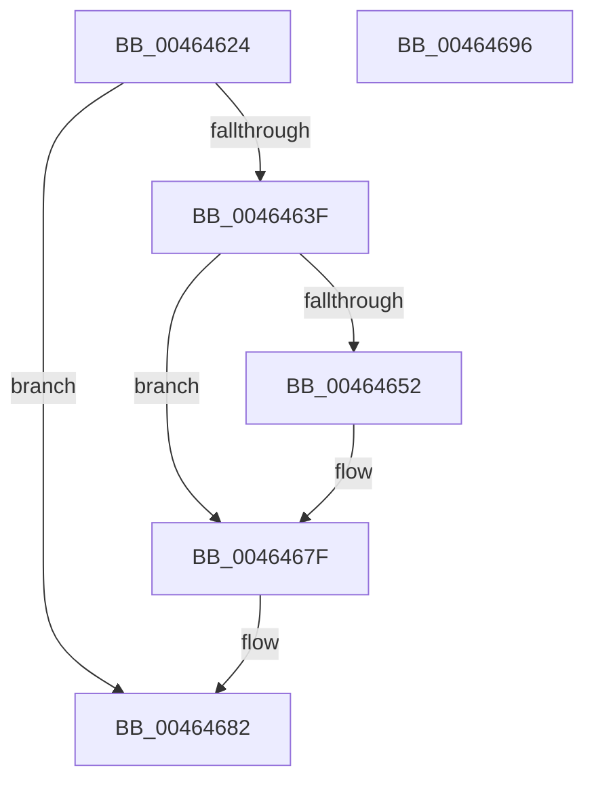

# MiMakeHyperPteDemandZero

- RVA: `0x00464624`–`0x00464697` (길이 `115` bytes)
- VA: `0x0000000140464624`
- 실행 섹션: `.text`
- PDB 이름 있음: `예`; PDB Function 태그: `아니요`
- unwind 정보 RVA: `0x00060BC4`
- 디코드: `30`개 명령, `115/115` bytes 표시
- 미해석 바이트: `0` (있으면 어셈블리에 `.byte`로 보존)

> 이 문서는 커널 이미지의 기계어와 PDB 기호를 분석해 생성했습니다. 4번과 5번은 함수 원형과 자료형을 바이너리 사용 방식에서 추정한 C 해석이며 원본 소스 복구 결과는 아닙니다.

## 1. Dependencies

- 직접 호출 지점: **2**; 고유 호출 대상: **2**
- 직접 호출자로 확인된 함수: **1**
- RIP 상대 이미지 참조: **0**

### Outgoing calls
- `0x00464644` → [MiMakeDemandZeroPte](../33/MiMakeDemandZeroPte_function_00337A00.md) (function, `0x00337A00`)
- `0x0046467A` → [MiIncreaseUsedPtes](../24/MiIncreaseUsedPtes_function_00243630.md) (function, `0x00243630`)

### Direct callers
- [MiFillHyperPtes](MiFillHyperPtes_function_004644AC.md) at `0x004645DD`

### Static image references
- 디코드된 RIP-relative 메모리 참조가 없습니다.

## 2. Other-region calls and transfers

- 다른 실행 섹션으로 향하는 call: **0**
- 별도 외부 분기/꼬리 이동을 확인하지 못했습니다.

## 3. Assembly (complete function range)

```asm
00464624  48 89 5C 24 08                  mov qword ptr [rsp + 8], rbx
00464629  48 89 74 24 10                  mov qword ptr [rsp + 0x10], rsi
0046462E  57                              push rdi
0046462F  48 83 EC 20                     sub rsp, 0x20
00464633  41 83 39 00                     cmp dword ptr [r9], 0
00464637  49 8B F9                        mov rdi, r9
0046463A  48 8B F1                        mov rsi, rcx
0046463D  74 43                           je 0x140464682
0046463F  B9 04 00 00 00                  mov ecx, 4
00464644  E8 B7 33 ED FF                  call 0x140337a00
00464649  48 8B D8                        mov rbx, rax
0046464C  41 83 F8 03                     cmp r8d, 3
00464650  74 2D                           je 0x14046467f
00464652  48 8B D6                        mov rdx, rsi
00464655  48 B8 F8 FF FF FF 7F 00 00 00   movabs rax, 0x7ffffffff8
0046465F  48 C1 EA 09                     shr rdx, 9
00464663  48 23 D0                        and rdx, rax
00464666  48 B8 00 00 00 00 80 F6 FF FF   movabs rax, 0xfffff68000000000
00464670  45 33 C9                        xor r9d, r9d
00464673  48 03 D0                        add rdx, rax
00464676  45 8D 41 01                     lea r8d, [r9 + 1]
0046467A  E8 B1 EF DD FF                  call 0x140243630
0046467F  48 89 1E                        mov qword ptr [rsi], rbx
00464682  48 FF 47 08                     inc qword ptr [rdi + 8]
00464686  48 8B 5C 24 30                  mov rbx, qword ptr [rsp + 0x30]
0046468B  48 8B 74 24 38                  mov rsi, qword ptr [rsp + 0x38]
00464690  48 83 C4 20                     add rsp, 0x20
00464694  5F                              pop rdi
00464695  C3                              ret
00464696  CC                              int3
```

## 4. C-style interpretation (structured pseudocode)

```c
__int64 __fastcall MiMakeHyperPteDemandZero(__int64 a1, __int64 a2, int a3, __int64 a4)
{
    __int64 result;
    __int64 v_rsp;
    unsigned __int64 v_stack_p10;
    unsigned __int64 v_stack_p8;

    v_stack_p8 = v_rbx;
    v_stack_p10 = v_rsi;
    v_rsp = (v_rsp) - (32);
    if ((*(unsigned int *)(a4)) == 0) goto loc_00464682;
    result = MiMakeDemandZeroPte(4, a2, a3, a4);
    if (a3 != 3) {
        a2 = a1;
        a2 = (a2) >> (9);
        a2 = (a2) & (result);
        a4 = 0;
        a2 = (a2) + (result);
        a3 = a4 + 1;
        result = MiIncreaseUsedPtes(4, a2, a3, a4);
    }
    *(unsigned __int64 *)(a1) = result;
loc_00464682:
    v_rsp = (v_rsp) + (32);
    return result;
}
```

## 5. (Beta) C Style

```c
int64_t MiMakeHyperPteDemandZero(void *Arg1, int64_t Arg2, int32_t Arg3, void *Arg4)
{
    uint8_t *arg1 = (uint8_t *)Arg1;
    uint8_t *arg4 = (uint8_t *)Arg4;

    int64_t result;
    int64_t local_rsp;
    uint64_t v_stack_p10;
    uint64_t v_stack_p8;

    v_stack_p8 = local_rbx;
    v_stack_p10 = local_rsi;
    local_rsp = (local_rsp) - (32);
    if ((*(uint32_t *)(arg4)) == 0) goto loc_00464682;
    result = MiMakeDemandZeroPte(4, Arg2, Arg3, Arg4);
    if (Arg3 != 3) {
        Arg2 = Arg1;
        Arg2 = (Arg2) >> (9);
        Arg2 = (Arg2) & (result);
        Arg4 = 0;
        Arg2 = (Arg2) + (result);
        Arg3 = Arg4 + 1;
        result = MiIncreaseUsedPtes(4, Arg2, Arg3, Arg4);
    }
    *(uint64_t *)(arg1) = result;
loc_00464682:
    local_rsp = (local_rsp) + (32);
    return result;
}
```

### 관측된 메모리 오프셋

구조체 형식이 확인되지 않은 접근은 인자 기준의 오프셋으로만 기록했습니다.

| 기준 인자 | 오프셋 표현 | 폭 (bit) | 접근 |
|---|---:|---:|---|
| `Arg1` | `+ 0x0` | `64` | `W` |
| `Arg4` | `+ 0x0` | `32` | `R` |
| `Arg4` | `+ 0x8` | `64` | `R/W` |

## 6. Execution-region graph

[열기: 2D/3D 그래프와 함수 탐색 컨트롤 패널](../../../control-panel.html?section=text&rva=0x00464624&view=graph)

- 2D 그래프는 위에서 아래로 흐르고, 3D 그래프는 빈 공간을 드래그해 회전합니다. Shift+드래그는 이동, 휠은 확대·축소, 함수 노드 선택은 대상 보고서 이동입니다.

### Static fallback


