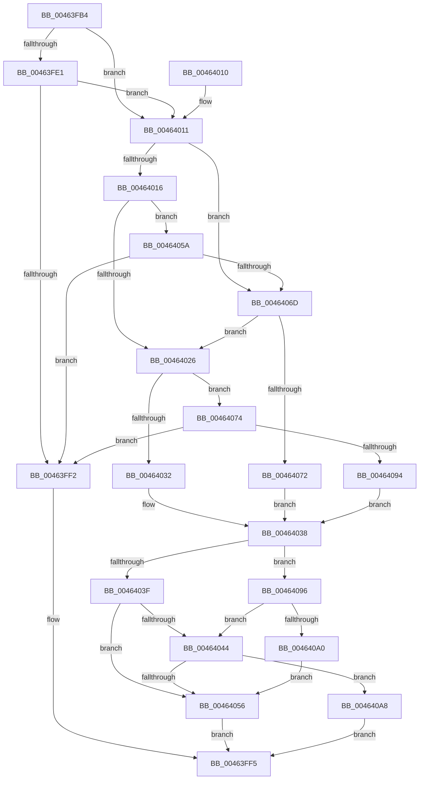

# MiMakeSystemPtesAppear

- RVA: `0x00463FB4`–`0x004640CA` (길이 `278` bytes)
- VA: `0x0000000140463FB4`
- 실행 섹션: `.text`
- PDB 이름 있음: `예`; PDB Function 태그: `아니요`
- unwind 정보 RVA: `0x000AA838`
- 디코드: `80`개 명령, `278/278` bytes 표시
- 미해석 바이트: `0` (있으면 어셈블리에 `.byte`로 보존)

> 이 문서는 커널 이미지의 기계어와 PDB 기호를 분석해 생성했습니다. 4번과 5번은 함수 원형과 자료형을 바이너리 사용 방식에서 추정한 C 해석이며 원본 소스 복구 결과는 아닙니다.

## 1. Dependencies

- 직접 호출 지점: **6**; 고유 호출 대상: **2**
- 직접 호출자로 확인된 함수: **1**
- RIP 상대 이미지 참조: **1**

### Outgoing calls
- `0x00463FE8` → [MiEmptyPteBins](../31/MiEmptyPteBins_function_0031AAE4.md) (function, `0x0031AAE4`)
- `0x00464029` → [MiPteBinsNeedTrimming](MiPteBinsNeedTrimming_function_00464228.md) (function, `0x00464228`)
- `0x0046404D` → [MiPteBinsNeedTrimming](MiPteBinsNeedTrimming_function_00464228.md) (function, `0x00464228`)
- `0x00464063` → [MiEmptyPteBins](../31/MiEmptyPteBins_function_0031AAE4.md) (function, `0x0031AAE4`)
- `0x00464086` → [MiEmptyPteBins](../31/MiEmptyPteBins_function_0031AAE4.md) (function, `0x0031AAE4`)
- `0x004640B7` → [MiEmptyPteBins](../31/MiEmptyPteBins_function_0031AAE4.md) (function, `0x0031AAE4`)

### Direct callers
- [MiReservePtes](../31/MiReservePtes_function_00318D20.md) at `0x003193F2`

### Static image references
- `0x00464016` → RVA `0x00FC5000` (`ALMOSTRO`; read)

## 2. Other-region calls and transfers

- 다른 실행 섹션으로 향하는 call: **0**
- 별도 외부 분기/꼬리 이동을 확인하지 못했습니다.

## 3. Assembly (complete function range)

```asm
00463FB4  48 8B C4                        mov rax, rsp
00463FB7  48 89 58 08                     mov qword ptr [rax + 8], rbx
00463FBB  48 89 68 10                     mov qword ptr [rax + 0x10], rbp
00463FBF  48 89 70 18                     mov qword ptr [rax + 0x18], rsi
00463FC3  48 89 78 20                     mov qword ptr [rax + 0x20], rdi
00463FC7  41 56                           push r14
00463FC9  48 83 EC 20                     sub rsp, 0x20
00463FCD  33 FF                           xor edi, edi
00463FCF  49 8B D8                        mov rbx, r8
00463FD2  48 8B EA                        mov rbp, rdx
00463FD5  48 8B F1                        mov rsi, rcx
00463FD8  44 8D 77 01                     lea r14d, [rdi + 1]
00463FDC  41 39 38                        cmp dword ptr [r8], edi
00463FDF  75 30                           jne 0x140464011
00463FE1  45 89 30                        mov dword ptr [r8], r14d
00463FE4  44 8D 47 02                     lea r8d, [rdi + 2]
00463FE8  E8 F7 6A EB FF                  call 0x14031aae4
00463FED  48 85 C0                        test rax, rax
00463FF0  74 1F                           je 0x140464011
00463FF2  41 8B C6                        mov eax, r14d
00463FF5  48 8B 5C 24 30                  mov rbx, qword ptr [rsp + 0x30]
00463FFA  48 8B 6C 24 38                  mov rbp, qword ptr [rsp + 0x38]
00463FFF  48 8B 74 24 40                  mov rsi, qword ptr [rsp + 0x40]
00464004  48 8B 7C 24 48                  mov rdi, qword ptr [rsp + 0x48]
00464009  48 83 C4 20                     add rsp, 0x20
0046400D  41 5E                           pop r14
0046400F  C3                              ret
00464010  CC                              int3
00464011  44 39 33                        cmp dword ptr [rbx], r14d
00464014  75 57                           jne 0x14046406d
00464016  66 44 39 35 E2 0F B6 00         cmp word ptr [rip + 0xb60fe2], r14w
0046401E  C7 03 02 00 00 00               mov dword ptr [rbx], 2
00464024  75 34                           jne 0x14046405a
00464026  48 8B CE                        mov rcx, rsi
00464029  E8 FA 01 00 00                  call 0x140464228
0046402E  85 C0                           test eax, eax
00464030  75 42                           jne 0x140464074
00464032  C7 03 03 00 00 00               mov dword ptr [rbx], 3
00464038  8B 03                           mov eax, dword ptr [rbx]
0046403A  83 F8 04                        cmp eax, 4
0046403D  74 57                           je 0x140464096
0046403F  83 F8 03                        cmp eax, 3
00464042  75 12                           jne 0x140464056
00464044  48 8B CE                        mov rcx, rsi
00464047  C7 03 05 00 00 00               mov dword ptr [rbx], 5
0046404D  E8 D6 01 00 00                  call 0x140464228
00464052  85 C0                           test eax, eax
00464054  75 52                           jne 0x1404640a8
00464056  33 C0                           xor eax, eax
00464058  EB 9B                           jmp 0x140463ff5
0046405A  45 33 C0                        xor r8d, r8d
0046405D  48 8B D5                        mov rdx, rbp
00464060  48 8B CE                        mov rcx, rsi
00464063  E8 7C 6A EB FF                  call 0x14031aae4
00464068  48 85 C0                        test rax, rax
0046406B  75 85                           jne 0x140463ff2
0046406D  83 3B 02                        cmp dword ptr [rbx], 2
00464070  74 B4                           je 0x140464026
00464072  EB C4                           jmp 0x140464038
00464074  41 B8 03 00 00 00               mov r8d, 3
0046407A  C7 03 04 00 00 00               mov dword ptr [rbx], 4
00464080  48 8B D5                        mov rdx, rbp
00464083  48 8B CE                        mov rcx, rsi
00464086  E8 59 6A EB FF                  call 0x14031aae4
0046408B  48 85 C0                        test rax, rax
0046408E  0F 85 5E FF FF FF               jne 0x140463ff2
00464094  EB A2                           jmp 0x140464038
00464096  66 44 39 35 62 0F B6 00         cmp word ptr [rip + 0xb60f62], r14w
0046409E  75 A4                           jne 0x140464044
004640A0  C7 03 06 00 00 00               mov dword ptr [rbx], 6
004640A6  EB AE                           jmp 0x140464056
004640A8  45 8B C6                        mov r8d, r14d
004640AB  C7 03 06 00 00 00               mov dword ptr [rbx], 6
004640B1  48 8B D5                        mov rdx, rbp
004640B4  48 8B CE                        mov rcx, rsi
004640B7  E8 28 6A EB FF                  call 0x14031aae4
004640BC  48 85 C0                        test rax, rax
004640BF  40 0F 95 C7                     setne dil
004640C3  8B C7                           mov eax, edi
004640C5  E9 2B FF FF FF                  jmp 0x140463ff5
```

## 4. C-style interpretation (structured pseudocode)

```c
__int64 __fastcall MiMakeSystemPtesAppear(__int64 a1, __int64 a2, __int64 a3)
{
    __int64 result;
    __int64 v_rdi;
    __int64 v_rsp;
    unsigned __int64 v_stack_p10;
    unsigned __int64 v_stack_p18;
    unsigned __int64 v_stack_p20;
    unsigned __int64 v_stack_p8;

    *(unsigned __int64 *)(v_rsp + 8) = v_rbx;
    *(unsigned __int64 *)(v_rsp + 16) = v_rbp;
    *(unsigned __int64 *)(v_rsp + 24) = v_rsi;
    *(unsigned __int64 *)(v_rsp + 32) = v_rdi;
    v_rsp = (v_rsp) - (32);
    v_rdi = 0;
    if ((*(unsigned int *)(a3)) != 0) goto loc_00464011;
    *(unsigned int *)(a3) = (unsigned int)(v_rdi + 1);
    result = MiEmptyPteBins(a1, a2, v_rdi + 2, a4);
    if (result == 0) goto loc_00464011;
loc_00463FF2:
loc_00463FF5:
    v_rsp = (v_rsp) + (32);
    return (unsigned int)((unsigned int)(v_rdi + 1));
loc_00464011:
    if ((*(unsigned int *)(v_stack_p8)) != ((unsigned int)(v_rdi + 1))) goto loc_0046406D;
    *(unsigned int *)(v_stack_p8) = 2;
    if ((*(unsigned __int16 *)(v_rip + 11931618)) != ((unsigned __int16)(v_rdi + 1))) goto loc_0046405A;
loc_00464026:
    result = MiPteBinsNeedTrimming(v_stack_p18, a2, v_rdi + 2, a4);
    if ((unsigned int)(result) != 0) goto loc_00464074;
    *(unsigned int *)(v_stack_p8) = 3;
loc_00464038:
    if (((unsigned int)((unsigned int)(*(unsigned int *)(v_stack_p8)))) == 4) goto loc_00464096;
    if (((unsigned int)((unsigned int)(*(unsigned int *)(v_stack_p8)))) != 3) goto loc_00464056;
loc_00464044:
    *(unsigned int *)(v_stack_p8) = 5;
    result = MiPteBinsNeedTrimming(v_stack_p18, a2, v_rdi + 2, a4);
    if ((unsigned int)(result) != 0) goto loc_004640A8;
loc_00464056:
    result = 0;
    goto loc_00463FF5;
loc_0046405A:
    a3 = 0;
    result = MiEmptyPteBins(v_stack_p18, v_stack_p10, a3, a4);
    if (result != 0) goto loc_00463FF2;
loc_0046406D:
    if ((*(unsigned int *)(v_stack_p8)) == 2) goto loc_00464026;
    goto loc_00464038;
loc_00464074:
    *(unsigned int *)(v_stack_p8) = 4;
    result = MiEmptyPteBins(v_stack_p18, v_stack_p10, 3, a4);
    if (result != 0) goto loc_00463FF2;
    goto loc_00464038;
loc_00464096:
    if ((*(unsigned __int16 *)(v_rip + 11931490)) != ((unsigned __int16)(v_rdi + 1))) goto loc_00464044;
    *(unsigned int *)(v_stack_p8) = 6;
    goto loc_00464056;
loc_004640A8:
    *(unsigned int *)(v_stack_p8) = 6;
    result = MiEmptyPteBins(v_stack_p18, v_stack_p10, (unsigned int)((unsigned int)(v_rdi + 1)), a4);
    v_rdi = (result != 0) ? 1 : 0;
    goto loc_00463FF5;
}
```

## 5. (Beta) C Style

```c
int64_t MiMakeSystemPtesAppear(int64_t Arg1, int64_t Arg2, void *Arg3)
{
    uint8_t *arg3 = (uint8_t *)Arg3;

    int64_t result;
    int64_t local_rdi;
    int64_t local_rsp;
    uint64_t v_stack_p10;
    uint64_t v_stack_p18;
    uint64_t v_stack_p20;
    uint64_t v_stack_p8;

    *(uint64_t *)(local_rsp + 0x8) = local_rbx;
    *(uint64_t *)(local_rsp + 0x10) = local_rbp;
    *(uint64_t *)(local_rsp + 0x18) = local_rsi;
    *(uint64_t *)(local_rsp + 0x20) = local_rdi;
    local_rsp = (local_rsp) - (32);
    local_rdi = 0;
    if ((*(uint32_t *)(arg3)) != 0) goto loc_00464011;
    *(uint32_t *)(arg3) = (uint32_t)(local_rdi + 1);
    result = MiEmptyPteBins(Arg1, Arg2, local_rdi + 2, a4);
    if (result == 0) goto loc_00464011;
loc_00463FF2:
loc_00463FF5:
    local_rsp = (local_rsp) + (32);
    return (uint32_t)((uint32_t)(local_rdi + 1));
loc_00464011:
    if ((*(uint32_t *)(v_stack_p8)) != ((uint32_t)(local_rdi + 1))) goto loc_0046406D;
    *(uint32_t *)(v_stack_p8) = 2;
    if ((*(uint16_t *)(v_rip + 0xB60FE2)) != ((uint16_t)(local_rdi + 1))) goto loc_0046405A;
loc_00464026:
    result = MiPteBinsNeedTrimming(v_stack_p18, Arg2, local_rdi + 2, a4);
    if ((uint32_t)(result) != 0) goto loc_00464074;
    *(uint32_t *)(v_stack_p8) = 3;
loc_00464038:
    if (((uint32_t)((uint32_t)(*(uint32_t *)(v_stack_p8)))) == 4) goto loc_00464096;
    if (((uint32_t)((uint32_t)(*(uint32_t *)(v_stack_p8)))) != 3) goto loc_00464056;
loc_00464044:
    *(uint32_t *)(v_stack_p8) = 5;
    result = MiPteBinsNeedTrimming(v_stack_p18, Arg2, local_rdi + 2, a4);
    if ((uint32_t)(result) != 0) goto loc_004640A8;
loc_00464056:
    result = 0;
    goto loc_00463FF5;
loc_0046405A:
    Arg3 = 0;
    result = MiEmptyPteBins(v_stack_p18, v_stack_p10, Arg3, a4);
    if (result != 0) goto loc_00463FF2;
loc_0046406D:
    if ((*(uint32_t *)(v_stack_p8)) == 2) goto loc_00464026;
    goto loc_00464038;
loc_00464074:
    *(uint32_t *)(v_stack_p8) = 4;
    result = MiEmptyPteBins(v_stack_p18, v_stack_p10, 3, a4);
    if (result != 0) goto loc_00463FF2;
    goto loc_00464038;
loc_00464096:
    if ((*(uint16_t *)(v_rip + 0xB60F62)) != ((uint16_t)(local_rdi + 1))) goto loc_00464044;
    *(uint32_t *)(v_stack_p8) = 6;
    goto loc_00464056;
loc_004640A8:
    *(uint32_t *)(v_stack_p8) = 6;
    result = MiEmptyPteBins(v_stack_p18, v_stack_p10, (uint32_t)((uint32_t)(local_rdi + 1)), a4);
    local_rdi = (result != 0) ? 1 : 0;
    goto loc_00463FF5;
}
```

### 관측된 메모리 오프셋

구조체 형식이 확인되지 않은 접근은 인자 기준의 오프셋으로만 기록했습니다.

| 기준 인자 | 오프셋 표현 | 폭 (bit) | 접근 |
|---|---:|---:|---|
| `Arg3` | `+ 0x0` | `32` | `R` |
| `Arg3` | `+ 0x0` | `32` | `W` |

## 6. Execution-region graph

[열기: 2D/3D 그래프와 함수 탐색 컨트롤 패널](../../../control-panel.html?section=text&rva=0x00463FB4&view=graph)

- 2D 그래프는 위에서 아래로 흐르고, 3D 그래프는 빈 공간을 드래그해 회전합니다. Shift+드래그는 이동, 휠은 확대·축소, 함수 노드 선택은 대상 보고서 이동입니다.

### Static fallback


