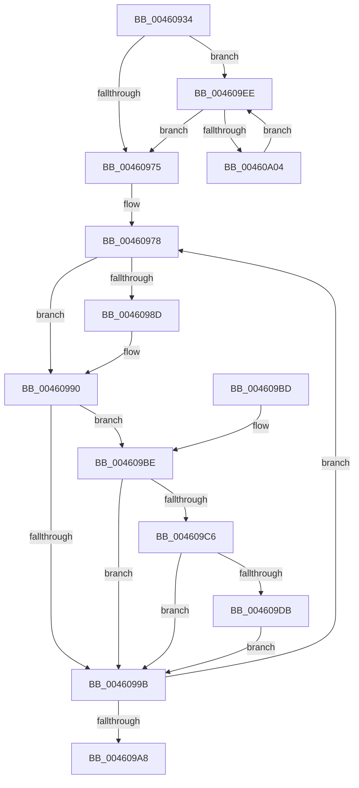

# MiMappingHasIoReferences

- RVA: `0x00460934`–`0x00460A06` (길이 `210` bytes)
- VA: `0x0000000140460934`
- 실행 섹션: `.text`
- PDB 이름 있음: `예`; PDB Function 태그: `아니요`
- unwind 정보 RVA: `0x000A9CCC`
- 디코드: `55`개 명령, `210/210` bytes 표시
- 미해석 바이트: `0` (있으면 어셈블리에 `.byte`로 보존)

> 이 문서는 커널 이미지의 기계어와 PDB 기호를 분석해 생성했습니다. 4번과 5번은 함수 원형과 자료형을 바이너리 사용 방식에서 추정한 C 해석이며 원본 소스 복구 결과는 아닙니다.

## 1. Dependencies

- 직접 호출 지점: **2**; 고유 호출 대상: **2**
- 직접 호출자로 확인된 함수: **3**
- RIP 상대 이미지 참조: **1**

### Outgoing calls
- `0x0046096C` → [MI_IS_PHYSICAL_ADDRESS](../23/MI_IS_PHYSICAL_ADDRESS_function_0023B3A0.md) (function, `0x0023B3A0`)
- `0x004609E7` → [MiCheckLinearProtectedPteAccessedBit](../29/MiCheckLinearProtectedPteAccessedBit_function_00292D80.md) (function, `0x00292D80`)

### Direct callers
- [MmProtectMdlSystemAddress](../22/MmProtectMdlSystemAddress_function_00227B50.md) at `0x00227E50`
- [MiMapContiguousMemory](../32/MiMapContiguousMemory_function_0032787C.md) at `0x00327A8C`
- [MmMapMdl](../67/MmMapMdl_function_0067CBA0.md) at `0x0067CD35`

### Static image references
- `0x00460980` → RVA `0x00FC6A88` (`ALMOSTRO`; read)

## 2. Other-region calls and transfers

- 다른 실행 섹션으로 향하는 call: **0**
- 별도 외부 분기/꼬리 이동을 확인하지 못했습니다.

## 3. Assembly (complete function range)

```asm
00460934  48 89 5C 24 08                  mov qword ptr [rsp + 8], rbx
00460939  48 89 6C 24 10                  mov qword ptr [rsp + 0x10], rbp
0046093E  48 89 74 24 18                  mov qword ptr [rsp + 0x18], rsi
00460943  57                              push rdi
00460944  48 83 EC 20                     sub rsp, 0x20
00460948  48 8B F1                        mov rsi, rcx
0046094B  48 BD 00 00 00 00 80 F6 FF FF   movabs rbp, 0xfffff68000000000
00460955  48 C1 EE 09                     shr rsi, 9
00460959  48 BB F8 FF FF FF 7F 00 00 00   movabs rbx, 0x7ffffffff8
00460963  48 23 F3                        and rsi, rbx
00460966  48 8B C5                        mov rax, rbp
00460969  48 03 F0                        add rsi, rax
0046096C  E8 2F AA DD FF                  call 0x14023b3a0
00460971  85 C0                           test eax, eax
00460973  75 79                           jne 0x1404609ee
00460975  48 8B 3E                        mov rdi, qword ptr [rsi]
00460978  48 8B DF                        mov rbx, rdi
0046097B  48 0F BA EB 09                  bts rbx, 9
00460980  48 F7 05 FD 60 B6 00 00 00 00 02  test qword ptr [rip + 0xb660fd], 0x2000000
0046098B  74 03                           je 0x140460990
0046098D  0F AE E8                        lfence
00460990  48 0F BA 25 EF 60 B6 00 24      bt qword ptr [rip + 0xb660ef], 0x24
00460999  72 23                           jb 0x1404609be
0046099B  48 8B C7                        mov rax, rdi
0046099E  F0 48 0F B1 1E                  lock cmpxchg qword ptr [rsi], rbx
004609A3  48 8B F8                        mov rdi, rax
004609A6  75 D0                           jne 0x140460978
004609A8  48 8B 5C 24 30                  mov rbx, qword ptr [rsp + 0x30]
004609AD  48 8B 6C 24 38                  mov rbp, qword ptr [rsp + 0x38]
004609B2  48 8B 74 24 40                  mov rsi, qword ptr [rsp + 0x40]
004609B7  48 83 C4 20                     add rsp, 0x20
004609BB  5F                              pop rdi
004609BC  C3                              ret
004609BD  CC                              int3
004609BE  8A C3                           mov al, bl
004609C0  24 21                           and al, 0x21
004609C2  3C 01                           cmp al, 1
004609C4  75 D5                           jne 0x14046099b
004609C6  48 8B C5                        mov rax, rbp
004609C9  48 B9 00 00 00 00 40 00 00 00   movabs rcx, 0x4000000000
004609D3  48 03 C1                        add rax, rcx
004609D6  48 3B F0                        cmp rsi, rax
004609D9  72 C0                           jb 0x14046099b
004609DB  41 B8 80 00 00 00               mov r8d, 0x80
004609E1  48 8B D3                        mov rdx, rbx
004609E4  48 8B CE                        mov rcx, rsi
004609E7  E8 94 23 E3 FF                  call 0x140292d80
004609EC  EB AD                           jmp 0x14046099b
004609EE  48 C1 EE 09                     shr rsi, 9
004609F2  48 23 F3                        and rsi, rbx
004609F5  48 8B CD                        mov rcx, rbp
004609F8  48 03 F1                        add rsi, rcx
004609FB  83 C0 FF                        add eax, -1
004609FE  0F 84 71 FF FF FF               je 0x140460975
00460A04  EB E8                           jmp 0x1404609ee
```

## 4. C-style interpretation (structured pseudocode)

```c
__int64 __fastcall MiMappingHasIoReferences(__int64 a1)
{
    __int64 result;
    __int64 v_rsi;
    __int64 v_rsp;
    unsigned __int64 v_stack_p10;
    unsigned __int64 v_stack_p18;
    unsigned __int64 v_stack_p8;

    v_stack_p8 = v_rbx;
    v_stack_p10 = v_rbp;
    v_stack_p18 = v_rsi;
    v_rsp = (v_rsp) - (32);
    v_rsi = (a1) >> (9);
    v_rsi = (v_rsi) & (v_rbx);
    v_rsi = (v_rsi) + (v_rbp);
    result = MI_IS_PHYSICAL_ADDRESS(a1, a2, a3, a4);
    if ((unsigned int)(result) != 0) goto loc_004609EE;
loc_00460975:
loc_00460978:
    if (((*(unsigned __int64 *)(v_rip + 11952381)) & (0x2000000ULL)) != 0) {
    }
    if (condition_is_below) goto loc_004609BE;
loc_0046099B:
    if (((*(unsigned __int64 *)(v_rip + 11952381)) & (0x2000000ULL)) != 0) goto loc_00460978;
    v_rsp = (v_rsp) + (32);
    return *(unsigned __int64 *)(v_rsi);
loc_004609BE:
    result = (unsigned __int8)(((unsigned __int8)(v_stack_p8)) & (33));
    if (((unsigned __int8)(result)) != 1) goto loc_0046099B;
    result = (v_stack_p10) + (a1);
    if (v_stack_p18 < result) goto loc_0046099B;
    result = MiCheckLinearProtectedPteAccessedBit(v_stack_p18, v_stack_p8, 128, a4);
    goto loc_0046099B;
loc_004609EE:
    v_rsi = (v_stack_p18) >> (9);
    v_rsi = (v_rsi) & (v_stack_p8);
    v_rsi = (v_rsi) + (v_stack_p10);
    result = (unsigned int)((result) + (-1));
    if (condition_is_equal) goto loc_00460975;
    goto loc_004609EE;
}
```

## 5. (Beta) C Style

```c
int64_t MiMappingHasIoReferences(int64_t Arg1)
{
    int64_t result;
    int64_t local_rsi;
    int64_t local_rsp;
    uint64_t v_stack_p10;
    uint64_t v_stack_p18;
    uint64_t v_stack_p8;

    v_stack_p8 = local_rbx;
    v_stack_p10 = local_rbp;
    v_stack_p18 = local_rsi;
    local_rsp = (local_rsp) - (32);
    local_rsi = (Arg1) >> (9);
    local_rsi = (local_rsi) & (local_rbx);
    local_rsi = (local_rsi) + (local_rbp);
    result = MI_IS_PHYSICAL_ADDRESS(Arg1, a2, a3, a4);
    if ((uint32_t)(result) != 0) goto loc_004609EE;
loc_00460975:
loc_00460978:
    if (((*(uint64_t *)(v_rip + 0xB660FD)) & (0x2000000ULL)) != 0) {
    }
    if (condition_is_below) goto loc_004609BE;
loc_0046099B:
    if (((*(uint64_t *)(v_rip + 0xB660FD)) & (0x2000000ULL)) != 0) goto loc_00460978;
    local_rsp = (local_rsp) + (32);
    return *(uint64_t *)(local_rsi);
loc_004609BE:
    result = (uint8_t)(((uint8_t)(v_stack_p8)) & (33));
    if (((uint8_t)(result)) != 1) goto loc_0046099B;
    result = (v_stack_p10) + (Arg1);
    if (v_stack_p18 < result) goto loc_0046099B;
    result = MiCheckLinearProtectedPteAccessedBit(v_stack_p18, v_stack_p8, 128, a4);
    goto loc_0046099B;
loc_004609EE:
    local_rsi = (v_stack_p18) >> (9);
    local_rsi = (local_rsi) & (v_stack_p8);
    local_rsi = (local_rsi) + (v_stack_p10);
    result = (uint32_t)((result) + (-1));
    if (condition_is_equal) goto loc_00460975;
    goto loc_004609EE;
}
```

## 6. Execution-region graph

[열기: 2D/3D 그래프와 함수 탐색 컨트롤 패널](../../../control-panel.html?section=text&rva=0x00460934&view=graph)

- 2D 그래프는 위에서 아래로 흐르고, 3D 그래프는 빈 공간을 드래그해 회전합니다. Shift+드래그는 이동, 휠은 확대·축소, 함수 노드 선택은 대상 보고서 이동입니다.

### Static fallback


