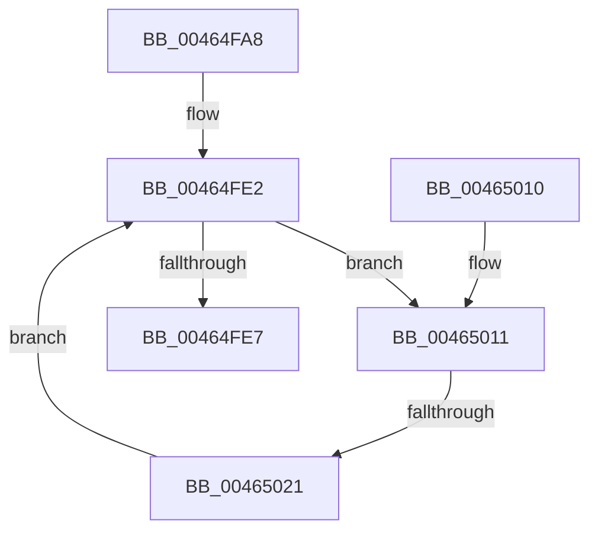

# MiMarkPendingCommitRequests

- RVA: `0x00464FA8`–`0x0046502D` (길이 `133` bytes)
- VA: `0x0000000140464FA8`
- 실행 섹션: `.text`
- PDB 이름 있음: `예`; PDB Function 태그: `예`
- unwind 정보 RVA: `0x000AA9C0`
- 디코드: `37`개 명령, `133/133` bytes 표시
- 미해석 바이트: `0` (있으면 어셈블리에 `.byte`로 보존)

> 이 문서는 커널 이미지의 기계어와 PDB 기호를 분석해 생성했습니다. 4번과 5번은 함수 원형과 자료형을 바이너리 사용 방식에서 추정한 C 해석이며 원본 소스 복구 결과는 아닙니다.

## 1. Dependencies

- 직접 호출 지점: **2**; 고유 호출 대상: **2**
- 직접 호출자로 확인된 함수: **1**
- RIP 상대 이미지 참조: **0**

### Outgoing calls
- `0x00464FD7` → [ExAcquireSpinLockExclusive](../24/ExAcquireSpinLockExclusive_function_00248690.md) (function, `0x00248690`)
- `0x00464FED` → [MiReleaseSpinLockExclusive](../24/MiReleaseSpinLockExclusive_function_002482C0.md) (function, `0x002482C0`)

### Direct callers
- [MiComputeUnusedSegmentReduction](MiComputeUnusedSegmentReduction_function_00464E58.md) at `0x00464EDB`

### Static image references
- 디코드된 RIP-relative 메모리 참조가 없습니다.

## 2. Other-region calls and transfers

- 다른 실행 섹션으로 향하는 call: **0**
- call이 아닌 외부 분기/꼬리 이동: **1**
  - `0x0046501B` → [sub_006F2D60](../6F/Unknown_function_006F2D60.md) (`tail-transfer`)

## 3. Assembly (complete function range)

```asm
00464FA8  48 8B C4                        mov rax, rsp
00464FAB  48 89 58 08                     mov qword ptr [rax + 8], rbx
00464FAF  48 89 68 10                     mov qword ptr [rax + 0x10], rbp
00464FB3  48 89 70 18                     mov qword ptr [rax + 0x18], rsi
00464FB7  48 89 78 20                     mov qword ptr [rax + 0x20], rdi
00464FBB  41 56                           push r14
00464FBD  48 83 EC 20                     sub rsp, 0x20
00464FC1  48 8D A9 C0 06 00 00            lea rbp, [rcx + 0x6c0]
00464FC8  48 8B F9                        mov rdi, rcx
00464FCB  48 8D B1 98 07 00 00            lea rsi, [rcx + 0x798]
00464FD2  33 DB                           xor ebx, ebx
00464FD4  48 8B CD                        mov rcx, rbp
00464FD7  E8 B4 36 DE FF                  call 0x140248690
00464FDC  48 8B 16                        mov rdx, qword ptr [rsi]
00464FDF  44 8A F0                        mov r14b, al
00464FE2  48 3B D6                        cmp rdx, rsi
00464FE5  75 2A                           jne 0x140465011
00464FE7  41 8A D6                        mov dl, r14b
00464FEA  48 8B CD                        mov rcx, rbp
00464FED  E8 CE 32 DE FF                  call 0x1402482c0
00464FF2  48 8B 6C 24 38                  mov rbp, qword ptr [rsp + 0x38]
00464FF7  48 8B C3                        mov rax, rbx
00464FFA  48 8B 5C 24 30                  mov rbx, qword ptr [rsp + 0x30]
00464FFF  48 8B 74 24 40                  mov rsi, qword ptr [rsp + 0x40]
00465004  48 8B 7C 24 48                  mov rdi, qword ptr [rsp + 0x48]
00465009  48 83 C4 20                     add rsp, 0x20
0046500D  41 5E                           pop r14
0046500F  C3                              ret
00465010  CC                              int3
00465011  48 8B 4A 18                     mov rcx, qword ptr [rdx + 0x18]
00465015  48 03 CB                        add rcx, rbx
00465018  48 3B CB                        cmp rcx, rbx
0046501B  0F 86 3F DD 28 00               jbe 0x1406f2d60
00465021  80 4A 47 40                     or byte ptr [rdx + 0x47], 0x40
00465025  48 8B D9                        mov rbx, rcx
00465028  48 8B 12                        mov rdx, qword ptr [rdx]
0046502B  EB B5                           jmp 0x140464fe2
```

## 4. C-style interpretation (structured pseudocode)

```c
__int64 __fastcall MiMarkPendingCommitRequests(__int64 a1)
{
    __int64 result;
    __int64 v_rbx;
    __int64 v_rsp;
    unsigned __int64 v_stack_p10;
    unsigned __int64 v_stack_p18;
    unsigned __int64 v_stack_p20;
    unsigned __int64 v_stack_p8;

    *(unsigned __int64 *)(v_rsp + 8) = v_rbx;
    *(unsigned __int64 *)(v_rsp + 16) = v_rbp;
    *(unsigned __int64 *)(v_rsp + 24) = v_rsi;
    *(unsigned __int64 *)(v_rsp + 32) = v_rdi;
    v_rsp = (v_rsp) - (32);
    v_rbx = 0;
    result = ExAcquireSpinLockExclusive(a1 + 1728, a2, a3, a4);
loc_00464FE2:
    if ((*(unsigned __int64 *)(a1 + 1944)) != (a1 + 1944)) goto loc_00465011;
    result = MiReleaseSpinLockExclusive(a1 + 1728, (unsigned __int8)((unsigned __int8)(result)), a3, a4);
    v_rsp = (v_rsp) + (32);
    return 0;
loc_00465011:
    a1 = (*(unsigned __int64 *)((unsigned __int8)((unsigned __int8)(result)) + 24)) + (v_stack_p8);
    goto loc_00464FE2;
}
```

## 5. (Beta) C Style

```c
int64_t MiMarkPendingCommitRequests(void *Arg1)
{
    uint8_t *arg1 = (uint8_t *)Arg1;

    int64_t result;
    int64_t local_rbx;
    int64_t local_rsp;
    uint64_t v_stack_p10;
    uint64_t v_stack_p18;
    uint64_t v_stack_p20;
    uint64_t v_stack_p8;

    *(uint64_t *)(local_rsp + 0x8) = local_rbx;
    *(uint64_t *)(local_rsp + 0x10) = local_rbp;
    *(uint64_t *)(local_rsp + 0x18) = local_rsi;
    *(uint64_t *)(local_rsp + 0x20) = local_rdi;
    local_rsp = (local_rsp) - (32);
    local_rbx = 0;
    result = ExAcquireSpinLockExclusive(Arg1 + 1728, a2, a3, a4);
loc_00464FE2:
    if ((*(uint64_t *)(arg1 + 0x798)) != (Arg1 + 1944)) goto loc_00465011;
    result = MiReleaseSpinLockExclusive(Arg1 + 1728, (uint8_t)((uint8_t)(result)), a3, a4);
    local_rsp = (local_rsp) + (32);
    return 0;
loc_00465011:
    Arg1 = (*(uint64_t *)((uint8_t)((uint8_t)(result)) + 0x18)) + (v_stack_p8);
    goto loc_00464FE2;
}
```

### 관측된 메모리 오프셋

구조체 형식이 확인되지 않은 접근은 인자 기준의 오프셋으로만 기록했습니다.

| 기준 인자 | 오프셋 표현 | 폭 (bit) | 접근 |
|---|---:|---:|---|
| `Arg1` | `+ 0x0` | `64` | `R` |
| `Arg1` | `+ 0x6C0` | `64` | `R` |
| `Arg1` | `+ 0x798` | `64` | `R` |

## 6. Execution-region graph

[열기: 2D/3D 그래프와 함수 탐색 컨트롤 패널](../../../control-panel.html?section=text&rva=0x00464FA8&view=graph)

- 2D 그래프는 위에서 아래로 흐르고, 3D 그래프는 빈 공간을 드래그해 회전합니다. Shift+드래그는 이동, 휠은 확대·축소, 함수 노드 선택은 대상 보고서 이동입니다.

### Static fallback


