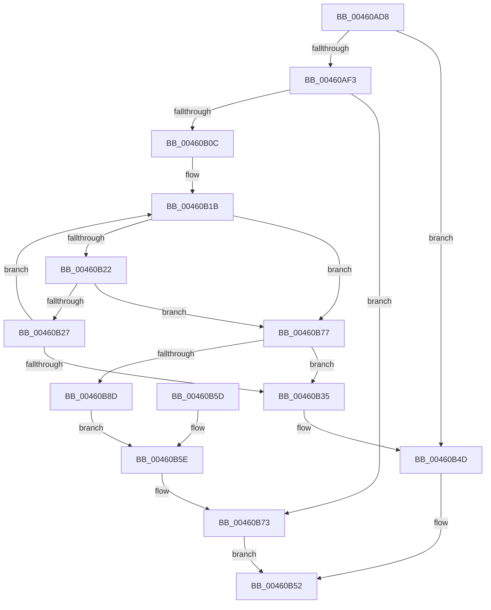

# MiObtainPoolCharges

- RVA: `0x00460AD8`–`0x00460B8F` (길이 `183` bytes)
- VA: `0x0000000140460AD8`
- 실행 섹션: `.text`
- PDB 이름 있음: `예`; PDB Function 태그: `아니요`
- unwind 정보 RVA: `0x000A9D24`
- 디코드: `49`개 명령, `183/183` bytes 표시
- 미해석 바이트: `0` (있으면 어셈블리에 `.byte`로 보존)

> 이 문서는 커널 이미지의 기계어와 PDB 기호를 분석해 생성했습니다. 4번과 5번은 함수 원형과 자료형을 바이너리 사용 방식에서 추정한 C 해석이며 원본 소스 복구 결과는 아닙니다.

## 1. Dependencies

- 직접 호출 지점: **3**; 고유 호출 대상: **3**
- 직접 호출자로 확인된 함수: **3**
- RIP 상대 이미지 참조: **4**

### Outgoing calls
- `0x00460B03` → [MiChargeCommit](../28/MiChargeCommit_function_00286EB0.md) (function, `0x00286EB0`)
- `0x00460B6E` → [MiReturnCommit](../24/MiReturnCommit_function_00248410.md) (function, `0x00248410`)
- `0x00460B84` → [MiChargePartitionResidentAvailable](../28/MiChargePartitionResidentAvailable_function_0028B000.md) (function, `0x0028B000`)

### Direct callers
- [MiGetPoolPages](../32/MiGetPoolPages_function_00327D3C.md) at `0x00327DDB`
- [MiGetLargePoolPages](../32/MiGetLargePoolPages_function_00327FF8.md) at `0x00328036`
- [MmAllocateIndependentPagesEx](../../page/AA/MmAllocateIndependentPagesEx_function_00AA0CFC.md) at `0x00AA0D5E`

### Static image references
- `0x00460AE2` → RVA `0x00E3D998` (`.data`; read)
- `0x00460AFC` → RVA `0x00E38D00` (`.data`; read)
- `0x00460B37` → RVA `0x00E376D0` (`.data`; read)
- `0x00460B3E` → RVA `0x00E376C8` (`.data`; read)

## 2. Other-region calls and transfers

- 다른 실행 섹션으로 향하는 call: **0**
- 별도 외부 분기/꼬리 이동을 확인하지 못했습니다.

## 3. Assembly (complete function range)

```asm
00460AD8  48 89 74 24 08                  mov qword ptr [rsp + 8], rsi
00460ADD  57                              push rdi
00460ADE  48 83 EC 20                     sub rsp, 0x20
00460AE2  48 8B 05 AF CE 9D 00            mov rax, qword ptr [rip + 0x9dceaf]
00460AE9  8B F2                           mov esi, edx
00460AEB  48 8B F9                        mov rdi, rcx
00460AEE  48 85 C0                        test rax, rax
00460AF1  74 5A                           je 0x140460b4d
00460AF3  48 8B D1                        mov rdx, rcx
00460AF6  41 B8 01 00 00 00               mov r8d, 1
00460AFC  48 8D 0D FD 81 9D 00            lea rcx, [rip + 0x9d81fd]
00460B03  E8 A8 63 E2 FF                  call 0x140286eb0
00460B08  85 C0                           test eax, eax
00460B0A  74 67                           je 0x140460b73
00460B0C  65 48 8B 14 25 20 00 00 00      mov rdx, qword ptr gs:[0x20]
00460B15  8B 82 9C 8B 00 00               mov eax, dword ptr [rdx + 0x8b9c]
00460B1B  8B C8                           mov ecx, eax
00460B1D  48 3B F9                        cmp rdi, rcx
00460B20  77 55                           ja 0x140460b77
00460B22  83 F8 FF                        cmp eax, -1
00460B25  74 50                           je 0x140460b77
00460B27  8B C8                           mov ecx, eax
00460B29  2B CF                           sub ecx, edi
00460B2B  F0 0F B1 8A 9C 8B 00 00         lock cmpxchg dword ptr [rdx + 0x8b9c], ecx
00460B33  75 E6                           jne 0x140460b1b
00460B35  85 F6                           test esi, esi
00460B37  48 8D 0D 92 6B 9D 00            lea rcx, [rip + 0x9d6b92]
00460B3E  48 8D 05 83 6B 9D 00            lea rax, [rip + 0x9d6b83]
00460B45  48 0F 45 C1                     cmovne rax, rcx
00460B49  F0 48 01 38                     lock add qword ptr [rax], rdi
00460B4D  B8 01 00 00 00                  mov eax, 1
00460B52  48 8B 74 24 30                  mov rsi, qword ptr [rsp + 0x30]
00460B57  48 83 C4 20                     add rsp, 0x20
00460B5B  5F                              pop rdi
00460B5C  C3                              ret
00460B5D  CC                              int3
00460B5E  41 B8 01 00 00 00               mov r8d, 1
00460B64  48 8D 0D 95 81 9D 00            lea rcx, [rip + 0x9d8195]
00460B6B  48 8B D7                        mov rdx, rdi
00460B6E  E8 9D 78 DE FF                  call 0x140248410
00460B73  33 C0                           xor eax, eax
00460B75  EB DB                           jmp 0x140460b52
00460B77  45 33 C0                        xor r8d, r8d
00460B7A  48 8D 0D 7F 81 9D 00            lea rcx, [rip + 0x9d817f]
00460B81  48 8B D7                        mov rdx, rdi
00460B84  E8 77 A4 E2 FF                  call 0x14028b000
00460B89  85 C0                           test eax, eax
00460B8B  75 A8                           jne 0x140460b35
00460B8D  EB CF                           jmp 0x140460b5e
```

## 4. C-style interpretation (structured pseudocode)

```c
__int64 __fastcall MiObtainPoolCharges(__int64 a1, int a2)
{
    __int64 result;
    __int64 v_rsp;
    unsigned __int64 v_stack_p8;

    v_stack_p8 = v_rsi;
    v_rsp = (v_rsp) - (32);
    if (*(unsigned __int64 *)(v_rip + 10342063) == 0) goto loc_00460B4D;
    result = MiChargeCommit(v_rip + 10322429, a1, 1, a4);
    if ((unsigned int)(result) == 0) goto loc_00460B73;
loc_00460B1B:
    if (a1 > ((unsigned int)((unsigned int)((unsigned int)(*(unsigned int *)(*(unsigned __int64 *)(gs_base + (0 + 32)) + 35740)))))) goto loc_00460B77;
    if (((unsigned int)((unsigned int)(*(unsigned int *)(*(unsigned __int64 *)(gs_base + (0 + 32)) + 35740)))) == -1) goto loc_00460B77;
    a1 = (unsigned int)(((unsigned int)((unsigned int)((unsigned int)(*(unsigned int *)(*(unsigned __int64 *)(gs_base + (0 + 32)) + 35740))))) - ((unsigned int)(a1)));
    if (condition_is_not_equal) goto loc_00460B1B;
loc_00460B35:
    result = v_rip + 10316675;
    if ((unsigned int)((unsigned int)(a2)) != 0) { result = v_rip + 10316690; }
loc_00460B4D:
loc_00460B52:
    v_rsp = (v_rsp) + (32);
    return 1;
loc_00460B5E:
    result = MiReturnCommit(v_rip + 10322325, a1, 1, a4);
loc_00460B73:
    result = 0;
    goto loc_00460B52;
loc_00460B77:
    a3 = 0;
    result = MiChargePartitionResidentAvailable(v_rip + 10322303, a1, a3, a4);
    if ((unsigned int)(result) != 0) goto loc_00460B35;
    goto loc_00460B5E;
}
```

## 5. (Beta) C Style

```c
int64_t MiObtainPoolCharges(int64_t Arg1, int32_t Arg2)
{
    int64_t result;
    int64_t local_rsp;
    uint64_t v_stack_p8;

    v_stack_p8 = local_rsi;
    local_rsp = (local_rsp) - (32);
    if (*(uint64_t *)(v_rip + 0x9DCEAF) == 0) goto loc_00460B4D;
    result = MiChargeCommit(v_rip + 10322429, Arg1, 1, a4);
    if ((uint32_t)(result) == 0) goto loc_00460B73;
loc_00460B1B:
    if (Arg1 > ((uint32_t)((uint32_t)((uint32_t)(*(uint32_t *)(*(uint64_t *)(gs_base + (0 + 0x20)) + 0x8B9C)))))) goto loc_00460B77;
    if (((uint32_t)((uint32_t)(*(uint32_t *)(*(uint64_t *)(gs_base + (0 + 0x20)) + 0x8B9C)))) == -1) goto loc_00460B77;
    Arg1 = (uint32_t)(((uint32_t)((uint32_t)((uint32_t)(*(uint32_t *)(*(uint64_t *)(gs_base + (0 + 0x20)) + 0x8B9C))))) - ((uint32_t)(Arg1)));
    if (condition_is_not_equal) goto loc_00460B1B;
loc_00460B35:
    result = v_rip + 10316675;
    if ((uint32_t)((uint32_t)(Arg2)) != 0) { result = v_rip + 10316690; }
loc_00460B4D:
loc_00460B52:
    local_rsp = (local_rsp) + (32);
    return 1;
loc_00460B5E:
    result = MiReturnCommit(v_rip + 10322325, Arg1, 1, a4);
loc_00460B73:
    result = 0;
    goto loc_00460B52;
loc_00460B77:
    a3 = 0;
    result = MiChargePartitionResidentAvailable(v_rip + 10322303, Arg1, a3, a4);
    if ((uint32_t)(result) != 0) goto loc_00460B35;
    goto loc_00460B5E;
}
```

## 6. Execution-region graph

[열기: 2D/3D 그래프와 함수 탐색 컨트롤 패널](../../../control-panel.html?section=text&rva=0x00460AD8&view=graph)

- 2D 그래프는 위에서 아래로 흐르고, 3D 그래프는 빈 공간을 드래그해 회전합니다. Shift+드래그는 이동, 휠은 확대·축소, 함수 노드 선택은 대상 보고서 이동입니다.

### Static fallback


