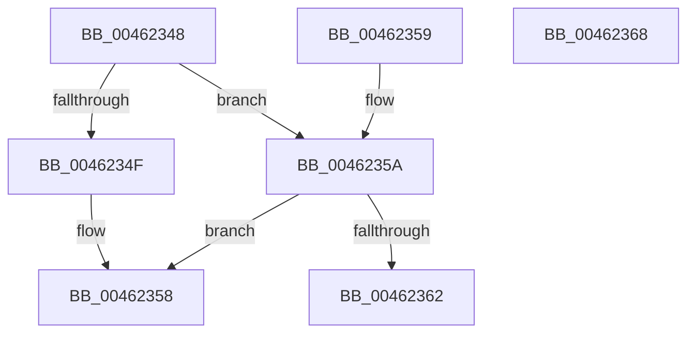

# MiPageCombiningActive

- RVA: `0x00462348`–`0x00462369` (길이 `33` bytes)
- VA: `0x0000000140462348`
- 실행 섹션: `.text`
- PDB 이름 있음: `예`; PDB Function 태그: `아니요`
- unwind 정보 RVA: `0x000DB714`
- 디코드: `12`개 명령, `33/33` bytes 표시
- 미해석 바이트: `0` (있으면 어셈블리에 `.byte`로 보존)

> 이 문서는 커널 이미지의 기계어와 PDB 기호를 분석해 생성했습니다. 4번과 5번은 함수 원형과 자료형을 바이너리 사용 방식에서 추정한 C 해석이며 원본 소스 복구 결과는 아닙니다.

## 1. Dependencies

- 직접 호출 지점: **0**; 고유 호출 대상: **0**
- 직접 호출자로 확인된 함수: **3**
- RIP 상대 이미지 참조: **1**

### Outgoing calls
- 직접 디코드된 call 명령이 없습니다.

### Direct callers
- [MiSignalLargePageRebuild](../2D/MiSignalLargePageRebuild_function_002DB4C8.md) at `0x002DB4F2`
- [MiChangePageAttribute](../33/MiChangePageAttribute_function_00332ECC.md) at `0x003330A8`
- [MiInitializeDynamicPfns](../67/MiInitializeDynamicPfns_function_00672BD0.md) at `0x00672FFB`

### Static image references
- `0x0046234F` → RVA `0x00E2FF04` (`.data`; read)

## 2. Other-region calls and transfers

- 다른 실행 섹션으로 향하는 call: **0**
- 별도 외부 분기/꼬리 이동을 확인하지 못했습니다.

## 3. Assembly (complete function range)

```asm
00462348  33 C0                           xor eax, eax
0046234A  48 85 C9                        test rcx, rcx
0046234D  75 0B                           jne 0x14046235a
0046234F  39 05 AF DB 9C 00               cmp dword ptr [rip + 0x9cdbaf], eax
00462355  0F 95 C0                        setne al
00462358  C3                              ret
00462359  CC                              int3
0046235A  39 81 98 42 00 00               cmp dword ptr [rcx + 0x4298], eax
00462360  74 F6                           je 0x140462358
00462362  B8 01 00 00 00                  mov eax, 1
00462367  C3                              ret
00462368  CC                              int3
```

## 4. C-style interpretation (structured pseudocode)

```c
__int64 __fastcall MiPageCombiningActive(__int64 a1)
{
    __int64 result;

    result = 0;
    if (a1 != 0) goto loc_0046235A;
    result = ((*(unsigned int *)(v_rip + 10279855)) != 0) ? 1 : 0;
loc_00462358:
    return result;
loc_0046235A:
    if ((*(unsigned int *)(a1 + 17048)) == ((unsigned int)(result))) goto loc_00462358;
    return 1;
}
```

## 5. (Beta) C Style

```c
int64_t MiPageCombiningActive(int64_t Arg1)
{
    int64_t result;

    result = 0;
    if (Arg1 != 0) goto loc_0046235A;
    result = ((*(uint32_t *)(v_rip + 0x9CDBAF)) != 0) ? 1 : 0;
loc_00462358:
    return result;
loc_0046235A:
    if ((*(uint32_t *)(Arg1 + 0x4298)) == ((uint32_t)(result))) goto loc_00462358;
    return 1;
}
```

## 6. Execution-region graph

[열기: 2D/3D 그래프와 함수 탐색 컨트롤 패널](../../../control-panel.html?section=text&rva=0x00462348&view=graph)

- 2D 그래프는 위에서 아래로 흐르고, 3D 그래프는 빈 공간을 드래그해 회전합니다. Shift+드래그는 이동, 휠은 확대·축소, 함수 노드 선택은 대상 보고서 이동입니다.

### Static fallback


