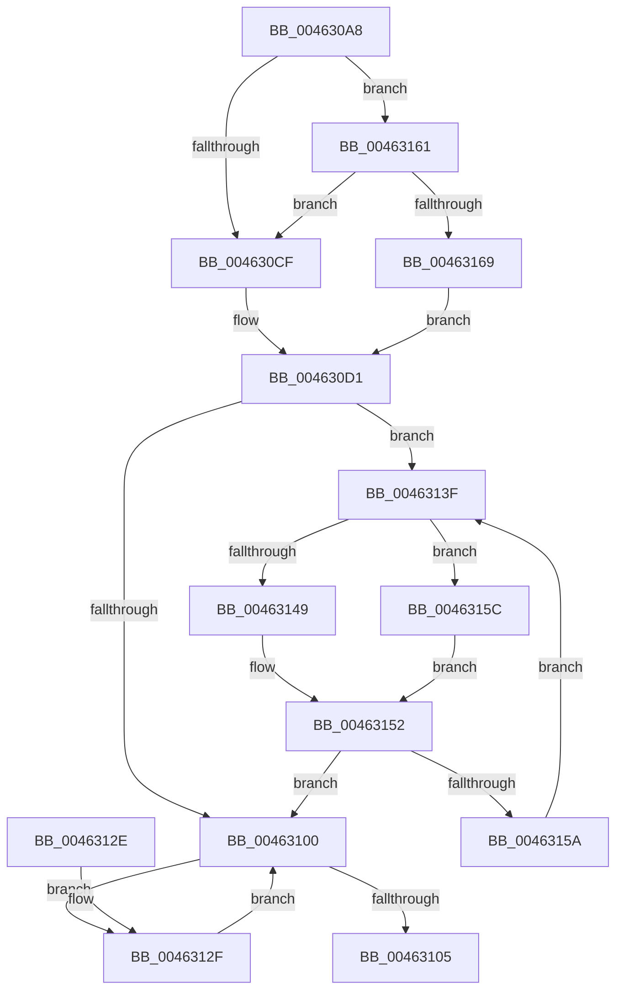

# MiPrepareSegmentForDeletion

- RVA: `0x004630A8`–`0x00463175` (길이 `205` bytes)
- VA: `0x00000001404630A8`
- 실행 섹션: `.text`
- PDB 이름 있음: `예`; PDB Function 태그: `아니요`
- unwind 정보 RVA: `0x000AA61C`
- 디코드: `62`개 명령, `205/205` bytes 표시
- 미해석 바이트: `0` (있으면 어셈블리에 `.byte`로 보존)

> 이 문서는 커널 이미지의 기계어와 PDB 기호를 분석해 생성했습니다. 4번과 5번은 함수 원형과 자료형을 바이너리 사용 방식에서 추정한 C 해석이며 원본 소스 복구 결과는 아닙니다.

## 1. Dependencies

- 직접 호출 지점: **5**; 고유 호출 대상: **5**
- 직접 호출자로 확인된 함수: **1**
- RIP 상대 이미지 참조: **0**

### Outgoing calls
- `0x004630D8` → [ExAcquireSpinLockExclusive](../24/ExAcquireSpinLockExclusive_function_00248690.md) (function, `0x00248690`)
- `0x004630E5` → [MiDrainControlAreaWrites](MiDrainControlAreaWrites_function_0046317C.md) (function, `0x0046317C`)
- `0x004630ED` → [MiRemoveUnusedSegment](../2B/MiRemoveUnusedSegment_function_002BBE74.md) (function, `0x002BBE74`)
- `0x0046310B` → [MiReleaseSpinLockExclusive](../24/MiReleaseSpinLockExclusive_function_002482C0.md) (function, `0x002482C0`)
- `0x00463134` → [MiIncrementSubsectionViewCount](../24/MiIncrementSubsectionViewCount_function_00249440.md) (function, `0x00249440`)

### Direct callers
- [MiSegmentDelete](../../page/A1/MiSegmentDelete_function_00A1FBB4.md) at `0x00A1FBE9`

### Static image references
- 디코드된 RIP-relative 메모리 참조가 없습니다.

## 2. Other-region calls and transfers

- 다른 실행 섹션으로 향하는 call: **0**
- 별도 외부 분기/꼬리 이동을 확인하지 못했습니다.

## 3. Assembly (complete function range)

```asm
004630A8  48 8B C4                        mov rax, rsp
004630AB  48 89 58 08                     mov qword ptr [rax + 8], rbx
004630AF  48 89 68 10                     mov qword ptr [rax + 0x10], rbp
004630B3  48 89 70 18                     mov qword ptr [rax + 0x18], rsi
004630B7  48 89 78 20                     mov qword ptr [rax + 0x20], rdi
004630BB  41 56                           push r14
004630BD  48 83 EC 20                     sub rsp, 0x20
004630C1  8B 41 38                        mov eax, dword ptr [rcx + 0x38]
004630C4  48 8B F9                        mov rdi, rcx
004630C7  84 C0                           test al, al
004630C9  0F 88 92 00 00 00               js 0x140463161
004630CF  33 DB                           xor ebx, ebx
004630D1  48 8D 69 48                     lea rbp, [rcx + 0x48]
004630D5  48 8B CD                        mov rcx, rbp
004630D8  E8 B3 55 DE FF                  call 0x140248690
004630DD  8A D0                           mov dl, al
004630DF  48 8B CF                        mov rcx, rdi
004630E2  44 8A F0                        mov r14b, al
004630E5  E8 92 00 00 00                  call 0x14046317c
004630EA  48 8B CF                        mov rcx, rdi
004630ED  E8 82 8D E5 FF                  call 0x1402bbe74
004630F2  48 83 C7 50                     add rdi, 0x50
004630F6  33 F6                           xor esi, esi
004630F8  48 8B 0F                        mov rcx, qword ptr [rdi]
004630FB  48 85 C9                        test rcx, rcx
004630FE  75 3F                           jne 0x14046313f
00463100  48 85 DB                        test rbx, rbx
00463103  75 2A                           jne 0x14046312f
00463105  41 8A D6                        mov dl, r14b
00463108  48 8B CD                        mov rcx, rbp
0046310B  E8 B0 51 DE FF                  call 0x1402482c0
00463110  48 8B 5C 24 30                  mov rbx, qword ptr [rsp + 0x30]
00463115  48 8B C6                        mov rax, rsi
00463118  48 8B 74 24 40                  mov rsi, qword ptr [rsp + 0x40]
0046311D  48 8B 6C 24 38                  mov rbp, qword ptr [rsp + 0x38]
00463122  48 8B 7C 24 48                  mov rdi, qword ptr [rsp + 0x48]
00463127  48 83 C4 20                     add rsp, 0x20
0046312B  41 5E                           pop r14
0046312D  C3                              ret
0046312E  CC                              int3
0046312F  33 D2                           xor edx, edx
00463131  48 8B CB                        mov rcx, rbx
00463134  E8 07 63 DE FF                  call 0x140249440
00463139  48 8B 5B 10                     mov rbx, qword ptr [rbx + 0x10]
0046313D  EB C1                           jmp 0x140463100
0046313F  8B 41 08                        mov eax, dword ptr [rcx + 8]
00463142  48 8B 11                        mov rdx, qword ptr [rcx]
00463145  A8 01                           test al, 1
00463147  74 13                           je 0x14046315c
00463149  48 89 31                        mov qword ptr [rcx], rsi
0046314C  48 8B F1                        mov rsi, rcx
0046314F  48 89 17                        mov qword ptr [rdi], rdx
00463152  48 8B CA                        mov rcx, rdx
00463155  48 85 D2                        test rdx, rdx
00463158  74 A6                           je 0x140463100
0046315A  EB E3                           jmp 0x14046313f
0046315C  48 8B F9                        mov rdi, rcx
0046315F  EB F1                           jmp 0x140463152
00463161  A8 20                           test al, 0x20
00463163  0F 85 66 FF FF FF               jne 0x1404630cf
00463169  48 8D 99 80 00 00 00            lea rbx, [rcx + 0x80]
00463170  E9 5C FF FF FF                  jmp 0x1404630d1
```

## 4. C-style interpretation (structured pseudocode)

```c
__int64 __fastcall MiPrepareSegmentForDeletion(__int64 a1)
{
    __int64 result;
    __int64 v_rbx;
    __int64 v_rdi;
    __int64 v_rsi;
    __int64 v_rsp;
    unsigned __int64 v_stack_p10;
    unsigned __int64 v_stack_p18;
    unsigned __int64 v_stack_p20;
    unsigned __int64 v_stack_p8;

    *(unsigned __int64 *)(v_rsp + 8) = v_rbx;
    *(unsigned __int64 *)(v_rsp + 16) = v_rbp;
    *(unsigned __int64 *)(v_rsp + 24) = v_rsi;
    *(unsigned __int64 *)(v_rsp + 32) = v_rdi;
    v_rsp = (v_rsp) - (32);
    if (sign_flag) goto loc_00463161;
loc_004630CF:
    v_rbx = 0;
loc_004630D1:
    result = ExAcquireSpinLockExclusive(a1 + 72, a2, a3, a4);
    result = MiDrainControlAreaWrites(a1, (unsigned __int8)(result), a3, a4);
    result = MiRemoveUnusedSegment(a1, (unsigned __int8)(result), a3, a4);
    v_rdi = (a1) + (80);
    v_rsi = 0;
    if (*(unsigned __int64 *)(v_rdi) != 0) goto loc_0046313F;
loc_00463100:
    if (0 != 0) goto loc_0046312F;
    result = MiReleaseSpinLockExclusive(a1 + 72, (unsigned __int8)((unsigned __int8)(result)), a3, a4);
    v_rsp = (v_rsp) + (32);
    return 0;
loc_0046312F:
    a2 = 0;
    result = MiIncrementSubsectionViewCount(v_stack_p8, a2, a3, a4);
    goto loc_00463100;
loc_0046313F:
    if ((((unsigned __int8)((unsigned int)(*(unsigned int *)(v_stack_p8 + 8)))) & (1)) == 0) goto loc_0046315C;
    *(unsigned __int64 *)(v_stack_p8) = v_stack_p18;
    *(unsigned __int64 *)(v_stack_p20) = *(unsigned __int64 *)(v_stack_p8);
loc_00463152:
    if (*(unsigned __int64 *)(v_stack_p8) == 0) goto loc_00463100;
    goto loc_0046313F;
loc_0046315C:
    goto loc_00463152;
loc_00463161:
    if ((((unsigned __int8)((unsigned int)(*(unsigned int *)(v_stack_p8 + 8)))) & (32)) != 0) goto loc_004630CF;
    goto loc_004630D1;
}
```

## 5. (Beta) C Style

```c
int64_t MiPrepareSegmentForDeletion(void *Arg1)
{
    uint8_t *arg1 = (uint8_t *)Arg1;

    int64_t result;
    int64_t local_rbx;
    int64_t local_rdi;
    int64_t local_rsi;
    int64_t local_rsp;
    uint64_t v_stack_p10;
    uint64_t v_stack_p18;
    uint64_t v_stack_p20;
    uint64_t v_stack_p8;

    *(uint64_t *)(local_rsp + 0x8) = local_rbx;
    *(uint64_t *)(local_rsp + 0x10) = local_rbp;
    *(uint64_t *)(local_rsp + 0x18) = local_rsi;
    *(uint64_t *)(local_rsp + 0x20) = local_rdi;
    local_rsp = (local_rsp) - (32);
    if (sign_flag) goto loc_00463161;
loc_004630CF:
    local_rbx = 0;
loc_004630D1:
    result = ExAcquireSpinLockExclusive(Arg1 + 72, a2, a3, a4);
    result = MiDrainControlAreaWrites(Arg1, (uint8_t)(result), a3, a4);
    result = MiRemoveUnusedSegment(Arg1, (uint8_t)(result), a3, a4);
    local_rdi = (Arg1) + (80);
    local_rsi = 0;
    if (*(uint64_t *)(local_rdi) != 0) goto loc_0046313F;
loc_00463100:
    if (0 != 0) goto loc_0046312F;
    result = MiReleaseSpinLockExclusive(Arg1 + 72, (uint8_t)((uint8_t)(result)), a3, a4);
    local_rsp = (local_rsp) + (32);
    return 0;
loc_0046312F:
    a2 = 0;
    result = MiIncrementSubsectionViewCount(v_stack_p8, a2, a3, a4);
    goto loc_00463100;
loc_0046313F:
    if ((((uint8_t)((uint32_t)(*(uint32_t *)(v_stack_p8 + 0x8)))) & (1)) == 0) goto loc_0046315C;
    *(uint64_t *)(v_stack_p8) = v_stack_p18;
    *(uint64_t *)(v_stack_p20) = *(uint64_t *)(v_stack_p8);
loc_00463152:
    if (*(uint64_t *)(v_stack_p8) == 0) goto loc_00463100;
    goto loc_0046313F;
loc_0046315C:
    goto loc_00463152;
loc_00463161:
    if ((((uint8_t)((uint32_t)(*(uint32_t *)(v_stack_p8 + 0x8)))) & (32)) != 0) goto loc_004630CF;
    goto loc_004630D1;
}
```

### 관측된 메모리 오프셋

구조체 형식이 확인되지 않은 접근은 인자 기준의 오프셋으로만 기록했습니다.

| 기준 인자 | 오프셋 표현 | 폭 (bit) | 접근 |
|---|---:|---:|---|
| `Arg1` | `+ 0x0` | `64` | `R` |
| `Arg1` | `+ 0x38` | `32` | `R` |
| `Arg1` | `+ 0x48` | `64` | `R` |
| `Arg1` | `+ 0x80` | `64` | `R` |

## 6. Execution-region graph

[열기: 2D/3D 그래프와 함수 탐색 컨트롤 패널](../../../control-panel.html?section=text&rva=0x004630A8&view=graph)

- 2D 그래프는 위에서 아래로 흐르고, 3D 그래프는 빈 공간을 드래그해 회전합니다. Shift+드래그는 이동, 휠은 확대·축소, 함수 노드 선택은 대상 보고서 이동입니다.

### Static fallback


