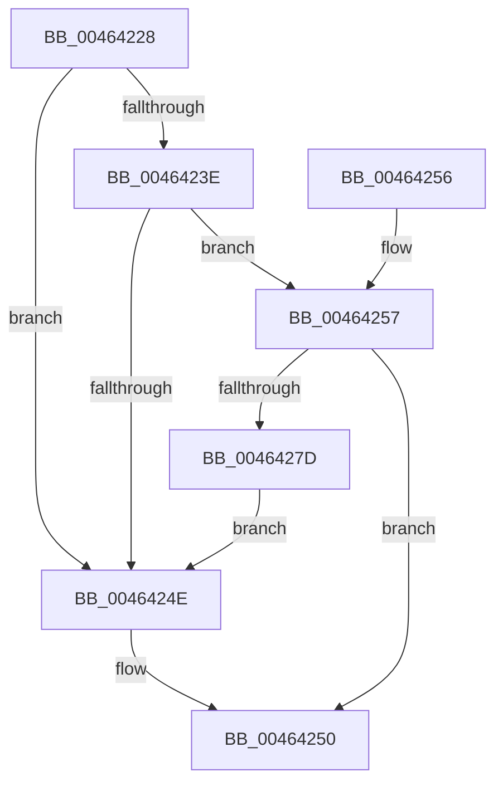

# MiPteBinsNeedTrimming

- RVA: `0x00464228`–`0x0046427F` (길이 `87` bytes)
- VA: `0x0000000140464228`
- 실행 섹션: `.text`
- PDB 이름 있음: `예`; PDB Function 태그: `아니요`
- unwind 정보 RVA: `0x0007FC80`
- 디코드: `27`개 명령, `87/87` bytes 표시
- 미해석 바이트: `0` (있으면 어셈블리에 `.byte`로 보존)

> 이 문서는 커널 이미지의 기계어와 PDB 기호를 분석해 생성했습니다. 4번과 5번은 함수 원형과 자료형을 바이너리 사용 방식에서 추정한 C 해석이며 원본 소스 복구 결과는 아닙니다.

## 1. Dependencies

- 직접 호출 지점: **1**; 고유 호출 대상: **1**
- 직접 호출자로 확인된 함수: **2**
- RIP 상대 이미지 참조: **0**

### Outgoing calls
- `0x00464231` → [MiGetNumberOfCachedPtes](MiGetNumberOfCachedPtes_function_00464288.md) (function, `0x00464288`)

### Direct callers
- [MiMakeSystemPtesAppear](MiMakeSystemPtesAppear_function_00463FB4.md) at `0x00464029`
- [MiMakeSystemPtesAppear](MiMakeSystemPtesAppear_function_00463FB4.md) at `0x0046404D`
- [MiAdjustPteBins](MiAdjustPteBins_function_0046410C.md) at `0x00464186`

### Static image references
- 디코드된 RIP-relative 메모리 참조가 없습니다.

## 2. Other-region calls and transfers

- 다른 실행 섹션으로 향하는 call: **0**
- 별도 외부 분기/꼬리 이동을 확인하지 못했습니다.

## 3. Assembly (complete function range)

```asm
00464228  40 53                           push rbx
0046422A  48 83 EC 20                     sub rsp, 0x20
0046422E  48 8B D9                        mov rbx, rcx
00464231  E8 52 00 00 00                  call 0x140464288
00464236  48 3D 00 04 00 00               cmp rax, 0x400
0046423C  72 10                           jb 0x14046424e
0046423E  4C 8B 4B 58                     mov r9, qword ptr [rbx + 0x58]
00464242  4C 03 C8                        add r9, rax
00464245  49 81 F9 00 00 20 00            cmp r9, 0x200000
0046424C  77 09                           ja 0x140464257
0046424E  33 C0                           xor eax, eax
00464250  48 83 C4 20                     add rsp, 0x20
00464254  5B                              pop rbx
00464255  C3                              ret
00464256  CC                              int3
00464257  48 8B 43 48                     mov rax, qword ptr [rbx + 0x48]
0046425B  4C 8B 03                        mov r8, qword ptr [rbx]
0046425E  4C 2B C0                        sub r8, rax
00464261  B8 01 00 00 00                  mov eax, 1
00464266  49 8B D0                        mov rdx, r8
00464269  48 C1 E2 04                     shl rdx, 4
0046426D  84 43 28                        test byte ptr [rbx + 0x28], al
00464270  49 0F 44 D0                     cmove rdx, r8
00464274  48 C1 EA 02                     shr rdx, 2
00464278  4C 3B CA                        cmp r9, rdx
0046427B  77 D3                           ja 0x140464250
0046427D  EB CF                           jmp 0x14046424e
```

## 4. C-style interpretation (structured pseudocode)

```c
__int64 __fastcall MiPteBinsNeedTrimming(__int64 a1)
{
    __int64 result;
    __int64 v_rsp;

    v_rsp = (v_rsp) - (32);
    result = MiGetNumberOfCachedPtes(a1, a2, a3, a4);
    if (result < 0x400ULL) goto loc_0046424E;
    a4 = (*(unsigned __int64 *)(a1 + 88)) + (result);
    if (a4 > 0x200000ULL) goto loc_00464257;
loc_0046424E:
    result = 0;
loc_00464250:
    v_rsp = (v_rsp) + (32);
    return result;
loc_00464257:
    a3 = (*(unsigned __int64 *)(a1)) - (*(unsigned __int64 *)(a1 + 72));
    a2 = (a3) << (4);
    if (((*(unsigned __int8 *)(a1 + 40)) & (1)) == 0) { a2 = a3; }
    a2 = (a2) >> (2);
    if (a4 > a2) goto loc_00464250;
    goto loc_0046424E;
}
```

## 5. (Beta) C Style

```c
int64_t MiPteBinsNeedTrimming(void *Arg1)
{
    uint8_t *arg1 = (uint8_t *)Arg1;

    int64_t result;
    int64_t local_rsp;

    local_rsp = (local_rsp) - (32);
    result = MiGetNumberOfCachedPtes(Arg1, a2, a3, a4);
    if (result < 0x400ULL) goto loc_0046424E;
    a4 = (*(uint64_t *)(arg1 + 0x58)) + (result);
    if (a4 > 0x200000ULL) goto loc_00464257;
loc_0046424E:
    result = 0;
loc_00464250:
    local_rsp = (local_rsp) + (32);
    return result;
loc_00464257:
    a3 = (*(uint64_t *)(arg1)) - (*(uint64_t *)(arg1 + 0x48));
    a2 = (a3) << (4);
    if (((*(uint8_t *)(arg1 + 0x28)) & (1)) == 0) { a2 = a3; }
    a2 = (a2) >> (2);
    if (a4 > a2) goto loc_00464250;
    goto loc_0046424E;
}
```

### 관측된 메모리 오프셋

구조체 형식이 확인되지 않은 접근은 인자 기준의 오프셋으로만 기록했습니다.

| 기준 인자 | 오프셋 표현 | 폭 (bit) | 접근 |
|---|---:|---:|---|
| `Arg1` | `+ 0x0` | `64` | `R` |
| `Arg1` | `+ 0x28` | `8` | `R` |
| `Arg1` | `+ 0x48` | `64` | `R` |
| `Arg1` | `+ 0x58` | `64` | `R` |

## 6. Execution-region graph

[열기: 2D/3D 그래프와 함수 탐색 컨트롤 패널](../../../control-panel.html?section=text&rva=0x00464228&view=graph)

- 2D 그래프는 위에서 아래로 흐르고, 3D 그래프는 빈 공간을 드래그해 회전합니다. Shift+드래그는 이동, 휠은 확대·축소, 함수 노드 선택은 대상 보고서 이동입니다.

### Static fallback


